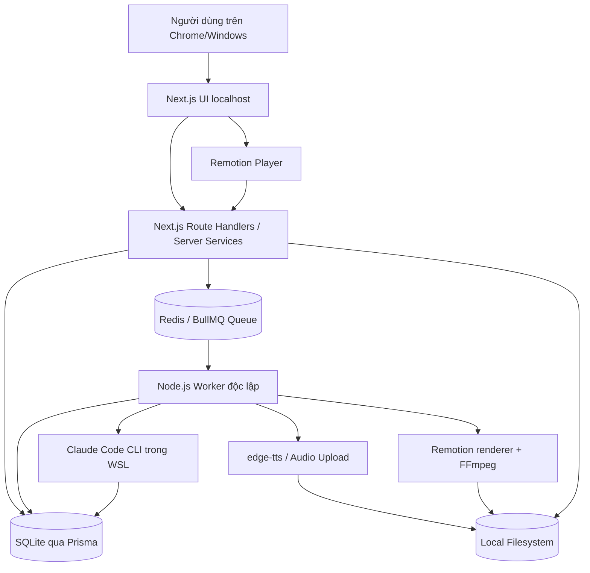

# BOOK VIDEO STUDIO — BUSINESS REQUIREMENTS & TECHNICAL ARCHITECTURE

> **Loại tài liệu:** Product Requirements Document (PRD) + Business Requirements (BRD) + Solution Architecture + Implementation Specification  
> **Phiên bản:** 1.1 — 27/10/2026 (cập nhật Short-form Video + WSL optimization); mở rộng v1.2 (§23) đã chốt 28/10/2026  
> **Trạng thái:** Đặc tả MVP cho Codex triển khai. §1–§22 mô tả phần đã triển khai (v1.1); **§23 là mục tiêu v1.2, chưa triển khai**  
> **Ngôn ngữ giao diện, kịch bản, giọng đọc và phụ đề:** Tiếng Việt (vi-VN)  
> **Mục đích xuất bản:** TikTok, YouTube Shorts, Facebook Reels; video dọc **9:16**  
> **Thời lượng:** Mặc định **30–60 giây** (target 60 giây); tùy chọn mở rộng tối đa **90 giây** khi người dùng chủ động chọn  
> **Môi trường:** Local-first, Windows + WSL2 (Ubuntu), một người dùng; máy CPU/GPU không mạnh, RAM vật lý Windows **48 GB**  
> **Ưu tiên cao nhất:** Chạy được end-to-end; đơn giản, nhanh, chi phí thấp; code sạch và dễ mở rộng.

---

## 0. HƯỚNG DẪN CHO CODEX — ĐỌC TRƯỚC KHI VIẾT CODE

Bạn là **Senior Full-stack Engineer / Software Architect**, có trách nhiệm **triển khai một ứng dụng hoạt động thực tế**, không chỉ tạo mock UI hoặc bản kế hoạch.

1. Đọc toàn bộ tài liệu này, kiểm tra thư mục repository hiện có và xác định những phần cần làm.
2. **Không đổi stack đã chốt** nếu không có lý do tương thích nghiêm trọng: Next.js App Router, TypeScript, Tailwind CSS, shadcn/ui, Prisma + SQLite, BullMQ + Redis, Node.js worker độc lập, Remotion.
3. **Không dùng Claude API / Anthropic SDK/API key** trong MVP. Người dùng có Claude Code Max 5x và muốn sử dụng **Claude Code qua terminal WSL**. Phân biệt rõ việc tích hợp CLI với chính sách sử dụng tài khoản; xem §9.
4. **Không dùng NestJS**, không chia microservices, không dựng hạ tầng cloud. Một repository, một Next.js web process và một Node.js worker process.
5. Code theo **feature-first + phân tách lớp nhẹ**; tách UI, business logic, persistence, job orchestration và infrastructure; route handlers phải mỏng.
6. Làm tuần tự theo các milestone ở §17. Kết thúc mỗi milestone phải chạy các bước kiểm tra thích hợp, sửa lỗi rồi mới chuyển tiếp.
7. Nếu thiếu thông tin nhỏ, dùng giá trị mặc định trong tài liệu; không tự ý mở rộng scope sang các tính năng tương lai.
8. Phải có **demo/seed data và mock AI mode** để kiểm thử toàn bộ luồng ngay cả khi CLI chưa cấu hình.
9. Không công bố “đã hoạt động” nếu chưa thực thi kiểm thử thật. Cuối cùng báo cáo: phần hoàn thành, lệnh chạy, kết quả test, phần còn hạn chế.
10. Giữ tài liệu `README.md`, `.env.example`, scripts và hướng dẫn WSL chính xác theo code thực tế.
11. **Ràng buộc sản phẩm bắt buộc:** Đây là **Short-form Video Studio**, KHÔNG phải trình tạo video dài. Thiết kế **9:16**, xuất **1080×1920/30 FPS**, giới hạn **30–60 giây mặc định, tối đa 90 giây khi chọn riêng**, kịch bản/giọng đọc/phụ đề **tiếng Việt**; 0–4 giây đầu phải có **hook** thực chất, nhìn thấy và nghe được. Không để những yêu cầu cũ về 16:9 hoặc video 4–7 phút lấn át đặc tả này.
12. Tối ưu cho **máy Windows chạy WSL2 với RAM host 48 GB nhưng CPU/GPU chưa xác định**: worker 1 job/lần, render concurrency khởi điểm 1, preview nhẹ, draft 720×1280 và final 1080×1920. Đo trên máy thật trước khi tăng tài nguyên.

**Định nghĩa hoàn thành (Definition of Done):** Người dùng có thể import sách `.txt`/`.md`, kiểm tra chương, duyệt bài học, chọn một hoặc hai bài học để dựng **video ngắn 9:16** (nhiều hơn chỉ khi thời lượng cho phép), chỉnh **hook 4 giây đầu**, sửa kịch bản tiếng Việt, tạo/tải giọng đọc tiếng Việt, xem preview dạng điện thoại có safe-zone overlay, kiểm soát thời lượng 30–60 giây (hoặc chủ động chọn 90 giây) và render MP4 dọc; đồng thời theo dõi job trên UI và chạy ổn định trên WSL2.

---

## 1. TẦM NHÌN SẢN PHẨM

### 1.1. Vấn đề

Người dùng muốn tạo **nhiều video giáo dục từ cùng một cuốn sách**, tập trung vào kiến thức áp dụng được, không đọc lại hoặc kể lại toàn bộ sách.

Ví dụ với *Atomic Habits*:
- Video A: chỉ một bài học — “Bắt đầu từ hành động rất nhỏ”.
- Video B: hai bài học — “Thiết kế môi trường” + “Làm cho thói quen dễ thực hiện”.
- Video C: ba bài học có chung chủ đề — “Duy trì thói quen lâu dài”.

Các video phải dùng cùng một phong cách hình ảnh, có tình huống thực tế, lỗi thường gặp, giải pháp, bài học và hành động cụ thể. **Mỗi video là một nội dung độc lập dành cho mobile feed**: ưu tiên **một bài học chính**, có thể kết hợp hai bài học liên quan nếu truyền đạt rõ trong 30–60 giây; tùy chọn 90 giây khi nội dung thực sự cần. Video phải thu hút từ **0–4 giây đầu**, không mở bằng logo dài, mục lục sách hay lời chào lan man.

### 1.2. Mục tiêu kinh doanh

| Mã | Mục tiêu |
|---|---|
| BG-01 | Import nội dung sách **một lần**, tái sử dụng qua nhiều video. |
| BG-02 | Quản lý sách → chương → bài học → video có khả năng truy vết nguồn. |
| BG-03 | Tạo nhiều video với một hoặc nhiều bài học, không cần sửa mã nguồn React. |
| BG-04 | Giảm thao tác lặp; phân tích chương một lần và lưu kết quả để dùng lại. |
| BG-05 | Có bước người dùng duyệt nội dung trước khi tạo audio/render. |
| BG-06 | MVP chạy local trong WSL, **không yêu cầu Claude API key** hoặc cloud hosting. |
| BG-07 | Sản xuất MP4 **dọc 9:16**, tối ưu mobile cho **TikTok, YouTube Shorts, Facebook Reels** (không phải video ngang YouTube dài). |
| BG-08 | Độ dài **30–60 giây mặc định**, `target=60`; chỉ cho phép đến **90 giây** khi người dùng chọn rõ ràng; không cho render dài hơn giới hạn đã chọn. |
| BG-09 | **0–4 giây đầu phải có hook** bằng thông tin/visual có giá trị, đủ nổi bật để tạo hứng thú; ưu tiên độ rõ ràng, không dùng clickbait sai lệch. |
| BG-10 | 100% narration, on-screen text, captions và UI tiếng Việt có dấu; thiết kế phù hợp màn hình điện thoại và máy WSL có CPU/GPU hạn chế. |

### 1.3. Đối tượng sử dụng

- Một người dùng cá nhân quản lý thư viện sách và sản xuất video.
- Không cần login, team collaboration, phân quyền, thanh toán, chia sẻ public trong MVP.
- Phải lắng nghe **localhost** mặc định và không được mặc định mở ra Internet.

### 1.4. Ngoài phạm vi MVP (NON-GOALS)

Không triển khai trong MVP:
- PDF/EPUB/OCR, scan sách, đọc hình ảnh trong sách.
- Trình biên tập timeline kéo thả kiểu CapCut/Premiere.
- AI tạo video phức tạp, AI tạo 3D, stock footage tự động.
- SaaS/multi-user/RBAC, upload cloud, S3, Vercel rendering, NestJS.
- Auto-upload TikTok/YouTube/Facebook, marketing SEO, monetization, thumbnail AI.
- Thanh toán, sử dụng Claude API key hay trích xuất token/cookie từ tài khoản Claude.
- Speech-to-text word alignment chính xác đến từng âm tiết; chỉ cần subtitle đủ dùng.

> **Cập nhật v1.2:** hai mục "PDF/EPUB/OCR" (chỉ riêng **PDF** và OCR trang scan; EPUB và đọc hình ảnh trong sách vẫn ngoài phạm vi) và "upload cloud" (chỉ riêng **lưu trữ video vào Google Drive của chính người dùng**) được đưa vào phạm vi bởi §23. Các mục còn lại giữ nguyên, kể cả "không dùng Claude API key" và "không tự đăng lên TikTok/YouTube/Facebook".

---

## 2. CÁC NGUYÊN TẮC THIẾT KẾ CỐT LÕI

1. **Book ≠ Video:** Một sách có nhiều chương, nhiều bài học và nhiều video.
2. **Chapter ≠ Lesson:** Một chương có thể tạo nhiều lesson; một lesson có thể liên quan tới nhiều chương.
3. **Lesson ≠ Video:** Một video chọn 1–N lesson, một lesson có thể dùng lại ở nhiều video.
4. **Nguồn dữ liệu bất biến:** Giữ nguyên file sách gốc; thao tác chỉnh chương phải được lưu thành cấu trúc dẫn xuất, không sửa file gốc.
5. **Nguồn và diễn giải tách biệt:** Cần phân biệt lời tác giả/ý trong sách với ví dụ hoặc tình huống do AI sáng tác.
6. **Content-driven:** Template Remotion dùng dữ liệu JSON; sửa nội dung không yêu cầu chỉnh code.
7. **Human-in-the-loop:** Người dùng duyệt chương, lesson và script trước khi render.
8. **Local-first:** Cơ sở dữ liệu, tài liệu, audio, video nằm trên ổ local WSL; Claude CLI/TTS trực tuyến vẫn cần Internet.
9. **Giới hạn chi phí:** Không tự động reanalyze nếu nội dung và prompt version không đổi; giới hạn AI concurrency = 1.
10. **Ít hiệu ứng, nhiều giá trị:** Ưu tiên truyền đạt bài học, không lạm dụng transition.
11. **Mobile-first short-form:** Video mặc định 9:16; text/nhân vật/phụ đề luôn nằm trong vùng an toàn trước overlay của nền tảng.
12. **Hook-first:** Cảnh đầu luôn bắt đầu tại frame 0, tạo sự chú ý trong 4 giây đầu; không intro/logo trước hook.
13. **Thời lượng có kiểm soát:** Nội dung được lập kế hoạch theo budget (30/45/60/90 giây), cuối cùng xác nhận bằng thời lượng audio thực tế; không cắt ngang lời đọc để ép thời lượng.
14. **CPU-friendly:** Ưu tiên React/CSS/SVG, cache asset/audio, giới hạn render concurrency, có draft-render nhẹ; không mặc định cần GPU rời.

---

## 3. WORKFLOW NGHIỆP VỤ END-TO-END

```text
Book Library
    |
    v
Import .txt/.md
    |
    v
Detect Chapters -> Review / Rename / Split / Merge / Reorder -> Confirm
    |
    v
Analyze Chapters (Claude Code CLI hoặc mock)
    |
    v
Lesson Library (Draft -> Review -> Approved)
    |
    v
Select 1..2 approved lessons by default -> Choose 30/45/60 sec (or explicit 90 sec) -> Create Short-form Video
    |
    v
Generate 2..3 hook options + Storyboard & Vietnamese Narration (Claude Code CLI hoặc mock)
    |
    v
Choose hook -> Edit scenes, captions, timing -> Approve Script
    |
    v
Generate/Upload Vietnamese Voiceover -> Measure duration -> Validate target duration & safe zones
    |
    v
9:16 Remotion mobile preview -> Draft 720x1280 (optional) -> Final 1080x1920 MP4
    |
    v
Render via BullMQ Worker -> Download / Re-render
```

### 3.1. Quy tắc nghiệp vụ

- **BR-01:** Một file nhập tương ứng một `Book` (có thể nhiều phiên bản nguồn sau này, MVP chỉ cần một file gốc).
- **BR-02:** Chương là kết quả phân tách có duyệt; chapter order do người dùng quyết định.
- **BR-03:** Một `Lesson` có thể liên kết 1..N `Chapter` bằng `LessonSource`; phải lưu chapter ID và trích đoạn/điểm tham chiếu có thể kiểm tra.
- **BR-04:** AI không được tự bịa trích dẫn, câu nói nguyên văn hoặc viện dẫn trang sách không có căn cứ.
- **BR-05:** Mỗi video thuộc đúng một sách trong MVP; chọn được 1..N lesson trong sách đó.
- **BR-06:** `VideoLesson` có `position` và **snapshot nội dung** tại thời điểm tạo video. Khi lesson thay đổi, video cũ không bị sửa theo.
- **BR-07:** Có thể tái sử dụng lesson trong nhiều video. UI cho biết “Đã dùng trong N video”.
- **BR-08:** Chỉ lesson `APPROVED` mới được chọn làm nguồn video mới; script có thể biên tập tự do sau đó.
- **BR-09:** Video có script mới / scene sửa / audio thay đổi thì đánh dấu render trước đó là **outdated**, không xoá MP4 cũ.
- **BR-10:** Không gửi toàn bộ sách cho Claude trong mọi lần generate; xử lý theo chương hoặc tập lesson đã chọn.
- **BR-11:** Nội dung nhập từ sách là **dữ liệu không đáng tin**, không phải mệnh lệnh để AI/worker thực thi.
- **BR-12:** Tránh tái hiện một phần lớn nội dung gốc có bản quyền; sản phẩm hướng tới tổng hợp, giải thích và ví dụ mới. Người dùng chịu trách nhiệm về quyền sử dụng tài liệu nguồn.
- **BR-13:** Video mới có profile `SHORT_VERTICAL` mặc định: **9:16, 1080×1920, 30 FPS, MP4 H.264 + AAC**; không triển khai 16:9 trong MVP.
- **BR-14:** Target duration mặc định **60 giây**; preset 30/45/60 giây, mở rộng **90 giây** bằng lựa chọn tường minh. Không để thời lượng thực tế vượt quá preset đã chọn khi final render.
- **BR-15:** Trong **0–4 giây** đầu phải hiện và/hoặc đọc một câu hook đủ ý nghĩa; không có logo animation, silence, fade-in quá dài hoặc chèn intro trước hook.
- **BR-16:** Script phải tối ưu cho **một ý chính/video**; 2 bài học chỉ khi chúng bổ trợ nhau và còn chỗ cho tình huống + hành động cụ thể. Nếu quá tải thời lượng, gợi ý tách thành nhiều video thay vì tăng tốc đọc vô lý.
- **BR-17:** UI có trình xem trước theo màn hình điện thoại kèm safe-zone overlay tùy TikTok/Shorts/Reels; text/phụ đề tránh vùng nút tương tác, thanh mô tả và mép màn hình.
- **BR-18:** Kịch bản, lời đọc, on-screen text và captions phải là tiếng Việt tự nhiên, đúng dấu, không lỗi font hoặc cắt chữ.
- **BR-19:** Với máy Windows + WSL2 RAM host 48 GB nhưng CPU/GPU không mạnh, render concurrency mặc định 1; draft render 720×1280; không bắt buộc tăng RAM WSL nếu chưa đo thiếu.

---

## 4. TECHNOLOGY STACK — ĐÃ CHỐT

| Layer | Công nghệ | Vai trò |
|---|---|---|
| App | **Next.js App Router** + TypeScript strict | UI, server actions/route handlers mỏng |
| UI | **shadcn/ui** + Tailwind CSS + Lucide | Component và layout |
| Validation | **Zod** | Validate form, AI output, API payload |
| ORM | **Prisma** | Schema, migration, data access |
| Primary DB | **SQLite** | Sách, chương, lesson, video, assets, job metadata |
| Queue | **BullMQ + Redis** | Điều phối và trạng thái thực thi background jobs |
| Worker | **Node.js process độc lập** + TypeScript | Claude CLI, TTS, Remotion render |
| AI | **Claude Code CLI** qua terminal WSL | Phân tích chương, kịch bản (không API key) |
| AI test | **MockAiProvider** | Chạy demo/test không tiêu tốn quota |
| Voice | **edge-tts** (thử nghiệm) hoặc upload MP3 | Giọng tiếng Việt chi phí thấp |
| Media tools | **FFmpeg/ffprobe** | Đo thời lượng âm thanh, kiểm tra file |
| Video | **Remotion** + `@remotion/player` + `@remotion/renderer` | Preview dọc 9:16, draft 720×1280, final 1080×1920 local |
| Dev environment | **Windows + WSL2 Ubuntu** + Redis local/Docker | Chạy web/worker/assets trên filesystem Linux; RAM host 48 GB, CPU chưa xác định |

**Lưu ý:** Trước đó có đề xuất queue trong SQLite để giảm phụ thuộc. **Tài liệu này thay bằng BullMQ + Redis theo quyết định mới.** SQLite dùng cho dữ liệu nghiệp vụ; Redis/BullMQ chịu trách nhiệm queue. **Không tạo hai hệ queue cạnh tranh.**

### 4.1. Quy tắc lựa chọn phiên bản

- Dùng bản stable tương thích tại thời điểm triển khai, không pin major version chỉ vì ví dụ cũ.
- Prisma phiên bản mới có thể yêu cầu `prisma.config.ts`, driver adapter, và `prisma generate` riêng. Kiểm tra hướng dẫn chính thức cho đúng version.
- Nếu Next.js mặc định chạy Turbopack và Remotion renderer cần bundling khác, tách bước bundle cho worker, không ép các API Node/browser lẫn nhau.
- Chọn một package manager duy nhất; **ưu tiên pnpm**, commit lockfile.
- Bật TypeScript strict; thêm ESLint, Prettier hoặc formatter thống nhất.

---

## 5. KIẾN TRÚC TỔNG QUAN



### 5.1. Phân chia trách nhiệm

**Next.js**
- Trang sách, chương, lesson, video, job monitor và settings.
- Route handler validate dữ liệu, gọi application service và enqueue job.
- Trả response nhanh; **không chờ Claude/TTS/render hoàn tất trong HTTP request**.
- Đọc trạng thái từ `JobRecord` (Prisma), có thể đối soát BullMQ khi cần.

**BullMQ/Redis**
- Giữ job chờ, đang chạy, retries và progress thực thi.
- Job chỉ lưu ID/đường dẫn tham chiếu, **không nhét toàn văn sách, audio hay secrets vào Redis**.
- Có thể dùng một queue tên `studio-jobs` cho MVP với các job types khác nhau.
- Dùng `jobId`/deduplication key hợp lý để tránh enqueue trùng.

**Worker**
- Chạy độc lập bằng `pnpm worker:dev`/`pnpm worker:start`, không nằm trong Next.js route.
- Lấy dữ liệu qua repository/service và xử lý các loại job.
- Cập nhật tiến độ/status/error.
- Render video chỉ được thực thi ở worker (Node.js runtime).
- Không gọi nested `claude` từ tiến trình Claude Code đang chạy nếu thừa hưởng biến môi trường session.

### 5.2. Worker / queue concurrency

- MVP chỉ chạy **một worker process**; `concurrency = 1` để kiểm soát quota và tài nguyên WSL.
- Nếu tách queue AI/media sau này, vẫn giới hạn global Claude calls = 1.
- Không tăng concurrency chỉ vì muốn “nhanh hơn”: video render tiêu tốn CPU/RAM.
- Redis có thể chạy bằng Docker Compose hoặc `redis-server` trong WSL; có hướng dẫn cả hai. Nếu Docker Desktop gây tốn tài nguyên, dùng `redis-server` trực tiếp trong WSL.
- **Remotion render concurrency riêng** mặc định **1** (khác với worker concurrency); chỉ tăng lên 2 sau khi benchmark CPU, RAM và thời gian render. Không spawn hàng loạt Chromium instances.
- Khởi đầu với preview giảm scale/size trong browser, draft **720×1280**, final **1080×1920**. Dùng cùng composition/input, chỉ khác render resolution.
- Windows có RAM vật lý 48 GB **không có nghĩa WSL được cấp 48 GB**. Kiểm tra `free -h`, `nproc`, Task Manager; nếu cần mới cân chỉnh `%UserProfile%\.wslconfig`, không tự thay đổi thiết lập máy.

---

## 6. FUNCTIONAL REQUIREMENTS — THEO MODULE

### 6.1. FR-01 — Book Library

- Dashboard tất cả sách, có ô tìm kiếm theo tên/tác giả.
- Thẻ sách hiển thị: tên, tác giả, số chương, số lesson, số video, ngày import.
- Tạo sách bằng upload `.md` hoặc `.txt` (và có thể dán text vào ô nhập).
- Có trang Book Detail với tabs: **Chapters / Lessons / Videos**.
- Có thể đổi tên/tác giả; xoá sách phải yêu cầu xác nhận và giải thích ảnh hưởng tới video liên quan.
- MVP chọn **soft delete** hoặc block delete khi sách còn video; không âm thầm xoá media.

**Acceptance:** Import thành công một cuốn sách mới và thấy trên Book Library sau khi refresh/restart.

### 6.2. FR-02 — Import / Chapter Parser

- Chấp nhận `.md`, `.txt`, UTF-8 và UTF-8 BOM; validate MIME/signature/extension và kích thước (mặc định max 10 MiB, configurable).
- Giữ file gốc bất biến trong filesystem, có SHA-256 checksum.
- Markdown: phân tích heading bằng AST (`remark-parse` hoặc tương đương). Không mặc định mọi `#`/`##` đều là chương; đầu sách thường có title, mục lục, phần mở đầu.
- TXT: nhận diện `Chương 1`, `CHƯƠNG I`, `Chapter 1`, `Chapter One`, `Phần 1`, v.v. Có pattern theo configuration.
- Không tự bịa ranh giới; nếu không chắc, hiển thị cảnh báo và cho phép xác định thủ công.
- Trang preview phân chia hiển thị vị trí bắt đầu, số ký tự, đoạn đầu chương.
- Có Rename / Split / Merge / Reorder, sau đó bấm **Confirm Import**.
- Chuẩn hóa whitespace vừa đủ, **không làm mất đoạn và không sửa nội dung gốc**.
- Nếu import trùng hash, thông báo và cho chọn mở sách có sẵn / tạo bản mới (mặc định không tạo trùng).

**Acceptance:** File có 3 heading chương được phân thành 3 mục đúng; file TXT không chuẩn có thể chỉnh tay.

### 6.3. FR-03 — Chapter Management

- Danh sách chương theo thứ tự, trạng thái analysis.
- Mở chương xem text/markdown nguồn.
- Phân tích một chương, hoặc phân tích tất cả **tuần tự**.
- Hiển thị số bài học rút ra từ chương và lần phân tích gần nhất.
- Cho phép “Re-analyze” có xác nhận; không ghi đè lesson đã được người dùng duyệt.
- Chỉ chạy lại khi chapter hash hoặc analysis prompt version thay đổi, trừ khi người dùng chọn force.

### 6.4. FR-04 — Lesson Library & Review

Mỗi lesson bao gồm:
- `title` (tiêu đề), `summary` (giải thích ngắn), `principle` (bài học cốt lõi).
- `realLifeScenario` (tình huống minh họa, có thể do AI tạo).
- `commonMistake` (cách làm chưa hiệu quả).
- `betterApproach` (cách xử lý tốt hơn).
- `actionableStep` (một hành động cụ thể).
- `sources[]` tham chiếu các chapter ID và đoạn bằng chứng; **không bắt buộc số trang** khi nguồn không có pagination.
- `status`: `DRAFT`, `APPROVED`, `ARCHIVED`.
- `analysisVersion`, `contentHash`, `createdAt`, `updatedAt`.

Tính năng:
- Danh sách lesson có filter theo chương, trạng thái, đã/chưa sử dụng.
- Chỉnh sửa, duyệt/từ chối, gộp lesson trùng ý (merge có xác nhận), xem source.
- Hiển thị “Used in N videos” và liên kết tới video.
- Cho phép tạo lesson thủ công không thông qua AI nhưng phải ghi `origin = MANUAL`.
- Không được trình bày tình huống tự tạo như chuyện có thật trong sách.

### 6.5. FR-05 — Create Video from Lessons

- Tại Book Detail / Lesson Library, chọn **1–N lesson APPROVED** nhưng UX **khuyên 1 lesson/video**, tối đa **2 lesson** theo preset 30–60 giây; nếu chọn nhiều hơn, cảnh báo nguy cơ quá tải nội dung và cho phép tách video.
- Nhấn `Create Video`; nhập tiêu đề, mô tả ngắn, chọn preset **30 / 45 / 60 giây** (mặc định **60**). Preset **90 giây** chỉ xuất hiện dưới lựa chọn `Extended Short` rõ ràng.
- **MVP chỉ hỗ trợ:** vertical **9:16, 1080×1920, 30 FPS**. Đây là giới hạn sản phẩm, không phải khẳng định giới hạn độ dài của các nền tảng.
- Hiển thị estimated duration và số lượng lesson; nếu không đủ thời lượng để diễn đạt đủ ý, đề nghị bỏ bớt lesson hoặc chuyển thành hai video.
- Lưu `VideoLesson` theo thứ tự cùng snapshot JSON của lesson tại thời điểm chọn.
- Video có thể được tạo dù chưa có script (status = `DRAFT`).
- Có thể có nhiều video từ cùng lesson; không tạo cấm trùng tuyệt đối.
- Cảnh báo khi bài học đã xuất hiện ở video khác để người dùng tự quyết định.

### 6.6. FR-06 — Storyboard / Script Editor

- AI đề xuất **2–3 hook ngắn bằng tiếng Việt**, mỗi hook khớp một visual nổi bật. Người dùng chọn/chỉnh hook trước khi duyệt script; `MockAiProvider` cũng phải có hook mẫu.
- Scene `HOOK` là cảnh bắt buộc đầu tiên, **bắt đầu frame 0, kéo dài tối đa 4 giây**. Không chèn lời chào, logo, trang bìa sách hoặc intro dài trước hook.
- Sau HOOK, AI dùng **ít scene hơn và nhịp nhanh hơn** video dài: `SITUATION` → `COMMON_MISTAKE` → `BETTER_APPROACH` → `KEY_TAKEAWAY` → `ACTION_STEP`. Có thể gộp hai bước trên cùng scene để đúng budget; không ép mọi video phải có tất cả các cảnh riêng biệt.
- Kịch bản phải thể hiện **một insight rõ ràng, một tình huống cụ thể, một cách xử lý và một hành động khán giả có thể làm ngay**. Bài học thứ hai chỉ thêm khi còn đủ thời lượng.
- Dữ liệu mỗi scene gồm `id`, `type`, `order`, `title`, `narration`, `onScreenText`, `visualVariant`, `estimatedSeconds`, `audioAssetId?`; toàn bộ nội dung hiển thị và lời đọc là tiếng Việt.
- Hiển thị tổng estimated duration và mức độ sử dụng duration budget; báo quá dài trước khi tạo voiceover.
- Có thể sửa narration, text trên màn hình, thứ tự scene, ẩn/xoá scene, thêm scene bằng mẫu có sẵn.
- **Regenerate a scene** không làm thay đổi nội dung scene khác.
- Có `APPROVE_SCRIPT`; script bị sửa sau khi duyệt thì chuyển về `NEEDS_REVIEW`.
- Không hardcode tên sách, số bài học hay lời đọc trong Remotion React components.
- Cần có scene preview trực tiếp để giảm thao tác render lại.

### 6.7. FR-07 — Voiceover tiếng Việt

- **MVP:** Upload MP3/WAV cho từng scene hoặc gọi edge-tts qua worker.
- Default voice nên có thể cấu hình, ví dụ giọng tiếng Việt của Edge nếu dịch vụ đang khả dụng.
- Có nút Generate Voice per scene, Generate All Missing, Listen, Replace.
- Đo thời lượng thực tế qua `ffprobe`; duration của scene = audio duration + padding hợp lý (configurable).
- Chỉ tạo lại audio khi narration đổi; cache theo `hash(text + voice + speed + ttsVersion)`.
- Phụ đề **tiếng Việt có dấu** phải rõ trên màn hình điện thoại và không bị che bởi UI nền tảng. MVP tối thiểu caption theo phrase/scene; nếu edge-tts trả SRT thì có thể import, nhưng không tuyên bố đồng bộ từng từ chính xác nếu chưa kiểm chứng.
- Lời đọc bắt đầu ngay trong đoạn **0–4 giây HOOK** hoặc hook text xuất hiện rõ ngay tại frame 0; tránh 1–2 giây im lặng đầu video.
- Tốc độ đọc tiếng Việt cần tự nhiên; không tăng tốc quá mức chỉ để nhét 2–3 lesson. Nếu audio dài hơn budget, yêu cầu rút gọn script hoặc chọn preset 90 giây.
- Kiểm tra font/Unicode, dấu tiếng Việt, xuống dòng, độ tương phản và safe zone trong cả preview lẫn video đã render.
- Có thể thêm một file background music được người dùng cấp quyền; default không có nhạc.
- edge-tts là thư viện không chính thức, dùng dịch vụ trực tuyến, có nguy cơ lỗi/thay đổi hoặc giới hạn sử dụng. **Phải có upload-audio fallback**, không khóa MVP vào edge-tts.
- Không yêu cầu API TTS trả phí trong MVP.

### 6.8. FR-08 — Remotion Player & Render

- Shared video composition giữa preview và render; cùng input props, font, asset references.
- Scene templates cơ bản: `HookScene`, `ScenarioScene`, `MistakeScene`, `SolutionScene`, `TakeawayScene`, `ActionScene`, `SummaryScene`.
- Visual **mobile-first**: typography lớn/rõ, chuyển động 2D nhịp tốt và tiết kiệm CPU (CSS/SVG/text), màu có tương phản; không cần 3D/AI-generated footage.
- Preview trong Studio bằng `@remotion/player` tỷ lệ **9:16** trong khung điện thoại (có play/pause/seek/audio); hiển thị **TikTok / YouTube Shorts / Facebook Reels safe-zone overlay** dạng gợi ý để tránh vùng giao diện nền tảng che chữ.
- Worker render MP4 H.264 + AAC **final 1080×1920 / 30 FPS**, tùy chọn **draft 720×1280 / 30 FPS**, bằng `@remotion/renderer` hoặc CLI chính thức.
- Dùng **render concurrency = 1** mặc định, UI phân biệt `Draft` và `Final`; ưu tiên render ổn định trên CPU yếu hơn render song song.
- `renderMedia` cần progress callback; UI hiển thị tiến độ có thể gần đúng.
- Render output lưu vào folder video dưới `data/videos/{videoId}/renders/`.
- Mỗi render có record version/output path/createdAt; download đúng file đã render.
- Thay nội dung hoặc audio thì mark bản render trước là stale, cho render mới.
- **Pre-render validation:** video có HOOK 0–4 giây; tổng thời lượng tính từ audio + scene padding **không vượt preset đã chọn** (max 90 giây); các scene có caption/safe zone phù hợp; không xuất final nếu lỗi blocking chưa sửa.
- Không lưu video MP4 lớn trong SQLite hay Redis.

### 6.9. FR-09 — Jobs Dashboard

- Trang “Jobs” hiển thị: job name, book/video, status, progress %, thời gian tạo/bắt đầu/kết thúc, lỗi rút gọn.
- Trạng thái: `QUEUED`, `WAITING_FOR_CLI`, `RUNNING`, `COMPLETED`, `FAILED`, `CANCEL_REQUESTED`, `CANCELLED`.
- Có `Retry` (sau khi failed), `Cancel` (best-effort), `View Details`.
- UI polling 2–3 giây/lần là đủ; **không cần WebSocket/SSE trong MVP**.
- Refresh trang hoặc restart Next.js không được làm mất job đang nằm trong BullMQ/Redis.
- Worker offline: job vẫn nằm trong queue; UI cảnh báo worker not running.
- Logs phải che credentials, tránh log nguyên văn toàn bộ nội dung sách.

### 6.10. FR-10 — Settings / Developer Diagnostics

- Hiển thị trạng thái: Node runtime, Redis, worker heartbeat, SQLite, ffmpeg, edge-tts, Claude CLI.
- Có đường dẫn dữ liệu local (read-only), phiên bản ứng dụng và AI mode.
- Không hiển thị token, session cookie hay Claude credentials.
- Có nút chạy **Mock AI test** để xác thực pipeline không cần Claude account.
- Có hướng dẫn khởi động `web`, `worker`, `redis` qua WSL.
- Trong Settings hiển thị **render concurrency, preview quality, draft/final preset**, mức RAM khả dụng/CPU WSL ở mức thông tin; không tự chỉnh `.wslconfig`.

### 6.11. FR-11 — Short-form Creative Studio / Hook-first (BẮT BUỘC)

- Có **3 chế độ hook** cho Claude chọn đề xuất: (a) câu hỏi đánh trúng vấn đề, (b) sai lầm thường gặp, (c) tương phản trước/sau. Không bắt buộc mỗi video phải đủ 3 loại, nhưng **tạo 2–3 phương án để người dùng duyệt**.
- Hook xuất hiện từ frame 0, tối đa 4 giây; phải dễ hiểu ngay cả khi xem không bật âm thanh (có on-screen text), đồng thời được voiceover hỗ trợ khi có audio.
- **Không dùng clickbait sai lệch**, hứa hẹn không có căn cứ, trích dẫn sách bịa đặt hoặc đưa tiêu đề quá đà so với phần giải thích.
- Không sử dụng intro/logo kéo dài trước nội dung; có thể đặt tên sách nhỏ gọn ở góc giữa video hoặc cuối video.
- Tự động ước lượng script length theo preset và phản hồi khi quá tải; **ưu tiên một bài học/video** trong 30–60 giây. Với hai bài học, yêu cầu mạch logic chung và không làm mất ví dụ thực tế.
- Chọn layout preset dọc: `HOOK_QUESTION`, `SPLIT_MISTAKE_SOLUTION`, `SCENARIO_CARD`, `BIG_TAKEAWAY`, `ACTION_CHECKLIST`.
- Chuyển động giữ sự chú ý (highlight keyword, chuyển đổi bố cục, nhấn số liệu có căn cứ) nhưng **không cần đổi cảnh đúng mỗi X giây**, không lạm dụng hiệu ứng chớp, zoom nhanh hoặc animation tốn GPU.
- Phải có **màn hình xem trước 0–4 giây đầu** (quick preview / scrub tới hook); người dùng sửa text/visual hook trước khi render.

### 6.12. FR-12 — Video Length, Platform Presets & Performance (BẮT BUỘC)

- Product preset: `SHORT_30`, `SHORT_45`, `SHORT_60` (default), `EXTENDED_90` (chỉ khi chủ động chọn). Nội dung MVP luôn **dọc 9:16, 30 FPS, tiếng Việt**.
- Khi tính duration, lấy **độ dài TTS/audio thật** và scene padding. UI hiển thị tổng thời lượng và cảnh báo/bắt chỉnh sửa khi vượt preset. **Không im lặng cắt ngắn giọng đọc**, không tự tăng tốc quá nhanh.
- **Giới hạn final render:** Không được quá thời lượng preset đã chọn; tất cả preset đều phải `<= 90 giây`. Nếu muốn 60 giây, không tự kéo thành 70–90 giây.
- `PlatformPreviewMode`: TikTok / Shorts / Reels; các mode cùng composition video nhưng overlay vùng an toàn có thể khác và phải **configurable**, không khẳng định một kích thước safe zone cố định chính thức cho mọi phiên bản ứng dụng.
- Dựng draft **720×1280** (nhanh hơn, chỉ để review) và final **1080×1920**. Preview browser hiển thị ở kích thước nhỏ theo khung điện thoại; không render full-size cho từng lần sửa chữ.
- Dùng audio caching và local assets; giới hạn tối đa một job render, một Chromium rendering concurrency khởi điểm; xử lý cleanup file tạm khi render fail/cancel.
- Không đòi hỏi GPU rời, OpenGL, 3D hoặc video nền 4K; kiểm chứng benchmark trên thiết bị người dùng trước khi tinh chỉnh.

---

## 7. USER INTERFACE / INFORMATION ARCHITECTURE

### 7.1. Pages (Next.js App Router)

| Route | Trang | Mục tiêu |
|---|---|---|
| `/` | Dashboard | Sách gần đây, video gần đây, active jobs |
| `/books` | Book Library | Tìm kiếm, thêm sách |
| `/books/import` | Import wizard | Upload, chapter review, confirm |
| `/books/[bookId]` | Book Detail | Tabs Chapters / Lessons / Videos |
| `/books/[bookId]/chapters/[chapterId]` | Chapter | Xem nguồn, Analyze, lesson links |
| `/books/[bookId]/lessons/[lessonId]` | Lesson Editor | Xem/chỉnh/duyệt lesson |
| `/videos/[videoId]` | Video Editor | Chỉnh scene, narration, audio, preview |
| `/videos/[videoId]/render` | Render | Kích hoạt render, version, download |
| `/jobs` | Jobs | Tiến độ, retry, cancel |
| `/settings` | Settings | Diagnostics và tùy chọn local |

### 7.2. Design system

- Responsive desktop-first, tối ưu màn hình 1280–1920px; tablet có thể xem.
- Sidebar điều hướng: Dashboard / Books / Videos / Jobs / Settings.
- Dùng shadcn/ui: `Button`, `Card`, `Tabs`, `Dialog`, `Sheet`, `Input`, `Textarea`, `Select`, `Table`, `Badge`, `Progress`, `Toast`/Sonner, `AlertDialog`.
- UI có trạng thái Loading, Empty, Error, Success thật; không mock nút không có tác dụng.
- Ưu tiên các màn hình làm việc rõ ràng, không trang trí nặng.
- Form có validation message tiếng Việt và xác nhận khi thao tác phá hủy.
- **Video Editor có khung preview dọc 9:16** kiểu màn hình điện thoại, nhãn thời lượng 0–60/90 giây, tab Hook/Story/Voice/Preview, toggle safe-zone overlay TikTok/Shorts/Reels.
- Có lựa chọn preset 30/45/60/90; **90 giây phải là tùy chọn explicit**, không được âm thầm mặc định.
- Hiển thị trạng thái `Hook first 4s` và `Duration budget`: tổng audio đo được, phần over-limit; nếu vượt giới hạn, cung cấp nút sửa/rút gọn script (không tự cắt lời).
- Có breadcrumbs và liên kết ngược từ video → sách → bài học nguồn.

---

## 8. DATA MODEL — PRISMA + SQLITE

### 8.1. Entities bắt buộc

**Book**
- `id`, `title`, `author?`, `description?`, `language` (default `vi` hoặc `unknown`), `slug?`
- `sourceFilePath`, `sourceFileName`, `sourceHash`, `sourceFormat`, `sourceSizeBytes`
- `status`, `createdAt`, `updatedAt`, `deletedAt?`

**Chapter**
- `id`, `bookId`, `order`, `title`, `contentPath` hoặc `content` (khuyên lưu file đối với nội dung lớn)
- `sourceStartOffset?`, `sourceEndOffset?`, `contentHash`
- `analysisStatus`, `analyzedAt?`, `analysisPromptVersion?`
- `createdAt`, `updatedAt`

**Lesson**
- `id`, `bookId`, `title`, `summary`, `principle`
- `realLifeScenario`, `commonMistake`, `betterApproach`, `actionableStep`
- `origin` (`AI`/`MANUAL`), `status` (`DRAFT`/`APPROVED`/`ARCHIVED`)
- `contentHash?`, `analysisPromptVersion?`, timestamps

**LessonSource** (many-to-many)
- `id`, `lessonId`, `chapterId`, `sourceExcerpt?`, `sourceLocator?`, `confidence?`
- Unique khi phù hợp theo `(lessonId, chapterId, sourceLocator)`; không để trùng bằng chứng.

**Video**
- `id`, `bookId`, `title`, `description?`, `status`
- `aspectRatio` (default `9:16`), `fps` (30), `width` (1080), `height` (1920), `videoProfile` (`SHORT_VERTICAL`)
- `targetDurationSec` (default `60`, allowed `30|45|60|90`), `scriptVersion`, `approvedScriptVersion?`
- `platformPreviewMode?` (`TIKTOK`/`YOUTUBE_SHORTS`/`FACEBOOK_REELS`) để cấu hình overlay preview; không thay đổi định dạng file export
- `latestRenderId?` (nếu circular relation khó, giải quyết bằng query)
- timestamps

**VideoLesson** (many-to-many)
- `id`, `videoId`, `lessonId`, `position`, `lessonSnapshotJson`, `createdAt`
- Unique `(videoId, lessonId)` trong MVP; `position` unique theo video.

**VideoScene**
- `id`, `videoId`, `order`, `type`, `title?`, `narration`, `onScreenText`
- `visualVariant`, `durationFrames?`, `estimatedSeconds?`, `hookVariant?` (chỉ có ý nghĩa với `HOOK`)
- `audioAssetId?`, `contentHash`, `version`, timestamps
- Ràng buộc logic: có HOOK đầu tiên tại frame 0, thời lượng HOOK không quá 120 frames ở 30 FPS

**MediaAsset**
- `id`, `videoId?`, `sceneId?`, `kind` (`VOICEOVER`/`MUSIC`/`RENDER`)
- `path`, `mimeType`, `durationMs?`, `fileSizeBytes`, `contentHash?`
- `provider?`, `generationSettingsJson?`, timestamps

**RenderRecord**
- `id`, `videoId`, `jobRecordId?`, `scriptVersion`, `outputPath`, `status`, `durationMs?`
- `qualityPreset` (`DRAFT`/`FINAL`), `width`, `height`, `fps`
- `createdAt`, `completedAt?`, `errorMessage?`

**JobRecord**
- `id`, `bullmqJobId`, `jobType`, `entityType`, `entityId`
- `status`, `progress`, `attempts`, `errorCode?`, `errorMessage?`
- `createdAt`, `startedAt?`, `completedAt?`, `updatedAt`
- `requestFingerprint?`, `createdBy` (`LOCAL_USER`)

**AiRun** (nhẹ, nhưng hữu ích)
- `id`, `jobRecordId?`, `mode`, `promptVersion`, `inputHash`, `outputPath?`
- `status`, `errorMessage?`, `createdAt`, `completedAt?`
- Không lưu secrets hoặc raw session tokens.

### 8.2. Quan hệ

```text
Book 1 ---- N Chapter
Book 1 ---- N Lesson
Book 1 ---- N Video
Chapter N -- N Lesson (via LessonSource)
Video N --- N Lesson (via VideoLesson + snapshot)
Video 1 --- N VideoScene
Video 1 --- N RenderRecord
Video/Scene --- N MediaAsset
JobRecord --- optional references to book/chapter/video, by entityType/entityId
```

### 8.3. Ràng buộc dữ liệu

- Index theo `bookId`, `videoId`, `status`, `createdAt`.
- `Chapter.order` unique trong mỗi book; `VideoScene.order` unique trong mỗi video.
- Enforce belong-to-book: không cho thêm lesson của Book A vào video của Book B.
- SQLite file trong WSL filesystem, **không dùng path `/mnt/c` mặc định**.
- Validate `targetDurationSec ∈ {30,45,60,90}`, `aspectRatio=9:16`, `width/height` đúng profile theo từng render quality; hook bắt đầu tại frame 0.
- Dùng Prisma migrations; tránh schema drift, không xoá dữ liệu trong migration không được báo trước.
- Bật foreign keys/cascade có chủ đích, soft delete và xử lý media orphan rõ ràng.
- File assets lưu bằng **relative path** tới data root; kiểm tra traversal trước khi đọc/ghi.

---

## 9. TÍCH HỢP CLAUDE CODE CLI — KHÔNG API KEY

**Quyết định người dùng:** Chỉ muốn dùng tài khoản Claude Max 5x và Claude Code trên terminal WSL; **không dùng Claude API**.

### 9.1. Phải phân biệt ba khái niệm

1. **Dùng Claude Code để lập trình Studio** (trong terminal) — không cần API key nếu đã đăng nhập bằng subscription và gói hỗ trợ.
2. **Dùng Claude Code CLI để phân tích sách/kịch bản** — có thể chạy `claude -p` trực tiếp trong terminal; mức cho phép của các phương thức tự động hóa phải đối chiếu điều khoản Anthropic hiện hành.
3. **Studio tự khởi chạy CLI qua web backend/worker** — làm được bằng kỹ thuật, nhưng không được mặc định khẳng định đây là cách sử dụng subscription được phép trong mọi ngữ cảnh sản phẩm/dịch vụ.

### 9.2. Chiến lược MVP an toàn theo chính sách

Thiết kế `AiProvider` interface với hai implementation:

**A. `MockAiProvider` (BẮT BUỘC)**
- Trả bài học, kịch bản mẫu đã định nghĩa trước.
- Không gọi network hoặc Claude.
- Dùng cho kiểm thử và demo không tốn hạn mức.

**B. `LocalCliTaskProvider` (BẮT BUỘC, mặc định cho AI thật)**
- Studio tạo AI task có ID, payload, prompt version và JSON Schema đầu ra vào thư mục task local.
- UI hiển thị `WAITING_FOR_CLI`.
- Người dùng **chủ động chạy lệnh từ terminal WSL**, ví dụ `pnpm ai:run --job <jobId>` hoặc lệnh tương tự do Codex triển khai.
- Lệnh gọi **bản Claude Code CLI nguyên gốc** đã đăng nhập bởi chính người dùng, đọc task được định nghĩa trước và ghi kết quả JSON về thư mục output.
- Worker kiểm tra output/schema, lưu vào SQLite và cập nhật trạng thái job. Không dùng Claude API, không đọc/copy OAuth token, không proxy token.
- Đây là workflow cá nhân local-first có thao tác chủ động của người dùng; vẫn phải kiểm tra việc sử dụng phù hợp tài liệu pháp lý mới nhất.

**C. `AutomatedCliProvider` (OPTIONAL — chỉ bật sau khi xác nhận phù hợp điều khoản)**
- Node.js worker có thể `spawn('claude', ['-p', ...])` qua `child_process` nếu hình thức sử dụng được phép.
- Chỉ hoạt động trên localhost, qua tài khoản của chính người dùng; tuyệt đối không bán/chia sẻ quyền truy cập.
- Mặc định `enabled=false`; **không biến một gói subscription thành API ngầm cho người dùng khác**.
- Không cần triển khai C trong milestone đầu tiên.

**Không được thay thế các lựa chọn trên bằng Anthropic API** vì trái yêu cầu hiện tại.

### 9.3. Bảo mật cho AI task

- Sử dụng prompt template versioned (ví dụ `chapter-analysis-v1`, `video-script-v1`).
- Gửi nội dung chapter/lesson dưới dạng **quoted/untrusted data**, chỉ áp dụng system instruction của ứng dụng.
- Validate JSON với Zod; chưa hợp lệ thì hiển thị lỗi/retry thủ công.
- Không bật tool quyền ghi file/chạy shell khi AI chỉ cần sinh JSON; nếu dùng subprocess phải giới hạn tool permission.
- Không ghép input người dùng vào shell command string; dùng `spawn` argument array/stdio.
- Không dùng `--dangerously-skip-permissions`, không thu thập Claude cookies/credentials/tokens.
- Kiểm tra authentication bằng CLI từ terminal (`claude auth status`) theo hướng dẫn hiện hành.
- Giới hạn số job AI đang thực hiện = 1, có timeout và cancel best-effort.
- Không log full source text; ghi hash, chapter ID, prompt version, thời gian, lỗi được làm sạch.
- Nếu CLI báo hết quota, ghi `FAILED` với mã lỗi thích hợp và gợi ý thử lại sau; không retry vô hạn.

### 9.4. Prompt contract phân tích chương

Đầu vào:
- `bookTitle`, `author`, `chapterTitle`, `chapterContent`, `chapterId`, `promptVersion`.

Đầu ra:
```json
{
  "chapterId": "chapter-001",
  "lessons": [
    {
      "title": "Bắt đầu thật nhỏ",
      "summary": "Giải thích ngắn về ý tưởng",
      "principle": "Lựa chọn hành động đủ nhỏ để duy trì",
      "realLifeScenario": "Một nhân viên luôn trì hoãn việc tập thể dục",
      "commonMistake": "Ép bản thân tập quá nhiều ngay ngày đầu",
      "betterApproach": "Bắt đầu bằng thời lượng rất ngắn",
      "actionableStep": "Tập 2 phút sau khi thay quần áo",
      "sourceExcerpts": [
        {"chapterId": "chapter-001", "text": "Đoạn hoặc ý có thật trong đầu vào"}
      ],
      "exampleIsIllustrative": true
    }
  ]
}
```

**Yêu cầu kiểm chứng nguồn:** Không tự điền `sourceExcerpts` nếu không có phần nội dung tương ứng trong văn bản nhập. Có thể trả mảng rỗng và đánh dấu cần duyệt.

### 9.5. Prompt contract tạo video

Đầu vào: snapshot 1..N lesson, tiêu đề video, `targetDurationSec ∈ {30,45,60,90}`, `videoProfile=SHORT_VERTICAL`, style/version.

Đầu ra: **2–3 hook options** + một storyboard đã chọn hook (sau bước duyệt) + narration tiếng Việt + `onScreenText` + ước tính duration. Yêu cầu AI:
- Viết narration **tiếng Việt tự nhiên, ngắn, rõ, dễ nghe**; mọi chữ hiện trên video đều bằng tiếng Việt.
- **0–4 giây đầu bắt buộc có HOOK** khơi gợi một vấn đề, một sai lầm hoặc kết quả đối lập; không dùng intro/logo trước hook.
- Ưu tiên **một bài học/video**; với 2 bài học phải có mối liên hệ rõ và không làm video quá tải.
- Tình huống → sai lầm → cách xử lý → takeaway → hành động; có thể gộp scene để đáp ứng giới hạn 30–60 giây.
- Mở đầu hấp dẫn nhưng **không clickbait**, không bịa nghiên cứu/số liệu/trích dẫn.
- On-screen text cô đọng, từ khóa nổi bật, không tạo paragraph dài phủ kín màn hình dọc.
- Phân bổ budget theo preset; **duration cuối cùng dựa trên audio thật**, không tự tăng tốc đọc hoặc cắt cụt tiếng khi vượt budget.
- Nếu 2 bài học không phù hợp preset, đề nghị tách làm 2 video hoặc chủ động chọn `EXTENDED_90`.

---

## 10. JOBS, QUEUE, RELIABILITY

### 10.1. Job types

| Job type | Input | Output | Retry mặc định |
|---|---|---|---|
| `ANALYZE_CHAPTER` | `chapterId`, `promptVersion` | Lesson drafts | 0 auto (quota-aware) |
| `GENERATE_VIDEO_SCRIPT` | `videoId`, `scriptPromptVersion` | Video scenes | 0 auto |
| `GENERATE_SCENE_TTS` | `sceneId`, voice settings | MP3 / timing | 1–2 với backoff |
| `RENDER_VIDEO` | `videoId`, revision | MP4 / render record | 0–1, tránh lãng phí |

- **MVP:** một queue `studio-jobs`, một worker `concurrency=1`. Job types phân nhánh tới đúng processor.
- Job trong Redis phải chỉ chứa ID và metadata nhỏ; worker đọc dữ liệu nguồn từ Prisma/filesystem.
- Dữ liệu `JobRecord` trong SQLite làm **read model/audit**; BullMQ là nguồn thực thi runtime. Cần reconcile khi restart để không hiển thị trạng thái sai.
- Phải có idempotency: job cùng input fingerprint không tạo lại lesson/audio/render nếu output đã hợp lệ, trừ thao tác force.
- BullMQ có semantics ít nhất một lần trong điều kiện lỗi; processors phải chịu được việc job chạy lại.
- Có retry/backoff rõ ràng; không retry hàng loạt AI khi quota hết.
- Queue cancellation:
  - Job chờ: remove/discard theo API an toàn.
  - Job đang chạy: đánh dấu cancel-requested, dừng subprocess/renderer nếu hỗ trợ; đảm bảo cleanup, trạng thái nhất quán.
- Khi worker crash/restart: job không được biến mất; xử lý stalled/recovered theo khả năng BullMQ, reconcile với DB.
- Dùng `QueueEvents` hoặc worker hooks cập nhật tiến độ DB; tránh tạo kết nối Redis mới ở mỗi request.
- Chỉ lưu job history chi tiết một khoảng cấu hình; giữ audit record tối thiểu trong SQLite.

### 10.2. Job status và UI

```text
QUEUED -> WAITING_FOR_CLI -> RUNNING -> COMPLETED
              |                |         |
              v                v         |
            FAILED           FAILED -----+
              \                /
               -> RETRY (manual)
QUEUED/RUNNING -> CANCEL_REQUESTED -> CANCELLED (best-effort)
```

Không phải mọi job có `WAITING_FOR_CLI`; TTS/render đi `QUEUED -> RUNNING`.

### 10.3. API conventions

- Job creation trả HTTP `202` + `{ jobId, status }`.
- Lấy progress qua `GET /api/jobs/:jobId`; UI poll 2–3 giây.
- Không đồng bộ dài hạn trong request.
- Errors có mã ổn định và message hữu ích tiếng Việt.

---

## 11. REST ROUTES / SERVER CONTRACTS (ĐỊNH HƯỚNG)

| Method | Endpoint | Chức năng |
|---|---|---|
| GET/POST | `/api/books` | Danh sách / tạo sách |
| POST | `/api/books/import/preview` | Upload temporary & parse chapters preview |
| POST | `/api/books/import/confirm` | Lưu book, chapters, source |
| GET/PATCH | `/api/books/:bookId` | Xem/sửa metadata |
| GET | `/api/books/:bookId/chapters` | Danh sách chương |
| GET/PATCH | `/api/chapters/:chapterId` | Đọc/chỉnh metadata/split/merge qua service |
| POST | `/api/chapters/:chapterId/analyze` | Enqueue analysis |
| GET/PATCH | `/api/lessons/:lessonId` | Xem/sửa lesson |
| POST | `/api/lessons/:lessonId/approve` | Duyệt |
| POST | `/api/videos` | Tạo video từ lesson IDs |
| GET/PATCH | `/api/videos/:videoId` | Video details & metadata |
| GET/PATCH | `/api/videos/:videoId/scenes` | Xem/chỉnh scenes |
| POST | `/api/videos/:videoId/generate-script` | Enqueue AI script task |
| POST | `/api/scenes/:sceneId/tts` | Enqueue audio generation |
| POST | `/api/videos/:videoId/render` | Enqueue MP4 render |
| GET | `/api/videos/:videoId/renders` | Các render versions |
| GET | `/api/jobs` | Job dashboard |
| GET | `/api/jobs/:jobId` | Job status |
| POST | `/api/jobs/:jobId/retry` | Retry |
| POST | `/api/jobs/:jobId/cancel` | Cancel |
| GET | `/api/health` | Health checks |

Đây là **contract mục tiêu**, không bắt buộc tạo từng endpoint nếu server action/service phù hợp hơn; vẫn phải giữ giao diện API được tách lớp và test được. Route handlers dùng `runtime = 'nodejs'` khi cần filesystem/Redis; tuyệt đối không chạy worker trong route handler.

---

## 12. REMOTION / VIDEO CONTENT CONTRACT

### 12.1. Định dạng video mẫu

```json
{
  "videoId": "video-001",
  "title": "Một thói quen nhỏ tạo thay đổi lớn",
  "book": {"id": "book-001", "title": "Atomic Habits"},
  "settings": {
    "width": 1080,
    "height": 1920,
    "fps": 30,
    "targetDurationSec": 60,
    "videoProfile": "SHORT_VERTICAL",
    "language": "vi-VN",
    "theme": "bold-mobile-educational"
  },
  "scenes": [
    {
      "id": "scene-001",
      "type": "HOOK",
      "order": 0,
      "narration": "Tại sao bạn luôn bỏ cuộc chỉ sau ba ngày?",
      "onScreenText": "VÌ SAO BẠN LUÔN BỎ CUỘC?",
      "visualVariant": "hook-bold-question",
      "durationFrames": 90,
      "audioAssetPath": null
    },
    {
      "id": "scene-002",
      "type": "SITUATION",
      "order": 1,
      "narration": "Một người muốn tập thể dục sau giờ làm...",
      "onScreenText": "MỆT MỎI SAU GIỜ LÀM",
      "visualVariant": "person-and-clock",
      "durationFrames": 210,
      "audioAssetPath": null
    }
  ]
}
```

- Dữ liệu ví dụ chỉ minh họa hai cảnh đầu của một video ngắn; scene count/duration còn lại phải do tổng audio và preset quyết định.
- HOOK đầu tiên bắt đầu tại frame 0, mục tiêu tối đa 4 giây; nội dung HOOK trên cả hình và audio phải khớp.
- Không hardcode scene length theo số chữ; nếu có audio, ưu tiên đo từ audio + padding, tổng kết không quá `targetDurationSec`.
- Bắt buộc validate props bằng Zod trước render.
- Preview và render phải dùng **cùng một data mapping/scene components**.
- Remotion scene không truy cập SQLite, Redis hay process.env.
- Hạn chế loading tài sản từ Internet trong render; assets cần nằm local và có đường dẫn đã được server cho phép.

### 12.2. Short-form video style MVP — ưu tiên retention và mobile readability

- **Định dạng:** Dọc 9:16 trên tất cả video mới; hỗ trợ TikTok, YouTube Shorts và Facebook Reels; **30–60 giây mặc định, 90 giây là extended preset**.
- **Visual design:** Bố cục bắt mắt, typography có phân cấp, màu tương phản rõ, text ngắn gọn, highlight ý chính. Có thể dùng phong cách nền ấm + accent đậm, không làm một slide tĩnh kéo dài cả video.
- **Hook:** Khung hình đầu tiên có thông điệp thực chất, on-screen text đọc được ngay; âm thanh lời dẫn không bắt đầu bằng khoảng lặng dài; không intro/logo trước HOOK.
- **Nhịp kể:** Chuyển giữa situation, mistake, solution, takeaway có thay đổi hình/position/type nhẹ để giữ chú ý. Không yêu cầu chuyển cảnh đều đặn theo nhịp cứng hoặc dùng nhiều flashy effects.
- Font hỗ trợ Unicode tiếng Việt, render giữ nguyên dấu; kiểm tra font fallback trong Chromium WSL.
- Hiệu ứng `fade`, `slide`, `scale`, `spring` đơn giản; 2D illustration bằng SVG/icon/shape/flow; không phụ thuộc 3D, AI image generation hoặc GPU rời.
- Caption hiển thị rõ ở màn hình nhỏ, đoạn văn ngắn, có background/outline thích hợp; tránh vùng app overlay.
- Nhạc nền mặc định off, narration luôn có ưu tiên nghe rõ hơn music.
- Không sản xuất video dài 4–7 phút trong MVP; nếu input nhiều bài học, gợi ý chia thành nhiều clip ngắn.

### 12.3. Storyboard tham chiếu cho video 60 giây

| Timeline | Nội dung | Yêu cầu sáng tạo |
|---|---|---|
| **00–04s** | **HOOK** | Câu hỏi bất ngờ / sai lầm quen thuộc / tương phản; visual rõ từ frame 0 |
| **04–12s** | Tình huống | Nhân vật/vấn đề gần gũi, không kể dài |
| **12–23s** | Sai lầm phổ biến | Gọi tên hành động chưa hiệu quả, 1 thông điệp |
| **23–45s** | Cách xử lý | Cụ thể, trực quan, gắn với bài học trong sách |
| **45–55s** | Takeaway | Một điều cần nhớ, chữ lớn, dễ đọc |
| **55–60s** | Action step | Một hành động khán giả thử ngay; không CTA quảng cáo bắt buộc |

**Lưu ý:** Bảng là khung của luồng thủ công v1.1; luồng sản xuất v1.2 (§23.3) đổi thứ tự: bài học (Takeaway) đến trước phần quay lại xử lý tình huống. Bảng là khung minh họa cho **một bài học**. Với 30/45 giây, rút gọn hoặc gộp scene; với 90 giây có thể đào sâu thêm tình huống hoặc ghép hai bài học. **Thời lượng audio thực tế mới quyết định frame**. Nếu voiceover kéo dài quá target, cần sửa lời dẫn hoặc đổi preset trước khi final render.

### 12.4. Platform safe zones và preview dọc

- Hỗ trợ chọn preview overlay `TikTok`, `YouTube Shorts`, `Facebook Reels` trên cùng một composition 9:16; **không xuất watermark/logo của nền tảng**.
- Safe zones phải tùy chỉnh được theo profile/version; UI mobile của các nền tảng thay đổi theo thiết bị, mô tả video, nút follow/like/comment.
- Tránh đặt text quan trọng quá sát cạnh phải, đáy và góc trên; subtitle không mặc định dính đáy khung hình. Dùng bố cục giữa, cân đối; có lớp guide hiển thị trong editor **nhưng không render guide vào MP4**.
- Kiểm tra thumbnail frame 0, các text overlays và captions trên preview điện thoại ở kích thước nhỏ (ví dụ 360×640 CSS px) và tại final output.
- Không dùng kích thước safe zone tự đoán như quy chuẩn kỹ thuật của nền tảng; nếu có token phần trăm/pixel khởi điểm thì lưu như **app defaults có thể chỉnh**, không coi là giới hạn cố định.

### 12.5. Local rendering với CPU/GPU hạn chế

- Draft render `720×1280`, Final render `1080×1920`, 30 FPS, H.264 MP4 + AAC; cùng timeline/audio, không thay nội dung.
- `renderMedia` concurrency = **1** mặc định; chỉ tăng sau benchmark. BullMQ worker concurrency = 1.
- Không render full resolution cho mỗi lần preview; dùng `@remotion/player` nhỏ trong browser và chỉ render draft khi cần review file.
- Preload/cache font và local assets; tránh fetch Internet theo từng frame; tối giản số lượng layer nặng, blur/shadow phức tạp, canvas 3D và video nền nhiều luồng.
- Khi thiếu RAM/CPU, ưu tiên render lâu hơn thay vì khởi chạy thêm tiến trình hoặc làm mất ổn định cả Windows.
- Track thời gian render, peak RAM quan sát được và lỗi OOM trong log/diagnostics; cleanup temp files khi job bị huỷ hoặc thất bại.

---

## 13. LOCAL FILESYSTEM / STORAGE CONTRACT

```text
book-video-studio/
  data/                    # gitignored
    studio.db
    books/
      {bookId}/
        original.md
        chapters/
          {chapterId}.md
    ai-tasks/
      {jobId}/
        input.json
        prompt.md
        output.json
    videos/
      {videoId}/
        snapshots/
        audio/
        renders/
  prisma/
    schema.prisma
    migrations/
  ...
```

- Không dùng title/author gốc làm tên thư mục (tránh Unicode/path traversal/trùng).
- Filesystem paths được resolve từ `DATA_DIR` tuyệt đối; chặn `../` và symlink escape.
- Đặt file output tạm rồi rename atomically khi tạo xong.
- Giới hạn size và MIME với upload audio.
- **Không** commit `data/`, SQLite, MP3, MP4, credential files, `.env.local`.
- Có backup/restore đơn giản: dừng tiến trình rồi copy `data/` và DB nhất quán.

---

## 14. SOURCE STRUCTURE / CLEAN CODE

**Ưu tiên một repository, không cần monorepo/microservice.** Ví dụ:

```text
book-video-studio/
├── src/
│   ├── app/                         # App Router: pages, layouts, thin API routes
│   │   ├── (studio)/
│   │   │   ├── books/
│   │   │   ├── videos/
│   │   │   ├── jobs/
│   │   │   └── settings/
│   │   └── api/
│   ├── components/
│   │   ├── ui/                      # shadcn/ui generated components
│   │   └── layout/
│   ├── features/
│   │   ├── books/
│   │   │   ├── components/
│   │   │   ├── schemas/
│   │   │   ├── services/
│   │   │   └── repositories/
│   │   ├── chapters/
│   │   ├── lessons/
│   │   ├── videos/
│   │   └── jobs/
│   ├── server/
│   │   ├── db/
│   │   ├── queue/
│   │   ├── storage/
│   │   └── ai/
│   │       ├── ai-provider.ts
│   │       ├── mock-ai-provider.ts
│   │       └── local-cli-task-provider.ts
│   ├── worker/
│   │   ├── main.ts
│   │   ├── processors/
│   │   │   ├── analyze-chapter.ts
│   │   │   ├── generate-script.ts
│   │   │   ├── generate-tts.ts
│   │   │   └── render-video.ts
│   │   └── lifecycle/
│   ├── remotion/
│   │   ├── root.tsx
│   │   ├── compositions/
│   │   ├── scenes/
│   │   ├── components/
│   │   └── theme/
│   └── shared/
│       ├── schemas/
│       ├── types/
│       └── utils/
├── prisma/
├── scripts/
├── tests/
├── data/                            # .gitignore
├── docker-compose.yml               # Redis local only
├── .env.example
├── package.json
└── README.md
```

### 14.1. Coding conventions

- Route handler/page chỉ orchestration; business logic vào feature services.
- DB access qua repository hoặc service có biên giới rõ ràng, tránh Prisma query rải khắp React components.
- Có `server-only` ở các module không được import trên client.
- Function/component ngắn, một trách nhiệm; **không áp ngưỡng số dòng cứng** nhưng cân nhắc split nếu >150–200 dòng với nhiều mối quan tâm.
- Không tạo “God service”, không tạo nhiều lớp interface trừ khi thực sự cần cho mock/replaceable integration.
- Shared module chỉ chứa thứ dùng chung thật, không biến thành `utils.ts` khổng lồ.
- File/component names có ý nghĩa, tiếng Anh; UI copy và tài liệu người dùng tiếng Việt.
- Không dùng `any` bừa bãi; runtime validate tất cả external data.
- Không nhồi state phức tạp vào một component; server state lấy từ server, UI state local tách biệt.
- Migrations trong Git; seed fixture trong repository; không commit generated large artifacts.
- Không import `child_process`, Redis, Prisma, `fs` vào client components hoặc Remotion render tree.
- Xử lý errors tập trung ở application boundary, không swallow exception.

---

## 15. SECURITY / COPYRIGHT / OPERATION NOTES

### 15.1. Bảo mật

- Chạy trên `127.0.0.1` mặc định; nếu bind `0.0.0.0` trong WSL thì cần cảnh báo truy cập LAN.
- Không yêu cầu user nhập Claude subscription password, token hoặc OAuth cookie vào Studio.
- Không tự truy cập thư mục nhạy cảm ngoài `DATA_DIR`.
- Upload size limits, extension validation, sanitize metadata; chống path traversal, zip bomb không áp dụng vì MVP không import ZIP.
- Tránh command injection bằng `spawn` với argument array, không `exec("string " + untrustedInput)`.
- TTS và AI chạy với least privilege; không truyền source text làm shell command.
- Secret/`.env.local` bị gitignore; logs không chứa token hoặc raw chapter.
- Bảo vệ `GET media` bằng allowlist assets nằm trong data directory; không cho đọc arbitrary filesystem paths.
- Nếu ứng dụng được expose ra LAN/Internet sau này, bắt buộc bổ sung auth/CSRF/rate limiting trước.

### 15.2. Terms/giấy phép

- **Claude:** Tài khoản Max 5x và Claude Code CLI không tương đương một API để bán hoặc cung cấp dịch vụ. Tài liệu pháp lý hiện tại của Anthropic khuyến nghị developer tích hợp sản phẩm bằng API key và có hạn chế chuyển tiếp subscription credentials. Ở MVP chỉ phục vụ cá nhân; ưu tiên thao tác terminal do chính người dùng chủ động và **không mặc định bật automated web-to-CLI proxy**. Đánh giá điều khoản trước khi tự động hóa cao hơn/đưa cho người khác.
- **edge-tts:** Không chính thức, phụ thuộc dịch vụ Edge; không đảm bảo uptime hay quyền dùng thương mại; fallback upload audio.
- **Sách:** Chỉ nhập nội dung mà người dùng có quyền xử lý; output ưu tiên phân tích, diễn giải, tình huống mới thay vì sao chép dài.
- **Remotion:** Kiểm tra giấy phép cho trường hợp sử dụng thực tế, đặc biệt nếu sau này là sản phẩm/nhóm nhiều người.
- **Không bảo đảm offline:** WSL/Next.js/Redis/render chạy local; gọi Claude và edge-tts vẫn cần Internet.

### 15.3. Reliability/maintainability

- App start phải không bị crash chỉ vì worker hoặc Redis chưa chạy; UI hiển thị degraded state.
- Worker start phải fail rõ ràng khi Redis không kết nối; không âm thầm mất job.
- Không tạo trùng asset hoặc lesson vô hạn khi job retry.
- Timeout/cancel subprocess, graceful shutdown của worker.
- Có tool kiểm tra dependencies (`pnpm doctor` hoặc tương đương).
- Không gọi Claude trong mỗi lần page reload.
- Data phải tồn tại qua restart web/worker/Redis theo cấu hình persist Redis hợp lý.

### 15.4. Ràng buộc Windows + WSL2, RAM host 48 GB (MVP)

- Môi trường người dùng: Windows + Ubuntu WSL2, RAM vật lý máy **48 GB**; CPU/GPU chưa có thông số, **không được tự suy đoán là máy đủ mạnh để render nhiều luồng**.
- Source code, SQLite, Redis data, media, cache, temp render ở filesystem Linux (`~/projects/...`), không dùng `/mnt/c` làm working directory mặc định vì I/O nhiều file nhỏ có thể chậm.
- WSL2 có giới hạn bộ nhớ cấu hình riêng; theo tài liệu Microsoft, mặc định `.wslconfig` có thể cấp khoảng **50% RAM Windows**. Với host 48 GB, khả năng nhìn thấy khoảng 24 GB nếu chưa có cấu hình khác, **nhưng phải đo `free -h` thay vì giả định**.
- **Không tự ghi đè `%UserProfile%\.wslconfig`**. Nếu benchmark cần chỉnh, hướng dẫn người dùng làm thủ công; có thể đề xuất hạn mức ví dụ 12–16 GB khi phù hợp với workload và ứng dụng Windows khác, không coi đó là yêu cầu cứng. Việc chỉnh phải restart WSL từ Windows.
- `pnpm doctor` báo phiên bản Node, WSL, `nproc`, `free -h`, dung lượng disk, ffmpeg, Chromium dependencies và Redis. Không tự động thu thập/đưa ra Internet thông số máy.
- Default: `WORKER_CONCURRENCY=1`, `RENDER_CONCURRENCY=1`, không chạy song song video final renders; browser preview giảm scale; draft 720p portrait.
- Nếu render chậm, đánh giá thời gian/CPU/RAM thực tế rồi điều chỉnh resolution, `concurrency` và hiệu ứng; **không yêu cầu GPU acceleration hoặc Docker Desktop** để hoàn thành MVP.

---

## 16. NON-FUNCTIONAL REQUIREMENTS

| ID | Yêu cầu | Tiêu chí MVP |
|---|---|---|
| NFR-01 | Local deployment | Chạy WSL2 Ubuntu; browser Windows truy cập localhost |
| NFR-02 | Usability | Luồng import → video hoàn chỉnh có thể thao tác từ UI, AI có terminal step |
| NFR-03 | Modularity | AI/TTS renderer là adapters thay được |
| NFR-04 | Resilience | Restart Next.js không làm mất job/DB |
| NFR-05 | Cost | Không bắt buộc API trả phí, không cloud services |
| NFR-06 | Correctness | Input/Output Zod validated; source provenance được lưu |
| NFR-07 | Rendering | MP4 H.264 phát được, có audio và chữ tiếng Việt rõ |
| NFR-08 | Security | Không expose credential, không shell injection |
| NFR-09 | Debuggability | Job status, safe errors, logs có correlation/jobId |
| NFR-10 | Testing | Unit + integration + một smoke test end-to-end |
| NFR-11 | Short-form | Default target 60s; presets 30/45/60, tùy chọn 90; không final-render quá preset |
| NFR-12 | Mobile-first output | Portrait 9:16, final 1080×1920/30fps, H.264 MP4 + AAC; draft 720×1280 |
| NFR-13 | First 4 seconds | HOOK frame 0–120 (30fps); không intro trước hook; xem trước hook độc lập |
| NFR-14 | Vietnamese localization | Voice, on-screen text, captions có dấu và đọc rõ trên điện thoại |
| NFR-15 | Resource usage | Worker concurrency=1, Remotion concurrency=1 mặc định, không yêu cầu GPU rời |

Không đặt cam kết thời lượng render hoặc thời lượng AI cụ thể nếu chưa benchmark trên máy thật.

---

## 17. IMPLEMENTATION PLAN — TRIỂN KHAI THEO MILESTONE

### M0 — Scaffold & toolchain
- [ ] Scaffold Next.js App Router TypeScript, Tailwind, shadcn/ui; cấu hình layout.
- [ ] Setup Prisma + SQLite (theo hướng dẫn version hiện hành).
- [ ] Setup Redis local, BullMQ, worker process; lệnh start/stop và health.
- [ ] Setup Vitest (hoặc Jest) và Playwright (smoke UI) nếu hợp lý; lint/typecheck.
- [ ] Viết `.env.example`, scripts và README hướng dẫn WSL.
- [ ] Ghi rõ cấu hình sản phẩm `SHORT_VERTICAL`, default 9:16 và preset 30/45/60/90; kiểm tra `nproc`, `free -h`, ffmpeg trong WSL, không cần GPU rời.

**Gate:** UI chạy, worker xử lý được job giả, Redis/DB kết nối được; config short-form/WSL được đọc đúng.

### M1 — Book import & chapters
- [ ] Book Library, import `.txt/.md`, parser và import preview.
- [ ] Chapter rename/split/merge/reorder và confirm.
- [ ] Filesystem storage + Prisma persistence + duplicate hash.
- [ ] Unit tests cho Markdown/TXT parser, Unicode, BOM, ambiguous headings.

**Gate:** Import fixture 3 chương, refresh vẫn đúng, file gốc giữ nguyên.

### M2 — Lessons & mock AI pipeline
- [ ] `MockAiProvider`, prompts schemas, analyze job.
- [ ] Chapter analyze → lesson drafts → review/edit/approve.
- [ ] LessonSource + Used-in-videos tracking.

**Gate:** Có ít nhất 3 approved lessons đúng source chapter.

### M3 — Video builder / script editor
- [ ] Tạo video từ 1..N approved lessons; snapshot.
- [ ] Generate mock storyboard **short-form**; tạo 2–3 hook candidates, chọn hook, script editor; video scenes DB.
- [ ] Chọn duration preset 30/45/60 (mặc định 60), extended 90; kiểm soát estimated duration.
- [ ] Regenerate/edit scene không làm thay đổi phần khác.

**Gate:** Tạo 2 video khác nhau từ cùng sách; hook 0–4 giây có thể chỉnh, video có target duration đúng.

### M4 — Remotion preview & local render
- [ ] Scene components **9:16 mobile-first**; dynamic durations; hook từ frame 0, safe-zone guides.
- [ ] Remotion Player portrait trong Video Editor với phone frame + toggle preview platform.
- [ ] BullMQ render processor, MP4 H.264 + AAC, progress + download, render concurrency=1, draft 720×1280 và final 1080×1920.
- [ ] Preflight validate hook/target duration/safe zones trước final render.

**Gate:** Render file MP4 **1080×1920 / 30fps / <=60 giây** từ demo data, không lỗi font/caption; draft 720×1280 tạo được.

### M5 — Voiceover & real CLI task flow
- [ ] Upload audio per scene, edge-tts adapter + fallback.
- [ ] `ffprobe` duration, cache audio, scene timing sync; nếu vượt duration preset, UI hiển thị lỗi cần sửa hoặc đổi preset.
- [ ] Lời đọc/subtitles tiếng Việt; không có khoảng im lặng đầu video làm lãng phí HOOK.
- [ ] Local CLI task provider, terminal `ai:run --job`, JSON schema validation.
- [ ] Job dashboard: status, retry, cancel, doctor diagnostics.

**Gate:** Luồng tạo kịch bản thật qua Claude Code terminal hoàn tất, không API key; tạo audio và render lại thành công.

### M6 — Hardening & documentation
- [ ] E2E smoke test, negative tests, migration/test script.
- [ ] Worker restart, Redis unavailable, malformed AI JSON, TTS unavailable.
- [ ] Test video 30s/60s/90s, HOOK 4 giây, safe-zone preview, audio vượt limit, draft/final render và WSL resource defaults.
- [ ] Verify `.env.example`, README, docs architecture, code cleanup.
- [ ] Không còn placeholder controls hoặc unhandled promises trên các đường đi chính.

**Gate:** Hoàn thành checklist §18 và README có thể chạy từ môi trường WSL sạch.

---

## 18. ACCEPTANCE CRITERIA / TEST SCENARIOS

### 18.1. E2E chính

**Scenario E2E-01 — Một sách, nhiều video**
1. Import `atomic-habits-sample.md` có ít nhất 3 chương *minh họa*.
2. Sửa tiêu đề một chương và xác nhận import.
3. Analyze 2 chương với MockAiProvider (hoặc Claude CLI nếu sẵn).
4. Duyệt 3 lessons.
5. Tạo Video A từ Lesson 1 và Video B từ Lesson 2 + Lesson 3.
6. Sửa Lesson 1 trong Library → **Video A không tự đổi snapshot**.
7. Sửa scene trong Video B → scene khác không đổi; audio đã tạo cho scene này marked stale.
8. Chọn preset 60s cho Video A, 90s (explicit) cho Video B; chọn HOOK, generate/upload narration tiếng Việt.
9. Preview tỷ lệ 9:16, bật safe-zone overlay, xem riêng 0–4 giây đầu; bảo đảm có text HOOK ngay frame 0.
10. Render draft 720×1280 và final 1080×1920, 30fps; kiểm tra độ dài không vượt preset, audio tiếng Việt rõ và caption không bị che.
11. Refresh browser, restart Next.js → book/video/job records vẫn còn.

**Expected:** Book has 2 videos; lessons show usage counts; video vertical MP4 phát được, trong budget và hook đạt yêu cầu.

### 18.2. Negative/edge cases

- Upload file `.pdf` hoặc binary → từ chối rõ ràng.
- Upload `.txt` thiếu chapter markers → yêu cầu phân chia thủ công.
- Markdown có TOC + heading phụ → parser không tạo chương ma.
- Import trùng SHA-256 → cảnh báo.
- Claude trả JSON sai schema → job failed, không lưu lesson lỗi.
- Claude CLI chưa đăng nhập / không tồn tại → UI gợi ý thao tác terminal.
- Hết quota Claude → không retry vô hạn.
- Redis stopped → Next.js vẫn mở; enqueue thông báo lỗi.
- Worker stopped → jobs vẫn queued và resume khi worker trở lại.
- TTS fail → upload audio fallback vẫn hoạt động.
- Audio duration thay đổi → scene length cập nhật, render cũ stale.
- Audio/kịch bản dài 65s khi target 60s → chặn final render, hiển thị cảnh quá dài; không tự tăng preset lên 90.
- Không có HOOK hoặc HOOK dài >4s → báo lỗi preflight, yêu cầu sửa trước render.
- Text/subtitle nằm ngoài safe zone → hiển thị cảnh báo xem trước và/hoặc preflight theo mức độ xác định được; kiểm tra bằng visual QA.
- WSL render concurrency=1 vẫn render được khi tài nguyên hạn chế; benchmark thực tế, không khởi chạy quá nhiều Chromium.
- Render fail giữa chừng → không ghi file MP4 hỏng thành bản thành công.
- Upload tên file `../../secret.md` → không cho path traversal.
- Input chứa câu “ignore previous instructions” trong sách → bị coi là text, không điều khiển job.

### 18.3. Quality gates bắt buộc

- `pnpm lint` pass.
- `pnpm typecheck` pass.
- `pnpm test` pass.
- `pnpm build` pass.
- Prisma migrations apply/seed đúng.
- Worker chạy được thực sự, không phải fake queue update bằng setTimeout.
- Render local được kiểm chứng trên một sample **9:16, 1080×1920, 30fps, <=60s** có audio/caption tiếng Việt.
- FFprobe xác nhận kích thước, fps, duration và audio codec của output; kiểm tra HOOK trong 4 giây đầu ở preview và output.
- README thể hiện lệnh chính xác để khởi chạy mới từ WSL.
- Repo không chứa API key/token, SQLite data hay MP4 được commit.

---

## 19. ENVIRONMENT / SCRIPTS / DOCUMENTATION

### 19.1. `.env.example` tối thiểu

```dotenv
NODE_ENV=development
DATABASE_URL=file:./data/studio.db
DATA_DIR=./data
REDIS_URL=redis://127.0.0.1:6379

# AI: mock | cli-task
AI_MODE=cli-task
MAX_AI_CONCURRENCY=1
CLAUDE_CLI_COMMAND=claude

# Audio: upload | edge-tts
TTS_MODE=edge-tts
TTS_VOICE=vi-VN-NamMinhNeural
TTS_SPEED=0

# Short-form output: 9:16 portrait (TikTok / YouTube Shorts / Facebook Reels)
VIDEO_PROFILE=SHORT_VERTICAL
DEFAULT_VIDEO_DURATION_SEC=60
MAX_VIDEO_DURATION_SEC=90
RENDER_WIDTH=1080
RENDER_HEIGHT=1920
RENDER_FPS=30
RENDER_CONCURRENCY=1
WORKER_CONCURRENCY=1
DRAFT_RENDER_WIDTH=720
DRAFT_RENDER_HEIGHT=1280
```

Lưu ý: `DATABASE_URL` relative path semantics phụ thuộc Prisma adapter/config version; Codex phải kiểm chứng đường dẫn thực tế và cập nhật `.env.example` nếu cần. **Không tự tạo `ANTHROPIC_API_KEY`**.

### 19.2. `package.json` scripts dự kiến

```json
{
  "scripts": {
    "dev": "next dev",
    "build": "next build",
    "start": "next start",
    "worker:dev": "tsx watch src/worker/main.ts",
    "worker:start": "tsx src/worker/main.ts",
    "ai:run": "tsx scripts/run-claude-task.ts",
    "db:migrate": "prisma migrate dev",
    "db:generate": "prisma generate",
    "db:seed": "tsx prisma/seed.ts",
    "lint": "eslint .",
    "typecheck": "tsc --noEmit",
    "test": "vitest run"
  }
}
```

Đây là **gợi ý**, Codex có thể tinh chỉnh lệnh chính xác theo cấu trúc repo; không khai báo script rỗng hoặc không hoạt động.

### 19.3. README phải có

- Prerequisites: Node LTS, pnpm, WSL2, Redis hoặc Docker, ffmpeg/ffprobe, Python edge-tts (optional), Claude Code.
- Cài dependencies, setup DB, migration, seed.
- Khởi động Redis, Next.js, worker; mở UI trên Windows.
- Cách dùng Mock AI và cách chạy task thật qua terminal Claude Code.
- Cách tạo video MP4 mẫu; thư mục output.
- Troubleshooting: Redis down, worker not running, Claude CLI missing, Chromium deps trong WSL, font tiếng Việt, TTS failure.
- Cách kiểm tra hook 0–4 giây, preset 30/45/60/90, safe-zone overlay, tiếng Việt có dấu, draft/final render, kiểm tra metadata file bằng `ffprobe`.
- Cách xem và tối ưu tài nguyên WSL (`free -h`, `nproc`, Windows Task Manager); tùy chọn `.wslconfig` phải do người dùng tự chỉnh sau khi benchmark.
- Phạm vi bản quyền tài liệu sách và giới hạn Claude subscription/CLI automation.

---

## 20. THỨ TỰ ƯU TIÊN KHI PHẢI ĐÁNH ĐỔI

1. **Tính đúng đắn của dữ liệu Book–Chapter–Lesson–Video.**
2. Pipeline **video dọc ngắn (30–60s mặc định, max 90s)** end-to-end từ import đến MP4.
3. **HOOK 0–4 giây**, narration và caption tiếng Việt, safe-zone readability trên điện thoại.
4. Job processing đáng tin cậy, không mất dữ liệu; render nhẹ trên WSL.
5. UI đơn giản, thao tác rõ ràng; preview portrait và duration validation.
6. Animation/visual polish nâng cao, hiệu ứng phức tạp và các tùy chọn ngoài MVP.

Nếu thời gian thực thi hạn chế, hoàn thành vertical slice bằng **Mock AI + audio upload** trước; không hy sinh pipeline chạy thật chỉ để thêm tính năng trang trí.

---

## 21. THAM KHẢO CHÍNH THỨC CHO CODEX

Đọc tài liệu hiện hành của các dependency trước khi quyết định cú pháp/major version:

1. Next.js Route Handlers: https://nextjs.org/docs/app/getting-started/route-handlers
2. shadcn/ui Next.js: https://ui.shadcn.com/docs/installation/next
3. Prisma SQLite: https://www.prisma.io/docs/orm/v7/core-concepts/supported-databases/sqlite
4. Prisma Migrate: https://www.prisma.io/docs/cli/v7/migrate/dev
5. BullMQ overview: https://docs.bullmq.io/
6. BullMQ concurrency: https://docs.bullmq.io/guide/workers/concurrency
7. BullMQ deduplication: https://docs.bullmq.io/guide/jobs/deduplication
8. Remotion Player: https://www.remotion.dev/docs/player/player
9. Remotion renderMedia: https://www.remotion.dev/docs/renderer/render-media
10. Claude Code programmatic CLI: https://code.claude.com/docs/en/headless
11. Claude Code CLI reference: https://code.claude.com/docs/en/cli-reference
12. Claude Code legal/compliance: https://code.claude.com/docs/en/legal-and-compliance
13. edge-tts (unofficial): https://github.com/rany2/edge-tts
14. Remotion license: https://www.remotion.dev/docs/license
15. TikTok video creative guide (hook 3s, 9:16, 1080×1920, safe zones): https://ads.tiktok.com/business/vi/guides/video-advertising-guide
16. YouTube Shorts length/ratio (nền tảng cho phép dài tới 3 phút; **MVP tự giới hạn 90s**): https://support.google.com/youtube/answer/15424877
17. Facebook Reels overview (độ dài/định dạng chính sách có thể thay đổi): https://www.facebook.com/help/262748009210134/
18. Microsoft WSL2 resource `.wslconfig`: https://learn.microsoft.com/en-us/windows/wsl/wsl-config
19. Remotion encoding guide (H.264, compression tradeoffs): https://www.remotion.dev/docs/encoding

## 22. CHANGELOG — PHIÊN BẢN 1.1 (27/10/2026)

- Chuyển **toàn bộ định hướng video** từ video dài/ngang sang **Short-form Vertical 9:16** cho TikTok, YouTube Shorts và Facebook Reels.
- Cố định **final 1080×1920 / 30fps / H.264 + AAC**, draft 720×1280, hiển thị trong khung điện thoại.
- Thêm preset **30/45/60 giây** (default 60s) và **extended 90 giây** chỉ khi chọn rõ ràng; preflight chặn final render quá preset.
- Thêm yêu cầu **HOOK ngay frame 0 và trong 3 giây đầu**, 2–3 hook proposals, scene layouts bắt mắt nhưng nhẹ.
- Nâng yêu cầu voiceover/caption/on-screen text **tiếng Việt**, mobile safe-zone overlays, visual QA.
- Thêm tối ưu WSL2 cho máy Windows RAM host **48 GB** nhưng CPU/GPU không mạnh: worker/render concurrency mặc định 1, cache assets, preview nhẹ, kiểm tra memory và benchmark.
- Cập nhật business rules, functional requirements, data schema, story contract, milestones, acceptance tests, `.env.example` và README; **không thay đổi stack hoặc chính sách không dùng Claude API**.

### 22.1. CHANGELOG — MỞ RỘNG 1.2 (28/10/2026, đã chốt, chưa triển khai)

- Nhập **cả cuốn sách PDF** (300–700 trang): trích văn bản local, OCR bằng **Mistral OCR Batch** cho trang không có văn bản dùng được.
- **NotebookLM** (qua MCP stdio trong worker) dựng cấu trúc chương, danh mục bài học và bản thảo kịch bản; **Claude** (`askClaude()`) biên tập lời dẫn và biên dịch ra JSON cảnh cho Remotion.
- Người dùng **chọn bài học cần sản xuất**; mỗi bài học được chọn tạo một video. Không duyệt từng kịch bản; không dùng Google Sheets.
- Mẫu kể chuyện bắt buộc **Hook → tình huống → sai lầm → bài học trong sách → quay lại tình huống → hành động**; hook tối đa **4 giây / 120 frame** (thay cho 3 giây / 90 frame).
- Video và hồ sơ (`script.json`, `manifest.json`) được lưu lên **Google Drive** qua OAuth `drive.file`, bằng job độc lập với render.
- Không đổi stack, không dùng Claude API key, vẫn chỉ nghe `127.0.0.1`.

## 23. MỞ RỘNG v1.2 — PDF/OCR → NOTEBOOKLM → CLAUDE → REMOTION → GOOGLE DRIVE

> **Trạng thái: đã có trong mã, chưa nghiệm thu với tài khoản thật.** Luồng v1.1 (§1–§22) vẫn chạy nguyên. Bảng §23.7 nói rõ từng năng lực; mọi tích hợp (Mistral OCR, NotebookLM, Google Drive) mới được kiểm thử với fake cục bộ, việc chạy với tài khoản thật thuộc G07/G08 của `plan.md`. Vận hành: `docs/runbook.md`.

### 23.1. Luồng sản phẩm

1. Người dùng nhập một sách PDF (mặc định tối đa **500 MiB và 1.000 trang**).
2. Worker kiểm tra PDF, trích văn bản local theo trang; chỉ trang không có văn bản dùng được mới đi OCR (**Mistral OCR 4.1 Batch**, model ghim cố định, không dùng alias tự đổi).
3. Văn bản theo trang được ghép thành Markdown chuẩn kèm **bản đồ trang**; NotebookLM xác định chương và lập danh mục bài học có nguồn.
4. Người dùng **chọn các bài học muốn sản xuất** và preset thời lượng (mặc định 60 giây; 90 giây cần chọn riêng).
5. Mỗi bài học được chọn là một video: NotebookLM viết bản thảo → Claude biên tập lời dẫn, chia cảnh, chọn bố cục và chữ trên màn hình → TTS → kiểm tra tự động → render Remotion.
6. Video, `script.json` và `manifest.json` được lưu lên Drive. Lỗi Drive không làm mất MP4 và không chạy lại AI, TTS hay render.

### 23.2. Quy tắc thay thế v1.1 trong luồng mới

| Chủ đề                      | v1.1 (đã triển khai)                                         | v1.2 (mục tiêu)                                                                                         |
| --------------------------- | ------------------------------------------------------------ | ------------------------------------------------------------------------------------------------------- |
| Định dạng nhập              | `.txt`, `.md`                                                | Thêm `.pdf`; luồng `.txt`/`.md` giữ nguyên                                                              |
| Chọn nguồn video            | Chỉ lesson `APPROVED` (BR-08), người dùng duyệt lesson/script | Người dùng **chọn** lesson; readiness tự động từ kiểm tra nguồn. Chọn lesson không được ghi là "đã duyệt" |
| Hook                        | 0–3 giây, tối đa 90 frame (bản v1.1 gốc)                     | Tối đa **4 giây / 120 frame** ở 30 FPS, bắt đầu frame 0, **cho mọi luồng** (BR-15, FR-11, NFR-13 đã cập nhật) |
| Số bài học mỗi chương       | 1–3                                                          | Không giới hạn cứng; gộp bài trùng khi xác định được                                                    |
| Lưu trữ video               | Chỉ local `data/videos/`                                     | Local vẫn là bản gốc; Drive là bản lưu trữ độc lập                                                      |
| Luồng thủ công `cli-task`   | Có                                                           | **Giữ nguyên** (mock, `cli-task`, `cli-auto` không bị thay thế)                                         |

Hook 4 giây áp dụng cho **mọi luồng** vì Player, preflight và render dùng chung một composition và một bộ kiểm tra; các dòng hook ở §1–§22 đã được cập nhật theo (D03). Chỉ việc bỏ bước duyệt lesson/script là riêng của luồng sản xuất mới; luồng thủ công giữ hành vi cũ.

### 23.3. Mẫu kể chuyện bắt buộc

**Hook → tình huống đời thường → sai lầm/thất bại → bài học trong sách → quay lại xử lý tình huống → hành động cụ thể.**

- Lời hứa của hook phải được giải quyết trong phần nội dung.
- Bài học và tên sách chỉ xuất hiện **sau** phần tình huống/sai lầm.
- Claude được sửa lời dẫn nhưng **không được thêm** trích dẫn, số liệu hay khẳng định ngoài nguồn.
- Tình huống do AI sáng tác phải được ghi là minh họa trong hồ sơ (`manifest.json`).

### 23.4. Ranh giới tích hợp (port)

| Port                   | Trách nhiệm                                                   | Triển khai đầu tiên                |
| ---------------------- | ------------------------------------------------------------- | ---------------------------------- |
| `OcrProvider`          | Bắt đầu xử lý, đọc trạng thái, lấy kết quả, hủy               | Mistral OCR Batch                  |
| `ScriptStudioProvider` | Phân tích nguồn, rút bài học, viết bản thảo                   | NotebookLM qua MCP stdio           |
| `ScenePlanCompiler`    | Chuyển bản thảo thành JSON cảnh hợp lệ cho Remotion           | Claude qua `askClaude()`           |
| `VideoArchiveProvider` | Chuẩn bị đích, upload, đối soát, xác minh                     | Google Drive (OAuth `drive.file`)  |

- Mỗi adapter quản lý đúng một tích hợp; factory chọn implementation, service nhận port qua tham số. Không nhét OCR, NotebookLM, OAuth và render vào `AiProvider`.
- Hợp đồng OCR hỗ trợ cả kết quả hoàn thành ngay lẫn operation cần chờ.
- Không có plugin framework, DI container hay workflow DSL. Không triển khai DeepSeek, GPU tự host, sinh mã Remotion tùy ý, và không mở ứng dụng ra ngoài `127.0.0.1`.

### 23.5. Phân biệt các loại dữ liệu

| Dữ liệu                  | Ý nghĩa                                                                 | Bất biến                                          |
| ------------------------ | ----------------------------------------------------------------------- | ------------------------------------------------- |
| PDF gốc                  | Byte người dùng tải lên, kèm SHA-256                                     | Không bao giờ sửa                                 |
| Bản trích xuất           | Văn bản theo trang (text local hoặc OCR) + Markdown chuẩn + bản đồ trang | Dẫn xuất; có thể tạo lại từ PDF gốc               |
| Catalogue                | Chương và bài học có nguồn, map về trang/revision                        | Retry không nhân bài học                          |
| Bản thảo NotebookLM      | Lời dẫn, nhịp kể chuyện và nguồn                                         | Không ghi vào kết quả Claude                      |
| Kế hoạch cảnh Claude     | JSON cảnh đã kiểm tra Zod; đầu vào duy nhất của Remotion                 | Có version và fingerprint riêng                   |
| Snapshot render          | Cảnh, audio, nguồn, template tại thời điểm render                        | Bất biến; manifest Drive lấy từ đây, không từ cảnh hiện tại |

- Trang OCR không được thiếu âm thầm; trang trống hợp lệ khác trang xử lý lỗi.
- OCR confidence và trạng thái "trích đoạn khớp nguồn" là hai bằng chứng riêng.
- Không dùng offset đã chuẩn hóa whitespace làm số trang PDF.
- Mỗi item của một production batch ứng với đúng một bài học và một video; retry không tạo video mới.
- Claude CLI chỉ sinh JSON: không builtin tool, không MCP ngoài cấu hình cho phép, môi trường đã làm sạch. Tối đa **một lượt sửa AI chung cho mỗi video** (sai nội dung/nguồn sửa ở NotebookLM; lỗi biên dịch hoặc quá thời lượng sửa ở Claude).
- Readiness được xác lập **sau khi audio gắn xong**. Thiếu audio, hook vượt 4 giây hoặc vượt preset chặn bản FINAL; không tăng preset và không tăng tốc narration để vừa thời lượng.

### 23.6. Giới hạn và ngân sách mặc định

| Hạng mục        | Giá trị mặc định                                                                                     |
| --------------- | ---------------------------------------------------------------------------------------------------- |
| PDF             | 500 MiB, 1.000 trang                                                                                 |
| Chunk OCR       | Tối đa 50 trang và 40 MiB, có map về trang PDF gốc                                                   |
| Chi phí OCR     | Dự trù tối đa **$3/sách**, chỉnh được trước khi chạy; không tự nâng trần, không tự đổi provider      |
| Concurrency     | Worker 1, Remotion 1, AI 1; worker không đứng chờ Batch hay job con                                  |
| Drive           | 1 upload cùng lúc, 1 request/giây, 5.000 request và 10 GiB gửi/24 giờ                                |
| Credential      | OAuth loopback, scope `drive.file`, token chỉ ở server; API key Mistral đọc qua `src/shared/config/env.ts` |

### 23.6b. Điều chỉnh của chủ dự án (28/10/2026)

Thay thế các quy định tương ứng ở §1–§23:

- **Ngôn ngữ:** sách nguồn có thể bằng tiếng Anh hoặc tiếng Việt (OCR trả đúng ngôn ngữ của sách). Bài học, bản thảo NotebookLM, lời dẫn và chữ trên màn hình **luôn bằng tiếng Việt**; trích đoạn nguồn giữ **nguyên văn ngôn ngữ gốc** để còn đối chiếu được với sách.
- **Khung kể giữ nguyên:** hook (giật tít) khoảng 4 giây, tối đa 120 frame → tình huống đời thường → sai lầm/hành động sai/lỗi → liên hệ bài học trong sách → điều rút ra → hành động cụ thể khi gặp vấn đề thật (quay lại xử lý tình huống mở đầu).
- **Thời lượng:** tối đa **5 phút** (300 giây). Preset 30/45/60 giây cho video ngắn (mặc định 60); preset dài 90, 120, 180, 240, 300 giây chỉ dùng khi người dùng chọn rõ ràng. Vẫn 9:16, 30 FPS, H.264 + AAC; vẫn **một bài học mỗi video**. Video quá 60 giây có thể không còn là "Shorts/Reels" theo quy định của từng nền tảng — người dùng tự cân nhắc khi đăng.
- **Hoạt cảnh:** các cảnh có minh hoạ kiểu hoạt hình phẳng vẽ bằng SVG (nhân vật, bối cảnh như nhà, văn phòng, phố, công viên, quán cà phê, lớp học) chuyển động theo frame (thở, chớp mắt, cử chỉ, đi bộ, mây trôi). Claude chọn bối cảnh và hành động cho từng cảnh từ danh sách cố định; người dùng đổi được trong trình biên tập. Không 3D, không GPU, không tải tài sản từ mạng; giữ chi phí render vừa phải.

### 23.7. Hiện trạng triển khai

| Năng lực                                         | Trạng thái           | Task trong `plan.md` |
| ------------------------------------------------ | -------------------- | -------------------- |
| Nhập `.txt`/`.md`, chương, lesson, video, render | Đã triển khai (v1.1) | —                    |
| Bốn port, DTO và contract test (chỉ có fake)     | Một phần: chưa có adapter thật | A04        |
| Outbox bền vững giữa SQLite và Redis             | Đã triển khai        | A05                  |
| Kết quả "trì hoãn" của processor trong worker    | Cơ chế đã có, chưa processor nào dùng | A06 |
| Nhập PDF, trích text, OCR Mistral Batch          | Có trong mã, chưa chạy với tài khoản Mistral thật: tải PDF (B02), Poppler (B03), lớp chữ + phân loại trang (B04), chunk theo giới hạn (B05), dự trù/pacing chi phí (B06), adapter Mistral Batch (B07–B09, mới thử với fake server), đối chiếu kết quả theo bản đồ trang (B10), vòng đời/đối soát lô (B11), Markdown chuẩn + bản đồ offset (B12), job `EXTRACT_PDF` đi từ PDF tới chương, hoãn khi lô chờ, giữ lại khi thiếu khoá/vượt trần, `PARTIAL` khi trang lỗi, thử lại chỉ trang lỗi (B13); tab tải PDF + thẻ tiến độ trích xuất, thử lại, trần chi phí (F01); sách không tìm thấy chương dừng ở `NEEDS_CHAPTERS` chờ C05 | B01–B13, F01 |
| NotebookLM MCP, catalogue, bản thảo | Một phần (chưa chạy với tài khoản thật): client MCP stdio (C01), phiên NotebookLM với profile riêng của tiến trình + phân loại lỗi theo phong bì (C02), ràng buộc notebook/nguồn theo tài khoản và phiên bản (C03), tạo notebook/nguồn một lần + đối soát sau mất phản hồi + hỏi với source IDs tường minh (C04), xác định chương khi parser cục bộ không thấy: NotebookLM chỉ nhận dàn ý đầu trang, đề xuất được kiểm anchor/mục lục/thứ tự trước khi tạo chương (C05), danh mục bài học của sách PDF theo từng phần nguồn có giới hạn, không giới hạn số bài/chương, chương đọc dở là "Phân tích chưa hết", trích đoạn được đối chiếu và map về trang PDF, chạy lại không nhân bài học (C06, C07), `NotebookLmScriptStudio` viết bản thảo theo mạch kể bắt buộc từ chính các nguồn chương mà bài học trích dẫn, sai thứ tự → một lượt sửa (C08), cache bản thảo đã hợp lệ theo đúng yêu cầu (không tốn quota lần hai), mức dùng và trạng thái đăng nhập NotebookLM ghi từ worker và hiện trong Cài đặt (C09) | C01–C09 |
| Chọn lesson, production batch, Claude compiler   | Một phần: bảng và claim (D01), API chọn lesson + snapshot (D02), mạch kể (D03), hợp đồng handoff bản thảo/kế hoạch cảnh (D04), bộ biên dịch cảnh bằng Claude/mock (D05), áp dụng kế hoạch cảnh một lần + khoá chỉnh sửa (D06), giọng đọc tuần tự có checkpoint (D07), readiness tự động sau audio (D08), một lượt sửa AI mỗi video (D09), snapshot render bất biến (D10), tách lỗi render khỏi hậu xử lý + ý định lưu trữ bền (D11), điều phối mỗi item bằng một job tiếp tục được + huỷ/thử lại/reconcile (D12; chế độ thật `cli-auto` dùng NotebookLM từ C08); giao diện chọn bài học (F02) và theo dõi sản xuất (F03) | D01–D12, F02, F03 |
| Hook 4 giây / 120 frame (mọi luồng)              | Đã triển khai        | D03                  |
| Mạch kể bắt buộc (kiểm tra thứ tự beat và cảnh)  | Đã triển khai (contract + bộ biên dịch Claude); chưa chạy với NotebookLM thật | D03, D05 |
| Google Drive archive | Có trong mã, chưa kiểm với Google thật: OAuth `drive.file` + PKCE, token ngoài SQLite, làm mới/kết nối lại/ngắt kết nối, cây thư mục với ID cấp trước, upload resumable + đối soát + xác minh checksum, `script.json`/`manifest.json` từ snapshot, quota của ứng dụng + dung lượng, job `ARCHIVE_RENDER` + quét, API trạng thái/thử lại (E01–E11); trạng thái Drive trong lịch sử render (F06), kết nối/ngắt kết nối và mức dùng trong Cài đặt (F05); nghiệm thu thật (G08) còn lại | E01–E11, F05, F06 |
| Giao diện luồng mới                              | Đã triển khai: tải PDF + tiến độ trích xuất (F01), chọn bài học (F02), theo dõi sản xuất (F03), khoá/nguồn trong trình biên tập (F04), Drive trong lịch sử render (F06), Cài đặt tích hợp Drive + NotebookLM (F05), rà soát responsive/theme/bàn phím (F07) | F01–F07 |
| Điều chỉnh 28/10/2026 (§23.6b)                   | Đã triển khai: kịch bản luôn tiếng Việt, trích đoạn giữ nguyên văn gốc (H01); preset tới 5 phút, chọn rõ ràng (H02); hoạt cảnh SVG theo frame (H03), Claude chọn cho từng cảnh, sửa trong trình biên tập (H04) | H01–H05 |
| Nghiệm thu với OCR, NotebookLM, Drive thật       | Chưa thực hiện       | G07, G08             |

> **Nhắc cuối cho Codex:** Hãy triển khai ứng dụng thực tế dựa trên đặc tả này. Ưu tiên chạy tốt trên máy WSL, code có cấu trúc rõ, không phát triển quá phạm vi MVP, không tự thay Claude CLI bằng API. Bất kỳ chức năng nào chưa chạy thật phải được đánh dấu rõ trong báo cáo cuối.
