<div align="center">

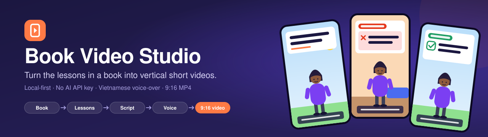

<br>

**Import a book once. Get many voiced, captioned 9:16 videos, rendered on your own machine with no AI API key.**

[](docs/operations.md)
[](#commands)
[](#tech-stack)
[](#tech-stack)
[](#tech-stack)
[](#tech-stack)
<br>
[](#security-and-privacy)
[](#results)
[](#ai-modes)
[](#testing)

[Demo](#demo) · [Goals](#goals) · [Features](#features) · [How it works](#how-it-works) · [Architecture](#architecture) · [Quick start](#quick-start) · [Docs](#documentation)

</div>

---

## Demo

<table>
  <tr>
    <td width="340" align="center" valign="top">
      
      <br>
      <sub>Real output of the Studio, shown as a silent, downsized preview.<br>The MP4 is 1080×1920 with Vietnamese voice-over.</sub>
    </td>
    <td valign="top">
      <h3>One lesson from <em>Atomic Habits</em> → one 56-second video</h3>
      <p>Everything on screen was generated by the app from a single book lesson:</p>
      <ul>
        <li><b>A hook in the first 4 seconds.</b> The text is on screen and the narration is audible from frame 0.</li>
        <li><b>A fixed story frame</b> that is checked by code: hook → situation → mistake → takeaway → better approach → action.</li>
        <li><b>Flat SVG animation</b> with a character and a setting chosen per scene. No stock footage, no GPU.</li>
        <li><b>Vietnamese voice-over and captions</b>, even though the source book is English.</li>
        <li><b>Timing from the real audio</b>, never from a guess. Narration is never cut or sped up to fit.</li>
      </ul>
      <p><sub>Measured with <code>ffprobe</code>: 56.3 s · 1080×1920 · 30 fps · H.264 + AAC.</sub></p>
    </td>
  </tr>
</table>

### The story frame, scene by scene

<table>
  <tr>
    <td align="center" width="16%"></td>
    <td align="center" width="16%">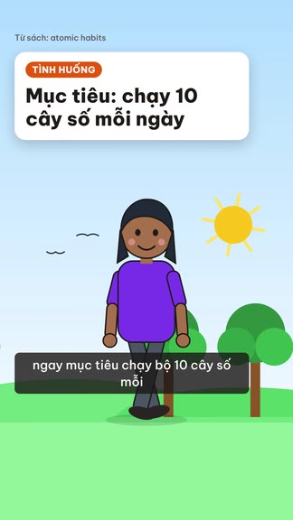</td>
    <td align="center" width="16%">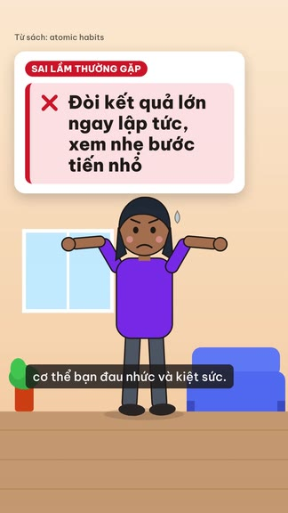</td>
    <td align="center" width="16%">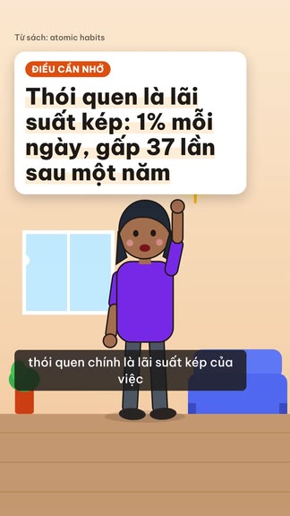</td>
    <td align="center" width="16%">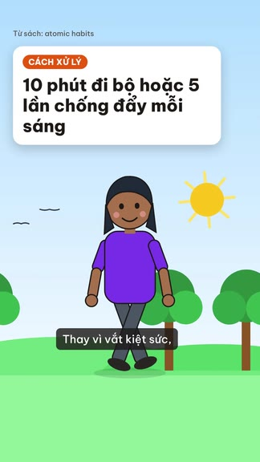</td>
    <td align="center" width="16%">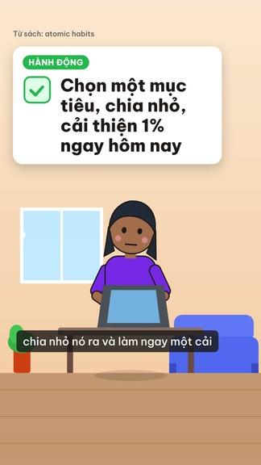</td>
  </tr>
  <tr>
    <td align="center" valign="top"><b>1 · Hook</b><br><sub>“Why do you keep quitting after a few days?”</sub></td>
    <td align="center" valign="top"><b>2 · Situation</b><br><sub>“Goal: run 10 km every day.”</sub></td>
    <td align="center" valign="top"><b>3 · Common mistake</b><br><sub>“Demanding big results right away, ignoring small steps.”</sub></td>
    <td align="center" valign="top"><b>4 · Key takeaway</b><br><sub>“Habits are compound interest: 1% a day is 37× in a year.”</sub></td>
    <td align="center" valign="top"><b>5 · Better approach</b><br><sub>“Start with a 10-minute walk or 5 push-ups each morning.”</sub></td>
    <td align="center" valign="top"><b>6 · Action step</b><br><sub>“Pick one goal, break it down, improve 1% today.”</sub></td>
  </tr>
</table>

<sub>On-screen text is in Vietnamese in the video; the captions above are translations.</sub>

## Contents

- [Goals](#goals) · [Results](#results) · [Features](#features)
- [How it works](#how-it-works) · [AI modes](#ai-modes)
- [Screenshots](#screenshots)
- [Architecture](#architecture) · [Tech stack](#tech-stack)
- [Quick start](#quick-start) · [Make your first video](#make-your-first-video) · [Configuration](#configuration)
- [Project structure](#project-structure) · [Commands](#commands) · [Testing](#testing)
- [Status](#status) · [Documentation](#documentation) · [Contributing](#contributing)
- [Security and privacy](#security-and-privacy) · [License and credits](#license-and-credits)

## Goals

A book holds dozens of ideas you can act on. Each one could be a short video, but making one by hand means summarising,
scripting, recording, subtitling, animating and exporting: hours per video. Book Video Studio turns that into a pipeline.
You choose the lesson, the machine does the rest.

**What it aims to do**

- **One book, many videos.** Import and analyse a book once, then reuse its lessons. Each video teaches _one_ applicable idea
  instead of retelling the book.
- **Stay faithful to the source.** Every lesson links back to verbatim excerpts, with page numbers for PDFs. A scenario the AI
  invented is always flagged as illustrative.
- **Run locally and cheaply.** It runs on a modest WSL2 machine, with no cloud infrastructure and no Anthropic API key. The
  only optional spend is Mistral OCR for scanned pages, and it stops at a per-book ceiling (default 3 USD).
- **Never lose work or pay twice.** Jobs are idempotent and resumable. A restart, a crash or a retry does not duplicate
  lessons, audio, renders or OCR batches.
- **Preview equals output.** The in-browser player and the MP4 render from the same Remotion composition and the same
  validated props.

**What it deliberately does not do:** 16:9 video, multi-user or hosted SaaS, AI-generated footage or images, auto-posting,
thumbnails or SEO, EPUB input, word-accurate captions. See [`docs/requirements.md`](docs/requirements.md) §1.4.

## Results

| Property        | What you get                                                                                      |
| --------------- | ------------------------------------------------------------------------------------------------- |
| Format          | MP4 · H.264 + AAC · 30 fps · vertical 9:16                                                        |
| Resolution      | Final 1080×1920, draft 720×1280 (same composition and content)                                    |
| Length          | 30 s – 5 min (presets 30 / 45 / 60 / 90 / 120 / 180 / 240 / 300 s). You set a range, the AI picks |
| Hook            | Scene 1 starts at frame 0 and lasts at most 4 s (120 frames). No logo, intro or silence before it |
| Scenes          | Up to 30 after the hook, laid out in five vertical layouts                                        |
| Narrative       | Hook → Situation → Common mistake → Key takeaway → Better approach → Action step                  |
| Language        | Vietnamese narration, on-screen text and captions (the source book can be English)                |
| Illustration    | Flat SVG cartoon: 7 settings × 8 character actions, driven only by the frame                      |
| Editor guides   | TikTok / YouTube Shorts / Facebook Reels safe zones, shown in the editor and never in the MP4     |
| Render safety   | Preflight rules before rendering, then an `ffprobe` check of codec, size, FPS and duration        |
| Archive (batch) | Final MP4 + `script.json` + `manifest.json` (with SHA-256) uploaded to your Google Drive          |

## Features

<table>
  <tr>
    <td width="50%" valign="top">
      <h4>📚 Book ingestion</h4>
      <ul>
        <li><code>.md</code> / <code>.txt</code> import with a chapter preview you can rename, split, merge and reorder</li>
        <li>PDF up to 500 MiB / 1,000 pages, streamed to disk and hashed (SHA-256), original kept immutable</li>
        <li>Poppler reads the text layer; <b>Mistral OCR Batch</b> only handles pages that need it, under a cost ceiling</li>
        <li>Local chapter detection first, NotebookLM as a verified fallback. A whole book is never one chapter</li>
      </ul>
    </td>
    <td width="50%" valign="top">
      <h4>🧠 Lessons you can trust</h4>
      <ul>
        <li>Claude (or the mock provider) extracts lessons per chapter. NotebookLM catalogues PDF chapters</li>
        <li>Excerpts are kept only if they really occur in the chapter text; PDF page numbers come from where they were found</li>
        <li>Approve, edit, merge or archive lessons. Videos keep a <b>snapshot</b>, so later edits never change them</li>
        <li>Book text is treated as untrusted data and never as instructions</li>
      </ul>
    </td>
  </tr>
  <tr>
    <td width="50%" valign="top">
      <h4>🎬 Video editor</h4>
      <ul>
        <li>Pick one of 2–3 generated hooks, then edit narration, on-screen text, layout and illustration per scene</li>
        <li>Rewrite a single scene without touching the others</li>
        <li>Phone-frame preview with platform safe zones and a “play the first 4 seconds” button</li>
        <li>Voice-over with edge-tts, or upload your own audio per scene</li>
      </ul>
    </td>
    <td width="50%" valign="top">
      <h4>🏭 Batch production</h4>
      <ul>
        <li>Choose up to 100 lessons; each becomes one video, with no approval step</li>
        <li>Checkpointed per video: draft → scene plan → voice → readiness → render → archive</li>
        <li>One AI correction pass per video, routed to the step that can fix the problem</li>
        <li>Cancel or retry one video or a whole batch; it resumes from the last finished step</li>
      </ul>
    </td>
  </tr>
  <tr>
    <td width="50%" valign="top">
      <h4>🛡️ Reliable by design</h4>
      <ul>
        <li>Long work never runs in an HTTP request: the API answers <code>202</code> and a worker does the job</li>
        <li>Transactional outbox, at-least-once delivery and idempotent processors</li>
        <li>The web app stays up when Redis or the worker is down and shows a degraded state</li>
      </ul>
    </td>
    <td width="50%" valign="top">
      <h4>🖥️ Studio experience</h4>
      <ul>
        <li>Vietnamese UI with light, dark and system themes</li>
        <li>Live jobs dashboard, production progress and a diagnostics page</li>
        <li>Optional automatic archive of every final render to Google Drive</li>
      </ul>
    </td>
  </tr>
</table>

## How it works

The two flows share books, chapters, lessons, the editor, the video template and the renderer.

### Manual flow: `.md` / `.txt`, you approve each step

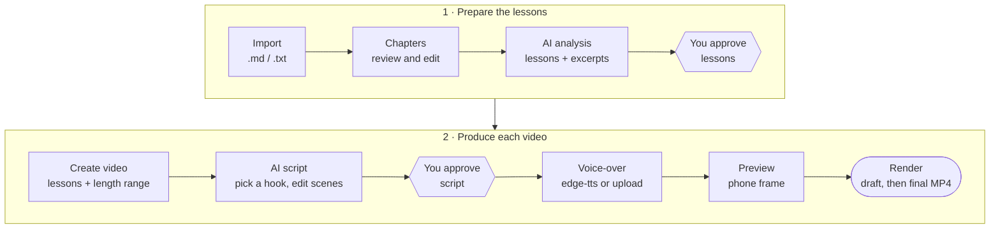

### Batch flow: PDF, you only choose lessons

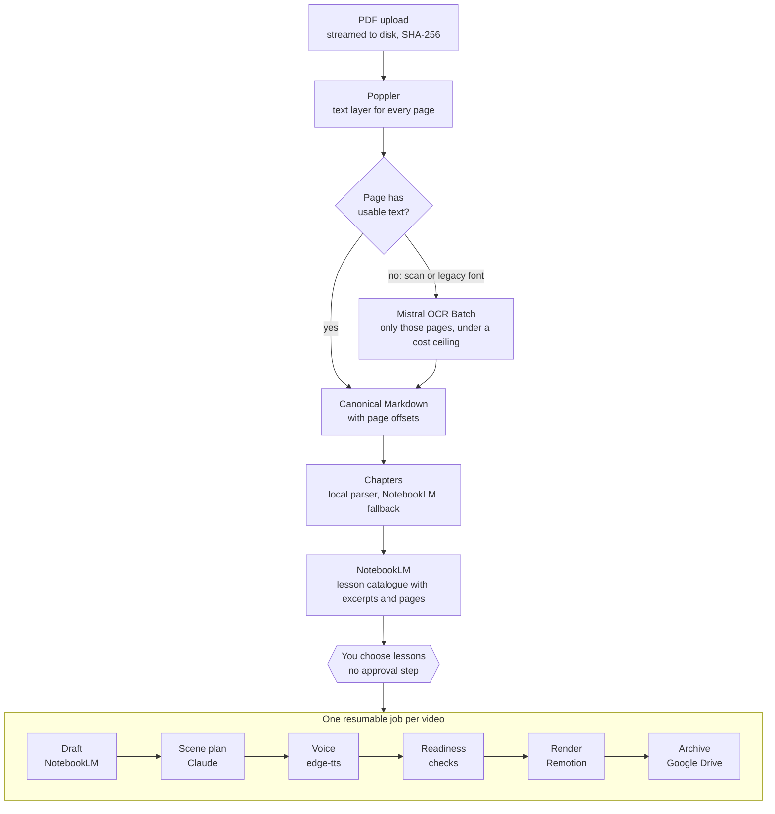

Each production item moves through checkpoints, so a restart continues after the last finished step. A failed check gets
**one** AI correction pass that rewinds only as far as needed.

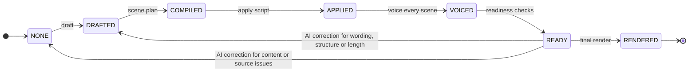

### AI modes

`AI_MODE` in `.env` selects how the Studio reaches Claude. There is **no** Anthropic SDK and **no** API key anywhere.

| Mode                 | What happens                                                                                             | Use it for                                 |
| -------------------- | -------------------------------------------------------------------------------------------------------- | ------------------------------------------ |
| `mock`               | Deterministic sample output, no network                                                                  | Trying the app, tests                      |
| `cli-task` (default) | The job writes a task folder and waits in **Waiting for CLI**. You run `pnpm ai:run --job <id>` yourself | Real Claude with you in the loop           |
| `cli-auto`           | The worker runs your own logged-in Claude Code CLI right away. Opt-in, off by default                    | Personal localhost use, batch with real AI |

Batch production needs `mock` or `cli-auto`, because `cli-task` would wait for you to run a command for every single video.

## Screenshots

<table>
  <tr>
    <td width="50%"><a href="docs/assets/screenshots/dashboard.png">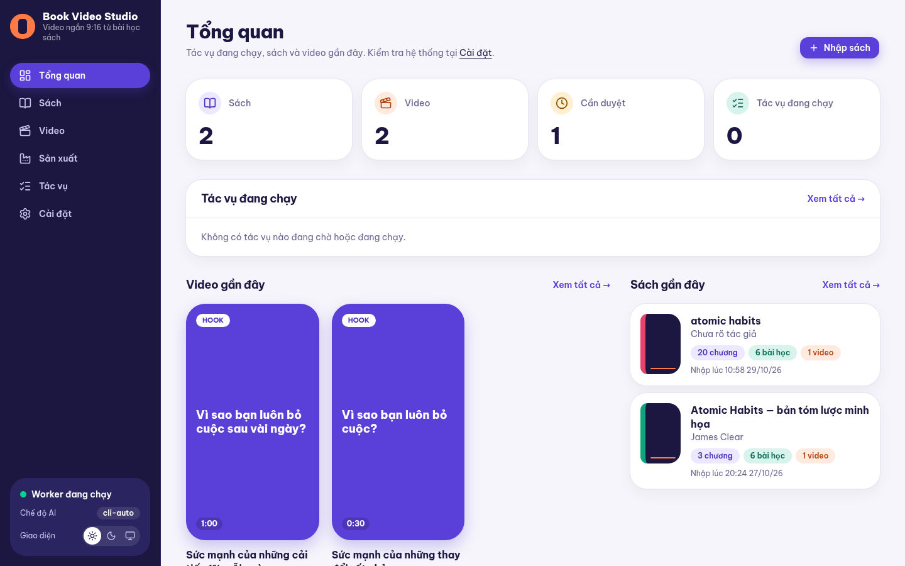</a><br><sub><b>Overview</b>: running jobs, recent videos as 9:16 poster cards, recent books.</sub></td>
    <td width="50%"><a href="docs/assets/screenshots/book-lessons.png">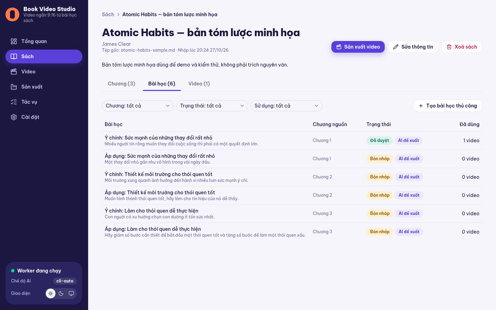</a><br><sub><b>Lessons</b>: reviewed lessons, their source chapter, status and how many videos use them.</sub></td>
  </tr>
  <tr>
    <td width="50%"><a href="docs/assets/screenshots/video-editor.png">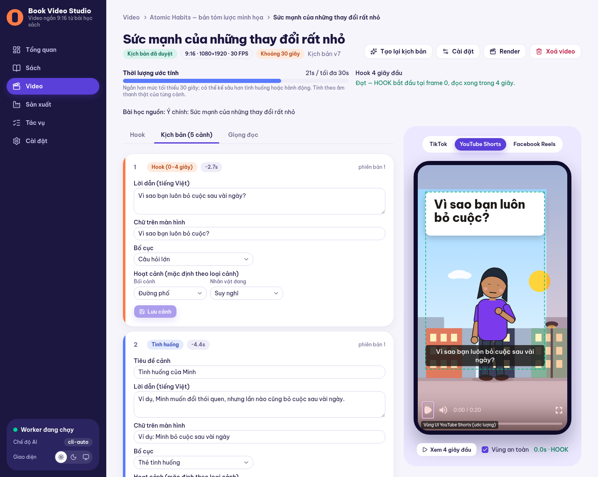</a><br><sub><b>Editor</b>: per-scene fields on the left, the exact render in a phone frame with safe zones on the right.</sub></td>
    <td width="50%"><a href="docs/assets/screenshots/video-editor-dark.png">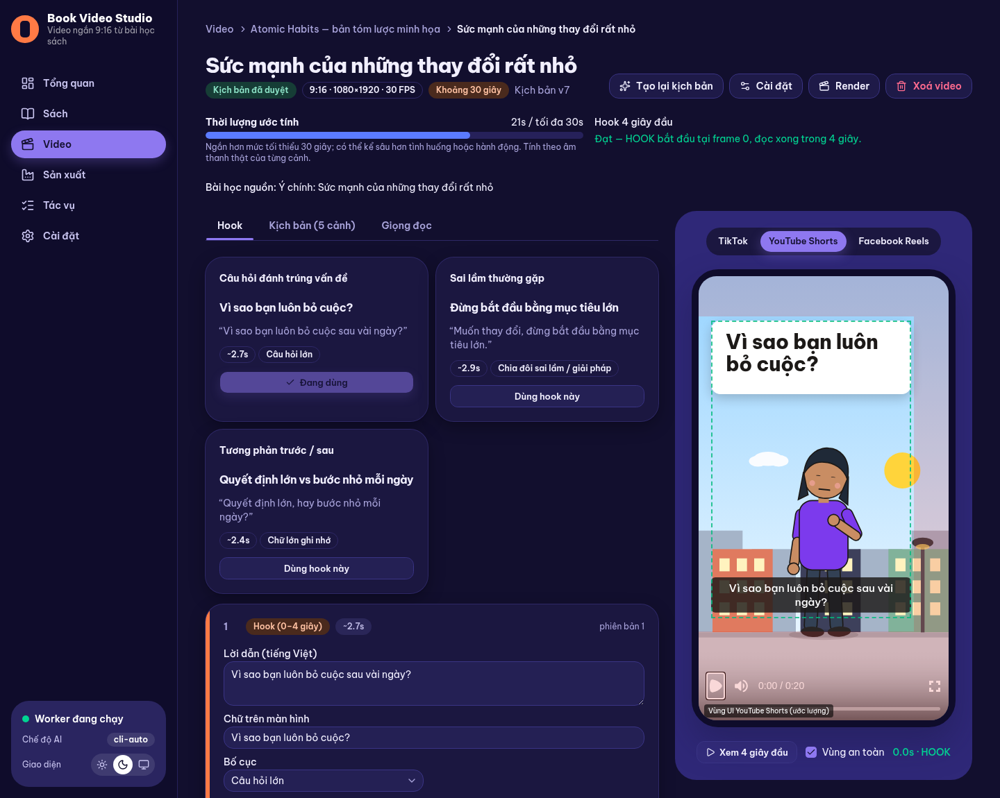</a><br><sub><b>Dark theme</b>: choose three hooks, then refine the script. Light, dark and system themes are built in.</sub></td>
  </tr>
  <tr>
    <td colspan="2" align="center"><a href="docs/assets/screenshots/production-progress.png">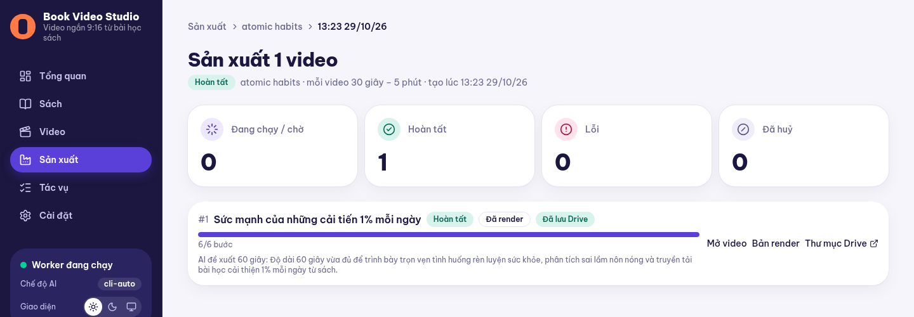</a><br><sub><b>Batch production</b>: each video shows its checkpoint progress, the AI-proposed length, the render and its Drive archive.</sub></td>
  </tr>
</table>

<sub>The interface text is Vietnamese.</sub>

## Architecture

One repository, **one web process, one worker process**, Redis and a SQLite file. No microservices, no cloud infrastructure.

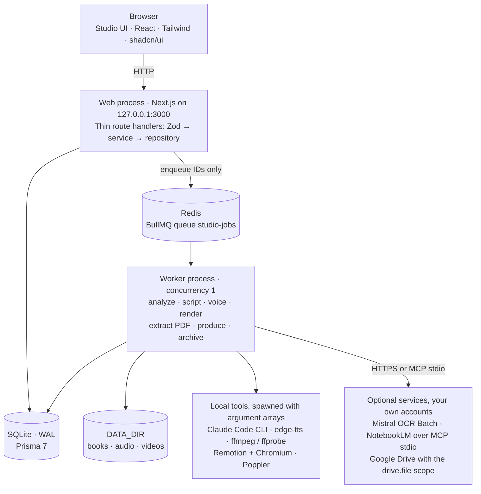

### Life of a long-running request

The web process never waits for AI, speech or rendering. It records the job and its dispatch row in one transaction, answers
`202`, and the browser polls.

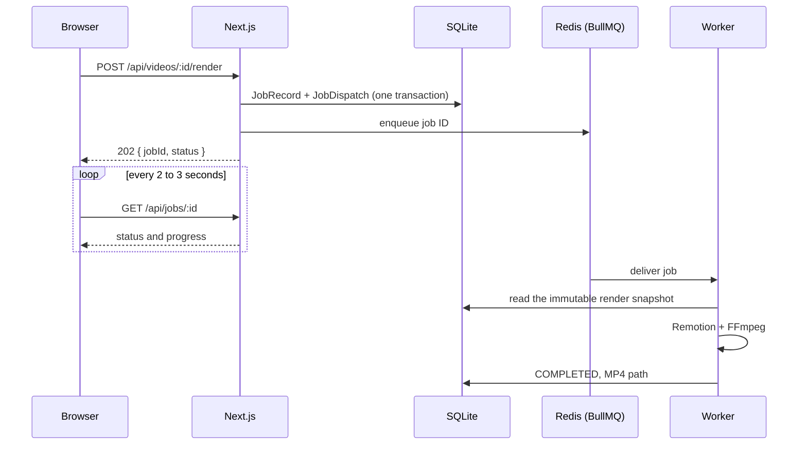

### Design decisions worth knowing

| Decision                                  | Why                                                                                                                                                          |
| ----------------------------------------- | ------------------------------------------------------------------------------------------------------------------------------------------------------------ |
| Transactional outbox + deferred jobs      | A job row and its dispatch are written together. Waiting on a remote service reschedules the job instead of blocking the worker                              |
| Idempotent, checkpointed processors       | BullMQ delivers at least once. Re-running never duplicates lessons, audio, renders, OCR spend or Drive files                                                 |
| One composition for preview and render    | `toCompositionProps()` is the only way to build props, so what you preview is what you get                                                                   |
| Renders come from an immutable snapshot   | Editing a video while it renders cannot change the output. Old MP4s are never deleted automatically                                                          |
| Timing comes from real audio              | Scene length is the measured audio plus padding. Narration is never cut or sped up to fit a range                                                            |
| Integrations sit behind ports             | `AiProvider`, `OcrProvider`, `ScriptStudioProvider`, `ScenePlanCompiler`, `VideoArchiveProvider`. Each has a fake and a contract test suite                  |
| Untrusted book text, validated everywhere | Zod checks HTTP input, uploads, AI output, job payloads and video props. A guard rejects numbers or quotes in a scene plan that the source does not support  |
| Layered code with enforced boundaries     | `app → services → repositories → db`. ESLint blocks Prisma, Redis, `fs` or `src/server` in client components, and keeps Remotion code free of server imports |

## Tech stack

| Layer            | Choice                                                                                        |
| ---------------- | --------------------------------------------------------------------------------------------- |
| Web app          | Next.js 16 (App Router), React 19, TypeScript 6 (strict), Tailwind CSS 4, shadcn/ui, Zod 4    |
| Data             | Prisma 7 with SQLite (better-sqlite3 adapter, WAL)                                            |
| Queue and worker | BullMQ 6 + Redis 7, standalone Node.js worker                                                 |
| Video            | Remotion 4 (Player for preview, renderer for MP4), FFmpeg / ffprobe, flat SVG illustrations   |
| Voice            | edge-tts (Vietnamese `vi-VN-NamMinhNeural` by default), or your own audio uploads             |
| AI               | Claude Code CLI (your own login), NotebookLM through an MCP stdio subprocess, a mock provider |
| PDF and OCR      | Poppler, Mistral OCR Batch (your own key)                                                     |
| Archive          | Google Drive, OAuth with the minimal `drive.file` scope                                       |
| Quality          | ESLint 9, Prettier, Vitest 5, Playwright 1.64                                                 |

## Quick start

### Prerequisites

| Requirement              | Needed for                 | Notes                                                             |
| ------------------------ | -------------------------- | ----------------------------------------------------------------- |
| WSL2 Ubuntu              | Always                     | Keep the project on the Linux filesystem, never under `/mnt/c`    |
| Node.js ≥ 24, pnpm ≥ 9.7 | Always                     | **pnpm only**; `npm` and `yarn` installs are blocked              |
| Docker (or Redis ≥ 6.2)  | Always                     | `docker compose up -d` starts Redis 7 on `127.0.0.1:6379`         |
| ffmpeg + ffprobe         | Voice-over, render         | `sudo apt install ffmpeg`                                         |
| edge-tts                 | Automatic Vietnamese voice | `pip install -U edge-tts`. Optional: you can upload audio instead |
| Claude Code CLI          | `cli-task`, `cli-auto`     | Optional. Use `AI_MODE=mock` to try the app without it            |
| Poppler, `uv`            | PDF books, NotebookLM      | Optional. See [`docs/operations.md`](docs/operations.md)          |

### Install

```bash
cp .env.example .env          # set AI_MODE=mock to try the app without any AI account
pnpm install                  # also runs `prisma generate`
docker compose up -d          # Redis at 127.0.0.1:6379
pnpm db:migrate               # creates data/studio.db
pnpm db:seed                  # demo book with draft lessons
pnpm diagnose                 # checks your environment
```

### Run

Use one WSL terminal per command, from the project folder:

```bash
docker compose up -d          # 1) Redis (skip if it is already running)
pnpm worker:dev               # 2) worker: analysis, scripts, voice, render, OCR, Drive archive
pnpm dev                      # 3) web app at http://127.0.0.1:3000
```

Open <http://127.0.0.1:3000> in your Windows browser. The web app still opens when Redis or the worker is down: **Settings**
reports a degraded state, and queued jobs continue once the worker is back. For production, use `pnpm build && pnpm start`
together with `pnpm worker:start`.

## Make your first video

The interface is Vietnamese; the Vietnamese label of each action is given in parentheses.

**Manual flow: a `.md` / `.txt` book, with approvals**

1. **Books → Import** (_Sách → Nhập sách_): upload a file or paste text, check the chapter list, then **Confirm** (_Xác nhận nhập_).
2. On the **Chapters** tab choose **Analyze all chapters** (_Phân tích tất cả chương_). On the **Lessons** tab compare each excerpt
   with the source, edit if needed and **Approve** (_Duyệt_).
3. On the **Videos** tab choose **Create video** (_Tạo video_): pick approved lessons and a length range (default 30 s – 5 min).
4. Generate the script, **pick a hook** (at most 4 s), refine each scene, then **Approve script** (_Duyệt kịch bản_).
5. On the **Voice** tab generate speech with edge-tts or upload audio, preview it in the phone frame, then **Render** a draft
   and a final version.

**Batch flow: a PDF book, no approvals**

1. **Import → PDF book** (_Nhập sách → Sách PDF_). Follow the **PDF extraction** card on the book page until chapters appear.
2. **Analyze all chapters**: NotebookLM builds a lesson catalogue with verbatim excerpts and page numbers.
3. **Produce videos** (_Sản xuất video_): choose lessons and a length range. The **Production** page follows every video until
   it is rendered and archived to Drive.

## Configuration

Everything lives in `.env` (validated by Zod at start-up; a wrong value stops the process with a clear message). The most
useful settings:

| Variable                                               | Default                                | Purpose                                                             |
| ------------------------------------------------------ | -------------------------------------- | ------------------------------------------------------------------- |
| `AI_MODE`                                              | `cli-task`                             | `mock`, `cli-task` or `cli-auto` ([AI modes](#ai-modes))            |
| `TTS_MODE`, `TTS_VOICE`, `TTS_SPEED`                   | `edge-tts`, `vi-VN-NamMinhNeural`, `0` | Voice-over engine, voice and speed                                  |
| `WORKER_CONCURRENCY`, `RENDER_CONCURRENCY`             | `1`, `1`                               | Keep at 1 until you have benchmarked your machine                   |
| `MAX_PDF_SIZE_MB`, `MAX_PDF_PAGES`                     | `500`, `1000`                          | PDF upload limits                                                   |
| `OCR_COST_CEILING_USD`, `MISTRAL_API_KEY`              | `3`, _(empty)_                         | Per-book OCR budget and your own Mistral key                        |
| `NOTEBOOKLM_PROFILE`                                   | _(empty)_                              | Logged-in NotebookLM profile, needed for PDF batch with real AI     |
| `GOOGLE_OAUTH_CLIENT_ID`, `GOOGLE_OAUTH_CLIENT_SECRET` | _(empty)_                              | Your own Desktop-app OAuth client; leave empty to keep videos local |

The full table, with limits and troubleshooting, is in [`docs/operations.md`](docs/operations.md).

<details>
<summary><b>Troubleshooting at a glance</b></summary>

| Symptom                           | What to do                                                                                  |
| --------------------------------- | ------------------------------------------------------------------------------------------- |
| The app reports a degraded state  | Start Redis (`docker compose up -d`) and the worker (`pnpm worker:dev`). Queued jobs resume |
| A job sits in **Waiting for CLI** | You are in `cli-task` mode: run the command shown on the job, `pnpm ai:run --job <id>`      |
| edge-tts returns no audio         | It is an unofficial service and can be flaky. Retry, or upload audio for the scene          |
| Render cannot find a browser      | `pnpm exec remotion browser ensure`                                                         |
| Data path rejected                | `DATA_DIR` must live on the Linux filesystem, not under `/mnt`                              |
| Anything else                     | `pnpm diagnose` prints a health report of every component                                   |

</details>

## Project structure

<details>
<summary><b>Show the repository layout</b></summary>

```text
src/
  app/            Next.js App Router: pages, layouts and thin API routes
  components/     shadcn/ui primitives and the app shell ("Studio Ink" look)
  features/       Feature-first modules: domain → schemas → services → repositories → components
    books/ extraction/ chapters/ lessons/ videos/ jobs/
    notebooklm/ drive/ archive/ productions/
  server/         Infrastructure, never imported by client code or Remotion
    db/ queue/ storage/ ai/ tts/ render/ media/ pdf/ ocr/ script-studio/ scene-plan/ archive/ diagnostics/
  worker/         Standalone process: dispatcher, one processor per job type, heartbeat, shutdown
  remotion/       Pure React video code: composition, scenes, captions, SVG illustrations
  shared/         Validated env, logger, typed errors
prisma/           schema.prisma, committed migrations, seed
scripts/          CLI entry points: run-claude-task.ts, diagnose.ts
tests/            unit + integration (Vitest), e2e (Playwright on an isolated stack)
docs/             requirements.md, architecture.md, operations.md, assets/
data/             Runtime data (gitignored): SQLite file, books, audio, renders, AI tasks
```

The detailed code map and "where does new code go?" table are in [`AGENTS.md`](AGENTS.md).

</details>

## Commands

| Task                                         | Command                                                        |
| -------------------------------------------- | -------------------------------------------------------------- |
| Install dependencies                         | `pnpm install`                                                 |
| Start Redis                                  | `docker compose up -d`                                         |
| Apply migrations · seed demo data            | `pnpm db:migrate` · `pnpm db:seed`                             |
| Web dev server · worker (watch)              | `pnpm dev` · `pnpm worker:dev`                                 |
| List / run Claude CLI tasks                  | `pnpm ai:run --list` · `pnpm ai:run --job <jobId> [--dry-run]` |
| Environment diagnostics                      | `pnpm diagnose`                                                |
| Inspect video compositions                   | `pnpm remotion:studio`                                         |
| Lint · format check · typecheck              | `pnpm lint` · `pnpm format:check` · `pnpm typecheck`           |
| Unit and integration tests                   | `pnpm test`                                                    |
| End-to-end tests (builds first, needs Redis) | `pnpm test:e2e`                                                |
| Production build                             | `pnpm build`                                                   |

Use `pnpm diagnose`, not `pnpm doctor`: the latter is a pnpm built-in.

## Testing

```bash
pnpm lint && pnpm typecheck && pnpm test && pnpm build   # quality gate
pnpm test:e2e                                            # two end-to-end paths on an isolated stack
```

- **Vitest** covers parsers, path guards, schemas, services, processors and the contract suite that every integration adapter
  must pass. Queue code is tested against real SQLite and Redis rather than mocks.
- **Playwright** runs two paths on a throw-away stack (temporary database and data folder, Redis logical DB 14, fake Google
  and a fake edge-tts): `E2E-01`, the manual flow, and `E2E-02`, PDF → batch production → Drive.
- Tests never reach Mistral, NotebookLM or Google.

## Status

Both flows are implemented and covered by end-to-end tests. Integrations with external accounts are the open item.

| Capability                                                                    | State                                                        |
| ----------------------------------------------------------------------------- | ------------------------------------------------------------ |
| Manual flow from `.md` / `.txt` to draft and final render                     | Implemented, covered by `E2E-01` with mock AI                |
| Claude Code CLI (`cli-task`, `cli-auto`), edge-tts and audio upload           | Implemented                                                  |
| Videos up to 5 min, AI-proposed length inside your range, 4 s hook            | Implemented                                                  |
| PDF import, text layer, chapters                                              | Implemented, tested with real Poppler                        |
| Batch production with checkpoints, correction pass, cancel and retry          | Implemented, covered by `E2E-02` with mock AI and fake Drive |
| Mistral OCR Batch, NotebookLM, Google Drive adapters                          | In the code, **tested against local fakes**                  |
| Acceptance run with real Mistral, NotebookLM and Google accounts              | **Tracked in [`docs/operations.md`](docs/operations.md)**    |
| Background music · EPUB · manual chapter split for PDFs · word-level captions | Not built                                                    |

## Documentation

| Document                                       | Read it for                                                                       |
| ---------------------------------------------- | --------------------------------------------------------------------------------- |
| [`docs/requirements.md`](docs/requirements.md) | Product specification: scope, user flows, business rules, video rules, acceptance |
| [`docs/architecture.md`](docs/architecture.md) | Technical design: processes, data model, jobs, pipelines, integrations            |
| [`docs/operations.md`](docs/operations.md)     | Setup, accounts, every `.env` variable, quotas, troubleshooting, backups          |
| [`AGENTS.md`](AGENTS.md)                       | Rules for contributors and AI coding agents: code map, commands, conventions      |

<sub>The product documents in `docs/` are currently written in Vietnamese. When they disagree with `AGENTS.md` about product
behaviour, the requirements win; about engineering practice, `AGENTS.md` wins.</sub>

## Contributing

1. Read [`AGENTS.md`](AGENTS.md): stack constraints, layering rules, coding standards and the job and AI rules.
2. Use **pnpm only** and keep identifiers in English; interface copy, scripts and narration stay Vietnamese.
3. Add tests with the code and run the quality gate (`pnpm lint && pnpm typecheck && pnpm test && pnpm build`). Also run
   `pnpm test:e2e` when you touch a user flow, the worker or rendering.
4. Write [Conventional Commits](https://www.conventionalcommits.org/) (`feat:`, `fix:`, `docs:`, …) in small steps. Never skip hooks.
5. Keep each topic in the one document that owns it, and update `.env.example` together with the env table in `docs/operations.md`.

## Security and privacy

- **Localhost only.** The app binds to `127.0.0.1`, has no login and is not meant to be exposed. Exposing it needs
  authentication, CSRF protection and rate limiting first.
- **No Anthropic API key, ever.** Claude runs only through your own logged-in Claude Code CLI, with no built-in tools, no MCP
  servers from your config and a sanitised environment. The app never reads or logs Claude tokens or cookies.
- **Secrets stay local.** They live in `.env` and in `data/credentials/` (mode `0600`, never in SQLite, DTOs or logs).
  Disconnecting Google Drive revokes access and deletes nothing on Drive.
- **No shell strings.** Every subprocess is spawned with an argument array. Filesystem access is resolved from `DATA_DIR`
  through a guard that blocks `../`, symlink escapes and `/mnt` locations.
- **Book text is data.** It is quoted as untrusted input, a whole book is never sent to an AI, and logs carry IDs and hashes
  instead of text.
- You are responsible for having the right to use the books you import. The Studio summarises and re-explains, and it keeps
  excerpts to short evidence quotes.

## License and credits

This repository does not include a `LICENSE` file yet.

Third-party terms to keep in mind:

- **Remotion** has its own [licence terms](https://www.remotion.dev/docs/license) that may apply to your use; check them before commercial use.
- **Be Vietnam Pro** is bundled under the SIL Open Font License (`public/fonts/BeVietnamPro-OFL.txt`).

Built with [Next.js](https://nextjs.org), [Remotion](https://www.remotion.dev), [Prisma](https://www.prisma.io),
[BullMQ](https://bullmq.io), [shadcn/ui](https://ui.shadcn.com), [Zod](https://zod.dev), [Poppler](https://poppler.freedesktop.org),
[FFmpeg](https://ffmpeg.org), [edge-tts](https://github.com/rany2/edge-tts), [Mistral OCR](https://mistral.ai),
[NotebookLM](https://notebooklm.google) and [Claude Code](https://www.anthropic.com/claude-code).
