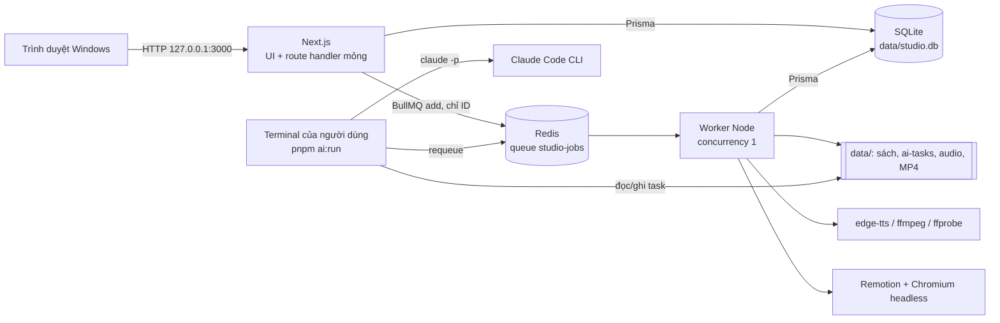
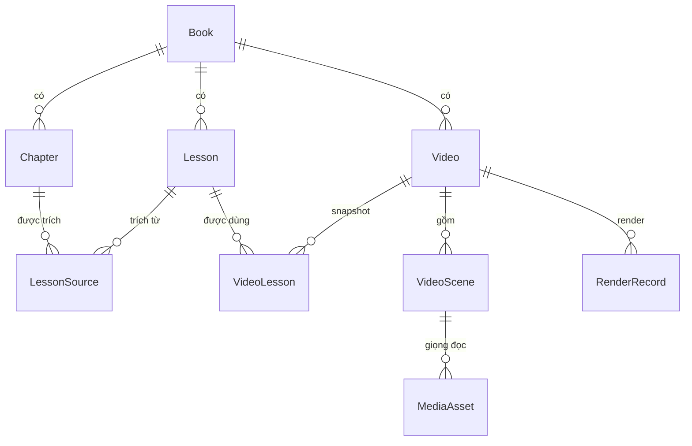
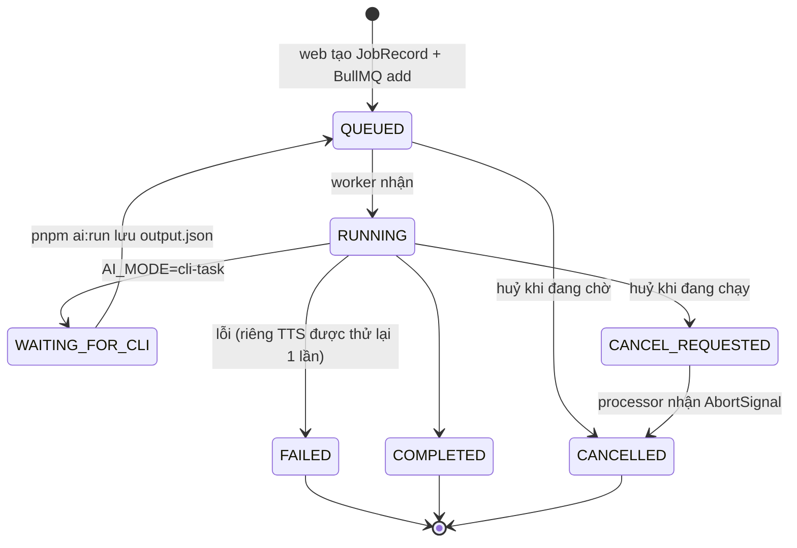
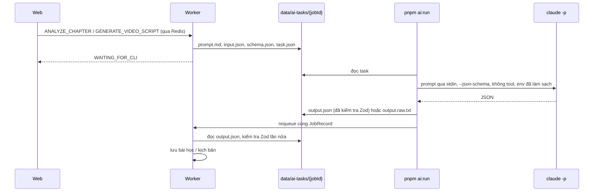

# Kiến trúc Book Video Studio

Tài liệu cho người phát triển: các tiến trình, luồng dữ liệu, vòng đời tác vụ và lý do của các quyết định thiết kế. Quy tắc viết code và ranh giới import nằm ở [`AGENTS.md`](../AGENTS.md); hành vi sản phẩm nằm ở [đặc tả](../BOOK_VIDEO_STUDIO_REQUIREMENTS_VI_v1.1.md).

## 1. Tiến trình



| Tiến trình    | Lệnh                                    | Trách nhiệm                                                                                                                                                             |
| ------------- | --------------------------------------- | ----------------------------------------------------------------------------------------------------------------------------------------------------------------------- |
| Web           | `pnpm dev` / `pnpm start`               | Trang, API route: kiểm tra đầu vào bằng Zod → service → repository. Việc dài chỉ được **xếp hàng** và trả `202 { jobId }`; UI hỏi lại `GET /api/jobs/:id` mỗi 2–3 giây. |
| Worker        | `pnpm worker:dev` / `pnpm worker:start` | Chạy mọi việc nặng: phân tích chương, tạo kịch bản, TTS, render. Một tác vụ một lúc.                                                                                    |
| Redis         | `docker compose up -d`                  | BullMQ — nguồn sự thật về **thực thi** tác vụ.                                                                                                                          |
| `pnpm ai:run` | Người dùng tự chạy                      | Cầu nối duy nhất tới Claude Code CLI. Web và worker không bao giờ tự gọi `claude`.                                                                                      |

Web không phụ thuộc vào Redis/worker để hiển thị: khi chúng tắt, trang vẫn mở và báo trạng thái suy giảm; thao tác cần xếp hàng trả `503 QUEUE_UNAVAILABLE` sau một lệnh `PING` thử (không treo). Worker thì thoát với mã 1 nếu không kết nối được Redis.

## 2. Mô hình dữ liệu



- **Book / Chapter:** tệp gốc lưu nguyên byte kèm SHA-256 và không bao giờ bị sửa; nội dung chương nằm ở `data/books/{bookId}/chapters/{chapterId}.md`. Xoá sách là xoá mềm và bị chặn khi đã có video.
- **Lesson / LessonSource:** bài học thuộc một sách, trích dẫn 1..N chương. Trích đoạn AI đưa ra phải xuất hiện thật trong chương, nếu không sẽ bị loại.
- **VideoLesson** giữ `lessonSnapshotJson` tại thời điểm tạo video, nên sửa bài học sau đó không làm đổi video.
- **Video / VideoScene:** `scriptVersion` tăng mỗi khi kịch bản đổi; `approvedScriptVersion` ghi lại phiên bản đã duyệt. Sửa sau khi duyệt chuyển video về `NEEDS_REVIEW`.
- **RenderRecord** lưu `scriptVersion` lúc render; bản render "lỗi thời" được **suy ra** (`scriptVersion < Video.scriptVersion`), không phải trạng thái lưu, và tệp MP4 cũ không bao giờ bị xoá tự động.
- **JobRecord** là read model/nhật ký của tác vụ cho UI; **AiRun** ghi mỗi lần gọi AI (chế độ, phiên bản prompt, hash đầu vào, đường dẫn đầu ra) — không chứa bí mật.
- Các trường trạng thái kiểu `String` có tập giá trị khai báo trong `features/*/domain` (xem chú thích trong `prisma/schema.prisma`); đường dẫn trong DB luôn **tương đối** với `DATA_DIR`.

## 3. Vòng đời tác vụ



- **Xếp hàng** (`features/jobs/services/job-service.ts`): kiểm tra Redis → tạo `JobRecord(QUEUED)` → `queue.add(type, { jobRecordId, …ID }, { jobId })`. Payload chỉ chứa ID, không bao giờ chứa văn bản sách hay âm thanh.
- **Dispatcher** (`src/worker/processors/index.ts`): bỏ qua tác vụ đã huỷ, đánh dấu `RUNNING`, chuyển tiến độ sang cả BullMQ lẫn SQLite, và thăm dò `CANCEL_REQUESTED` mỗi 2 giây để biến nó thành `AbortSignal` cho processor. Processor trả về giá trị đặc biệt "waiting for CLI" thì tác vụ chuyển `WAITING_FOR_CLI` thay vì `COMPLETED`.
- **Idempotent:** BullMQ giao ít nhất một lần, nên processor kiểm tra trạng thái trước khi làm (ví dụ render đã `COMPLETED` thì trả kết quả cũ; task AI đã có `output.json` thì dùng lại).
- **Khoá video khi đang tạo kịch bản:** khi một tác vụ `GENERATE_VIDEO_SCRIPT` của video còn mở (`QUEUED`, `RUNNING`, `WAITING_FOR_CLI`, `CANCEL_REQUESTED`) — cả tác vụ tạo cả kịch bản (entity `VIDEO`) lẫn tác vụ viết lại một cảnh (entity `SCENE`, tìm theo các cảnh của video, xem `findActiveVideoJob()`) — mọi service người dùng gọi để đổi video (cài đặt, hook, cảnh, giọng đọc, duyệt, render, xoá) đều gọi `assertScriptNotGenerating()` và trả `409 SCRIPT_GENERATION_IN_PROGRESS`; giao diện tắt các control tương ứng (`ScriptLock`). Một yêu cầu trùng đích (cùng cảnh, hoặc cả kịch bản khi tác vụ cả kịch bản đang mở) không bị từ chối mà nhận lại tác vụ đang chạy. Worker ghi kịch bản qua repository nên không bị chính tác vụ của nó chặn.
- **Thử lại / huỷ:** "Thử lại" tạo tác vụ mới; huỷ khi đang chờ xoá job khỏi BullMQ, khi đang chạy thì ghi `CANCEL_REQUESTED`. Khi tác vụ kết thúc, `job-effects.ts` trả thực thể (chương, render…) về trạng thái phù hợp.
- **Khởi động / dừng worker:** `lifecycle/reconcile.ts` đối soát JobRecord đang mở với BullMQ (job biến mất → `FAILED` kèm hướng dẫn thử lại); `heartbeat.ts` ghi khoá Redis có TTL để web biết worker còn sống; `shutdown.ts` đóng worker khi nhận SIGINT/SIGTERM, tối đa 15 giây rồi thoát hẳn (job dở được BullMQ coi là stalled và được đối soát ở lần chạy sau).

## 4. AI



- Giao diện `AiProvider` (`src/server/ai/ai-provider.ts`) có ba bản, chọn bằng `AI_MODE`: `MockAiProvider` (`mock`, tất định, không mạng), `LocalCliTaskProvider` (`cli-task`, sơ đồ trên) và `AutomatedCliProvider` (`cli-auto`, tuỳ chọn): kế thừa `LocalCliTaskProvider`, vẫn ghi đủ tệp tác vụ, nhưng worker gọi `askClaude()` ngay thay vì chờ `pnpm ai:run`. Cả hai đường CLI dùng chung `cli-task/ask-claude.ts` (cùng cờ, cùng env đã làm sạch, cùng phân loại lỗi); `AbortSignal` của tác vụ được truyền tới tiến trình `claude` để **Huỷ** dừng được nó.
- Prompt có phiên bản (`chapter-analysis-v1`, `video-script-v1`). Văn bản sách được bọc trong khối dữ liệu không đáng tin (`prompts/untrusted-text.ts`), và mỗi lần chỉ gửi một chương hoặc các bài học đã chọn — không bao giờ cả cuốn sách.
- Đầu ra luôn qua Zod (`contracts/`); JSON Schema gửi cho Claude được sinh từ chính các schema đó (draft-7). Sai schema → `FAILED`, không lưu gì.
- Lỗi Claude CLI được phân loại thành mã ổn định (`AI_CLI_AUTH`, `AI_QUOTA_EXCEEDED`, `AI_CLI_TIMEOUT`, `AI_CLI_MISSING`, `AI_CLI_ERROR`) và không tự thử lại.

## 5. Giọng đọc

`GENERATE_SCENE_TTS` → `features/videos/services/tts-runner.ts`: tính khoá cache `hash(TTS_ENGINE_VERSION, giọng, tốc độ, lời dẫn)`; nếu chưa có thì chạy `edge-tts` bằng mảng tham số (lời dẫn đi qua tệp, không qua dòng lệnh), cắt khoảng lặng đầu/cuối bằng ffmpeg, đo thời lượng bằng ffprobe, lưu `MediaAsset(VOICEOVER)` rồi gắn vào cảnh. Âm thanh tải lên đi qua `audio.service.ts` (kiểm tra kích thước và chữ ký tệp MP3/WAV) và chỉ được đo, không bị sửa. Độ dài cảnh = thời lượng âm thanh + `SCENE_AUDIO_PADDING_MS`.

## 6. Xem trước và render

- Trình biên tập video (`EditorWorkspace`) ghim khung xem trước bên phải khi viewport ≥ 1280 px và chỉ mount **một** Player (`useMediaQuery`); dưới ngưỡng đó Player là tab cuối. Nó phụ thuộc `<main>` dùng `overflow-x: clip`: `overflow-x: hidden` biến `<main>` thành scroll container và làm `position: sticky` mất tác dụng.
- Giao diện sáng/tối: `next-themes` (`ThemeProvider`, lưu ở `localStorage[studio-theme]`, mặc định theo hệ thống) bật class `dark` trên `<html>`; mọi màu đi qua token trong `globals.css`. Poster video và màu thanh trạng thái là màu cố định vì đại diện cho video thật.
- `toCompositionProps()` (`features/videos/domain/composition-props.ts`) là nơi duy nhất biến video thành props cho composition `ShortVideo`. Remotion Player trong trình duyệt và bản render trong worker dùng chung hàm này, nên hai bên luôn giống nhau.
- Code trong `src/remotion/` là React thuần: chỉ nhận props đã kiểm tra bằng Zod, không đọc `process.env`, DB hay mạng. Font Be Vietnam Pro được đóng gói trong `public/fonts`.
- Render (`render-runner.ts` → `server/render/render-short-video.ts`):
  1. kiểm tra trước (`domain/preflight.ts`) — bản cuối bị chặn nếu còn lỗi;
  2. mở một asset server tạm ở `127.0.0.1:<cổng ngẫu nhiên>` chỉ phục vụ các tệp giọng đọc của video;
  3. bundle composition (một lần mỗi tiến trình worker, có alias `@/` qua `webpack-override.ts`);
  4. `renderMedia` H.264 + AAC, BT.709, `concurrency = RENDER_CONCURRENCY`; bản nháp dùng `scale = 720/1080` trên cùng composition 1080×1920;
  5. ghi ra tệp tạm rồi đổi tên; ffprobe kiểm tra codec, kích thước, FPS và thời lượng (bản cuối không được vượt preset);
  6. lỗi hoặc huỷ → xoá tệp dở, `RenderRecord` thành `FAILED` / `CANCELLED`.
- Vùng an toàn chỉ là lớp phủ trong editor (`domain/safe-zones.ts`); nội dung được đặt trong vùng an toàn chặt nhất của cả ba nền tảng nên một bản render dùng được cho mọi nơi.

## 7. Phân lớp mã

```
app (page, route)  →  features/*/services  →  features/*/repositories  →  server/db
                             │
                             └→ features/*/domain (thuần, không I/O — dùng được ở client, worker, Remotion)
worker/processors  →  features/*/services (*-runner.ts)  →  server/{ai,tts,media,render,storage}
```

- `server-only` ném lỗi ngoài bundler của Next, nên chỉ module **chỉ dành cho web** (producer hàng đợi, `job-service`, `job-control.service`, route helpers, các `*-request.service.ts`) được import nó. Mọi thứ worker và `scripts/` dùng phải không có `server-only`.
- `@remotion/bundler` / `@remotion/renderer` chỉ xuất hiện trong module của worker.
- ESLint (`eslint.config.mjs`) chặn component client import Prisma, Redis, `node:*` hay `@/server`, và chặn Remotion đọc `process.env` hoặc import service.

## 8. Lưu trữ và bảo mật

- Mọi đường dẫn đi qua `server/storage/safe-path.ts`: chặn `..`, symlink thoát khỏi `DATA_DIR` và vị trí dưới `/mnt/`. Thư mục đặt theo ID, không theo tên sách.
- Ghi tệp theo kiểu tạm-rồi-đổi-tên; tệp gốc của sách ở chế độ chỉ đọc.
- Tiến trình con luôn chạy bằng `spawn`/`execFile` với mảng tham số, không bao giờ ghép chuỗi shell. `pnpm ai:run` loại bỏ biến môi trường phiên Claude Code và mọi biến kiểu API key trước khi gọi `claude`, không bao giờ dùng `--dangerously-skip-permissions`.
- Log là JSON, chỉ chứa ID và hash — không chứa văn bản chương hay bí mật. Chỉ lắng nghe `127.0.0.1`; không có xác thực nên không được mở ra mạng.

## 9. Kiểm thử

| Lớp         | Công cụ                      | Phạm vi                                                                                            |
| ----------- | ---------------------------- | -------------------------------------------------------------------------------------------------- |
| Unit        | Vitest (`tests/unit`)        | Parser chương, đường dẫn an toàn, env, domain bài học/video/audio/render, phân loại đầu ra Claude  |
| Integration | Vitest (`tests/integration`) | Service + repository trên SQLite tạm với migration thật; provider CLI; các tình huống lỗi          |
| E2E         | Playwright (`tests/e2e`)     | Stack riêng (DB tạm, Redis DB 14, worker, `next start` cổng 3100) chạy trọn E2E-01 tới ffprobe MP4 |

## 10. Các quyết định chính

| Quyết định                                                | Lý do                                                                                                                                      |
| --------------------------------------------------------- | ------------------------------------------------------------------------------------------------------------------------------------------ |
| Hai tiến trình (web + worker), một queue                  | Render và TTS chiếm CPU/RAM nhiều phút; tách khỏi web để UI luôn phản hồi. Một queue với concurrency 1 đủ cho một người dùng trên máy yếu. |
| SQLite + WAL                                              | Một người dùng, cục bộ, sao lưu chỉ là sao chép một thư mục.                                                                               |
| BullMQ là nguồn sự thật thực thi, JobRecord là read model | UI đọc nhanh từ SQLite; đối soát khi khởi động xử lý mất đồng bộ (Redis bị xoá, worker chết giữa chừng).                                   |
| AI qua tác vụ do người dùng chạy                          | Không dùng API key; mọi lần gọi Claude do người dùng chủ động, đúng tinh thần dùng cá nhân của Claude Code.                                |
| Trạng thái kiểu `String` cho vài trường                   | Tập giá trị sống trong domain TypeScript; thêm giá trị không cần migration SQLite.                                                         |
| Asset server cục bộ khi render                            | Remotion render trong Chromium cần URL cho âm thanh; phục vụ đúng các tệp của video qua `127.0.0.1` tránh lộ toàn bộ `data/`.              |
| Composition dùng chung Player và render                   | Bản xem trước là bản sẽ được render — không có hai bộ layout lệch nhau.                                                                    |
