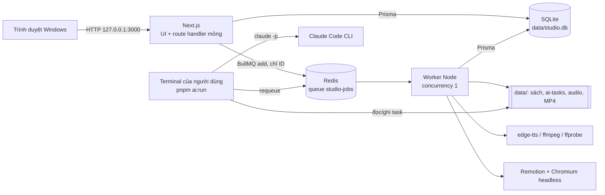
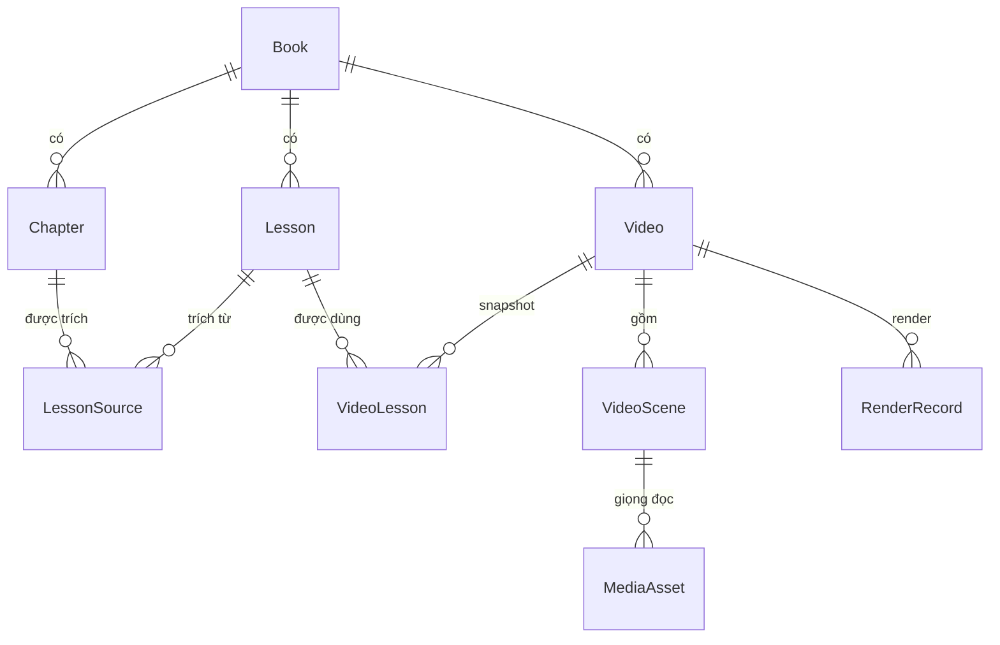
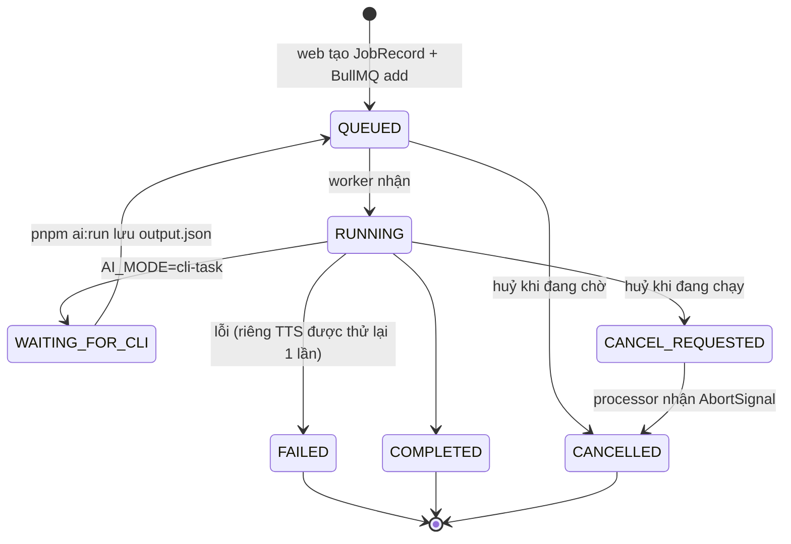
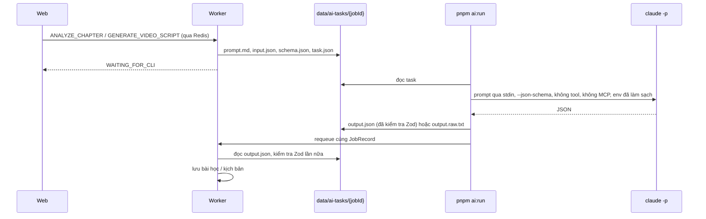
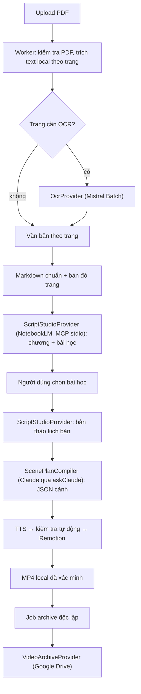

# Kiến trúc Book Video Studio

Tài liệu cho người phát triển: các tiến trình, luồng dữ liệu, vòng đời tác vụ và lý do của các quyết định thiết kế. Quy tắc viết code và ranh giới import nằm ở [`AGENTS.md`](../AGENTS.md); hành vi sản phẩm nằm ở [đặc tả](../BOOK_VIDEO_STUDIO_REQUIREMENTS_VI_v1.1.md).

## 1. Tiến trình



| Tiến trình    | Lệnh                                    | Trách nhiệm                                                                                                                                                             |
| ------------- | --------------------------------------- | ----------------------------------------------------------------------------------------------------------------------------------------------------------------------- |
| Web           | `pnpm dev` / `pnpm start`               | Trang, API route: kiểm tra đầu vào bằng Zod → service → repository. Việc dài chỉ được **xếp hàng** và trả `202 { jobId }`; UI hỏi lại `GET /api/jobs/:id` mỗi 2–3 giây. |
| Worker        | `pnpm worker:dev` / `pnpm worker:start` | Chạy mọi việc nặng: phân tích chương, tạo kịch bản, TTS, render. Một tác vụ một lúc.                                                                                    |
| Redis         | `docker compose up -d`                  | BullMQ — nguồn sự thật về **thực thi** tác vụ.                                                                                                                          |
| `pnpm ai:run` | Người dùng tự chạy                      | Cầu nối duy nhất tới Claude Code CLI. Web và worker không bao giờ tự gọi `claude`.                                                                                      |

Web không phụ thuộc vào Redis/worker để hiển thị: khi chúng tắt, trang vẫn mở và báo trạng thái suy giảm; thao tác cần xếp hàng trả `503 QUEUE_UNAVAILABLE` sau một lệnh `PING` thử (không treo). Worker thì thoát với mã 1 nếu không kết nối được Redis.

## 2. Mô hình dữ liệu



- **Book / Chapter:** tệp gốc lưu nguyên byte kèm SHA-256 và không bao giờ bị sửa; nội dung chương nằm ở `data/books/{bookId}/chapters/{chapterId}.md`. Xoá sách là xoá mềm và bị chặn khi đã có video.
- **Lesson / LessonSource:** bài học thuộc một sách, trích dẫn 1..N chương. Trích đoạn AI đưa ra phải xuất hiện thật trong chương, nếu không sẽ bị loại.
- **VideoLesson** giữ `lessonSnapshotJson` tại thời điểm tạo video, nên sửa bài học sau đó không làm đổi video.
- **Video / VideoScene:** `scriptVersion` tăng mỗi khi kịch bản đổi; `approvedScriptVersion` ghi lại phiên bản đã duyệt. Sửa sau khi duyệt chuyển video về `NEEDS_REVIEW`.
- **RenderRecord** lưu `scriptVersion` lúc render; bản render "lỗi thời" được **suy ra** (`scriptVersion < Video.scriptVersion`), không phải trạng thái lưu, và tệp MP4 cũ không bao giờ bị xoá tự động.
- **JobRecord** là read model/nhật ký của tác vụ cho UI; **AiRun** ghi mỗi lần gọi AI (chế độ, phiên bản prompt, hash đầu vào, đường dẫn đầu ra) — không chứa bí mật.
- Các trường trạng thái kiểu `String` có tập giá trị khai báo trong `features/*/domain` (xem chú thích trong `prisma/schema.prisma`); đường dẫn trong DB luôn **tương đối** với `DATA_DIR`.

## 3. Vòng đời tác vụ



- **Xếp hàng** (`features/jobs/services/job-service.ts` + `job-dispatch.service.ts`): tạo `JobRecord(QUEUED)` **cùng một hàng outbox `JobDispatch`** trong một giao dịch SQLite (`recordJobIntent`) → kiểm tra Redis và `queue.add(type, { jobRecordId, …ID }, { jobId })` → ghi `dispatchedAt`. Payload chỉ chứa ID, không bao giờ chứa văn bản sách hay âm thanh. Redis từ chối ngay (đường nhanh) thì hàng outbox bị xoá và job thành `FAILED` kèm `503 QUEUE_UNAVAILABLE`, như trước.
- **Outbox (`JobDispatch`):** nếu tiến trình chết giữa lúc ghi SQLite và lúc `queue.add`, hàng có `dispatchedAt = null` vẫn còn. Worker quét `sweepDueJobIntents` một lần lúc khởi động (trước `reconcile`) và mỗi 5 giây (`lifecycle/dispatch-sweeper.ts`), giao các hàng tới hạn (`availableAt <= now`, nên cũng giữ được job trì hoãn) rồi mới ghi `dispatchedAt`. Giao lại sau một vụ chết giữa hai bước không nhân đôi job vì BullMQ bỏ qua `add` trùng `jobId`; hàng của job đã huỷ bị bỏ, hàng có payload hỏng làm job `FAILED` (`DISPATCH_FAILED`), còn lỗi Redis chỉ ghi `lastError` và thử lại ở lượt sau. Huỷ job còn nằm trong outbox xoá hàng đó mà không gọi Redis.
- **Dispatcher** (`src/worker/processors/dispatcher.ts`, `createJobDispatcher(processors)`; `processors/index.ts` chỉ đăng ký processor): bỏ qua tác vụ đã huỷ, đánh dấu `RUNNING`, chuyển tiến độ sang cả BullMQ lẫn SQLite, và thăm dò `CANCEL_REQUESTED` mỗi 2 giây để biến nó thành `AbortSignal` cho processor. Processor trả về giá trị đặc biệt "waiting for CLI" thì tác vụ chuyển `WAITING_FOR_CLI` thay vì `COMPLETED`.
- **Trì hoãn (`deferred(retryAfterMs)`):** khi một thao tác từ xa còn đang chờ, processor trả `deferred()` thay vì đứng chờ. Job BullMQ kết thúc (worker rảnh ngay), còn `deferRunningJob` trong một giao dịch đưa `JobRecord` về `QUEUED`, **đổi `bullmqJobId`** (BullMQ nuốt `add` trùng id của job đã xong) và đặt lại hàng outbox với `availableAt = now + retryAfterMs`. Lịch nằm ở SQLite nên sống qua restart worker và cả khi Redis bị xoá; `reconcile` bỏ qua job vì hàng outbox chưa giao. Nếu lúc đó người dùng đã yêu cầu huỷ, dispatcher kết thúc việc huỷ thay vì đặt lịch. Cơ chế đã có, chưa processor nào dùng (OCR Batch sẽ dùng ở nhóm B).
- **Idempotent:** BullMQ giao ít nhất một lần, nên processor kiểm tra trạng thái trước khi làm (ví dụ render đã `COMPLETED` thì trả kết quả cũ; task AI đã có `output.json` thì dùng lại).
- **Khoá video khi đang tạo kịch bản:** khi một tác vụ `GENERATE_VIDEO_SCRIPT` của video còn mở (`QUEUED`, `RUNNING`, `WAITING_FOR_CLI`, `CANCEL_REQUESTED`) — cả tác vụ tạo cả kịch bản (entity `VIDEO`) lẫn tác vụ viết lại một cảnh (entity `SCENE`, tìm theo các cảnh của video, xem `findActiveVideoJob()`) — mọi service người dùng gọi để đổi video (cài đặt, hook, cảnh, giọng đọc, duyệt, render, xoá) đều gọi `assertScriptNotGenerating()` và trả `409 SCRIPT_GENERATION_IN_PROGRESS`; giao diện tắt các control tương ứng (`ScriptLock`). Một yêu cầu trùng đích (cùng cảnh, hoặc cả kịch bản khi tác vụ cả kịch bản đang mở) không bị từ chối mà nhận lại tác vụ đang chạy. Worker ghi kịch bản qua repository nên không bị chính tác vụ của nó chặn.
- **Thử lại / huỷ:** "Thử lại" tạo tác vụ mới; huỷ khi đang chờ xoá job khỏi BullMQ, khi đang chạy thì ghi `CANCEL_REQUESTED`. Khi tác vụ kết thúc, `job-effects.ts` trả thực thể (chương, render…) về trạng thái phù hợp.
- **Khởi động / dừng worker:** `lifecycle/reconcile.ts` đối soát JobRecord đang mở với BullMQ (job biến mất → `FAILED` kèm hướng dẫn thử lại); `heartbeat.ts` ghi khoá Redis có TTL để web biết worker còn sống; `shutdown.ts` đóng worker khi nhận SIGINT/SIGTERM, tối đa 15 giây rồi thoát hẳn (job dở được BullMQ coi là stalled và được đối soát ở lần chạy sau).

## 4. AI



- Giao diện `AiProvider` (`src/server/ai/ai-provider.ts`) có ba bản, chọn bằng `AI_MODE`: `MockAiProvider` (`mock`, tất định, không mạng), `LocalCliTaskProvider` (`cli-task`, sơ đồ trên) và `AutomatedCliProvider` (`cli-auto`, tuỳ chọn): kế thừa `LocalCliTaskProvider`, vẫn ghi đủ tệp tác vụ, nhưng worker gọi `askClaude()` ngay thay vì chờ `pnpm ai:run`. Cả hai đường CLI dùng chung `cli-task/ask-claude.ts` (cùng cờ, cùng env đã làm sạch, cùng phân loại lỗi); `AbortSignal` của tác vụ được truyền tới tiến trình `claude` để **Huỷ** dừng được nó.
- Prompt có phiên bản (`chapter-analysis-v1`, `video-script-v1`). Văn bản sách được bọc trong khối dữ liệu không đáng tin (`prompts/untrusted-text.ts`), và mỗi lần chỉ gửi một chương hoặc các bài học đã chọn — không bao giờ cả cuốn sách.
- Đầu ra luôn qua Zod (`contracts/`); JSON Schema gửi cho Claude được sinh từ chính các schema đó (draft-7). Sai schema → `FAILED`, không lưu gì.
- Lỗi Claude CLI được phân loại thành mã ổn định (`AI_CLI_AUTH`, `AI_QUOTA_EXCEEDED`, `AI_CLI_TIMEOUT`, `AI_CLI_MISSING`, `AI_CLI_ERROR`) và không tự thử lại.

## 5. Giọng đọc

`GENERATE_SCENE_TTS` → `features/videos/services/tts-runner.ts`: tính khoá cache `hash(TTS_ENGINE_VERSION, giọng, tốc độ, lời dẫn)`; nếu chưa có thì chạy `edge-tts` bằng mảng tham số (lời dẫn đi qua tệp, không qua dòng lệnh), cắt khoảng lặng đầu/cuối bằng ffmpeg, đo thời lượng bằng ffprobe, lưu `MediaAsset(VOICEOVER)` rồi gắn vào cảnh. Âm thanh tải lên đi qua `audio.service.ts` (kiểm tra kích thước và chữ ký tệp MP3/WAV) và chỉ được đo, không bị sửa. Độ dài cảnh = thời lượng âm thanh + `SCENE_AUDIO_PADDING_MS`.

## 6. Xem trước và render

- Trình biên tập video (`EditorWorkspace`) ghim khung xem trước bên phải khi viewport ≥ 1280 px và chỉ mount **một** Player (`useMediaQuery`); dưới ngưỡng đó Player là tab cuối. Nó phụ thuộc `<main>` dùng `overflow-x: clip`: `overflow-x: hidden` biến `<main>` thành scroll container và làm `position: sticky` mất tác dụng.
- Giao diện sáng/tối: `next-themes` (`ThemeProvider`, lưu ở `localStorage[studio-theme]`, mặc định theo hệ thống) bật class `dark` trên `<html>`; mọi màu đi qua token trong `globals.css`. Poster video và màu thanh trạng thái là màu cố định vì đại diện cho video thật.
- `toCompositionProps()` (`features/videos/domain/composition-props.ts`) là nơi duy nhất biến video thành props cho composition `ShortVideo`. Remotion Player trong trình duyệt và bản render trong worker dùng chung hàm này, nên hai bên luôn giống nhau.
- Code trong `src/remotion/` là React thuần: chỉ nhận props đã kiểm tra bằng Zod, không đọc `process.env`, DB hay mạng. Font Be Vietnam Pro được đóng gói trong `public/fonts`.
- Render (`render-runner.ts` → `server/render/render-short-video.ts`): 0. dùng **snapshot bất biến** chụp lúc yêu cầu render (`RenderRecord.snapshotJson`, xem §11), không đọc video hiện tại;
  1. kiểm tra trước (`domain/preflight.ts`, chạy trên snapshot) — bản cuối bị chặn nếu còn lỗi;
  2. mở một asset server tạm ở `127.0.0.1:<cổng ngẫu nhiên>` chỉ phục vụ các tệp giọng đọc của video;
  3. bundle composition (một lần mỗi tiến trình worker, có alias `@/` qua `webpack-override.ts`);
  4. `renderMedia` H.264 + AAC, BT.709, `concurrency = RENDER_CONCURRENCY`; bản nháp dùng `scale = 720/1080` trên cùng composition 1080×1920;
  5. ghi ra tệp tạm rồi đổi tên; ffprobe kiểm tra codec, kích thước, FPS và thời lượng (bản cuối không được vượt preset);
  6. lỗi hoặc huỷ **trước khi ghi hoàn tất** → xoá tệp dở, `RenderRecord` thành `FAILED` / `CANCELLED`; sau khi bản ghi đã `COMPLETED` thì không còn gì được phép xoá MP4 hay đổi trạng thái (xem §11, D11).
- Vùng an toàn chỉ là lớp phủ trong editor (`domain/safe-zones.ts`); nội dung được đặt trong vùng an toàn chặt nhất của cả ba nền tảng nên một bản render dùng được cho mọi nơi.

## 7. Phân lớp mã

```
app (page, route)  →  features/*/services  →  features/*/repositories  →  server/db
                             │
                             └→ features/*/domain (thuần, không I/O — dùng được ở client, worker, Remotion)
worker/processors  →  features/*/services (*-runner.ts)  →  server/{ai,tts,media,render,storage}
```

- `server-only` ném lỗi ngoài bundler của Next, nên chỉ module **chỉ dành cho web** (producer hàng đợi, `job-service`, `job-control.service`, route helpers, các `*-request.service.ts`) được import nó. Mọi thứ worker và `scripts/` dùng phải không có `server-only`.
- `@remotion/bundler` / `@remotion/renderer` chỉ xuất hiện trong module của worker.
- ESLint (`eslint.config.mjs`) chặn component client import Prisma, Redis, `node:*` hay `@/server`, và chặn Remotion đọc `process.env` hoặc import service.

## 8. Lưu trữ và bảo mật

- Mọi đường dẫn đi qua `server/storage/safe-path.ts`: chặn `..`, symlink thoát khỏi `DATA_DIR` và vị trí dưới `/mnt/`. Thư mục đặt theo ID, không theo tên sách.
- Ghi tệp theo kiểu tạm-rồi-đổi-tên; tệp gốc của sách ở chế độ chỉ đọc.
- Tiến trình con luôn chạy bằng `spawn`/`execFile` với mảng tham số, không bao giờ ghép chuỗi shell. `pnpm ai:run` loại bỏ biến môi trường phiên Claude Code và mọi biến kiểu API key trước khi gọi `claude`, không bao giờ dùng `--dangerously-skip-permissions`.
- Log là JSON, chỉ chứa ID và hash — không chứa văn bản chương hay bí mật. Chỉ lắng nghe `127.0.0.1`; không có xác thực nên không được mở ra mạng.

## 9. Kiểm thử

| Lớp         | Công cụ                      | Phạm vi                                                                                            |
| ----------- | ---------------------------- | -------------------------------------------------------------------------------------------------- |
| Unit        | Vitest (`tests/unit`)        | Parser chương, đường dẫn an toàn, env, domain bài học/video/audio/render, phân loại đầu ra Claude  |
| Integration | Vitest (`tests/integration`) | Service + repository trên SQLite tạm với migration thật; provider CLI; các tình huống lỗi          |
| E2E         | Playwright (`tests/e2e`)     | Stack riêng (DB tạm, Redis DB 14, worker, `next start` cổng 3100) chạy trọn E2E-01 tới ffprobe MP4 |

## 10. Các quyết định chính

| Quyết định                                                | Lý do                                                                                                                                      |
| --------------------------------------------------------- | ------------------------------------------------------------------------------------------------------------------------------------------ |
| Hai tiến trình (web + worker), một queue                  | Render và TTS chiếm CPU/RAM nhiều phút; tách khỏi web để UI luôn phản hồi. Một queue với concurrency 1 đủ cho một người dùng trên máy yếu. |
| SQLite + WAL                                              | Một người dùng, cục bộ, sao lưu chỉ là sao chép một thư mục.                                                                               |
| BullMQ là nguồn sự thật thực thi, JobRecord là read model | UI đọc nhanh từ SQLite; đối soát khi khởi động xử lý mất đồng bộ (Redis bị xoá, worker chết giữa chừng).                                   |
| AI qua tác vụ do người dùng chạy                          | Không dùng API key; mọi lần gọi Claude do người dùng chủ động, đúng tinh thần dùng cá nhân của Claude Code.                                |
| Trạng thái kiểu `String` cho vài trường                   | Tập giá trị sống trong domain TypeScript; thêm giá trị không cần migration SQLite.                                                         |
| Asset server cục bộ khi render                            | Remotion render trong Chromium cần URL cho âm thanh; phục vụ đúng các tệp của video qua `127.0.0.1` tránh lộ toàn bộ `data/`.              |
| Composition dùng chung Player và render                   | Bản xem trước là bản sẽ được render — không có hai bộ layout lệch nhau.                                                                    |

## 11. Kiến trúc v1.2 (có trong mã, chưa nghiệm thu với tài khoản thật)

> §1–§10 mô tả luồng v1.1, vẫn chạy nguyên. Mục này mô tả luồng v1.2 của `plan.md` (đặc tả: [§23](../BOOK_VIDEO_STUDIO_REQUIREMENTS_VI_v1.1.md)): toàn bộ đã có trong mã và được kiểm thử với fake cục bộ (OCR, NotebookLM, Claude, Drive), nhưng **chưa chạy với tài khoản Mistral/NotebookLM/Google thật** (G07, G08). Bảng hiện trạng ở §23.7 của đặc tả, nhật ký task ở `plan.md` §5, vận hành ở [`runbook.md`](./runbook.md) (cài đặt, đổi nhà cung cấp — gồm cách thêm OCR provider bằng adapter + bộ contract —, hạn mức, lỗi, khôi phục, giới hạn đã biết).



| Port                   | Việc của port                                   | Điều adapter giữ kín (không lộ ra service)                      |
| ---------------------- | ----------------------------------------------- | --------------------------------------------------------------- |
| `OcrProvider`          | Bắt đầu xử lý, đọc trạng thái, lấy kết quả, hủy | Trạng thái Batch, file ID, giới hạn Mistral, định dạng phản hồi |
| `ScriptStudioProvider` | Phân tích nguồn, rút bài học, viết bản thảo     | Tên tool MCP, notebook/source ID, envelope lỗi của NotebookLM   |
| `ScenePlanCompiler`    | Chuyển bản thảo thành JSON cảnh hợp lệ          | Prompt, cờ CLI, cách phân loại lỗi Claude                       |
| `VideoArchiveProvider` | Chuẩn bị đích, upload, đối soát, xác minh       | OAuth, session upload, folder/file ID, quota của Google         |

- **Service nhận port qua tham số**, factory chọn implementation; hợp đồng OCR cho phép cả "xong ngay" lẫn "cần chờ" nên provider không dùng Batch vẫn khớp.
- **Một queue, một worker, concurrency 1.** Submit / poll / collect của OCR là các job ngắn, không giữ worker chờ Batch nhiều giờ; worker không enqueue job con rồi đứng chờ. Cơ chế outbox và job trì hoãn được thiết kế ở A05–A06 và sẽ được mô tả ở đây khi có code.
- **Năm loại dữ liệu khác nhau:** PDF gốc (bất biến) → bản trích xuất (dẫn xuất) → catalogue (chương, bài học, nguồn) → bản thảo NotebookLM → kế hoạch cảnh Claude (đầu vào duy nhất của Remotion) → snapshot render (bất biến, nguồn của manifest Drive). Bản thảo không bao giờ được ghi vào chỗ chứa kết quả Claude.
- **Tải PDF (B02, `POST /api/books/import/pdf`):** thân request chính là PDF thô (không multipart); route đọc `ReadableStream` rồi `server/storage/stream-to-file.ts` ghi từng chunk ra `data/imports/<id>/` đồng thời băm SHA-256 và đếm byte, nên sách 500 MiB không bao giờ nằm trong RAM. Chữ ký `%PDF-` được kiểm tra trên chính các byte (tên tệp và Content-Type chỉ là lời khai), vượt `MAX_PDF_SIZE_MB` thì dừng đọc ngay, và huỷ upload hay lỗi giữa chừng xoá sạch tệp dở. Thành công thì tệp được đổi tên nguyên bản sang `data/books/<bookId>/original.pdf` (chỉ đọc), tạo `Book` (`sourceFormat: pdf`) cùng `BookExtraction(QUEUED)` trong một giao dịch và trả `202`. Job `EXTRACT_PDF` của lần trích xuất được ghi trong **cùng giao dịch** đó (B13) và outbox giao cho worker; PDF trùng hash với sách đang có bị từ chối `409 DUPLICATE_BOOK`.
- **Output OCR đã hết hạn (G02):** port `OcrProvider` có trạng thái `expired` cho lô đã chạy nhưng nhà cung cấp không còn giữ output (Mistral: job hoặc tệp output trả 404). Lô được chốt là đã tính tiền, các trang của nó thành `FAILED` (`OCR_OUTPUT_EXPIRED`) và lần trích xuất về `PARTIAL`; "Thử lại" gửi lại đúng các trang đó trong lô mới. Trước đây 404 bị coi là lỗi bị từ chối nên lần chạy bị giữ và thử lại gặp lại cùng 404 mãi.
- **Điều phối trích xuất (B13, job `EXTRACT_PDF`, `runExtraction`):** một job đi hết những bước làm được mà không phải chờ, mỗi bước bắt đầu từ dữ liệu đã lưu nên chạy lại sau sự cố, sau hoãn hay khi thử lại không bao giờ đọc, gửi hay trả tiền cho một trang hai lần: `QUEUED…EXTRACTING` → đọc lớp chữ (B04); `OCR_PENDING` → nếu có lô đang mở thì đi tiếp lô đó, nếu không thì gom các trang `NEEDS_OCR` thành chunk (B05), dự trù chi phí với khoá `<extractionId>-ocr-<n>` (n = số lô đã có, nên bước chạy lại sau sự cố dùng lại khoá) và **lưu bản đồ chunk vào `OcrOperation.chunkPlanJson`**, rồi gửi (B11); lô đang chờ → job `deferred` (60 giây đầu, sau đó theo provider); xong thì quay lại vòng lặp; khi mọi trang có kết quả: còn trang lỗi → `PARTIAL` nêu số trang, không thì `ASSEMBLING` → ghép `canonical.md` (B12) → tách chương bằng **cùng parser cục bộ** với sách Markdown (offset chương là offset trong tài liệu chuẩn, đổi về trang PDF bằng bản đồ trang) → `COMPLETED`; tạo chương và chuyển `COMPLETED` nằm trong một giao dịch mà câu lệnh đầu là chuyển trạng thái, nên bước chạy lại không tạo chương hai lần. Parser không thấy ranh giới chương nào → `NEEDS_CHAPTERS` (không bao giờ lấy cả sách làm một chương; C05 xử lý tiếp). Dừng mà người dùng phải quyết định (thiếu `MISTRAL_API_KEY`, vượt trần, khoá bị từ chối, lô bị huỷ ở phía nhà cung cấp, model khác lô đang mở, thiếu Poppler khi dựng chunk) → **giữ** ở `OCR_PENDING` kèm lý do, job lỗi với cùng lý do, lô đang mở và khoản giữ chỗ còn nguyên. Lỗi tạm thời (`TRANSIENT`/`QUOTA`/mất phản hồi) → hoãn theo `Retry-After` hoặc 30 giây nhân đôi tới 30 phút, tối đa 8 lần liên tiếp (đếm ở `transientFailures`, về 0 khi có tiến triển). Một trang đơn vượt giới hạn byte → `FAILED` (`OCR_PAGE_TOO_LARGE`) thay vì bị bỏ qua. Tệp chunk nằm ở `extractions/<id>/ocr/<requestKey>/`, được dựng lại từ bản đồ đã lưu khi thiếu (ghi `.part` rồi đổi tên nên tệp đã có luôn đầy đủ) và bị xoá khi lô xong. Thử lại (`retryExtraction`, cũng là thử lại job ở trang Tác vụ) xoá lý do, đưa trang OCR lỗi về hàng đợi và ghi job mới cùng giao dịch; huỷ job → `CANCELLED`; worker khởi động cấp job mới cho lần chạy dở đã mất job (`reconcileExtractions`), không chạy định kỳ.
- **Chia trang OCR thành chunk PDF (B05, `groupOcrPages`, `buildOcrChunks`):** các trang cần OCR (có thể không liên tiếp) được sắp xếp, bỏ trùng và gom thành nhóm tối đa `limits.maxPages` của provider (Mistral: 50 trang, 40 MiB); mỗi nhóm được dựng thành một PDF riêng (`buildPagesPdf`) và **mang theo danh sách số trang gốc theo đúng thứ tự** — trang thứ _i_ của chunk là trang `pageNumbers[i]` của PDF gốc, đúng như B10 dùng để ghép kết quả. Giới hạn byte chỉ biết được sau khi dựng: chunk vượt giới hạn bị xoá và chia đôi (nửa đầu nhận trang lẻ) rồi dựng lại cho tới khi vừa; một trang đơn vẫn vượt giới hạn được **báo lại** (`oversizedPages`) chứ không gửi đi. Mã chunk là `<tiền tố>-<n>` theo thứ tự xuất, nên cùng đầu vào cho cùng chunk; thư mục trang tạm được dọn.
- **Trích lớp chữ và phân loại trang (B04, `classifyPage`, `extractPdfPages`):** đọc PDF **một lần**: kiểm tra mở được và không vượt `MAX_PDF_PAGES`, đọc lớp chữ mọi trang và đếm hình mỗi trang, rồi phân loại (hàm thuần): còn chữ đọc đúng → `TEXT` (kể cả trang ngắn như tiêu đề chương; chữ được chuẩn hoá NFC); không chữ cái và không hình → `EMPTY`; ít hơn 20 chữ cái mà có hình → OCR "không có lớp chữ (trang scan hoặc ảnh)"; chữ dùng **font tiếng Việt cũ TCVN3/VNI** (nhận ra bằng các ký tự không bao giờ có trong tiếng Việt Unicode như `¸ ® µ ø ï ä`, quá 2% số chữ cái) → OCR; quá 5% ký tự thay thế/riêng tư → OCR "lỗi mã hoá". Lý do OCR được lưu bằng tiếng Việt trên từng trang, vì OCR tốn tiền. Chạy lại sau sự cố **không bao giờ** đặt lại trang đã gửi OCR, đã có kết quả OCR hay OCR thất bại; các trang này vẫn được tính là việc OCR còn lại. Lần trích xuất chuyển `INSPECTING → EXTRACTING → OCR_PENDING` (còn trang cần OCR) hoặc `ASSEMBLING`; PDF có mật khẩu, hỏng, quá dài hay thiếu Poppler → `FAILED` kèm mã và lời giải thích **trước khi** gọi bất kỳ dịch vụ trả phí nào (thiếu Poppler thì thử lại được sau khi cài). Sửa lỗi tìm ra khi viết test: `pdftotext` ghi vào thư mục của lần trích xuất chưa tồn tại và lỗi I/O bị báo nhầm là "PDF hỏng" — nay thư mục được tạo trước.
- **Bọc Poppler (B03, `server/pdf/poppler.ts`):** mọi công cụ (`pdfinfo`, `pdftotext`, `pdfimages`, `pdfseparate`, `pdfunite`) chạy từ **mảng đối số** (không shell), chỉ nhận **đường dẫn tuyệt đối** (không tên tệp nào bị hiểu nhầm là tùy chọn), môi trường tối thiểu (`PATH`, locale UTF-8), giới hạn thời gian (`PDF_TOOL_TIMEOUT_SEC`) và huỷ được; khi bị dừng, lời gọi kết thúc ngay lúc tiến trình thoát dù có tiến trình con còn giữ ống ra. Lỗi rõ ràng mà không chép thông điệp của Poppler (có thể chứa đường dẫn): `PDF_ENCRYPTED` (cần mật khẩu), `PDF_CORRUPT` (hỏng, không có số trang đọc được), `PDF_TOOL_MISSING` (kèm lệnh cài), `PDF_TOOL_TIMEOUT`. PDF chỉ giới hạn quyền (không cần mật khẩu) vẫn đọc được và được ghi `encrypted: true`. `extractTextLayer` chạy `pdftotext` **một lần** cho cả sách vào tệp tạm rồi tách trang theo ký tự form feed; `countPageImages` đọc `pdfimages -list`; `buildPagesPdf` cắt từng trang rồi ghép theo đúng thứ tự cho trước. Test dùng PDF dựng tay (`tests/helpers/pdf-fixtures.ts`: chữ, ảnh như trang scan, trang trống, font tiếng Việt cũ, mật khẩu RC4 40-bit, giới hạn quyền); các bộ test cần Poppler bị bỏ qua khi chưa cài (như các bộ cần Redis) và chạy với `TEST_POPPLER_BIN_DIR`.
- **Client Mistral (B07, `server/ocr/mistral/mistral-client.ts`):** REST có kiểu, mọi phản hồi qua Zod, upload tệp **bằng `file_id`** (`purpose: ocr` cho tài liệu, `batch` cho JSONL; không bao giờ cần URL công khai) và stream từ đĩa (`openAsBlob`). Lỗi quy về `IntegrationError`: 401/403 `AUTH`, 429 `QUOTA` (giữ `Retry-After`), 5xx/timeout/ngắt kết nối/phản hồi hỏng của một thao tác **ghi** là `UNKNOWN_OUTCOME` (có thể đã thực hiện), của thao tác đọc là `TRANSIENT`/`REJECTED`. Khóa API chỉ ở trong đối tượng client, không vào lỗi/log. Signal đã huỷ thì không gửi gì (còn tránh lỗi undici: `fetch` với `FormData` và signal đã abort để lại unhandled rejection làm sập worker). **Giả định chưa được tài liệu công khai xác nhận, phải kiểm chứng ở G07:** model `mistral-ocr-4-1` có tồn tại (các nguồn chỉ nói tới `mistral-ocr-4-0`/alias), đơn giá batch $2/1.000 trang, cách `/v1/ocr` tham chiếu tệp đã upload, dạng một dòng JSONL kết quả, và cơ số của chỉ số trang trong phản hồi.
- **Cài đặt tích hợp (F05):** mục **Tích hợp** ở đầu trang Cài đặt có thẻ Google Drive: trạng thái (chưa cấu hình kèm cách tạo OAuth client Desktop app / chưa kết nối / đã kết nối / cần kết nối lại kèm nguyên nhân thường gặp), tài khoản, nút kết nối (gọi `POST /api/integrations/drive/connect` rồi chuyển trình duyệt sang Google) và ngắt kết nối (có xác nhận; báo khi không thu hồi được ở Google và chỉ chỗ gỡ quyền trong tài khoản Google), mức dùng **của ứng dụng** trong 24 giờ so với giới hạn của nó, dung lượng Drive theo lần đọc gần nhất (ghi rõ đó là dung lượng, không phải quota API), và số bản lưu Drive bị lỗi — tất cả đọc từ trạng thái local (`getDriveOverview`), không gọi Google. Kết quả đăng nhập Google hiện thành thông báo (`drive=connected` hoặc lý do theo mã lỗi, mã lạ thì thông điệp chung, không lặp lại mã). Bốn kiểm tra mới trong chẩn đoán (cũng có trong `pnpm diagnose` và `/api/health`): **Poppler** (phiên bản hoặc lệnh cài), **Mistral OCR** (đã đặt khoá hay chưa — không bao giờ hiện khoá —, model, đơn giá, trần), **NotebookLM** (lệnh `uvx` chạy được, profile đã đặt; việc còn đăng nhập hay không chỉ biết khi worker mở phiên vì web không bao giờ khởi động máy chủ MCP), **Google Drive** (không hiện token). `formatBytes` thêm bậc GB. Hiển thị mức dùng NotebookLM (`usage_get`) chờ C09.
- **Trình biên tập và lịch sử render với sản xuất và Drive (F04, F06):** video thuộc một đợt sản xuất hiện thông báo ở đầu trình biên tập (trạng thái, bước tiếp theo, lượt sửa AI đã dùng, liên kết tới trang tiến độ); trong lúc item còn chạy (`PENDING`/`RUNNING`/`WAITING`), trình biên tập và trang render **khoá** các thao tác giống như API đã khoá (`409 VIDEO_IN_PRODUCTION`, D06): tạo/duyệt kịch bản, cài đặt, render, xoá, sửa cảnh và giọng đọc. Tab **Nguồn kịch bản** (`getVideoProduction`) hiện bản thảo đã lưu theo từng nhịp kể: lời dẫn, trích đoạn sách kèm số trang, đánh dấu **tình huống minh hoạ** hoặc "không trích sách", và phiên bản kế hoạch cảnh — chỉ khi artifact còn khớp fingerprint. Mọi giới hạn hook trên giao diện đều lấy từ `HOOK_MAX_SECONDS` (4 giây); README sửa "Xem 4 giây đầu". Lịch sử render có cột **Google Drive** cho bản cuối đã xong: trạng thái lưu trữ, số tệp đã xác minh trên 3, lý do khi lỗi, liên kết thư mục **chỉ khi đã xác minh**, nút "Lưu lên Drive"/"Thử lại lưu Drive" (gọi `POST /api/renders/:id/archive`, chỉ upload, không render lại), hoặc lời nhắc kết nối Drive trong Cài đặt; bản nháp ghi "Chỉ lưu bản cuối". Trang tự làm mới khi có archive đang chạy. Xem thật bằng Chromium (1280/390 px, sáng/tối).
- **Tải PDF và theo dõi trích xuất trên giao diện (F01):** trang Nhập sách có tab "Sách PDF": tệp được gửi nguyên làm thân request bằng `XMLHttpRequest` (chỉ nó báo tiến độ upload), thanh tiến độ là **số byte thực đã gửi**, có nút huỷ; tệp vượt `MAX_PDF_SIZE_MB` bị chặn ngay ở trình duyệt (máy chủ vẫn kiểm tra lại); `202` thì chuyển tới trang sách. Trang sách PDF có thẻ "Trích xuất PDF" (`getBookExtraction`, chỉ đọc DB): bốn bước (đọc PDF → OCR trang cần thiết → ghép văn bản → tạo chương) với trạng thái xong/đang làm/đang dừng/chưa tới, **không có phần trăm** (thời gian OCR phụ thuộc hàng đợi lô của nhà cung cấp), số trang thật theo từng trạng thái (có chữ sẵn, đã OCR, trống, chờ gửi, đang OCR, lỗi), chi phí OCR (đã chi, đang giữ chỗ, trần) và lô đang mở (gửi lúc, kiểm tra gần nhất). Lần chạy có lý do dừng mà không còn job là "Cần xử lý" (ví dụ thiếu `MISTRAL_API_KEY`); còn job (đang hoãn) thì lý do hiện như ghi chú "sẽ thử lại tự động". Nút "Thử lại" (`POST /api/extractions/:id/retry`, 202) chỉ có khi không còn job và lỗi có thể khắc phục — PDF có mật khẩu/hỏng thì không, vì tệp gốc không đổi (service cũng từ chối `409`); "Trần chi phí OCR" (`PUT /api/extractions/:id/ocr-ceiling`, 0–100 USD, không thấp hơn khoản đã chi/giữ chỗ) chỉ có khi còn có thể cần OCR. Trang tự làm mới mỗi 3 giây khi còn job. Thẻ sách trong thư viện có nhãn "PDF · <trạng thái>" cho tới khi xong, và "Cần xử lý" khi lần chạy đang mang lý do lỗi. `NEEDS_CHAPTERS` giải thích rằng bước xác định chương với NotebookLM chưa có. Đã xem thật bằng Chromium (1280 px và 390 px, sáng/tối) và tải một PDF thật qua trình duyệt rồi để worker thật xử lý (đọc lớp chữ, giữ lại ở OCR vì không có khoá).
- **Chọn bài học và theo dõi sản xuất trên giao diện (F02, F03):** trang `/books/:bookId/produce` liệt kê mọi bài học **chưa lưu trữ** của sách (đã duyệt hay chưa — chọn không phải duyệt), mỗi bài kèm các trích đoạn nguồn theo thứ tự chương (rút gọn 280 ký tự); bài không có trích đoạn nào vẫn hiện nhưng không chọn được, kèm lý do. Chọn nhiều bài + preset (30/45/60, 90 phải bật Extended) rồi gửi `POST /api/productions` với một khoá chống gửi trùng sinh **một lần cho mỗi lần mở trang**, thứ tự item theo thứ tự danh mục; xong chuyển tới trang tiến độ. `/productions` liệt kê các đợt (mới nhất trước, số video xong). `/productions/:id` chỉ đọc DB (không hỏi worker hay dịch vụ ngoài) và tự làm mới mỗi 3 giây khi còn video chưa xong: mỗi video có trạng thái, thanh tiến độ 6 bước (viết bản thảo → biên tập cảnh → áp dụng → lồng tiếng → kiểm tra tự động → render), **lý do** chờ hay lỗi (lỗi tạm thời gần nhất kèm số lần đã thử — nay được ghi cùng bộ đếm và xoá khi item tiến lên —, chờ render, hay lý do thất bại), lượt sửa AI đã dùng, trạng thái render và lưu Drive (liên kết thư mục Drive **chỉ khi archive đã xác minh**, `archiveFolderUrl` dùng chung với API), cùng nút thử lại/huỷ cho từng video và cả đợt (huỷ có hộp xác nhận tiếng Việt). Trang được xem thật bằng Chromium ở 1280 px và 390 px, sáng và tối.
- **Hoạt cảnh SVG (H03, `src/remotion/illustration/`):** mỗi cảnh có một hoạt cảnh kiểu hoạt hình phẳng vẽ bằng SVG thuần: 7 bối cảnh (`HOME`, `OFFICE`, `STREET`, `PARK`, `CAFE`, `CLASSROOM`, `NIGHT_ROOM` — cửa sổ có mây trôi, đồng hồ chạy, đèn đung đưa, hơi cà phê, sao nhấp nháy, phố/cây trôi khi đi bộ…) và một nhân vật có 8 hành động (`THINKING`, `WORRIED`, `WORKING`, `TALKING`, `WALKING`, `PHONE`, `IDEA`, `CELEBRATING`: thở, chớp mắt, cử chỉ khuỷu tay, bước chân, bong bóng suy nghĩ/lời nói, giọt mồ hôi, bóng đèn ý tưởng, hoa giấy). Mọi chuyển động là hàm của frame nên preview, bản nháp và bản cuối giống hệt; không `filter`/blur (chậm khi rasterise trong Chromium headless), không ảnh, không ngẫu nhiên (test kiểm). Một video có **một nhân vật** (màu da, tóc, kiểu tóc, áo chọn theo tiêu đề video, `CharacterLookContext`). Bố cục: hoạt cảnh tràn toàn khung (trang trí, được phép ra ngoài vùng an toàn), "sân khấu" dời xuống nửa dưới và nhân vật phóng 1,25×; chữ của cảnh nằm trên thẻ trắng đặc ở **đầu** vùng an toàn nên luôn đọc rõ và đọc trước, phụ đề không che chữ. Props cảnh có `illustration` (Zod, danh sách cố định); cảnh chưa có lựa chọn riêng dùng mặc định theo loại cảnh (`DEFAULT_ILLUSTRATION`: hook = phố + suy nghĩ, tình huống = ở nhà + lướt điện thoại, sai lầm = văn phòng + lo lắng, bài học = lớp học + nảy ra ý tưởng, cách làm = công viên + đi bộ, hành động = ở nhà + vui mừng). `RENDER_TEMPLATE_VERSION` = `short-video-template-v2`. Đo trên máy dev: 480 frame bản nháp 720×1280, concurrency 1: 36,8 giây so với 37,3 giây khi chưa có hoạt cảnh (không tốn thêm đáng kể); MP4 lớn hơn (2,3 MB so với 0,66 MB).
- **Video tới 5 phút (H02):** preset 30/45/60 giây (mặc định 60) và preset dài 90, 120, 180, 240, 300 giây (`DURATION_PRESETS_SEC`); preset dài chỉ nhận khi chọn rõ "Video dài" (`extended`, suy ra từ thời lượng khi đọc video — không lưu riêng) và chỉ hiện tới `MAX_VIDEO_DURATION_SEC` (mặc định 300). Bộ chọn preset dùng chung (`DurationPresetPicker`) cho tạo video, cài đặt video và trang sản xuất. Kiểm tra trước render chặn quá 300 giây (`OVER_MAX`); hook vẫn ≤ 4 giây/120 frame; không tự nâng preset. Hợp đồng kịch bản, kế hoạch cảnh và bản thảo cho tới `MAX_STORY_SCENES` = 30 cảnh/nhịp sau hook; prompt `video-script-v3`, `scene-plan-v3`, `notebooklm-script-draft-v3` hướng dẫn video dài kể sâu hơn (nhiều cảnh 8–15 giây mỗi phần, tình huống chi tiết, nhiều bước hành động) chứ không thêm bài học. Đợt sản xuất vẫn một bài học mỗi video.
- **Kịch bản luôn tiếng Việt (H01):** sách có thể bằng tiếng Anh hoặc tiếng Việt (OCR trả đúng ngôn ngữ của sách). Prompt `notebooklm-lesson-extraction-v2`, `notebooklm-script-draft-v2` và `scene-plan-v2` nói rõ: các trường bài học, lời dẫn và chữ trên màn hình luôn bằng tiếng Việt tự nhiên (dịch ý, không chèn câu tiếng Anh trừ tên riêng/tên sách), còn trích đoạn nguồn chép **nguyên văn đúng ngôn ngữ gốc** để vẫn đối chiếu được với sách (`locateExcerpt`) và trang. Bộ chặn khẳng định không có căn cứ của Claude vẫn so trích dẫn trên màn hình với lời dẫn tiếng Việt của bản thảo. Đổi phiên bản prompt bản thảo cũng đổi `draftVersion`, nên cache bản thảo không trả lại bản viết theo prompt cũ.
- **Cache bản thảo, mức dùng và phục hồi (C09):** bản thảo **đã qua kiểm tra** được lưu ở bảng `ScriptDraftCache` (migration `script_draft_cache`, chỉ `CREATE TABLE`) theo khoá SHA-256 của mọi thứ có thể đổi câu trả lời: provider và `draftVersion` của nó (với NotebookLM là phiên bản prompt bản thảo; thêm vào port), bài học + hash nội dung, preset, **tập** remote ID của nguồn (đổi khi văn bản nguồn có phiên bản mới; không phụ thuộc thứ tự) và ghi chú lượt sửa. Bước bản thảo hỏi cache trước: trúng thì dùng nguyên (worker chết sau khi NotebookLM trả lời nhưng trước khi lưu artifact, hoặc một đợt sau sản xuất lại cùng bài học cùng preset), trượt thì gọi script studio rồi lưu ngay trước khi lưu artifact. Bản lưu không còn qua hợp đồng bản thảo bị bỏ qua (không vá); lượt sửa có ghi chú là yêu cầu khác nên luôn hỏi lại. Quota/kết quả chưa rõ không gây vòng lặp: pipeline sản xuất hoãn tối đa 5 lần rồi lỗi kèm lý do, trích xuất tối đa 8 lần, phân tích chương lỗi ngay. Mức dùng: khi một phiên NotebookLM kết thúc (`close()`), worker đọc `usage_get` (cửa sổ ngắn hạn/tuần: phần trăm đã dùng — vắng mặt là **không rõ**, không phải 0 —, thời điểm đặt lại, gói) và ghi `data/integrations/notebooklm-status.json` (không cookie/token, chỉ lời của ứng dụng); phiên không mở được vì đăng nhập → `NEEDS_LOGIN`. Job chẩn đoán có thêm loại `notebooklm` (worker đăng nhập bằng profile, đọc hạn mức, đóng); Cài đặt → Tích hợp có thẻ NotebookLM (trạng thái, profile, lần kiểm tra, gói, thanh hạn mức, hướng dẫn `nlm login`, nút "Kiểm tra NotebookLM" tự làm mới khi xong); quan sát của profile khác không được hiện.
- **Bản thảo bằng NotebookLM (C08, `NotebookLmScriptStudio`):** adapter thật của port `ScriptStudioProvider`. Một tiến trình MCP mở ở lần gọi đầu và giữ cho cả lần chạy (`close()`; processor sản xuất đóng nó trong `finally`, mở lại được sau khi đóng); mỗi sách một notebook, mỗi nguồn tải một lần mỗi phiên bản văn bản; `SourceRef.remoteId` là `<notebookId>#<sourceId>` (vẫn mờ đối với bên gọi) nên câu hỏi biết đúng notebook và **chỉ** các nguồn được chọn — nguồn không phải của ứng dụng hoặc lẫn hai notebook bị từ chối (`NOTEBOOKLM_SOURCES_INVALID`). Port được mở rộng kiểu cộng thêm: `ensureSource` nhận `book`, `detectChapters` nhận `bookTitle`/`pageCount`, `extractLessons` nhận `bookTitle`/`partNumber`/`partCount`; bộ xác định chương (C05) và lập danh mục (C06) nay đi qua chính adapter này nên chỉ có một đường gọi NotebookLM. `writeDraft` hỏi với prompt `notebooklm-script-draft-v1` (bài học từ snapshot được trích như dữ liệu; mạch kể HOOK → tình huống → sai lầm → bài học → quay lại tình huống → hành động; hook dưới 4 giây; tên sách/bài học chỉ từ nhịp LESSON; ngân sách số từ theo preset; trích đoạn nguyên văn để riêng với lời dẫn; tình huống tự nghĩ đánh dấu `illustrative`; lượt sửa duy nhất được trích nguyên văn); câu trả lời sai định dạng hoặc sai thứ tự mạch kể → `DRAFT_INVALID` (`REJECTED`), đúng mã mà một lượt sửa AI của video dành cho script studio. Nguồn của bản thảo (`resolveLessonSources`): mọi phần của mọi chương mà bài học trích dẫn, **cùng khoá và cùng văn bản** với lúc lập danh mục (`chapterPartDocuments`) nên không tải lại; chương đã xoá hoặc thuộc sách khác bị bỏ qua. `createPipelineDeps`: `cli-auto` + `NOTEBOOKLM_PROFILE` → NotebookLM + Claude; `cli-auto` thiếu profile → báo thiếu cấu hình ngay (item lỗi kèm lý do); `mock` giữ mock. Bộ contract `ScriptStudioProvider` dùng chung nay chạy cả với adapter thật trên fake MCP (fake trả lời `notebook_query` theo nội dung câu hỏi).
- **Danh mục bài học bằng NotebookLM (C06, C07, `runNotebookChapterAnalysis`):** job `ANALYZE_CHAPTER` của một chương **sách PDF** dùng NotebookLM khi nó được cấu hình (`cli-auto` + `NOTEBOOKLM_PROFILE`); sách nhập từ `.md/.txt` và mọi chế độ khác giữ nguyên phân tích v1.1. Văn bản chương lấy từ tài liệu chuẩn của lần trích xuất đã xong (`loadChapterSource`: offset → trang PDF qua bản đồ trang; PDF gốc không bao giờ được đọc), cắt thành **các phần tối đa 40.000 ký tự** ở ranh giới đoạn (`splitIntoParts`); mỗi phần là một nguồn NotebookLM riêng (`chapter:<id>:part:<n>`, có dòng `[Trang N]` ở đầu mỗi trang, tải một lần mỗi phiên bản văn bản) và một câu hỏi riêng chỉ với nguồn đó (prompt `notebooklm-lesson-extraction-v1`: liệt kê **mọi** bài học, không giới hạn số lượng, trích nguyên văn, đánh dấu tình huống tự nghĩ ra). Bài học trùng tiêu đề giữa các phần (bỏ qua hoa thường/dấu câu/khoảng trắng) được giữ một lần với bằng chứng của cả hai (`mergeLessonCandidates`); giống nhau ít chắc chắn hơn thì để nguyên. Trích đoạn chỉ được giữ khi tìm thấy thật trong văn bản chương (`locateExcerpt`, không phân biệt khoảng trắng) và **trang lưu là trang nơi tìm thấy**, không phải trang mô hình khai (`sourceLocator = page:<n>;offset:<k>`); bài không còn trích đoạn nào giữ nguồn rỗng như v1.1 và không chọn được ở trang sản xuất. Lần chạy thay các bài nháp AI cũ của chương (lưu trữ chúng) nên chạy lại không nhân bài học; cùng nội dung + phiên bản prompt thì bỏ qua trừ khi ép chạy lại. Phần nào trả `complete: false` → chương ở trạng thái mới `PARTIAL` ("Phân tích chưa hết"), bài học vẫn lưu nhưng chương không bao giờ được coi là đã phân tích xong. Câu trả lời sai định dạng → chương `FAILED`, không lưu gì. Mỗi lần chạy ghi một `AiRun` (`mode: notebooklm`) và đầu ra thô `ai-tasks/<job>/notebooklm-lessons.json`. Trang chọn bài học hiện số trang của từng trích đoạn (`pageFromLocator`).
- **Xác định chương bằng NotebookLM (C05, `DETECTING_CHAPTERS`, `verifyProposedChapters`):** khi parser cục bộ không thấy ranh giới chương nào trên `canonical.md`, lần trích xuất sang `DETECTING_CHAPTERS` (vẫn do job `EXTRACT_PDF` chạy). NotebookLM **không nhận cả sách**: nó nhận một nguồn "Dàn ý theo trang" (`buildChapterOutline`: mỗi trang có chữ một dòng `[Trang N]` + tối đa 160 ký tự đầu trang) cộng các dòng giống mục lục làm gợi ý, và trả JSON `[{title,startPage,endPage,startAnchor}]` theo prompt có phiên bản `notebooklm-chapter-detection-v1` (văn bản sách được nói rõ là dữ liệu). Câu trả lời không phải JSON đúng lược đồ → từ chối (`NOTEBOOKLM_CHAPTERS_INVALID`), không vá. Đề xuất chỉ được dùng khi **mọi** chương qua kiểm tra thuần: `startAnchor` phải thật sự có trên trang bắt đầu (hoặc trang kế, vì cách đếm ngắt trang có thể lệch; khớp không phân biệt hoa thường, bỏ qua khoảng trắng và dấu nhấn Markdown; anchor dưới 4 ký tự bị từ chối), chương bắt đầu ở đầu dòng của anchor; không chương nào bắt đầu ở **trang mục lục** (trang chứa từ 3 tiêu đề chương trở lên); các chương đi tới theo thứ tự; số trang nằm trong sách; một chương phủ ≥ 90% sách từ 20 trang trở lên bị từ chối như fallback cả sách. **Phần đầu sách** (trước chương đầu) không thuộc chương nào; chương cuối dừng ở trang cuối của nó nên phụ lục/chỉ mục bị loại. Thành công → tạo chương + `COMPLETED` trong cùng giao dịch (như parser cục bộ, dùng chung `createChaptersFromRanges`). Đề xuất không khớp → `NEEDS_CHAPTERS` (`CHAPTER_DETECTION_REJECTED`, kèm lý do), không tạo gì; đăng nhập bị từ chối/NotebookLM từ chối → `NEEDS_CHAPTERS` với lý do; lỗi tạm thời → hoãn như OCR (đếm chung `transientFailures`). Không có NotebookLM (không phải `cli-auto` hoặc chưa đặt `NOTEBOOKLM_PROFILE`) → `NEEDS_CHAPTERS` kèm hướng dẫn. Thử lại từ `NEEDS_CHAPTERS` hỏi lại (về `DETECTING_CHAPTERS`). Mỗi lần hỏi mở một tiến trình MCP riêng và đóng ngay sau đó (`withNotebookLm`).
- **Tạo notebook/nguồn và đối soát (C04, `ensureNotebook`, `ensureSource`, `queryNotebook`):** hình dạng trả về đọc từ mã của gói đã ghim (`notebook_create` → `notebook_id`; `notebook_list` → `notebooks[{id,title}]`; `notebook_get` → `sources[{id,title}]`; `source_add` → `source_id`; `notebook_query` → `answer`, `conversation_id`, `sources_used`). Notebook được tạo **một lần** (`PENDING → CREATING`, có điều kiện) với tiêu đề `Book Video Studio · <sách> [bvs:<id>]`; mỗi phần sách là nguồn **văn bản** (`source_type: "text"`, `wait: true`) với tiêu đề mang dấu. Lần tạo mất phản hồi → `UNKNOWN_OUTCOME`; lần sau **tìm dấu** trong `notebook_list`/`notebook_get` trước, thấy thì nhận đúng đối tượng đó, không thấy mới tạo lại — nên mất phản hồi không bao giờ sinh notebook hay nguồn thứ hai; bị từ chối rõ ràng thì quay về trạng thái thử lại được. Sửa lỗi tìm ra khi viết test: quá hạn hay tiến trình chết trong một **công cụ thay đổi dữ liệu** trước đây là `TRANSIENT` (lần sau sẽ tạo lại → bản trùng), nay phiên NotebookLM nâng thành `UNKNOWN_OUTCOME`. Câu hỏi luôn truyền **`source_ids` tường minh** trong một hội thoại mới: NotebookLM mặc định dùng _mọi_ nguồn của notebook (kể cả phiên bản đã bị thay), nên hỏi mà không có nguồn bị từ chối (`NOTEBOOKLM_NO_SOURCES`). Trạng thái `"expired"` (từ `refresh_auth`) được hiểu là cần đăng nhập lại.
- **Ràng buộc notebook và nguồn (C03, `NotebookBinding`, `NotebookSourceBinding`):** mỗi sách có **một** notebook cho mỗi tài khoản NotebookLM (`bookId` + `profile`, khoá duy nhất; gọi đồng thời → một dòng), ID notebook từ xa ghi một lần. Mỗi phần văn bản của sách (`sourceKey`, ví dụ `chapter:<chapterId>`) ở mỗi **phiên bản nội dung** (`contentHash`) là một nguồn: văn bản đổi → dòng mới, các phiên bản cũ được đánh dấu `supersededAt` nhưng **giữ lại** cùng ID nguồn từ xa để còn truy được bài học cũ lấy từ đâu; văn bản quay lại phiên bản cũ → dùng lại đúng dòng đó. Câu hỏi chỉ hỏi trên các phiên bản hiện hành (`listCurrentSources`). Tiêu đề gửi tới NotebookLM mang **dấu `[bvs:<id>]`** của dòng ràng buộc, để sau một lần tạo mất phản hồi ứng dụng nhận ra đúng đối tượng của mình mà không đoán theo tên (C04). ID nguồn từ xa ghi một lần; trạng thái chỉ chuyển từ trạng thái mong đợi.
- **Phiên NotebookLM, profile và phong bì kết quả (C02, `NotebookLmSession`, `readNotebookLmEnvelope`):** worker chạy `uvx --from notebooklm-mcp-cli==0.15.8 notebooklm-mcp` với **danh sách biến môi trường cho phép** (`PATH`, `HOME`, `LANG`, `LC_ALL`, `TMPDIR`, `XDG_*`, `DBUS_SESSION_BUS_ADDRESS`, `UV_CACHE_DIR`); `NOTEBOOKLM_COOKIES` và mọi khoá của ứng dụng không bao giờ được truyền (cookie đó sẽ ghi đè profile đã chọn). Khi mở phiên: kiểm tra máy chủ có đủ công cụ cần dùng (`NOTEBOOKLM_TOOLS_MISSING` nếu khác phiên bản), chuyển sang `NOTEBOOKLM_PROFILE` **chỉ cho tiến trình này** (`make_default: false`) rồi **đọc lại** profile đang dùng — máy chủ nói đã chuyển mà vẫn chạy tài khoản khác thì từ chối (`NOTEBOOKLM_PROFILE_MISSING`, kèm lệnh `nlm login --profile <tên>`); chưa cấu hình profile → `NOTEBOOKLM_PROFILE_NOT_SET`. Mỗi lời gọi được xét theo **phong bì** `{"status": "success" | "error"}` (đọc `structuredContent`, hoặc JSON trong nội dung văn bản), **không** theo cờ `isError` (máy chủ báo lỗi với `isError: false`); thiếu `status` → `NOTEBOOKLM_BAD_RESPONSE`. Văn bản lỗi chỉ dùng để phân loại — đăng nhập (`NOTEBOOKLM_AUTH_REQUIRED`, `AUTH`), giới hạn sử dụng (`NOTEBOOKLM_QUOTA`, `QUOTA`), quá hạn (`NOTEBOOKLM_TIMEOUT`) — và **không bao giờ** được hiện ra (có thể chứa cookie hay đường dẫn); lỗi khác → `NOTEBOOKLM_TOOL_ERROR`. Với công cụ thay đổi dữ liệu (`notebook_create`, `source_add`, `source_delete`, `profile`), quá hạn hoặc phản hồi không đọc được là `UNKNOWN_OUTCOME` để bên gọi đối soát trước khi gửi lại. Các mẫu văn bản lỗi đăng nhập/giới hạn ngoài câu "No authentication found" (đã thấy thật) là **giả định**, cần kiểm ở G07.
- **Client MCP qua stdio (C01, `McpStdioClient`):** client JSON-RPC 2.0 tối giản theo từng dòng trên stdin/stdout của một tiến trình con (không thêm SDK): `initialize` với phiên bản giao thức `2025-06-18` (chấp nhận `2025-03-26`; phiên bản khác → `MCP_PROTOCOL_UNSUPPORTED`), `notifications/initialized`, `tools/list` đọc **mọi trang** (`nextCursor`), `tools/call`. Tiến trình được spawn từ mảng đối số, **không shell**, với **đúng môi trường được truyền vào** (không thừa hưởng gì từ worker, nên khoá của worker không bao giờ tới máy chủ MCP). Máy chủ `ping` thì trả lời; mọi yêu cầu khác từ máy chủ bị từ chối (không cung cấp sampling/roots/elicitation); dòng không phải JSON bị bỏ qua; thông điệp quá 32 MiB → tiến trình bị dừng. Gọi quá hạn (`MCP_TIMEOUT`) hoặc bị huỷ thì gửi `notifications/cancelled`; tiến trình chết → mọi lời gọi đang chờ và sau đó thất bại `MCP_PROCESS_EXITED` (tạm thời). Lỗi JSON-RPC chỉ giữ mã số, không giữ lời của máy chủ; stderr được giữ trong bộ đệm có giới hạn và **không bao giờ** nằm trong lỗi hay log. Đóng: đóng stdin, chờ, rồi `SIGTERM`, rồi `SIGKILL`. Đã hỏi máy chủ thật `notebooklm-mcp-cli==0.15.8` (chạy cô lập, `HOME` tạm, không có đăng nhập): máy chủ `gemini-notebook-mcp` 4.1.4, giao thức `2025-06-18`, 53 công cụ; `notebook_query` nhận `source_ids`; lỗi được trả về với **`isError: false`** và `structuredContent.status = "error"` — adapter (C02) không được tin cờ thành công của lời gọi; công cụ `profile` chuyển tài khoản cho cả tiến trình, nên tiến trình riêng của worker chọn được profile mà không đổi mặc định toàn cục.
- **API trạng thái và thử lại lưu trữ (E11, `GET`/`POST /api/renders/:renderId/archive`):** `GET` trả các archive của bản render (mới nhất trước) với trạng thái, lý do lỗi, số lần thử, và từng tệp (tên trên Drive, trạng thái, số byte, **số byte Google đã xác nhận**, thời điểm xác minh) — **không** có session URI, đường dẫn local, checksum hay ID tài khoản; liên kết thư mục Drive (`https://drive.google.com/drive/folders/<id>`) chỉ có khi archive đã `COMPLETED`. `POST` (`202`) lưu bản render ngay cho tài khoản đang kết nối (chưa kết nối → `409 DRIVE_NOT_CONNECTED`; không phải render FINAL đã xong → `409 ARCHIVE_NOT_ARCHIVABLE`): chưa có archive → tạo cùng job; đang chạy → giữ (hoặc cấp lại) job; đã xong → trả nguyên; `FAILED` → **thử lại đúng phần lỗi** bằng `UPDATE` có điều kiện (`FAILED` → `PENDING`, xoá lỗi, đặt lại bộ đếm) và job mới trong cùng giao dịch (hai lần thử lại đồng thời → một job), **không render lại**, dùng lại thư mục, ID tệp, checkpoint và tệp đã xác minh. Hai ngoại lệ: thư mục render đã bị xoá khỏi Drive (`ARCHIVE_FOLDER_MISSING`) → bỏ ràng buộc thư mục render, xoá ID thư mục/tệp và checkpoint để dựng lại; bản sao không khớp (`ARCHIVE_REMOTE_MISMATCH`) → các tệp chưa xác minh nhận **ID mới** (không thể tạo lại một ID tệp Drive) còn tệp đã xác minh giữ nguyên; bản lỗi cũ vẫn ở Drive vì ứng dụng không bao giờ xoá gì ở đó. Thử lại job lưu trữ ở trang Tác vụ đi cùng đường này.
- **Processor lưu trữ và quét khi khởi động (E10, `ARCHIVE_RENDER`, `requestRenderArchive`, `sweepRenderArchives`):** khi một render **FINAL** xong (ý định lưu trữ đã ghi cùng lúc với `COMPLETED`, D11), processor render gọi `requestRenderArchive` — lỗi ở bước này chỉ ghi log, không đụng tới bản render. Archive (ba dòng tệp) và job của nó được ghi **cùng giao dịch**, cho tài khoản đang kết nối (`destinationKey` = `permissionId`); chưa kết nối hoặc cần kết nối lại thì không làm gì và ý định vẫn còn đó. `sweepRenderArchives` chạy khi worker khởi động (sau reconcile) và mỗi phút: tạo archive cho các render FINAL đã xong có ý định lưu trữ mà chưa có archive ở tài khoản hiện tại (ví dụ render xong trước khi kết nối Drive), và cấp lại job cho archive dở dang **của tài khoản hiện tại** đã mất job; archive `FAILED` để người dùng thử lại. Processor dựng provider Drive từ credential (token tự làm mới, mọi yêu cầu qua `DriveRequestMeter` dùng chung cả worker, kiểm tra dung lượng) rồi chạy `runRenderArchive`; nó **chỉ upload**, không bao giờ render, lồng tiếng hay gọi AI. Lỗi chờ được (`QUOTA`/`TRANSIENT`/`UNKNOWN_OUTCOME`) → archive `WAITING` kèm lý do và job hoãn qua outbox (theo `Retry-After` nếu có, nếu không thì 30 giây nhân đôi tới tối đa 30 phút), tối đa 8 lần rồi `FAILED` kèm lý do; lỗi chờ không giải quyết được (quyền, Drive đầy, tệp đã đổi) → `FAILED` ngay. Kết nối cần đăng nhập lại → `DRIVE_RECONNECT_REQUIRED`; archive thuộc tài khoản khác tài khoản đang kết nối → `ARCHIVE_DESTINATION_CHANGED` (tài khoản mới nhận archive mới qua sweep). Huỷ job lưu trữ → archive `FAILED` (`ARCHIVE_CANCELLED`), không bao giờ đè lên archive đã xong; job bị mất → sweep cấp job mới. Trang Tác vụ hiện "Lưu Drive · <video>" và dẫn tới trang render.
- **Sổ quota, nhịp gọi và bộ nhớ đệm dung lượng Drive (E09, `DriveRequestMeter`, `DriveUsageHour`, `DriveCapacityGuard`):** mọi yêu cầu Drive API đi qua `beforeRequest(bytes)` của client (kể cả lần gửi lại sau `401`): `DriveRequestMeter` ghi vào sổ theo giờ (`DriveUsageHour`, theo provider) **chỉ những gì ứng dụng này gửi** — không phải quota của cả Google project hay tài khoản — và từ chối yêu cầu sẽ vượt giới hạn 24 giờ trượt (mặc định 5.000 yêu cầu, 10 GiB dữ liệu gửi; hai lần đặt chỗ đồng thời không thể cùng lấy chỗ cuối vì câu lệnh đầu giao dịch là ghi) bằng lỗi `QUOTA` `DRIVE_APP_DAILY_LIMIT` kèm thời gian tới khi giờ cũ nhất rời cửa sổ, **không** chờ trong worker; giữa hai yêu cầu chỉ giãn tối đa một khoảng (mặc định 1 giây). Phân biệt **dung lượng** với **quota API**: `403 storageQuotaExceeded` là `REJECTED` (chờ không giải quyết được, cũng không phải lỗi quyền — trước đây bị xếp nhầm vào `AUTH`), còn `rateLimitExceeded`/`userRateLimitExceeded`/`dailyLimitExceeded`/`sharingRateLimitExceeded`/429 là `QUOTA`. `DriveCapacityGuard` đọc `about.storageQuota(limit,usage)` (bộ nhớ đệm `DriveCapacity` theo tài khoản, làm mới tối đa mỗi giờ, cộng dồn các upload đã xong) và từ chối **upload mới** không vừa (`DRIVE_STORAGE_FULL`) trước khi gửi byte nào; upload đang tiếp tục thì không bị chặn. Tài khoản không giới hạn dung lượng không bị chặn. UI chỉ đọc các bảng local này, không gọi Google. Gói dung lượng (ví dụ Google One) không nói gì về quota API.
- **Hồ sơ bản render và một lượt lưu trữ (E08, `archive-record.ts`, `materializeArchiveFiles`, `runRenderArchive`):** `script.json` (lời dẫn, chữ trên màn hình, thời lượng của các cảnh hiện theo thứ tự, và nguồn sách của bài học) và `manifest.json` (render, kích thước, fps, thời lượng, phiên bản template/snapshot, `snapshotHash`, thời điểm chụp snapshot và hoàn tất render, tên + số byte + SHA-256 của MP4 và script, audio theo `contentHash`) được dựng **chỉ từ snapshot đã lưu của bản render** (D10; snapshot thiếu hoặc hash không khớp → `ARCHIVE_SNAPSHOT_MISSING`, `readStoredRenderSnapshot` dùng chung với render), không từ video hiện tại, không chứa đường dẫn local, và là JSON khoá sắp xếp + thụt lề 2 + xuống dòng cuối nên **dựng lại luôn ra cùng byte**. Hai tệp nằm cạnh MP4 (`videos/<videoId>/renders/<renderId>-script.json`, `-manifest.json`). Tên trên Drive: `video_s<scriptVersion>_<renderId>_<width>x<height>.mp4`, `script.json`, `manifest.json`. `runRenderArchive` ghi tệp local vào archive trước khi upload (tệp đã bắt đầu upload mà đổi nội dung → `ARCHIVE_LOCAL_FILE_CHANGED`), dùng lại đích đã lưu hoặc chuẩn bị rồi ghi ID một lần, rồi upload **MP4 → script → manifest** (manifest mô tả hai tệp kia), mỗi tệp tiếp tục từ checkpoint đã lưu, bỏ qua tệp đã xác minh, xác minh với bản local; Drive báo số byte khác hoặc bản sao không khớp → archive `FAILED` kèm lý do; Drive không thấy tệp vừa upload → đặt lại tệp đó và ném lỗi tạm thời để lần sau upload lại vào cùng ID. Chỉ `COMPLETED` khi cả ba tệp đã xác minh; archive đã xong không làm gì thêm (kể cả khi MP4 local đã bị xoá). Không bao giờ render, lồng tiếng hay gọi AI lại.
- **Đối soát sau khi mất phản hồi và xác minh (E07, `GoogleDriveArchiveProvider`):** adapter Drive của `VideoArchiveProvider` (`prepareDestination` = cây thư mục E05, `upload` = E06, `verify`) và **qua bộ contract test dùng chung** với fake Google. Một chunk mất phản hồi (timeout, mất kết nối, 5xx — với lệnh ghi đều là `UNKNOWN_OUTCOME`) được theo sau bằng một lần hỏi trạng thái rồi gửi tiếp đúng chỗ Google đang đứng: chunk Google đã lưu không bị gửi lại, chunk cuối mất phản hồi được nhận ra là đã hoàn tất tệp; tối đa 3 lần liên tiếp, còn Google mãi không giữ gì thì `DRIVE_UPLOAD_STALLED` dừng trước; mọi trường hợp đều giữ checkpoint để lần sau tiếp tục, và khởi động lại mất phiên vẫn ra **cùng một tệp** (phiên hết hạn → phiên mới cùng ID, hoặc `409` → tệp đã có). Thư mục render bị xoá trong Drive → mở phiên trả `404` → `ARCHIVE_FOLDER_MISSING`. `verify` đọc `files.get?fields=id,size,md5Checksum,sha256Checksum,trashed` và băm tệp local một lượt (stream, SHA-256 + MD5): không có → `missing`; trong thùng rác, khác kích thước, khác SHA-256 (hoặc MD5 khi Drive không có SHA-256) → `mismatch` kèm lý do; Drive chưa có checksum → `DRIVE_CHECKSUM_PENDING` (tạm thời) chứ **không** tin chỉ kích thước. Giả định nhà cung cấp chưa kiểm chứng (G08): tài liệu Drive không ghi mã hoá của `sha256Checksum`/`md5Checksum`; code so sánh dạng hex không phân biệt hoa thường.
- **Upload MP4 có thể tiếp tục (E06, `DriveResumableUpload`):** theo hướng dẫn upload của Google: mở phiên `uploadType=resumable` vào **ID tệp đã cấp trước** (`X-Upload-Content-Length`/`-Type`, metadata có `id`, `parents`), rồi gửi từng chunk `PUT` với `Content-Range`, chunk là bội số 256 KiB (mặc định 8 MiB, chunk cuối tuỳ ý). Bộ nhớ là **một** buffer cỡ chunk dùng lại cho mọi lần đọc từ đĩa, bất kể tệp lớn bao nhiêu. Tiến độ (`onCheckpoint`) chỉ báo **số byte Google xác nhận** qua header `Range` của `308` (không có `Range` = 0 byte), không phải số byte đã gửi; nếu Google giữ ít hơn, chunk sau bắt đầu đúng chỗ Google đang đứng; ba chunk liền không tiến → `DRIVE_UPLOAD_STALLED` (tạm thời) thay vì gửi mãi. Session URI chỉ nằm trong checkpoint (cho phép ghi vào upload nên coi như credential: không có trong lỗi, log hay UI; `sendGoogleRequest` không chép URL vào lỗi). Lần gọi sau với checkpoint **hỏi Google trước** (`PUT` rỗng, `Content-Range: bytes */<tổng>`): `308` → gửi tiếp từ chỗ đó, `200/201` → đã xong, `404` (phiên hết hạn sau một tuần) → mở phiên mới vào **cùng ID tệp**. Mở phiên bị `409` = tệp đã được tạo bởi lần trước (mất phản hồi) → đọc kích thước tệp từ Drive và coi như xong, không tạo tệp thứ hai; chỉ `409` mới được coi như vậy. Tệp local đổi kích thước so với lúc giao cho archive → từ chối trước khi gọi Google. `fetch` dùng `redirect: "manual"` để `308` không bao giờ bị hiểu là chuyển hướng.
- **Cây thư mục lưu trữ với ID cấp trước (E05, `ArchiveFolder`, `DriveFolderTree`):** cây trên Drive theo đúng kế hoạch: `Book Video Studio/books/<bookId>/videos/<videoId>/renders/<renderId>/`. Bảng `ArchiveFolder` gắn **đường dẫn** của mỗi thư mục (gốc là `""`) trong một đích (`provider` + `destinationKey` = `permissionId` của tài khoản) với ID từ xa. `prepare` xin ID bằng **một** lời gọi `files.generateIds` (đủ cho các thư mục còn thiếu + 3 tệp), **ghi ID vào bảng trước** (ghi một lần; bên thua cuộc đua nhận ID của bên thắng), rồi mới tạo thư mục với chính ID đó; Drive trả `409` cho lần tạo lặp lại một ID đã dùng (tài liệu Google: thử lại với ID cấp trước an toàn, không tạo bản trùng), nên mất phản hồi giữa chừng không bao giờ sinh thư mục thứ hai. Thư mục đã xác nhận được dùng lại: render thứ hai của cùng video chỉ tạo đúng thư mục của nó. **Không bao giờ tìm kiếm Drive**: chỉ có `generateIds` và tạo thư mục. Nếu ai đó xoá một thư mục trong Drive, lần tạo bên dưới nó trả `404` → bỏ ràng buộc của thư mục đó và mọi thứ bên dưới, dựng lại từ đó, mỗi lần một cấp, tối đa bằng độ sâu cây. (Chuẩn bị lại **cùng** render khi mọi thư mục đã xác nhận không gọi Drive nên không phát hiện được; trường hợp đó do bước upload xử lý.) Client Drive gửi lại **một lần** sau `401` với token mới (`invalidateAccessToken`), không lặp vô hạn; số ID trả về thiếu thì không tạo gì.
- **Vòng đời quyền truy cập Drive (E04, `DriveAccessToken`, `POST /api/integrations/drive/disconnect`):** worker lấy access token qua `DriveAccessToken.get()`: dùng token đã lưu khi còn hơn 1 phút, nếu không thì làm mới bằng refresh token (nhiều lời gọi cùng lúc chỉ gửi **một** yêu cầu tới Google; `invalidate()` sau khi Drive trả 401 buộc làm mới dù chưa hết hạn; refresh token mới nếu Google cấp thì được giữ). Google trả `invalid_grant` (thu hồi, hết hạn 7 ngày khi để Testing, đổi mật khẩu) → kết nối thành `NEEDS_RECONNECT` (xoá access token) và mọi lần sau báo ngay `DRIVE_RECONNECT_REQUIRED` mà không hỏi Google nữa; lỗi tạm thời không đổi gì. Mọi lần ghi lại credential đi qua `updateDriveCredential(connectedAt, …)`: chỉ ghi nếu vẫn là **cùng lần đăng nhập** đã đọc, nên một lần làm mới xong sau khi người dùng ngắt kết nối hoặc đăng nhập lại không thể làm sống lại kết nối cũ. Ngắt kết nối thu hồi refresh token ở Google (token nằm trong body form như ví dụ Node của Google, không trong URL; token Google không còn biết coi như đã thu hồi), xoá credential local kể cả khi không tới được Google (`revokedAtGoogle: false` để người dùng tự gỡ trong tài khoản Google), và **không bao giờ xoá gì trên Drive**: các archive giữ ID từ xa. Kết nối lại chỉ là đăng nhập lại (E03), ghi đè credential với trạng thái `CONNECTED`. Tệp credential cũ chưa có trạng thái được đọc là `CONNECTED`.
- **Kết nối Google Drive — callback và đổi mã (E03, `GET /api/integrations/drive/callback`, `completeDriveConnection`):** vì redirect loopback không có path, Google đưa trình duyệt về trang gốc; trang Tổng quan chỉ chuyển tiếp khi có `state` cùng `code` hoặc `error` (`oauthCallbackLocation`, giữ đúng `state`/`code`/`error`/`scope`) tới route callback, và route **luôn** chuyển tiếp sang `/settings?drive=connected` hoặc `?drive_error=<mã>`. `state` được **tiêu trước mọi việc khác** bằng `UPDATE` có điều kiện (chưa dùng, chưa hết hạn) là câu lệnh đầu tiên của giao dịch: sai → `DRIVE_OAUTH_STATE_INVALID`, quá 10 phút → `_EXPIRED`, dùng lại → `_USED`, và hai callback đua nhau cùng state chỉ một cái tới Google. Người dùng từ chối (`error=access_denied`) → `DRIVE_ACCESS_DENIED` và state vẫn bị tiêu. Đổi mã qua token endpoint với verifier đã lưu và đúng redirect URI (client secret chỉ gửi khi có); phải có `drive.file` trong `scope` trả về (người dùng có thể bỏ tick quyền) và có refresh token, rồi đọc tài khoản bằng `about.get?fields=user(permissionId,emailAddress)` (được phép với `drive.file`; `permissionId` là ID bền của tài khoản, email có thể vắng). **Chỉ ghi credential khi mọi bước thành công**; kết nối cũ được giữ nguyên nếu lần mới thất bại. Lỗi Google qua `sendGoogleRequest`: chỉ giữ mã lý do ngắn (`invalid_grant`, `userRateLimitExceeded`, …, đúng dạng định danh) chứ không bao giờ chép phần còn lại của body; `invalid_grant`/`invalid_client`/401/403 → `AUTH`, 429 hoặc 403 vượt tần suất → `QUOTA` (kèm `Retry-After`), 5xx/timeout → `TRANSIENT` hoặc `UNKNOWN_OUTCOME` nếu là lệnh ghi; huỷ thì để lỗi huỷ đi qua nguyên vẹn.
- **Kết nối Google Drive — bắt đầu OAuth (E02, `POST /api/integrations/drive/connect`, `GET /api/integrations/drive`):** cần OAuth client **Desktop app** của chính người dùng (`GOOGLE_OAUTH_CLIENT_ID`/`_SECRET`; Google coi client desktop là public nên secret không thật sự bí mật nhưng vẫn không bao giờ ghi log). Chỉ xin **một** quyền `drive.file` (tệp do ứng dụng tạo). `startDriveConnection` tạo `state` ngẫu nhiên và cặp PKCE `S256` (verifier 64 ký tự), lưu bảng `OAuthAuthorization` gồm **hash** của state, verifier, redirect URI và hạn 10 phút (dọn các dòng hết hạn/đã dùng mỗi lần bắt đầu), rồi trả URL đăng nhập Google. Redirect URI theo **dạng loopback Google ghi trong tài liệu cho client desktop**: `http://127.0.0.1:<cổng của ứng dụng>` không có path (tài liệu không nói path có được chấp nhận hay không nên không dựa vào nó); yêu cầu không đến từ địa chỉ loopback bị từ chối. Token nằm trong `data/credentials/google-drive.json` (tệp `0600` ghi nguyên tử với quyền ngay từ lúc tạo, thư mục `0700`), **không** trong SQLite, nên bản sao DB, chẩn đoán và DTO không bao giờ chứa token; tệp hỏng báo `DRIVE_CREDENTIAL_INVALID` mà không lặp lại nội dung. DTO trạng thái chỉ có `configured`, `connected`, email và thời điểm kết nối. Lưu ý từ tài liệu Google: dự án OAuth để trạng thái **Testing** nhận refresh token hết hạn sau 7 ngày; mỗi tài khoản có tối đa 100 refresh token cho một client (token cũ nhất bị huỷ khi vượt).
- **Bảng lưu trữ bản render (E01, `RenderArchive`, `RenderArchiveFile`, `render-archive.repository.ts`):** lưu trữ tách khỏi `RenderRecord`: lỗi lưu trữ không bao giờ đổi bản render hay MP4, và lưu lại không cần render lại. Mỗi `(renderId, provider, destinationKey)` có **đúng một** archive (khoá duy nhất; nhiều lời gọi đua nhau → một bản, bên thua bắt `P2002`), `destinationKey` là tài khoản + thư mục gốc nên kết nối tài khoản khác là archive mới. Mỗi archive có một dòng cho từng tệp `VIDEO`/`SCRIPT`/`MANIFEST` với ID từ xa được **cấp trước và ghi một lần** (`saveRemoteIds` không bao giờ thay ID đã lưu và trả lại ID đã lưu để mọi lần thử lại nhắm cùng đối tượng), tệp local cố định lúc giao cho archive (đường dẫn tương đối, kích thước, sha256), và checkpoint **chỉ gồm** token phiên + số byte: trong một phiên chỉ tiến lên, phiên mới đếm lại, token bị xoá ngay khi tệp upload xong vì nó có thể cấp quyền upload. Tệp chỉ "xong" khi đã đối chiếu bản từ xa với bản local (`VERIFIED`), và archive chỉ `COMPLETED` khi cả ba tệp đã xác minh (kiểm tra và ghi trong một giao dịch); archive đã xong không mở lại.
- **Điều phối production (D12, `RUN_PRODUCTION_ITEM`, `runProductionPipeline`, `production-control.service.ts`):** mỗi item có **một job** được ghi **cùng giao dịch** với thay đổi làm item chạy được (tạo đợt sản xuất, retry), outbox giao job; web không đụng Redis khi tạo đợt. Processor claim item (lease 10 phút) rồi đi từng bước từ checkpoint: `NONE` viết bản thảo (`ScriptStudioProvider`) → `DRAFTED` biên dịch cảnh → `COMPILED` áp dụng → `APPLIED` lồng tiếng → `VOICED` readiness → `READY` xếp render `FINAL` qua outbox (`queueFinalRender`: chụp snapshot, dùng lại bản render đang chạy hoặc đã xong cùng `scriptVersion`) → `RENDERED`. Bản thảo và kế hoạch cảnh được lưu trên item (`draftArtifactJson`, `scenePlanArtifactJson`) nên chạy lại **không lặp bước đã xong**. Processor **không bao giờ chờ**: render đang chạy (kiểm tra lại sau 15 giây) hay lỗi tạm thời (quota/mất mạng: 30 giây nhân đôi tới 10 phút, tối đa 5 lần rồi `FAILED` kèm lý do) trả `deferred`, item thành `WAITING` và cùng job quay lại qua outbox. Kết quả AI sai (`DRAFT_INVALID`, `INVALID_AI_OUTPUT`, …) dùng lượt sửa duy nhất (D09); lỗi `REJECTED`/`AUTH` khác thất bại ngay. Item còn bị giữ lease (worker trước chết giữa bước) thì job hẹn lại lúc lease hết thay vì bỏ item. **Huỷ** (`POST /api/productions/:id/cancel`, thân `{ itemId? }`, hoặc huỷ job ở trang Tác vụ) đặt item `CANCELLED`, dừng job của item và render đang xếp; bước đang chạy làm xong nhưng **không bước nào sau đó bắt đầu**, và trạng thái huỷ thắng mọi kết quả người giữ báo về. **Thử lại** (`POST /api/productions/:id/retry`, thân `{ itemId? }`, hoặc thử lại job ở trang Tác vụ) đưa item `FAILED`/`CANCELLED` về `PENDING` từ checkpoint cũ (xoá lỗi, bộ đếm lỗi tạm, liên kết render; lượt sửa AI vẫn đã dùng) với một job mới; hai lần thử lại đua nhau chỉ tạo một job. Lỗi bất ngờ ghi item `FAILED` (`PRODUCTION_STEP_ERROR`) để item không bao giờ "đang chạy" mà không có job. Khi worker khởi động, sau `reconcileJobRecords`, `reconcileProductionItems` cấp job mới cho item còn chạy được mà mất job (chỉ lúc khởi động, để lỗi lặp không thành vòng). Trạng thái batch là read model tính lại từ các item mỗi khi một item đổi trạng thái. Chế độ `mock` dùng `MockScriptStudioProvider`; `cli-auto` báo `SCRIPT_STUDIO_NOT_AVAILABLE` cho tới khi có adapter NotebookLM (nhóm C).
- **Tách lỗi render khỏi hậu xử lý (D11, `runRender`):** `runRender` có hai pha. Pha render (`produceRender`: snapshot → preflight → Remotion → ffprobe → kiểm tra → **ghi `COMPLETED`**) làm trọn hoặc không gì cả: lỗi hay huỷ ở đây xoá tệp dở và đánh `FAILED`/`CANCELLED`. Sau khi bản ghi đã hoàn tất, chỉ còn pha hậu xử lý (báo tiến độ 100%) chạy **ngoài** khối bắt lỗi của pha render: lỗi ở đó (Redis/DB báo tiến độ) chỉ ghi cảnh báo và **không bao giờ xoá MP4 hay lật trạng thái** — trước đây `await run.onProgress(100)` nằm chung khối `try` nên một lỗi báo tiến độ sẽ xoá MP4 vừa render xong. Ý định lưu trữ được ghi **bền trong cùng bản cập nhật hoàn tất**: `RenderRecord.archiveIntentAt` được đặt đồng thời với `status = COMPLETED` cho bản FINAL (nháp thì không), nên dù hàng đợi, Redis hay tiến trình hỏng ngay sau đó ý định vẫn còn; bước lưu trữ (E10) đọc cờ này thay vì phải chờ một job được enqueue đúng lúc, và không bao giờ cần render lại. Bản ghi đã `COMPLETED` chạy lại là no-op (không render lại, không đụng tệp). `renderVideo` và `probe` được truyền qua tham số `RenderDeps` để kiểm thử mà không cần Chromium.
- **Snapshot render bất biến (D10, `RenderSnapshot`, `captureRenderSnapshot`, `resolveRenderSnapshot`):** lúc yêu cầu render, `requestRender` chụp **mọi thứ bản render được làm từ**: các cảnh theo thứ tự (lời dẫn, chữ, bố cục, thời lượng, ẩn/hiện), các tệp audio theo đường dẫn lưu (tên theo hash nội dung nên byte không đổi) kèm độ lặng đầu, nguồn của từng bài học, kích thước/chất lượng, `scriptVersion`, trạng thái cổng duyệt tại lúc đó (`status`, `autoReady`) và `RENDER_TEMPLATE_VERSION` + id composition; lưu vào `snapshotJson` cùng `snapshotHash` (sha256 JSON có khoá sắp xếp) và **không bao giờ ghi đè** (`saveRenderSnapshotIfMissing` chỉ ghi khi chưa có). `runRender` dựng props Remotion, chạy preflight, phục vụ audio và kiểm tra thời lượng **từ snapshot**, nên sửa kịch bản/audio/tên bài học trong lúc bản render chờ hay chạy không bị trộn vào, và preflight được đánh giá trên đúng dữ kiện lúc yêu cầu (một video đã đổi thành không hợp lệ không làm hỏng bản render đã xếp hàng; bản render vẫn bị đánh dấu _lỗi thời_ theo `scriptVersion`). Một ràng buộc ESLint cấm `render-runner.ts` import `video.service`/`video-mapper`/`video.repository` để nó không quay lại đọc video sống. Snapshot được kiểm khi đọc (đúng schema, hash không đổi: `RENDER_SNAPSHOT_CORRUPT`); cảnh trỏ tới audio đã mất bị từ chối to (`RENDER_AUDIO_MISSING`) thay vì render im lặng, và runner kiểm từng tệp audio còn tồn tại. Bản ghi xếp hàng **trước** khi có snapshot thì được chụp từ video hiện tại lúc chạy rồi lưu lại. `stableStringify` chuyển sang `src/shared/stable-json.ts` vì dùng ở cả handoff và snapshot. Bản manifest Drive (E08) sẽ lấy từ snapshot này.
- **Một lượt sửa AI mỗi video (D09, `planCorrection`, `requestAiCorrection`):** sau một bước thất bại, mỗi video chỉ có **một** lượt sửa AI chung, và nó đi tới đúng bước sửa được: vấn đề **nội dung/nguồn** (`SOURCE_MISSING`, `DRAFT_INVALID`) về bước bản thảo (NotebookLM, lùi checkpoint về `NONE`); vấn đề **biên dịch/độ dài** (`OVER_TARGET`, `OVER_MAX`, `HOOK_TOO_LONG`, `HOOK_MISSING`, `NO_SCENES`, `EMPTY_TEXT`, `INVALID_AI_OUTPUT`, `SCENE_PLAN_UNSUPPORTED_CLAIM`) về bước biên dịch (Claude, lùi về `DRAFTED`). Có cả hai loại thì chọn bước sớm hơn (biên dịch vẫn chạy lại sau đó), và lời nhắn vẫn nêu mọi vấn đề để bản thảo mới cũng đúng độ dài. Vấn đề AI không sửa được (`AUDIO_NOT_READY`, `SCRIPT_CHANGED`, mã lạ) trả `NOT_CORRECTABLE` và **không tiêu** lượt sửa. Lời nhắn (≤ 600 ký tự, từ chính hệ thống chứ không phải văn bản sách) luôn dặn rút gọn thay vì **tăng preset hay đọc nhanh hơn**; code không bao giờ đụng `targetDurationSec` hay tốc độ TTS, nên video không vừa thì thất bại chứ không bị ép cho vừa. Việc tiêu lượt sửa là **một câu `UPDATE` có điều kiện** (đúng người giữ, `aiCorrectionTarget` còn trống, chỉ lùi hoặc giữ nguyên checkpoint) nên khi nhiều lời gọi đồng thời đúng một cái thắng (`CORRECTION_STARTED`), các cái còn lại `BUDGET_SPENT` (video nên thất bại cùng các vấn đề đó); tiến checkpoint bị từ chối. Điều kiện người giữ nằm cả trong chính câu lệnh để mất khoá sau lúc kiểm tra cũng không tiêu được lượt sửa. Cột `aiCorrectionTarget`/`aiCorrectionNote` đọc bởi bộ điều phối (D12) để truyền `revisionNote` cho `writeDraft` hoặc `compile`.
- **Readiness tự động thay cho duyệt tay (D08, `assessReadiness`, `markProductionItemReady`):** sau khi mọi cảnh có audio, bước `READY` chạy kiểm tra máy làm thay người duyệt kịch bản. `assessReadiness` áp mọi quy tắc **chặn** của preflight FINAL (HOOK trong 4 giây **theo audio thật**, tổng không vượt preset — không cắt lời, không nâng preset —, có HOOK và chữ trên màn hình) và thêm hai quy tắc chỉ có nghĩa sau khi đã có giọng: mọi cảnh hiển thị có audio (`AUDIO_NOT_READY`) và mọi lesson còn trích đoạn nguồn (`SOURCE_MISSING`); nó báo **tất cả** vấn đề một lượt để một lần sửa xử lý gộp. Đạt thì ghi `Video.autoReadyScriptVersion = scriptVersion` (CAS: nếu kịch bản đã đổi trong lúc kiểm tra thì không ghi, `SCRIPT_CHANGED`) rồi chuyển item `VOICED → READY`. **Không giả duyệt**: trạng thái video vẫn `NEEDS_REVIEW`, `approvedScriptVersion` vẫn `null` vì không ai duyệt. Cổng "chưa duyệt" của preflight FINAL (`SCRIPT_NOT_APPROVED`) giờ chấp nhận _hoặc_ `APPROVED` (người duyệt, luồng cũ giữ nguyên) _hoặc_ `autoReady` (`DTO`: `autoReadyScriptVersion` khớp `scriptVersion` hiện tại); sửa kịch bản hay audio sau đó làm tăng `scriptVersion` nên readiness tự mất hiệu lực và render FINAL lại bị chặn. Không đạt thì item **không đổi gì** và trả danh sách vấn đề cho bước sửa (D09). `requireHeldProductionItem`/`outOfOrder` là kiểm tra chung cho mọi bước (item tồn tại, còn giữ, có video).
- **Giọng đọc tuần tự có checkpoint (D07, `voiceProductionItem`, `voiceVideoScenes`):** bước `VOICED` lặp **một cảnh một lúc, đúng thứ tự** qua các cảnh hiển thị còn thiếu audio (edge-tts là dịch vụ trực tuyến và worker chạy một tác vụ một lúc, gọi song song chỉ làm chạm giới hạn của nó), dùng nguyên `runSceneTts` nên được cache theo hash `(phiên bản engine, giọng, tốc độ, lời dẫn)`: cảnh có lời dẫn giống một lần đã tổng hợp thì chỉ gắn lại audio, không gọi dịch vụ. Dừng sớm (lỗi hoặc huỷ — kiểm tra `AbortSignal` trước mỗi cảnh) **giữ nguyên audio đã tạo**, và vì checkpoint chỉ chuyển `APPLIED → VOICED` (CAS có điều kiện, đúng một bước và chỉ khi còn giữ item) sau khi **mọi** cảnh có audio, lần chạy lại tự tiếp tục từ cảnh đầu tiên chưa có audio mà không đọc lại các cảnh trước. Item đã `VOICED` trả `ALREADY_VOICED` mà không gọi gì; sai bước hoặc mất khoá bị từ chối. `synthesize` được truyền vào qua tham số (mặc định `runSceneTts`) để kiểm thử; cần `TTS_MODE=edge-tts` (với `upload` thì `TTS_DISABLED`). Test dùng fake edge-tts sinh MP3 thật bằng ffmpeg để chạy cả cắt lặng, đo và lưu.
- **Áp dụng kế hoạch cảnh đúng một lần (D06, `applyScenePlan`):** `applyScenePlanOnce` chạy trong một giao dịch mà **câu lệnh đầu tiên là `UPDATE` có điều kiện** (item do người gọi giữ, có video, đang ở checkpoint `COMPILED`) nên giao dịch lấy khoá ghi trước khi đọc gì (tránh lỗi nâng cấp khoá của SQLite WAL) và trong nhiều người gọi chỉ một thắng; thắng thì mới ghi cảnh (HOOK + các cảnh theo mạch kể, `hookOptionsJson = [hook]`) qua `replaceScriptWithin` — **cùng một đường ghi** với luồng thủ công (`replaceScript` giờ chỉ bọc nó) — rồi đặt `checkpoint = APPLIED` và `appliedPlanFingerprint`. Các trường hợp còn lại được phân loại **không ghi cảnh nào**: áp dụng lại cùng kế hoạch là `ALREADY_APPLIED` (cảnh, id cảnh và audio đã gắn vẫn nguyên, `scriptVersion` không đổi — đây là cái giữ audio khỏi mất khi replay), mất khoá là `PRODUCTION_CLAIM_LOST`, sai bước hoặc **kế hoạch khác khi đã áp dụng một kế hoạch** là `PRODUCTION_STEP_OUT_OF_ORDER` (muốn áp dụng kế hoạch khác thì phải lùi checkpoint có chủ đích, việc của lượt sửa ở D09). Artifact được kiểm lại fingerprint trước khi áp dụng (`INVALID_SCENE_PLAN_ARTIFACT`). **Khoá chỉnh sửa mở rộng:** `assertScriptNotGenerating` giờ còn chặn (`409 VIDEO_IN_PRODUCTION`) khi video thuộc một item đang `PENDING`/`RUNNING`/`WAITING`; hết khoá khi item `COMPLETED`/`FAILED`/`CANCELLED`. Khoá hiện có cho tác vụ tạo kịch bản/viết lại cảnh giữ nguyên. Bộ điều phối ghi qua repository nên không bị khoá của chính nó; nhưng đường yêu cầu render dành cho người dùng cũng bị khoá này, nên D11/D12 phải enqueue render theo đường riêng. UI chưa hiện khoá này (chỉ trả 409), việc của F04.
- **Bộ biên dịch cảnh bằng Claude (D05, `ClaudeScenePlanCompiler`, `createScenePlanCompiler(mode)`):** dùng đúng `askClaude()` như mọi tác vụ Claude (không viết runner thứ hai). Tác vụ đặt tên theo **chính đầu vào** (`scene-plan-<sha256 24 ký tự>` của bản thảo + snapshot lesson + độ dài + ghi chú sửa + phiên bản prompt) nên hỏi lại cùng đầu vào thì dùng kết quả đã lưu mà không tốn thêm lượt Claude, còn đổi bất kỳ thứ gì là tác vụ mới. CLI bị siết thêm `--strict-mcp-config` (không nạp MCP server nào từ cấu hình của người dùng) bên cạnh `--tools ""`; prompt `scene-plan-v1` bọc bản thảo và bài học như dữ liệu không đáng tin, cấm thêm trích dẫn/số liệu/khẳng định ngoài nguồn, giữ minh hoạ là minh hoạ và buộc mạch kể + ngân sách âm tiết. Sau khi Claude trả về, `findUnsupportedClaims` chặn **cơ học** mọi số hoặc câu trích dẫn không có trong bản thảo hay bài học (so sánh sau chuẩn hoá NFC/chữ thường/khoảng trắng, dấu thập phân phẩy hay chấm như nhau); đây chỉ là lưới an toàn cho quy tắc của prompt, không chứng minh được sự trung thực (một khẳng định bịa không dùng số hay dấu trích dẫn vẫn lọt), nên kế hoạch bị từ chối (`SCENE_PLAN_UNSUPPORTED_CLAIM`, `REJECTED`, kèm danh sách số/trích dẫn) và **không được lưu**, để lượt sửa duy nhất hỏi lại được. Lỗi CLI quy về `IntegrationError` (`AI_CLI_AUTH`→`AUTH`, `AI_QUOTA_EXCEEDED`→`QUOTA`, `INVALID_AI_OUTPUT`/`AI_CLI_MISSING`→`REJECTED`, timeout/lỗi chung→`TRANSIENT`). `MockScenePlanCompiler` (`AI_MODE=mock`) biến từng beat thành cảnh mà không sửa chữ; `cli-task` bị từ chối (`AI_MODE_UNSUPPORTED`) vì sản xuất hàng loạt không thể chờ người chạy `pnpm ai:run` cho từng video.
- **Hợp đồng handoff giữa các bước (D04, `server/scene-plan/handoff.ts`):** hai artifact tách biệt, **không bao giờ trộn**: _bản thảo_ do script studio (NotebookLM) viết (`script-draft-v1`) và _kế hoạch cảnh cuối_ do Claude biên dịch (`scene-plan-v1`). Mỗi artifact có `schemaVersion` và `fingerprint` riêng (sha256 của JSON có khoá sắp xếp, chỉ băm đúng các trường tham gia): fingerprint bản thảo gồm nội dung bản thảo, `contentHash` của lesson đã chụp và độ dài đích; fingerprint kế hoạch gồm kế hoạch, **fingerprint của bản thảo nguồn**, phiên bản prompt và độ dài đích — nên đổi bản thảo, prompt hay preset thì kế hoạch cũ không được dùng lại, và NotebookLM thành công / Claude lỗi chỉ chạy lại Claude. Schema tự kiểm tra lại fingerprint khi đọc nên artifact bị sửa tay hoặc hỏng bị từ chối. Loại tác vụ `scene-plan` được thêm vào `TASK_OUTPUT_SCHEMAS` (đầu ra = `scenePlanSchema`, đã gồm contract thứ tự mạch kể) và `scenePlanTaskInputSchema` mô tả `input.json` (bản thảo + snapshot lesson, không kèm fingerprint). Bản thảo không bao giờ được ghi vào `output.json` của tác vụ Claude. Việc lưu hai artifact thuộc D06/C09; bộ biên dịch dùng `askClaude()` thuộc D05.
- **Chọn bài học để sản xuất (D02, `POST /api/productions`, `GET /api/productions/:id`):** nhận `bookId`, `lessonIds` (thứ tự chọn thành thứ tự item), preset (90 giây vẫn cần `extended: true` như luồng cũ) và `idempotencyKey`. `requestProduction` kiểm tra mọi bài học thuộc cùng sách (`LESSON_NOT_IN_BOOK`), không `ARCHIVED`, và **đủ nguồn** (có ít nhất một trích đoạn không rỗng, `LESSON_SOURCE_MISSING` kèm danh sách), rồi ghi **trong một nested create**: batch + một item + một `Video` (kèm `VideoLesson` snapshot dựng bằng `buildLessonSnapshot`, dùng chung với `createVideo`) cho mỗi lesson — có đủ tất cả hoặc không có gì. **Chọn không phải duyệt**: không cần lesson `APPROVED` và không đổi trạng thái lesson. Chống nhân đôi: cùng khoá + cùng nội dung (`fingerprint` = sha256 của sách, danh sách lesson theo thứ tự, preset) trả lại batch cũ (`reused: true`, vẫn `202`, kể cả khi lesson đã bị lưu trữ từ đó), cùng khoá khác nội dung là `409 IDEMPOTENCY_KEY_REUSED`, và nhiều lần gửi đua nhau cùng khoá chỉ tạo một batch nhờ ràng buộc duy nhất (bên thua bắt `P2002` rồi trả batch của bên thắng). Snapshot không đổi khi sửa lesson sau đó. Mỗi item có job `RUN_PRODUCTION_ITEM` ghi cùng giao dịch (D12).
- **Production batch (D01):** `ProductionBatch` (một yêu cầu sản xuất trên các lesson người dùng chọn trong **một** sách; `idempotencyKey` duy nhất, `fingerprint` để nhận ra cùng khóa nhưng khác nội dung) và `ProductionItem` (**một lesson = một item = một video**: duy nhất theo `(batchId, lessonId)` và `(batchId, position)`, `videoId` duy nhất và đặt ngay khi tạo item để thử lại dùng lại video, `lessonId` là `Restrict` nên không xoá cứng lesson khi còn production trỏ tới). Item có `status` (`PENDING`/`RUNNING`/`WAITING`/`COMPLETED`/`FAILED`/`CANCELLED`) tách khỏi `checkpoint` (`NONE → DRAFTED → COMPILED → APPLIED → VOICED → READY → RENDERED`, bước cuối đã xong) để khởi động lại tiếp tục sau bước đã làm; trạng thái batch chỉ là read model suy ra từ item (`deriveBatchStatus`). `claimProductionItem` là **lease nguyên tử** (`UPDATE ... WHERE` một câu lệnh): trong nhiều worker đồng thời đúng một người nhận được item, lease hết hạn thì nhận lại được, chỉ người đang giữ mới gia hạn/nhả được, và item đã `COMPLETED`/`FAILED`/`CANCELLED` không bao giờ được trao lại.
- **Vòng đời một lô OCR (B11, `ocr-operation.service.ts`):** `PLANNED → SUBMITTING → SUBMITTED → COMPLETED/FAILED/CANCELLED`, hoặc `UNKNOWN_OUTCOME`. `submitOcrOperation` ghi ý định (`SUBMITTING`, trang chuyển `OCR_SUBMITTED`) **trước** khi gọi provider; lỗi `UNKNOWN_OUTCOME` giữ nguyên khoản giữ chỗ và lần gọi sau chạy `reconcileOcrOperation` (hỏi provider bằng `requestKey`): thấy thì nhận lại và **không gọi `start` lần nữa**, không thấy thì về `PLANNED` rồi mới gửi lại — không bao giờ gửi lại mù quáng. `REJECTED` là kết thúc (trang `FAILED` kèm mã, nhả giữ chỗ); `AUTH`/`QUOTA`/`TRANSIENT` nghĩa là chưa nhận và chưa tính tiền nên về `PLANNED` kèm `RETRY_LATER` (giữ giữ chỗ); lỗi bất ngờ (kể cả huỷ giữa lệnh gọi) coi là chưa rõ. `collectOcrOperation` là một bước **không chờ**: `PENDING` kèm `retryAfterMs` (processor trả `deferred()`), `COMPLETED` thì lưu chữ → đánh `outputStoredAt` → chốt ngân sách → rồi mới `cleanup` phía provider (dọn lỗi chỉ ghi cảnh báo, `cleanedAt` để trống, không làm hỏng lô đã xong), `FAILED` thì nhả giữ chỗ và đánh lỗi các trang, `CANCELLED` đưa trang về hàng đợi. `resetFailedOcrPagesForRetry` chỉ đưa lại các trang **đã định OCR mà lỗi** về `NEEDS_OCR` (trang lỗi vì lý do khác không bị đụng), và lô mới phải vừa ngân sách còn lại. Giả định cần kiểm chứng ở G07: một lô `FAILED`/`TIMEOUT_EXCEEDED` không bị tính tiền, và danh sách job của Mistral nhất quán ngay sau khi tạo (nếu không, "không thấy" có thể là chưa kịp hiện).
- **Tài liệu chuẩn và bản đồ offset (B12, `domain/canonical-document.ts`, `assembleExtractionDocument`):** văn bản các trang được ghép theo thứ tự thành một markdown (cách nhau `\n\n`; trang trống không chiếm chỗ và không thêm dòng trống) kèm `pageOffsets` = `[start, end)` của từng trang theo đơn vị UTF-16 — cùng đơn vị với offset chương (`text.slice`) — nên `pageAtOffset`/`pagesInRange` đổi mọi offset về trang PDF gốc. Phải có đủ mọi trang `1..N`, không trùng, không ngoài PDF, mỗi trang đã có kết quả (`EXTRACTED`); thiếu hay đang lỗi thì từ chối (`EXTRACTION_INCOMPLETE` kèm danh sách trang) và không ghi gì, để một trang thiếu không làm mọi trang sau lệch số. Tệp ghi nguyên tử tại `books/<bookId>/extractions/<extractionId>/canonical.md` và đường dẫn tương đối lưu ở `BookExtraction.canonicalPath`; offset không lưu mà tính lại được từ văn bản các trang (không đổi khi mọi trang đã có kết quả). Việc chuyển trạng thái lần trích xuất (`COMPLETED`/`PARTIAL`/`NEEDS_CHAPTERS`) do bộ điều phối B13 làm.
- **Đối chiếu kết quả OCR với bản đồ trang (B10, `domain/ocr-results.ts`, `recordOcrResults`):** mỗi chunk đã gửi có `pageNumbers[i]` = trang PDF gốc của trang `i` (chunk không cần liên tiếp). `reconcileOcrResults` trả **đúng một kết quả cho mỗi trang đã gửi**, nên không trang nào biến mất: `OK` (có chữ, hoặc `EMPTY` là trang trống hợp lệ) hay `FAILED` kèm mã lý do. Vì chỉ khi đúng những trang đã gửi quay về, mỗi chỉ số một lần, thì danh tính trang mới đáng tin, nên chunk thiếu (`OCR_CHUNK_MISSING`), trả hai lần (`OCR_DUPLICATE_RESULT`), trùng chỉ số (`OCR_DUPLICATE_PAGE`), ngoài phạm vi (`OCR_PAGE_INDEX_OUT_OF_RANGE`) hoặc sai số trang (`OCR_PAGE_COUNT_MISMATCH`) đều làm **cả chunk** thất bại để thử lại, thay vì đoán rồi gán nhầm chữ vào sai trang. Văn bản được chuẩn hoá NFC/LF và bỏ ký tự điều khiển; `confidence` chỉ nhận số trong 0..1, còn lại là `null`. `storeOcrPageOutcomes` chỉ ghi vào trang đang chờ OCR (`NEEDS_OCR`/`OCR_SUBMITTED`/`FAILED`) nên **không bao giờ đè** trang đã có chữ từ lớp văn bản, gọi lại cùng kết quả không đổi gì và lần thử lại có thể thay một lỗi bằng kết quả tốt. Lệch so với plan: "block" không được giữ vì lô OCR yêu cầu `include_blocks: false` (chỉ cần markdown + độ tin cậy trang); nếu sau này cần block thì đổi cả yêu cầu và DTO `OcrPageResult`.
- **Nhận kết quả OCR (B09, `mistral-batch-collect.ts`, ráp trong `MistralBatchOcrProvider` + `createOcrProvider()`):** `poll` **không bao giờ chờ**: `QUEUED`/`RUNNING`/`CANCELLATION_REQUESTED` trả `pending` (`retryAfterMs` 60 giây, để processor trả `deferred()`), `SUCCESS` tải tệp kết quả + tệp lỗi và trả kết quả **theo từng chunk** (khớp bằng `custom_id`), `FAILED`/`TIMEOUT_EXCEEDED` trả `failed` (hết thời gian thì `retryable`). Một chunk lỗi không làm hỏng chunk khác; chunk Mistral không trả gì thì vắng mặt để service so với những gì đã gửi (B10); hai kết quả cho một chunk bị đánh `OCR_DUPLICATE_RESULT` chứ không chọn bừa; chỉ số trang chỉ được nhận khi liên tục `0..n-1` hoặc `1..n` (rồi đổi về 0-based), còn lại là `OCR_BAD_PAGE_INDEX`; `confidence` là đúng con số cấp trang Mistral báo hoặc `null`, không bao giờ ước lượng. Dòng JSONL hỏng thì báo lỗi to (`MISTRAL_BAD_RESPONSE`, kèm số dòng, không trích nội dung vì đó là văn bản sách). `cleanup` xoá các PDF → tệp kết quả → tệp lỗi → tệp yêu cầu **cuối cùng** (id các PDF chỉ biết được từ tệp yêu cầu nên gọi lại sau khi xoá dở vẫn tìm được phần còn sót), bỏ qua 404, và sau `cleanup` thì `poll` không còn lấy lại được kết quả — vì vậy kết quả phải được lưu bền trước. `cancel` là bất đồng bộ (`CANCELLATION_REQUESTED` rồi `CANCELLED`). Provider chạy qua đúng bộ contract `OcrProvider` dùng chung với fake. `createOcrProvider()` ném `OCR_NOT_CONFIGURED` khi thiếu `MISTRAL_API_KEY`.
- **Gửi batch OCR (B08, `mistral-batch-submit.ts`):** trước mọi upload, `findBatchJobByRequestKey` duyệt tối đa 5 trang × 100 job mới nhất và lọc `metadata.request_key` phía client (không dùng bộ lọc `metadata` của server vì chưa có tài liệu về cách mã hoá query); thấy job rồi thì dùng lại, không upload và không trả tiền lần nữa. Nếu chưa có: upload từng đoạn PDF (`purpose: ocr`), một tệp JSONL yêu cầu (`purpose: batch`, mỗi dòng `custom_id` = `chunkId`, tài liệu tham chiếu bằng `file_id`, bảng ở dạng markdown, độ tin cậy cấp trang, không ảnh/khối), rồi tạo job với `metadata.request_key`. Nếu tạo job bị mất phản hồi (`UNKNOWN_OUTCOME`) thì **giữ nguyên tệp đã upload** vì job có thể đã tồn tại và đang đọc chúng, và lần gọi lại tìm job theo khóa thay vì gửi mới; mọi lỗi chắc chắn khác thì xoá các tệp đã upload. Đoạn vượt 50 trang / 40 MiB hoặc trùng `chunkId` bị từ chối trước khi upload. Thêm vào danh sách giả định cần kiểm chứng ở G07: cơ số của tham số `page` khi liệt kê job (đang dùng 0) và việc danh sách trả về `metadata`.
- **Ngân sách và pacing OCR (B06, `ocr-budget.service.ts`):** `planOcrOperation` làm trong **một giao dịch** bốn việc trước khi gửi bất cứ thứ gì: trả lại operation cũ nếu `requestKey` lặp lại (không giữ chỗ hai lần); chỉ cho **một** lô mở mỗi lần trích xuất (`PLANNED`/`SUBMITTING`/`SUBMITTED`/`UNKNOWN_OUTCOME`); chặn nếu `đã chi + đang giữ + ước tính` vượt trần (`OCR_BUDGET_EXCEEDED`); không đổi nhà cung cấp/model giữa chừng. Trần (`OCR_COST_CEILING_USD`, mặc định $3) được chép vào `BookExtraction` lúc tạo nên đổi cấu hình sau đó không nâng trần ngầm; chỉ `setOcrCostCeiling` (quyết định tường minh của người dùng) mới đổi, và không bao giờ xuống dưới khoản đã chi/giữ chỗ. Kết quả chưa rõ giữ nguyên khoản giữ chỗ; `settleOcrOperation` mới nhả: `COMPLETED` tính số provider báo (hoặc chính khoản ước tính nếu không báo, và không ghi nó như số thực), `FAILED`/`CANCELLED` nhả hết, và gọi lại không đổi gì. Tiền tính bằng micro-USD nguyên.
- **Bảng đã có trong schema (B01):** `BookExtraction` (một lần trích xuất của một PDF, gắn với `sourceHash`, chi phí OCR dự trù/đã dùng tính bằng micro-USD nguyên), `ExtractionPage` (kết quả từng trang, duy nhất theo `(extractionId, pageNumber)`; trang trống hợp lệ là `EXTRACTED` + `EMPTY`, khác `FAILED`; `confidence` chỉ ghi khi provider báo) và `OcrOperation` (batch từ xa, `requestKey` duy nhất, ghi trước khi submit để đối soát được). Chỉ thêm bảng mới; sách `.md`/`.txt` cũ không đổi.
- **Cache theo bước:** NotebookLM thành công / Claude lỗi chỉ chạy lại Claude; render thành công / Drive lỗi chỉ chạy lại upload.
- **Chọn lesson không phải duyệt:** người dùng chọn bài học để sản xuất; readiness do máy kiểm tra sau khi audio gắn xong. Hook tối đa 4 giây / 120 frame cho mọi luồng (D03; v1.1 gốc là 3 giây / 90 frame), và mạch kể bắt buộc được kiểm tra thành contract: thứ tự beat của bản thảo (`findNarrativeOrderProblem`) và thứ tự cảnh của kế hoạch (`findStorySceneOrderProblem`, bài học `KEY_TAKEAWAY` trước giải pháp `BETTER_APPROACH`).
- **Thêm provider OCR mới:** viết adapter thỏa `OcrProvider`, thêm vào factory, chạy bộ contract test dùng chung với fake (`tests/helpers/contracts/ocr-provider-contract.ts`, dùng như `tests/unit/integrations/ocr-provider.contract.test.ts`); chương, bài học, NotebookLM, Claude và Remotion không phải sửa. Lỗi của mọi adapter đi qua `IntegrationError` (`server/integrations/`), trong đó `UNKNOWN_OUTCOME` buộc người gọi đối soát trước khi gửi lại.
