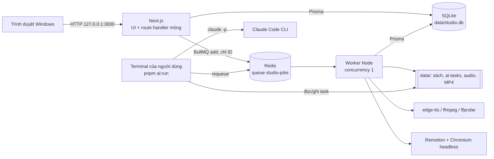
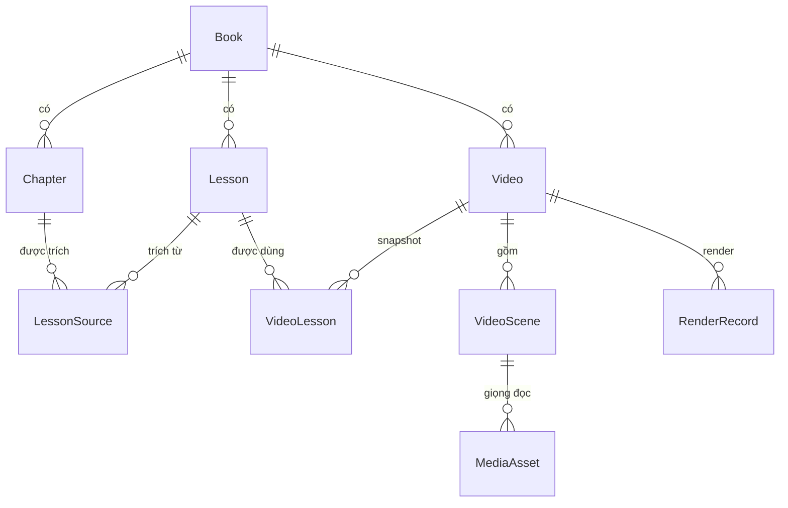
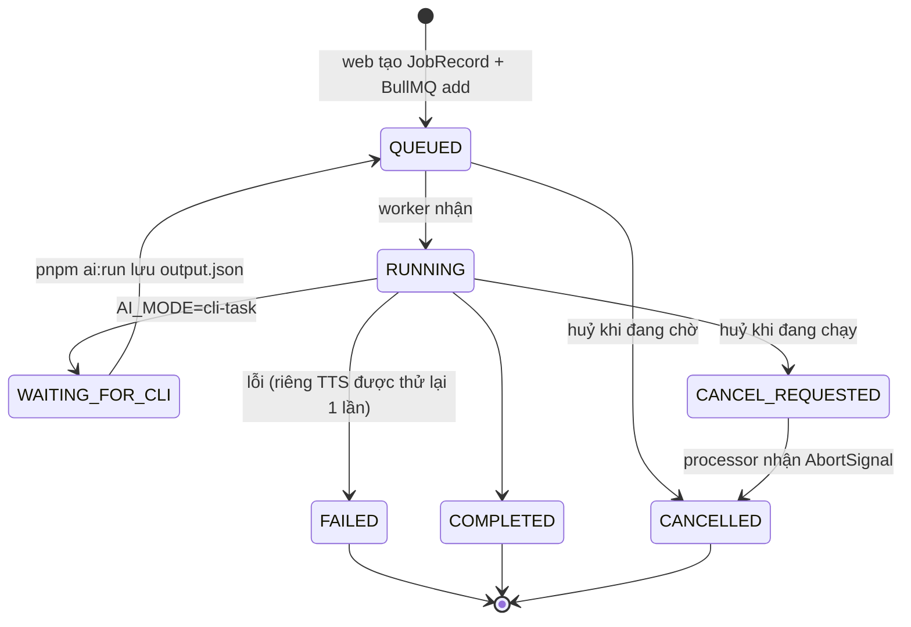
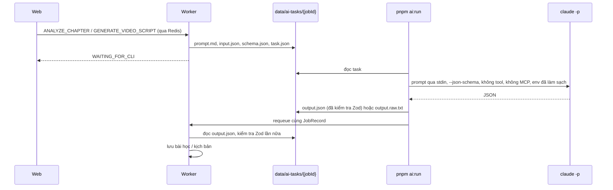
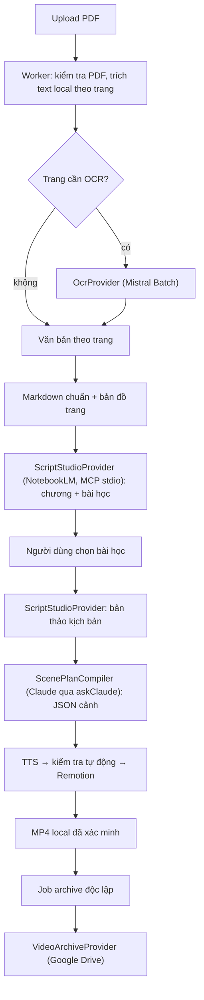

# Kiến trúc Book Video Studio

Tài liệu cho người phát triển: các tiến trình, luồng dữ liệu, vòng đời tác vụ và lý do của các quyết định thiết kế. Quy tắc viết code và ranh giới import nằm ở [`AGENTS.md`](../AGENTS.md); hành vi sản phẩm nằm ở [đặc tả](../BOOK_VIDEO_STUDIO_REQUIREMENTS_VI_v1.1.md).

## 1. Tiến trình



| Tiến trình    | Lệnh                                    | Trách nhiệm                                                                                                                                                             |
| ------------- | --------------------------------------- | ----------------------------------------------------------------------------------------------------------------------------------------------------------------------- |
| Web           | `pnpm dev` / `pnpm start`               | Trang, API route: kiểm tra đầu vào bằng Zod → service → repository. Việc dài chỉ được **xếp hàng** và trả `202 { jobId }`; UI hỏi lại `GET /api/jobs/:id` mỗi 2–3 giây. |
| Worker        | `pnpm worker:dev` / `pnpm worker:start` | Chạy mọi việc nặng: phân tích chương, tạo kịch bản, TTS, render. Một tác vụ một lúc.                                                                                    |
| Redis         | `docker compose up -d`                  | BullMQ — nguồn sự thật về **thực thi** tác vụ.                                                                                                                          |
| `pnpm ai:run` | Người dùng tự chạy                      | Cầu nối duy nhất tới Claude Code CLI. Web và worker không bao giờ tự gọi `claude`.                                                                                      |

Web không phụ thuộc vào Redis/worker để hiển thị: khi chúng tắt, trang vẫn mở và báo trạng thái suy giảm; thao tác cần xếp hàng trả `503 QUEUE_UNAVAILABLE` sau một lệnh `PING` thử (không treo). Worker thì thoát với mã 1 nếu không kết nối được Redis.

## 2. Mô hình dữ liệu



- **Book / Chapter:** tệp gốc lưu nguyên byte kèm SHA-256 và không bao giờ bị sửa; nội dung chương nằm ở `data/books/{bookId}/chapters/{chapterId}.md`. Xoá sách là xoá mềm và bị chặn khi đã có video.
- **Lesson / LessonSource:** bài học thuộc một sách, trích dẫn 1..N chương. Trích đoạn AI đưa ra phải xuất hiện thật trong chương, nếu không sẽ bị loại.
- **VideoLesson** giữ `lessonSnapshotJson` tại thời điểm tạo video, nên sửa bài học sau đó không làm đổi video.
- **Video / VideoScene:** `scriptVersion` tăng mỗi khi kịch bản đổi; `approvedScriptVersion` ghi lại phiên bản đã duyệt. Sửa sau khi duyệt chuyển video về `NEEDS_REVIEW`.
- **RenderRecord** lưu `scriptVersion` lúc render; bản render "lỗi thời" được **suy ra** (`scriptVersion < Video.scriptVersion`), không phải trạng thái lưu, và tệp MP4 cũ không bao giờ bị xoá tự động.
- **JobRecord** là read model/nhật ký của tác vụ cho UI; **AiRun** ghi mỗi lần gọi AI (chế độ, phiên bản prompt, hash đầu vào, đường dẫn đầu ra) — không chứa bí mật.
- Các trường trạng thái kiểu `String` có tập giá trị khai báo trong `features/*/domain` (xem chú thích trong `prisma/schema.prisma`); đường dẫn trong DB luôn **tương đối** với `DATA_DIR`.

## 3. Vòng đời tác vụ



- **Xếp hàng** (`features/jobs/services/job-service.ts` + `job-dispatch.service.ts`): tạo `JobRecord(QUEUED)` **cùng một hàng outbox `JobDispatch`** trong một giao dịch SQLite (`recordJobIntent`) → kiểm tra Redis và `queue.add(type, { jobRecordId, …ID }, { jobId })` → ghi `dispatchedAt`. Payload chỉ chứa ID, không bao giờ chứa văn bản sách hay âm thanh. Redis từ chối ngay (đường nhanh) thì hàng outbox bị xoá và job thành `FAILED` kèm `503 QUEUE_UNAVAILABLE`, như trước.
- **Outbox (`JobDispatch`):** nếu tiến trình chết giữa lúc ghi SQLite và lúc `queue.add`, hàng có `dispatchedAt = null` vẫn còn. Worker quét `sweepDueJobIntents` một lần lúc khởi động (trước `reconcile`) và mỗi 5 giây (`lifecycle/dispatch-sweeper.ts`), giao các hàng tới hạn (`availableAt <= now`, nên cũng giữ được job trì hoãn) rồi mới ghi `dispatchedAt`. Giao lại sau một vụ chết giữa hai bước không nhân đôi job vì BullMQ bỏ qua `add` trùng `jobId`; hàng của job đã huỷ bị bỏ, hàng có payload hỏng làm job `FAILED` (`DISPATCH_FAILED`), còn lỗi Redis chỉ ghi `lastError` và thử lại ở lượt sau. Huỷ job còn nằm trong outbox xoá hàng đó mà không gọi Redis.
- **Dispatcher** (`src/worker/processors/dispatcher.ts`, `createJobDispatcher(processors)`; `processors/index.ts` chỉ đăng ký processor): bỏ qua tác vụ đã huỷ, đánh dấu `RUNNING`, chuyển tiến độ sang cả BullMQ lẫn SQLite, và thăm dò `CANCEL_REQUESTED` mỗi 2 giây để biến nó thành `AbortSignal` cho processor. Processor trả về giá trị đặc biệt "waiting for CLI" thì tác vụ chuyển `WAITING_FOR_CLI` thay vì `COMPLETED`.
- **Trì hoãn (`deferred(retryAfterMs)`):** khi một thao tác từ xa còn đang chờ, processor trả `deferred()` thay vì đứng chờ. Job BullMQ kết thúc (worker rảnh ngay), còn `deferRunningJob` trong một giao dịch đưa `JobRecord` về `QUEUED`, **đổi `bullmqJobId`** (BullMQ nuốt `add` trùng id của job đã xong) và đặt lại hàng outbox với `availableAt = now + retryAfterMs`. Lịch nằm ở SQLite nên sống qua restart worker và cả khi Redis bị xoá; `reconcile` bỏ qua job vì hàng outbox chưa giao. Nếu lúc đó người dùng đã yêu cầu huỷ, dispatcher kết thúc việc huỷ thay vì đặt lịch. Cơ chế đã có, chưa processor nào dùng (OCR Batch sẽ dùng ở nhóm B).
- **Idempotent:** BullMQ giao ít nhất một lần, nên processor kiểm tra trạng thái trước khi làm (ví dụ render đã `COMPLETED` thì trả kết quả cũ; task AI đã có `output.json` thì dùng lại).
- **Khoá video khi đang tạo kịch bản:** khi một tác vụ `GENERATE_VIDEO_SCRIPT` của video còn mở (`QUEUED`, `RUNNING`, `WAITING_FOR_CLI`, `CANCEL_REQUESTED`) — cả tác vụ tạo cả kịch bản (entity `VIDEO`) lẫn tác vụ viết lại một cảnh (entity `SCENE`, tìm theo các cảnh của video, xem `findActiveVideoJob()`) — mọi service người dùng gọi để đổi video (cài đặt, hook, cảnh, giọng đọc, duyệt, render, xoá) đều gọi `assertScriptNotGenerating()` và trả `409 SCRIPT_GENERATION_IN_PROGRESS`; giao diện tắt các control tương ứng (`ScriptLock`). Một yêu cầu trùng đích (cùng cảnh, hoặc cả kịch bản khi tác vụ cả kịch bản đang mở) không bị từ chối mà nhận lại tác vụ đang chạy. Worker ghi kịch bản qua repository nên không bị chính tác vụ của nó chặn.
- **Thử lại / huỷ:** "Thử lại" tạo tác vụ mới; huỷ khi đang chờ xoá job khỏi BullMQ, khi đang chạy thì ghi `CANCEL_REQUESTED`. Khi tác vụ kết thúc, `job-effects.ts` trả thực thể (chương, render…) về trạng thái phù hợp.
- **Khởi động / dừng worker:** `lifecycle/reconcile.ts` đối soát JobRecord đang mở với BullMQ (job biến mất → `FAILED` kèm hướng dẫn thử lại); `heartbeat.ts` ghi khoá Redis có TTL để web biết worker còn sống; `shutdown.ts` đóng worker khi nhận SIGINT/SIGTERM, tối đa 15 giây rồi thoát hẳn (job dở được BullMQ coi là stalled và được đối soát ở lần chạy sau).

## 4. AI



- Giao diện `AiProvider` (`src/server/ai/ai-provider.ts`) có ba bản, chọn bằng `AI_MODE`: `MockAiProvider` (`mock`, tất định, không mạng), `LocalCliTaskProvider` (`cli-task`, sơ đồ trên) và `AutomatedCliProvider` (`cli-auto`, tuỳ chọn): kế thừa `LocalCliTaskProvider`, vẫn ghi đủ tệp tác vụ, nhưng worker gọi `askClaude()` ngay thay vì chờ `pnpm ai:run`. Cả hai đường CLI dùng chung `cli-task/ask-claude.ts` (cùng cờ, cùng env đã làm sạch, cùng phân loại lỗi); `AbortSignal` của tác vụ được truyền tới tiến trình `claude` để **Huỷ** dừng được nó.
- Prompt có phiên bản (`chapter-analysis-v1`, `video-script-v1`). Văn bản sách được bọc trong khối dữ liệu không đáng tin (`prompts/untrusted-text.ts`), và mỗi lần chỉ gửi một chương hoặc các bài học đã chọn — không bao giờ cả cuốn sách.
- Đầu ra luôn qua Zod (`contracts/`); JSON Schema gửi cho Claude được sinh từ chính các schema đó (draft-7). Sai schema → `FAILED`, không lưu gì.
- Lỗi Claude CLI được phân loại thành mã ổn định (`AI_CLI_AUTH`, `AI_QUOTA_EXCEEDED`, `AI_CLI_TIMEOUT`, `AI_CLI_MISSING`, `AI_CLI_ERROR`) và không tự thử lại.

## 5. Giọng đọc

`GENERATE_SCENE_TTS` → `features/videos/services/tts-runner.ts`: tính khoá cache `hash(TTS_ENGINE_VERSION, giọng, tốc độ, lời dẫn)`; nếu chưa có thì chạy `edge-tts` bằng mảng tham số (lời dẫn đi qua tệp, không qua dòng lệnh), cắt khoảng lặng đầu/cuối bằng ffmpeg, đo thời lượng bằng ffprobe, lưu `MediaAsset(VOICEOVER)` rồi gắn vào cảnh. Âm thanh tải lên đi qua `audio.service.ts` (kiểm tra kích thước và chữ ký tệp MP3/WAV) và chỉ được đo, không bị sửa. Độ dài cảnh = thời lượng âm thanh + `SCENE_AUDIO_PADDING_MS`.

## 6. Xem trước và render

- Trình biên tập video (`EditorWorkspace`) ghim khung xem trước bên phải khi viewport ≥ 1280 px và chỉ mount **một** Player (`useMediaQuery`); dưới ngưỡng đó Player là tab cuối. Nó phụ thuộc `<main>` dùng `overflow-x: clip`: `overflow-x: hidden` biến `<main>` thành scroll container và làm `position: sticky` mất tác dụng.
- Giao diện sáng/tối: `next-themes` (`ThemeProvider`, lưu ở `localStorage[studio-theme]`, mặc định theo hệ thống) bật class `dark` trên `<html>`; mọi màu đi qua token trong `globals.css`. Poster video và màu thanh trạng thái là màu cố định vì đại diện cho video thật.
- `toCompositionProps()` (`features/videos/domain/composition-props.ts`) là nơi duy nhất biến video thành props cho composition `ShortVideo`. Remotion Player trong trình duyệt và bản render trong worker dùng chung hàm này, nên hai bên luôn giống nhau.
- Code trong `src/remotion/` là React thuần: chỉ nhận props đã kiểm tra bằng Zod, không đọc `process.env`, DB hay mạng. Font Be Vietnam Pro được đóng gói trong `public/fonts`.
- Render (`render-runner.ts` → `server/render/render-short-video.ts`): 0. dùng **snapshot bất biến** chụp lúc yêu cầu render (`RenderRecord.snapshotJson`, xem §11), không đọc video hiện tại;
  1. kiểm tra trước (`domain/preflight.ts`, chạy trên snapshot) — bản cuối bị chặn nếu còn lỗi;
  2. mở một asset server tạm ở `127.0.0.1:<cổng ngẫu nhiên>` chỉ phục vụ các tệp giọng đọc của video;
  3. bundle composition (một lần mỗi tiến trình worker, có alias `@/` qua `webpack-override.ts`);
  4. `renderMedia` H.264 + AAC, BT.709, `concurrency = RENDER_CONCURRENCY`; bản nháp dùng `scale = 720/1080` trên cùng composition 1080×1920;
  5. ghi ra tệp tạm rồi đổi tên; ffprobe kiểm tra codec, kích thước, FPS và thời lượng (bản cuối không được vượt preset);
  6. lỗi hoặc huỷ **trước khi ghi hoàn tất** → xoá tệp dở, `RenderRecord` thành `FAILED` / `CANCELLED`; sau khi bản ghi đã `COMPLETED` thì không còn gì được phép xoá MP4 hay đổi trạng thái (xem §11, D11).
- Vùng an toàn chỉ là lớp phủ trong editor (`domain/safe-zones.ts`); nội dung được đặt trong vùng an toàn chặt nhất của cả ba nền tảng nên một bản render dùng được cho mọi nơi.

## 7. Phân lớp mã

```
app (page, route)  →  features/*/services  →  features/*/repositories  →  server/db
                             │
                             └→ features/*/domain (thuần, không I/O — dùng được ở client, worker, Remotion)
worker/processors  →  features/*/services (*-runner.ts)  →  server/{ai,tts,media,render,storage}
```

- `server-only` ném lỗi ngoài bundler của Next, nên chỉ module **chỉ dành cho web** (producer hàng đợi, `job-service`, `job-control.service`, route helpers, các `*-request.service.ts`) được import nó. Mọi thứ worker và `scripts/` dùng phải không có `server-only`.
- `@remotion/bundler` / `@remotion/renderer` chỉ xuất hiện trong module của worker.
- ESLint (`eslint.config.mjs`) chặn component client import Prisma, Redis, `node:*` hay `@/server`, và chặn Remotion đọc `process.env` hoặc import service.

## 8. Lưu trữ và bảo mật

- Mọi đường dẫn đi qua `server/storage/safe-path.ts`: chặn `..`, symlink thoát khỏi `DATA_DIR` và vị trí dưới `/mnt/`. Thư mục đặt theo ID, không theo tên sách.
- Ghi tệp theo kiểu tạm-rồi-đổi-tên; tệp gốc của sách ở chế độ chỉ đọc.
- Tiến trình con luôn chạy bằng `spawn`/`execFile` với mảng tham số, không bao giờ ghép chuỗi shell. `pnpm ai:run` loại bỏ biến môi trường phiên Claude Code và mọi biến kiểu API key trước khi gọi `claude`, không bao giờ dùng `--dangerously-skip-permissions`.
- Log là JSON, chỉ chứa ID và hash — không chứa văn bản chương hay bí mật. Chỉ lắng nghe `127.0.0.1`; không có xác thực nên không được mở ra mạng.

## 9. Kiểm thử

| Lớp         | Công cụ                      | Phạm vi                                                                                            |
| ----------- | ---------------------------- | -------------------------------------------------------------------------------------------------- |
| Unit        | Vitest (`tests/unit`)        | Parser chương, đường dẫn an toàn, env, domain bài học/video/audio/render, phân loại đầu ra Claude  |
| Integration | Vitest (`tests/integration`) | Service + repository trên SQLite tạm với migration thật; provider CLI; các tình huống lỗi          |
| E2E         | Playwright (`tests/e2e`)     | Stack riêng (DB tạm, Redis DB 14, worker, `next start` cổng 3100) chạy trọn E2E-01 tới ffprobe MP4 |

## 10. Các quyết định chính

| Quyết định                                                | Lý do                                                                                                                                      |
| --------------------------------------------------------- | ------------------------------------------------------------------------------------------------------------------------------------------ |
| Hai tiến trình (web + worker), một queue                  | Render và TTS chiếm CPU/RAM nhiều phút; tách khỏi web để UI luôn phản hồi. Một queue với concurrency 1 đủ cho một người dùng trên máy yếu. |
| SQLite + WAL                                              | Một người dùng, cục bộ, sao lưu chỉ là sao chép một thư mục.                                                                               |
| BullMQ là nguồn sự thật thực thi, JobRecord là read model | UI đọc nhanh từ SQLite; đối soát khi khởi động xử lý mất đồng bộ (Redis bị xoá, worker chết giữa chừng).                                   |
| AI qua tác vụ do người dùng chạy                          | Không dùng API key; mọi lần gọi Claude do người dùng chủ động, đúng tinh thần dùng cá nhân của Claude Code.                                |
| Trạng thái kiểu `String` cho vài trường                   | Tập giá trị sống trong domain TypeScript; thêm giá trị không cần migration SQLite.                                                         |
| Asset server cục bộ khi render                            | Remotion render trong Chromium cần URL cho âm thanh; phục vụ đúng các tệp của video qua `127.0.0.1` tránh lộ toàn bộ `data/`.              |
| Composition dùng chung Player và render                   | Bản xem trước là bản sẽ được render — không có hai bộ layout lệch nhau.                                                                    |

## 11. Kiến trúc đích v1.2 (chưa triển khai)

> Mọi thứ từ §1 tới §10 mô tả mã **đang chạy**. Mục này mô tả đích của `plan.md` (đặc tả: [§23](../BOOK_VIDEO_STUDIO_REQUIREMENTS_VI_v1.1.md)). Từng đoạn chỉ được chuyển vào các mục trên khi code tương ứng chạy thật; bảng hiện trạng nằm ở §23.7 của đặc tả và nhật ký task ở `plan.md` §5.



| Port                   | Việc của port                                   | Điều adapter giữ kín (không lộ ra service)                      |
| ---------------------- | ----------------------------------------------- | --------------------------------------------------------------- |
| `OcrProvider`          | Bắt đầu xử lý, đọc trạng thái, lấy kết quả, hủy | Trạng thái Batch, file ID, giới hạn Mistral, định dạng phản hồi |
| `ScriptStudioProvider` | Phân tích nguồn, rút bài học, viết bản thảo     | Tên tool MCP, notebook/source ID, envelope lỗi của NotebookLM   |
| `ScenePlanCompiler`    | Chuyển bản thảo thành JSON cảnh hợp lệ          | Prompt, cờ CLI, cách phân loại lỗi Claude                       |
| `VideoArchiveProvider` | Chuẩn bị đích, upload, đối soát, xác minh       | OAuth, session upload, folder/file ID, quota của Google         |

- **Service nhận port qua tham số**, factory chọn implementation; hợp đồng OCR cho phép cả "xong ngay" lẫn "cần chờ" nên provider không dùng Batch vẫn khớp.
- **Một queue, một worker, concurrency 1.** Submit / poll / collect của OCR là các job ngắn, không giữ worker chờ Batch nhiều giờ; worker không enqueue job con rồi đứng chờ. Cơ chế outbox và job trì hoãn được thiết kế ở A05–A06 và sẽ được mô tả ở đây khi có code.
- **Năm loại dữ liệu khác nhau:** PDF gốc (bất biến) → bản trích xuất (dẫn xuất) → catalogue (chương, bài học, nguồn) → bản thảo NotebookLM → kế hoạch cảnh Claude (đầu vào duy nhất của Remotion) → snapshot render (bất biến, nguồn của manifest Drive). Bản thảo không bao giờ được ghi vào chỗ chứa kết quả Claude.
- **Tải PDF (B02, `POST /api/books/import/pdf`):** thân request chính là PDF thô (không multipart); route đọc `ReadableStream` rồi `server/storage/stream-to-file.ts` ghi từng chunk ra `data/imports/<id>/` đồng thời băm SHA-256 và đếm byte, nên sách 500 MiB không bao giờ nằm trong RAM. Chữ ký `%PDF-` được kiểm tra trên chính các byte (tên tệp và Content-Type chỉ là lời khai), vượt `MAX_PDF_SIZE_MB` thì dừng đọc ngay, và huỷ upload hay lỗi giữa chừng xoá sạch tệp dở. Thành công thì tệp được đổi tên nguyên bản sang `data/books/<bookId>/original.pdf` (chỉ đọc), tạo `Book` (`sourceFormat: pdf`) cùng `BookExtraction(QUEUED)` trong một giao dịch và trả `202`. **Chưa có bước nào chạy tiếp lần trích xuất đó** cho tới khi B04 thêm job; PDF trùng hash với sách đang có bị từ chối `409 DUPLICATE_BOOK`.
- **Client Mistral (B07, `server/ocr/mistral/mistral-client.ts`):** REST có kiểu, mọi phản hồi qua Zod, upload tệp **bằng `file_id`** (`purpose: ocr` cho tài liệu, `batch` cho JSONL; không bao giờ cần URL công khai) và stream từ đĩa (`openAsBlob`). Lỗi quy về `IntegrationError`: 401/403 `AUTH`, 429 `QUOTA` (giữ `Retry-After`), 5xx/timeout/ngắt kết nối/phản hồi hỏng của một thao tác **ghi** là `UNKNOWN_OUTCOME` (có thể đã thực hiện), của thao tác đọc là `TRANSIENT`/`REJECTED`. Khóa API chỉ ở trong đối tượng client, không vào lỗi/log. Signal đã huỷ thì không gửi gì (còn tránh lỗi undici: `fetch` với `FormData` và signal đã abort để lại unhandled rejection làm sập worker). **Giả định chưa được tài liệu công khai xác nhận, phải kiểm chứng ở G07:** model `mistral-ocr-4-1` có tồn tại (các nguồn chỉ nói tới `mistral-ocr-4-0`/alias), đơn giá batch $2/1.000 trang, cách `/v1/ocr` tham chiếu tệp đã upload, dạng một dòng JSONL kết quả, và cơ số của chỉ số trang trong phản hồi.
- **Điều phối production (D12, `RUN_PRODUCTION_ITEM`, `runProductionPipeline`, `production-control.service.ts`):** mỗi item có **một job** được ghi **cùng giao dịch** với thay đổi làm item chạy được (tạo đợt sản xuất, retry), outbox giao job; web không đụng Redis khi tạo đợt. Processor claim item (lease 10 phút) rồi đi từng bước từ checkpoint: `NONE` viết bản thảo (`ScriptStudioProvider`) → `DRAFTED` biên dịch cảnh → `COMPILED` áp dụng → `APPLIED` lồng tiếng → `VOICED` readiness → `READY` xếp render `FINAL` qua outbox (`queueFinalRender`: chụp snapshot, dùng lại bản render đang chạy hoặc đã xong cùng `scriptVersion`) → `RENDERED`. Bản thảo và kế hoạch cảnh được lưu trên item (`draftArtifactJson`, `scenePlanArtifactJson`) nên chạy lại **không lặp bước đã xong**. Processor **không bao giờ chờ**: render đang chạy (kiểm tra lại sau 15 giây) hay lỗi tạm thời (quota/mất mạng: 30 giây nhân đôi tới 10 phút, tối đa 5 lần rồi `FAILED` kèm lý do) trả `deferred`, item thành `WAITING` và cùng job quay lại qua outbox. Kết quả AI sai (`DRAFT_INVALID`, `INVALID_AI_OUTPUT`, …) dùng lượt sửa duy nhất (D09); lỗi `REJECTED`/`AUTH` khác thất bại ngay. Item còn bị giữ lease (worker trước chết giữa bước) thì job hẹn lại lúc lease hết thay vì bỏ item. **Huỷ** (`POST /api/productions/:id/cancel`, thân `{ itemId? }`, hoặc huỷ job ở trang Tác vụ) đặt item `CANCELLED`, dừng job của item và render đang xếp; bước đang chạy làm xong nhưng **không bước nào sau đó bắt đầu**, và trạng thái huỷ thắng mọi kết quả người giữ báo về. **Thử lại** (`POST /api/productions/:id/retry`, thân `{ itemId? }`, hoặc thử lại job ở trang Tác vụ) đưa item `FAILED`/`CANCELLED` về `PENDING` từ checkpoint cũ (xoá lỗi, bộ đếm lỗi tạm, liên kết render; lượt sửa AI vẫn đã dùng) với một job mới; hai lần thử lại đua nhau chỉ tạo một job. Lỗi bất ngờ ghi item `FAILED` (`PRODUCTION_STEP_ERROR`) để item không bao giờ "đang chạy" mà không có job. Khi worker khởi động, sau `reconcileJobRecords`, `reconcileProductionItems` cấp job mới cho item còn chạy được mà mất job (chỉ lúc khởi động, để lỗi lặp không thành vòng). Trạng thái batch là read model tính lại từ các item mỗi khi một item đổi trạng thái. Chế độ `mock` dùng `MockScriptStudioProvider`; `cli-auto` báo `SCRIPT_STUDIO_NOT_AVAILABLE` cho tới khi có adapter NotebookLM (nhóm C).
- **Tách lỗi render khỏi hậu xử lý (D11, `runRender`):** `runRender` có hai pha. Pha render (`produceRender`: snapshot → preflight → Remotion → ffprobe → kiểm tra → **ghi `COMPLETED`**) làm trọn hoặc không gì cả: lỗi hay huỷ ở đây xoá tệp dở và đánh `FAILED`/`CANCELLED`. Sau khi bản ghi đã hoàn tất, chỉ còn pha hậu xử lý (báo tiến độ 100%) chạy **ngoài** khối bắt lỗi của pha render: lỗi ở đó (Redis/DB báo tiến độ) chỉ ghi cảnh báo và **không bao giờ xoá MP4 hay lật trạng thái** — trước đây `await run.onProgress(100)` nằm chung khối `try` nên một lỗi báo tiến độ sẽ xoá MP4 vừa render xong. Ý định lưu trữ được ghi **bền trong cùng bản cập nhật hoàn tất**: `RenderRecord.archiveIntentAt` được đặt đồng thời với `status = COMPLETED` cho bản FINAL (nháp thì không), nên dù hàng đợi, Redis hay tiến trình hỏng ngay sau đó ý định vẫn còn; bước lưu trữ (E10) đọc cờ này thay vì phải chờ một job được enqueue đúng lúc, và không bao giờ cần render lại. Bản ghi đã `COMPLETED` chạy lại là no-op (không render lại, không đụng tệp). `renderVideo` và `probe` được truyền qua tham số `RenderDeps` để kiểm thử mà không cần Chromium.
- **Snapshot render bất biến (D10, `RenderSnapshot`, `captureRenderSnapshot`, `resolveRenderSnapshot`):** lúc yêu cầu render, `requestRender` chụp **mọi thứ bản render được làm từ**: các cảnh theo thứ tự (lời dẫn, chữ, bố cục, thời lượng, ẩn/hiện), các tệp audio theo đường dẫn lưu (tên theo hash nội dung nên byte không đổi) kèm độ lặng đầu, nguồn của từng bài học, kích thước/chất lượng, `scriptVersion`, trạng thái cổng duyệt tại lúc đó (`status`, `autoReady`) và `RENDER_TEMPLATE_VERSION` + id composition; lưu vào `snapshotJson` cùng `snapshotHash` (sha256 JSON có khoá sắp xếp) và **không bao giờ ghi đè** (`saveRenderSnapshotIfMissing` chỉ ghi khi chưa có). `runRender` dựng props Remotion, chạy preflight, phục vụ audio và kiểm tra thời lượng **từ snapshot**, nên sửa kịch bản/audio/tên bài học trong lúc bản render chờ hay chạy không bị trộn vào, và preflight được đánh giá trên đúng dữ kiện lúc yêu cầu (một video đã đổi thành không hợp lệ không làm hỏng bản render đã xếp hàng; bản render vẫn bị đánh dấu _lỗi thời_ theo `scriptVersion`). Một ràng buộc ESLint cấm `render-runner.ts` import `video.service`/`video-mapper`/`video.repository` để nó không quay lại đọc video sống. Snapshot được kiểm khi đọc (đúng schema, hash không đổi: `RENDER_SNAPSHOT_CORRUPT`); cảnh trỏ tới audio đã mất bị từ chối to (`RENDER_AUDIO_MISSING`) thay vì render im lặng, và runner kiểm từng tệp audio còn tồn tại. Bản ghi xếp hàng **trước** khi có snapshot thì được chụp từ video hiện tại lúc chạy rồi lưu lại. `stableStringify` chuyển sang `src/shared/stable-json.ts` vì dùng ở cả handoff và snapshot. Bản manifest Drive (E08) sẽ lấy từ snapshot này.
- **Một lượt sửa AI mỗi video (D09, `planCorrection`, `requestAiCorrection`):** sau một bước thất bại, mỗi video chỉ có **một** lượt sửa AI chung, và nó đi tới đúng bước sửa được: vấn đề **nội dung/nguồn** (`SOURCE_MISSING`, `DRAFT_INVALID`) về bước bản thảo (NotebookLM, lùi checkpoint về `NONE`); vấn đề **biên dịch/độ dài** (`OVER_TARGET`, `OVER_MAX`, `HOOK_TOO_LONG`, `HOOK_MISSING`, `NO_SCENES`, `EMPTY_TEXT`, `INVALID_AI_OUTPUT`, `SCENE_PLAN_UNSUPPORTED_CLAIM`) về bước biên dịch (Claude, lùi về `DRAFTED`). Có cả hai loại thì chọn bước sớm hơn (biên dịch vẫn chạy lại sau đó), và lời nhắn vẫn nêu mọi vấn đề để bản thảo mới cũng đúng độ dài. Vấn đề AI không sửa được (`AUDIO_NOT_READY`, `SCRIPT_CHANGED`, mã lạ) trả `NOT_CORRECTABLE` và **không tiêu** lượt sửa. Lời nhắn (≤ 600 ký tự, từ chính hệ thống chứ không phải văn bản sách) luôn dặn rút gọn thay vì **tăng preset hay đọc nhanh hơn**; code không bao giờ đụng `targetDurationSec` hay tốc độ TTS, nên video không vừa thì thất bại chứ không bị ép cho vừa. Việc tiêu lượt sửa là **một câu `UPDATE` có điều kiện** (đúng người giữ, `aiCorrectionTarget` còn trống, chỉ lùi hoặc giữ nguyên checkpoint) nên khi nhiều lời gọi đồng thời đúng một cái thắng (`CORRECTION_STARTED`), các cái còn lại `BUDGET_SPENT` (video nên thất bại cùng các vấn đề đó); tiến checkpoint bị từ chối. Điều kiện người giữ nằm cả trong chính câu lệnh để mất khoá sau lúc kiểm tra cũng không tiêu được lượt sửa. Cột `aiCorrectionTarget`/`aiCorrectionNote` đọc bởi bộ điều phối (D12) để truyền `revisionNote` cho `writeDraft` hoặc `compile`.
- **Readiness tự động thay cho duyệt tay (D08, `assessReadiness`, `markProductionItemReady`):** sau khi mọi cảnh có audio, bước `READY` chạy kiểm tra máy làm thay người duyệt kịch bản. `assessReadiness` áp mọi quy tắc **chặn** của preflight FINAL (HOOK trong 4 giây **theo audio thật**, tổng không vượt preset — không cắt lời, không nâng preset —, có HOOK và chữ trên màn hình) và thêm hai quy tắc chỉ có nghĩa sau khi đã có giọng: mọi cảnh hiển thị có audio (`AUDIO_NOT_READY`) và mọi lesson còn trích đoạn nguồn (`SOURCE_MISSING`); nó báo **tất cả** vấn đề một lượt để một lần sửa xử lý gộp. Đạt thì ghi `Video.autoReadyScriptVersion = scriptVersion` (CAS: nếu kịch bản đã đổi trong lúc kiểm tra thì không ghi, `SCRIPT_CHANGED`) rồi chuyển item `VOICED → READY`. **Không giả duyệt**: trạng thái video vẫn `NEEDS_REVIEW`, `approvedScriptVersion` vẫn `null` vì không ai duyệt. Cổng "chưa duyệt" của preflight FINAL (`SCRIPT_NOT_APPROVED`) giờ chấp nhận _hoặc_ `APPROVED` (người duyệt, luồng cũ giữ nguyên) _hoặc_ `autoReady` (`DTO`: `autoReadyScriptVersion` khớp `scriptVersion` hiện tại); sửa kịch bản hay audio sau đó làm tăng `scriptVersion` nên readiness tự mất hiệu lực và render FINAL lại bị chặn. Không đạt thì item **không đổi gì** và trả danh sách vấn đề cho bước sửa (D09). `requireHeldProductionItem`/`outOfOrder` là kiểm tra chung cho mọi bước (item tồn tại, còn giữ, có video).
- **Giọng đọc tuần tự có checkpoint (D07, `voiceProductionItem`, `voiceVideoScenes`):** bước `VOICED` lặp **một cảnh một lúc, đúng thứ tự** qua các cảnh hiển thị còn thiếu audio (edge-tts là dịch vụ trực tuyến và worker chạy một tác vụ một lúc, gọi song song chỉ làm chạm giới hạn của nó), dùng nguyên `runSceneTts` nên được cache theo hash `(phiên bản engine, giọng, tốc độ, lời dẫn)`: cảnh có lời dẫn giống một lần đã tổng hợp thì chỉ gắn lại audio, không gọi dịch vụ. Dừng sớm (lỗi hoặc huỷ — kiểm tra `AbortSignal` trước mỗi cảnh) **giữ nguyên audio đã tạo**, và vì checkpoint chỉ chuyển `APPLIED → VOICED` (CAS có điều kiện, đúng một bước và chỉ khi còn giữ item) sau khi **mọi** cảnh có audio, lần chạy lại tự tiếp tục từ cảnh đầu tiên chưa có audio mà không đọc lại các cảnh trước. Item đã `VOICED` trả `ALREADY_VOICED` mà không gọi gì; sai bước hoặc mất khoá bị từ chối. `synthesize` được truyền vào qua tham số (mặc định `runSceneTts`) để kiểm thử; cần `TTS_MODE=edge-tts` (với `upload` thì `TTS_DISABLED`). Test dùng fake edge-tts sinh MP3 thật bằng ffmpeg để chạy cả cắt lặng, đo và lưu.
- **Áp dụng kế hoạch cảnh đúng một lần (D06, `applyScenePlan`):** `applyScenePlanOnce` chạy trong một giao dịch mà **câu lệnh đầu tiên là `UPDATE` có điều kiện** (item do người gọi giữ, có video, đang ở checkpoint `COMPILED`) nên giao dịch lấy khoá ghi trước khi đọc gì (tránh lỗi nâng cấp khoá của SQLite WAL) và trong nhiều người gọi chỉ một thắng; thắng thì mới ghi cảnh (HOOK + các cảnh theo mạch kể, `hookOptionsJson = [hook]`) qua `replaceScriptWithin` — **cùng một đường ghi** với luồng thủ công (`replaceScript` giờ chỉ bọc nó) — rồi đặt `checkpoint = APPLIED` và `appliedPlanFingerprint`. Các trường hợp còn lại được phân loại **không ghi cảnh nào**: áp dụng lại cùng kế hoạch là `ALREADY_APPLIED` (cảnh, id cảnh và audio đã gắn vẫn nguyên, `scriptVersion` không đổi — đây là cái giữ audio khỏi mất khi replay), mất khoá là `PRODUCTION_CLAIM_LOST`, sai bước hoặc **kế hoạch khác khi đã áp dụng một kế hoạch** là `PRODUCTION_STEP_OUT_OF_ORDER` (muốn áp dụng kế hoạch khác thì phải lùi checkpoint có chủ đích, việc của lượt sửa ở D09). Artifact được kiểm lại fingerprint trước khi áp dụng (`INVALID_SCENE_PLAN_ARTIFACT`). **Khoá chỉnh sửa mở rộng:** `assertScriptNotGenerating` giờ còn chặn (`409 VIDEO_IN_PRODUCTION`) khi video thuộc một item đang `PENDING`/`RUNNING`/`WAITING`; hết khoá khi item `COMPLETED`/`FAILED`/`CANCELLED`. Khoá hiện có cho tác vụ tạo kịch bản/viết lại cảnh giữ nguyên. Bộ điều phối ghi qua repository nên không bị khoá của chính nó; nhưng đường yêu cầu render dành cho người dùng cũng bị khoá này, nên D11/D12 phải enqueue render theo đường riêng. UI chưa hiện khoá này (chỉ trả 409), việc của F04.
- **Bộ biên dịch cảnh bằng Claude (D05, `ClaudeScenePlanCompiler`, `createScenePlanCompiler(mode)`):** dùng đúng `askClaude()` như mọi tác vụ Claude (không viết runner thứ hai). Tác vụ đặt tên theo **chính đầu vào** (`scene-plan-<sha256 24 ký tự>` của bản thảo + snapshot lesson + độ dài + ghi chú sửa + phiên bản prompt) nên hỏi lại cùng đầu vào thì dùng kết quả đã lưu mà không tốn thêm lượt Claude, còn đổi bất kỳ thứ gì là tác vụ mới. CLI bị siết thêm `--strict-mcp-config` (không nạp MCP server nào từ cấu hình của người dùng) bên cạnh `--tools ""`; prompt `scene-plan-v1` bọc bản thảo và bài học như dữ liệu không đáng tin, cấm thêm trích dẫn/số liệu/khẳng định ngoài nguồn, giữ minh hoạ là minh hoạ và buộc mạch kể + ngân sách âm tiết. Sau khi Claude trả về, `findUnsupportedClaims` chặn **cơ học** mọi số hoặc câu trích dẫn không có trong bản thảo hay bài học (so sánh sau chuẩn hoá NFC/chữ thường/khoảng trắng, dấu thập phân phẩy hay chấm như nhau); đây chỉ là lưới an toàn cho quy tắc của prompt, không chứng minh được sự trung thực (một khẳng định bịa không dùng số hay dấu trích dẫn vẫn lọt), nên kế hoạch bị từ chối (`SCENE_PLAN_UNSUPPORTED_CLAIM`, `REJECTED`, kèm danh sách số/trích dẫn) và **không được lưu**, để lượt sửa duy nhất hỏi lại được. Lỗi CLI quy về `IntegrationError` (`AI_CLI_AUTH`→`AUTH`, `AI_QUOTA_EXCEEDED`→`QUOTA`, `INVALID_AI_OUTPUT`/`AI_CLI_MISSING`→`REJECTED`, timeout/lỗi chung→`TRANSIENT`). `MockScenePlanCompiler` (`AI_MODE=mock`) biến từng beat thành cảnh mà không sửa chữ; `cli-task` bị từ chối (`AI_MODE_UNSUPPORTED`) vì sản xuất hàng loạt không thể chờ người chạy `pnpm ai:run` cho từng video.
- **Hợp đồng handoff giữa các bước (D04, `server/scene-plan/handoff.ts`):** hai artifact tách biệt, **không bao giờ trộn**: _bản thảo_ do script studio (NotebookLM) viết (`script-draft-v1`) và _kế hoạch cảnh cuối_ do Claude biên dịch (`scene-plan-v1`). Mỗi artifact có `schemaVersion` và `fingerprint` riêng (sha256 của JSON có khoá sắp xếp, chỉ băm đúng các trường tham gia): fingerprint bản thảo gồm nội dung bản thảo, `contentHash` của lesson đã chụp và độ dài đích; fingerprint kế hoạch gồm kế hoạch, **fingerprint của bản thảo nguồn**, phiên bản prompt và độ dài đích — nên đổi bản thảo, prompt hay preset thì kế hoạch cũ không được dùng lại, và NotebookLM thành công / Claude lỗi chỉ chạy lại Claude. Schema tự kiểm tra lại fingerprint khi đọc nên artifact bị sửa tay hoặc hỏng bị từ chối. Loại tác vụ `scene-plan` được thêm vào `TASK_OUTPUT_SCHEMAS` (đầu ra = `scenePlanSchema`, đã gồm contract thứ tự mạch kể) và `scenePlanTaskInputSchema` mô tả `input.json` (bản thảo + snapshot lesson, không kèm fingerprint). Bản thảo không bao giờ được ghi vào `output.json` của tác vụ Claude. Việc lưu hai artifact thuộc D06/C09; bộ biên dịch dùng `askClaude()` thuộc D05.
- **Chọn bài học để sản xuất (D02, `POST /api/productions`, `GET /api/productions/:id`):** nhận `bookId`, `lessonIds` (thứ tự chọn thành thứ tự item), preset (90 giây vẫn cần `extended: true` như luồng cũ) và `idempotencyKey`. `requestProduction` kiểm tra mọi bài học thuộc cùng sách (`LESSON_NOT_IN_BOOK`), không `ARCHIVED`, và **đủ nguồn** (có ít nhất một trích đoạn không rỗng, `LESSON_SOURCE_MISSING` kèm danh sách), rồi ghi **trong một nested create**: batch + một item + một `Video` (kèm `VideoLesson` snapshot dựng bằng `buildLessonSnapshot`, dùng chung với `createVideo`) cho mỗi lesson — có đủ tất cả hoặc không có gì. **Chọn không phải duyệt**: không cần lesson `APPROVED` và không đổi trạng thái lesson. Chống nhân đôi: cùng khoá + cùng nội dung (`fingerprint` = sha256 của sách, danh sách lesson theo thứ tự, preset) trả lại batch cũ (`reused: true`, vẫn `202`, kể cả khi lesson đã bị lưu trữ từ đó), cùng khoá khác nội dung là `409 IDEMPOTENCY_KEY_REUSED`, và nhiều lần gửi đua nhau cùng khoá chỉ tạo một batch nhờ ràng buộc duy nhất (bên thua bắt `P2002` rồi trả batch của bên thắng). Snapshot không đổi khi sửa lesson sau đó. Mỗi item có job `RUN_PRODUCTION_ITEM` ghi cùng giao dịch (D12).
- **Production batch (D01):** `ProductionBatch` (một yêu cầu sản xuất trên các lesson người dùng chọn trong **một** sách; `idempotencyKey` duy nhất, `fingerprint` để nhận ra cùng khóa nhưng khác nội dung) và `ProductionItem` (**một lesson = một item = một video**: duy nhất theo `(batchId, lessonId)` và `(batchId, position)`, `videoId` duy nhất và đặt ngay khi tạo item để thử lại dùng lại video, `lessonId` là `Restrict` nên không xoá cứng lesson khi còn production trỏ tới). Item có `status` (`PENDING`/`RUNNING`/`WAITING`/`COMPLETED`/`FAILED`/`CANCELLED`) tách khỏi `checkpoint` (`NONE → DRAFTED → COMPILED → APPLIED → VOICED → READY → RENDERED`, bước cuối đã xong) để khởi động lại tiếp tục sau bước đã làm; trạng thái batch chỉ là read model suy ra từ item (`deriveBatchStatus`). `claimProductionItem` là **lease nguyên tử** (`UPDATE ... WHERE` một câu lệnh): trong nhiều worker đồng thời đúng một người nhận được item, lease hết hạn thì nhận lại được, chỉ người đang giữ mới gia hạn/nhả được, và item đã `COMPLETED`/`FAILED`/`CANCELLED` không bao giờ được trao lại.
- **Vòng đời một lô OCR (B11, `ocr-operation.service.ts`):** `PLANNED → SUBMITTING → SUBMITTED → COMPLETED/FAILED/CANCELLED`, hoặc `UNKNOWN_OUTCOME`. `submitOcrOperation` ghi ý định (`SUBMITTING`, trang chuyển `OCR_SUBMITTED`) **trước** khi gọi provider; lỗi `UNKNOWN_OUTCOME` giữ nguyên khoản giữ chỗ và lần gọi sau chạy `reconcileOcrOperation` (hỏi provider bằng `requestKey`): thấy thì nhận lại và **không gọi `start` lần nữa**, không thấy thì về `PLANNED` rồi mới gửi lại — không bao giờ gửi lại mù quáng. `REJECTED` là kết thúc (trang `FAILED` kèm mã, nhả giữ chỗ); `AUTH`/`QUOTA`/`TRANSIENT` nghĩa là chưa nhận và chưa tính tiền nên về `PLANNED` kèm `RETRY_LATER` (giữ giữ chỗ); lỗi bất ngờ (kể cả huỷ giữa lệnh gọi) coi là chưa rõ. `collectOcrOperation` là một bước **không chờ**: `PENDING` kèm `retryAfterMs` (processor trả `deferred()`), `COMPLETED` thì lưu chữ → đánh `outputStoredAt` → chốt ngân sách → rồi mới `cleanup` phía provider (dọn lỗi chỉ ghi cảnh báo, `cleanedAt` để trống, không làm hỏng lô đã xong), `FAILED` thì nhả giữ chỗ và đánh lỗi các trang, `CANCELLED` đưa trang về hàng đợi. `resetFailedOcrPagesForRetry` chỉ đưa lại các trang **đã định OCR mà lỗi** về `NEEDS_OCR` (trang lỗi vì lý do khác không bị đụng), và lô mới phải vừa ngân sách còn lại. Giả định cần kiểm chứng ở G07: một lô `FAILED`/`TIMEOUT_EXCEEDED` không bị tính tiền, và danh sách job của Mistral nhất quán ngay sau khi tạo (nếu không, "không thấy" có thể là chưa kịp hiện).
- **Tài liệu chuẩn và bản đồ offset (B12, `domain/canonical-document.ts`, `assembleExtractionDocument`):** văn bản các trang được ghép theo thứ tự thành một markdown (cách nhau `\n\n`; trang trống không chiếm chỗ và không thêm dòng trống) kèm `pageOffsets` = `[start, end)` của từng trang theo đơn vị UTF-16 — cùng đơn vị với offset chương (`text.slice`) — nên `pageAtOffset`/`pagesInRange` đổi mọi offset về trang PDF gốc. Phải có đủ mọi trang `1..N`, không trùng, không ngoài PDF, mỗi trang đã có kết quả (`EXTRACTED`); thiếu hay đang lỗi thì từ chối (`EXTRACTION_INCOMPLETE` kèm danh sách trang) và không ghi gì, để một trang thiếu không làm mọi trang sau lệch số. Tệp ghi nguyên tử tại `books/<bookId>/extractions/<extractionId>/canonical.md` và đường dẫn tương đối lưu ở `BookExtraction.canonicalPath`; offset không lưu mà tính lại được từ văn bản các trang (không đổi khi mọi trang đã có kết quả). Việc chuyển trạng thái lần trích xuất (`COMPLETED`/`PARTIAL`) thuộc bộ điều phối, chưa có.
- **Đối chiếu kết quả OCR với bản đồ trang (B10, `domain/ocr-results.ts`, `recordOcrResults`):** mỗi chunk đã gửi có `pageNumbers[i]` = trang PDF gốc của trang `i` (chunk không cần liên tiếp). `reconcileOcrResults` trả **đúng một kết quả cho mỗi trang đã gửi**, nên không trang nào biến mất: `OK` (có chữ, hoặc `EMPTY` là trang trống hợp lệ) hay `FAILED` kèm mã lý do. Vì chỉ khi đúng những trang đã gửi quay về, mỗi chỉ số một lần, thì danh tính trang mới đáng tin, nên chunk thiếu (`OCR_CHUNK_MISSING`), trả hai lần (`OCR_DUPLICATE_RESULT`), trùng chỉ số (`OCR_DUPLICATE_PAGE`), ngoài phạm vi (`OCR_PAGE_INDEX_OUT_OF_RANGE`) hoặc sai số trang (`OCR_PAGE_COUNT_MISMATCH`) đều làm **cả chunk** thất bại để thử lại, thay vì đoán rồi gán nhầm chữ vào sai trang. Văn bản được chuẩn hoá NFC/LF và bỏ ký tự điều khiển; `confidence` chỉ nhận số trong 0..1, còn lại là `null`. `storeOcrPageOutcomes` chỉ ghi vào trang đang chờ OCR (`NEEDS_OCR`/`OCR_SUBMITTED`/`FAILED`) nên **không bao giờ đè** trang đã có chữ từ lớp văn bản, gọi lại cùng kết quả không đổi gì và lần thử lại có thể thay một lỗi bằng kết quả tốt. Lệch so với plan: "block" không được giữ vì lô OCR yêu cầu `include_blocks: false` (chỉ cần markdown + độ tin cậy trang); nếu sau này cần block thì đổi cả yêu cầu và DTO `OcrPageResult`.
- **Nhận kết quả OCR (B09, `mistral-batch-collect.ts`, ráp trong `MistralBatchOcrProvider` + `createOcrProvider()`):** `poll` **không bao giờ chờ**: `QUEUED`/`RUNNING`/`CANCELLATION_REQUESTED` trả `pending` (`retryAfterMs` 60 giây, để processor trả `deferred()`), `SUCCESS` tải tệp kết quả + tệp lỗi và trả kết quả **theo từng chunk** (khớp bằng `custom_id`), `FAILED`/`TIMEOUT_EXCEEDED` trả `failed` (hết thời gian thì `retryable`). Một chunk lỗi không làm hỏng chunk khác; chunk Mistral không trả gì thì vắng mặt để service so với những gì đã gửi (B10); hai kết quả cho một chunk bị đánh `OCR_DUPLICATE_RESULT` chứ không chọn bừa; chỉ số trang chỉ được nhận khi liên tục `0..n-1` hoặc `1..n` (rồi đổi về 0-based), còn lại là `OCR_BAD_PAGE_INDEX`; `confidence` là đúng con số cấp trang Mistral báo hoặc `null`, không bao giờ ước lượng. Dòng JSONL hỏng thì báo lỗi to (`MISTRAL_BAD_RESPONSE`, kèm số dòng, không trích nội dung vì đó là văn bản sách). `cleanup` xoá các PDF → tệp kết quả → tệp lỗi → tệp yêu cầu **cuối cùng** (id các PDF chỉ biết được từ tệp yêu cầu nên gọi lại sau khi xoá dở vẫn tìm được phần còn sót), bỏ qua 404, và sau `cleanup` thì `poll` không còn lấy lại được kết quả — vì vậy kết quả phải được lưu bền trước. `cancel` là bất đồng bộ (`CANCELLATION_REQUESTED` rồi `CANCELLED`). Provider chạy qua đúng bộ contract `OcrProvider` dùng chung với fake. `createOcrProvider()` ném `OCR_NOT_CONFIGURED` khi thiếu `MISTRAL_API_KEY`.
- **Gửi batch OCR (B08, `mistral-batch-submit.ts`):** trước mọi upload, `findBatchJobByRequestKey` duyệt tối đa 5 trang × 100 job mới nhất và lọc `metadata.request_key` phía client (không dùng bộ lọc `metadata` của server vì chưa có tài liệu về cách mã hoá query); thấy job rồi thì dùng lại, không upload và không trả tiền lần nữa. Nếu chưa có: upload từng đoạn PDF (`purpose: ocr`), một tệp JSONL yêu cầu (`purpose: batch`, mỗi dòng `custom_id` = `chunkId`, tài liệu tham chiếu bằng `file_id`, bảng ở dạng markdown, độ tin cậy cấp trang, không ảnh/khối), rồi tạo job với `metadata.request_key`. Nếu tạo job bị mất phản hồi (`UNKNOWN_OUTCOME`) thì **giữ nguyên tệp đã upload** vì job có thể đã tồn tại và đang đọc chúng, và lần gọi lại tìm job theo khóa thay vì gửi mới; mọi lỗi chắc chắn khác thì xoá các tệp đã upload. Đoạn vượt 50 trang / 40 MiB hoặc trùng `chunkId` bị từ chối trước khi upload. Thêm vào danh sách giả định cần kiểm chứng ở G07: cơ số của tham số `page` khi liệt kê job (đang dùng 0) và việc danh sách trả về `metadata`.
- **Ngân sách và pacing OCR (B06, `ocr-budget.service.ts`):** `planOcrOperation` làm trong **một giao dịch** bốn việc trước khi gửi bất cứ thứ gì: trả lại operation cũ nếu `requestKey` lặp lại (không giữ chỗ hai lần); chỉ cho **một** lô mở mỗi lần trích xuất (`PLANNED`/`SUBMITTING`/`SUBMITTED`/`UNKNOWN_OUTCOME`); chặn nếu `đã chi + đang giữ + ước tính` vượt trần (`OCR_BUDGET_EXCEEDED`); không đổi nhà cung cấp/model giữa chừng. Trần (`OCR_COST_CEILING_USD`, mặc định $3) được chép vào `BookExtraction` lúc tạo nên đổi cấu hình sau đó không nâng trần ngầm; chỉ `setOcrCostCeiling` (quyết định tường minh của người dùng) mới đổi, và không bao giờ xuống dưới khoản đã chi/giữ chỗ. Kết quả chưa rõ giữ nguyên khoản giữ chỗ; `settleOcrOperation` mới nhả: `COMPLETED` tính số provider báo (hoặc chính khoản ước tính nếu không báo, và không ghi nó như số thực), `FAILED`/`CANCELLED` nhả hết, và gọi lại không đổi gì. Tiền tính bằng micro-USD nguyên.
- **Bảng đã có trong schema (B01):** `BookExtraction` (một lần trích xuất của một PDF, gắn với `sourceHash`, chi phí OCR dự trù/đã dùng tính bằng micro-USD nguyên), `ExtractionPage` (kết quả từng trang, duy nhất theo `(extractionId, pageNumber)`; trang trống hợp lệ là `EXTRACTED` + `EMPTY`, khác `FAILED`; `confidence` chỉ ghi khi provider báo) và `OcrOperation` (batch từ xa, `requestKey` duy nhất, ghi trước khi submit để đối soát được). Chỉ thêm bảng mới; sách `.md`/`.txt` cũ không đổi.
- **Cache theo bước:** NotebookLM thành công / Claude lỗi chỉ chạy lại Claude; render thành công / Drive lỗi chỉ chạy lại upload.
- **Chọn lesson không phải duyệt:** người dùng chọn bài học để sản xuất; readiness do máy kiểm tra sau khi audio gắn xong. Hook tối đa 4 giây / 120 frame cho mọi luồng (D03; v1.1 gốc là 3 giây / 90 frame), và mạch kể bắt buộc được kiểm tra thành contract: thứ tự beat của bản thảo (`findNarrativeOrderProblem`) và thứ tự cảnh của kế hoạch (`findStorySceneOrderProblem`, bài học `KEY_TAKEAWAY` trước giải pháp `BETTER_APPROACH`).
- **Thêm provider OCR mới:** viết adapter thỏa `OcrProvider`, thêm vào factory, chạy bộ contract test dùng chung với fake (`tests/helpers/contracts/ocr-provider-contract.ts`, dùng như `tests/unit/integrations/ocr-provider.contract.test.ts`); chương, bài học, NotebookLM, Claude và Remotion không phải sửa. Lỗi của mọi adapter đi qua `IntegrationError` (`server/integrations/`), trong đó `UNKNOWN_OUTCOME` buộc người gọi đối soát trước khi gửi lại.
