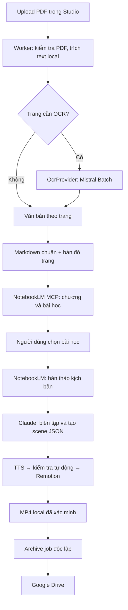

# Kiến trúc mới: OCR → NotebookLM → Claude → Remotion → Google Drive

## 1. Phạm vi đã chốt và trạng thái code hiện tại

Kế hoạch này thay thế kế hoạch trước, dựa trên **`main@84cbe95`**, kiểm tra ngày **28/10/2026**. Working tree sạch tại lần kiểm tra cuối; các thay đổi về theme, preview bên cạnh editor và khóa scene rewrite đã được đưa vào commit.

### Luồng sản phẩm

1. Người dùng nhập cả cuốn sách PDF, thường 300–700 trang.
2. Trích văn bản local trước; dùng **Mistral OCR 4.1 Batch** cho các trang không có văn bản sử dụng được.
3. Tạo cấu trúc chương và danh mục bài học bằng NotebookLM.
4. Người dùng **chọn những bài học muốn sản xuất**.
5. Mỗi bài học được chọn tạo một video:
   - NotebookLM viết kịch bản.
   - Claude biên tập lời dẫn, chia cảnh, chọn bố cục và chữ trên màn hình.
   - Tạo giọng đọc, kiểm tra thời lượng và render bằng mẫu Remotion.
   - Upload video cùng hồ sơ lên Drive.
6. Không dùng Google Sheets và không yêu cầu duyệt từng kịch bản.

### Mẫu kể chuyện bắt buộc

**Hook → tình huống đời thường → sai lầm/thất bại → bài học trong sách → quay lại xử lý tình huống → hành động cụ thể.**

- Hook tối đa **4 giây**, tương đương **120 frame ở 30 FPS**.
- Lời hứa của hook phải được giải quyết trong phần nội dung.
- Bài học và tên sách được giới thiệu sau phần tình huống/sai lầm.
- Claude được sửa lời dẫn, nhưng không được thêm trích dẫn, số liệu hay khẳng định ngoài nguồn.
- Tình huống tự sáng tác được ghi nhận là minh họa trong hồ sơ.
- Mặc định 60 giây; 90 giây vẫn cần người dùng chọn riêng.

### Những phần tái sử dụng

- Đã có `cli-auto`, `AbortSignal`, cache tác vụ và đường gọi chung [askClaude()](/home/hieple/code/short-video-workflow/src/server/ai/cli-task/ask-claude.ts). Không viết runner Claude thứ hai.
- Giữ các khóa chỉnh sửa video/scene hiện tại, rồi mở rộng cho production run.
- Giữ các layout Remotion, composition props, TTS và ffprobe hiện có.
- Giữ luồng nhập `.md/.txt`, mock AI và Claude CLI thủ công.

Hiện chưa có PDF/OCR, NotebookLM MCP hoặc Drive archive. Hai suite `automated-cli-provider` và `script-lock` vừa kiểm tra đều lỗi khi bootstrap SQLite; **14 test chưa thực sự chạy**. Thử nghiệm DB tạm cho thấy migrate chạy được sau khi tạo file SQLite rỗng, nên cần sửa baseline trước khi phát triển tính năng.

Lượt này chỉ lập kế hoạch. Branch và tài liệu kiến trúc chưa được thay đổi.

## 2. Kiến trúc đích và các hợp đồng quan trọng



### Ranh giới module và SOLID

| Ranh giới              | Trách nhiệm                                     | Khi đổi nhà cung cấp                                                   |
| ---------------------- | ----------------------------------------------- | ---------------------------------------------------------------------- |
| `OcrProvider`          | Bắt đầu xử lý, đọc trạng thái, lấy kết quả, hủy | Thêm adapter DeepSeek hoặc nhà cung cấp khác; không sửa nghiệp vụ sách |
| `ScriptStudioProvider` | Phân tích nguồn, rút bài học, viết bản thảo     | Thay NotebookLM mà giữ hợp đồng nội dung                               |
| `ScenePlanCompiler`    | Chuyển bản thảo thành dữ liệu cảnh hợp lệ       | Thay Claude qua adapter; Remotion nhận cùng JSON                       |
| `VideoArchiveProvider` | Chuẩn bị đích, upload, đối soát, xác minh       | Thay Drive mà không sửa pipeline tạo video                             |

Áp dụng cụ thể:

- Mỗi adapter quản lý một tích hợp; không nhét OCR, NotebookLM, OAuth và render vào `AiProvider`.
- Factory lựa chọn implementation; services nhận các port qua tham số, không tự chọn vendor.
- Trạng thái Batch, file ID và giới hạn Mistral nằm trong adapter. Bộ chia PDF nhận giới hạn làm tham số.
- Hợp đồng OCR hỗ trợ cả kết quả hoàn thành ngay và operation cần chờ, để không buộc mọi provider tương lai phải hoạt động giống Mistral Batch.
- Không tạo plugin framework, DI container hoặc workflow DSL.
- JavaScript dùng pnpm. Dùng MCP client chính thức; OAuth qua `google-auth-library`; Mistral có thể gọi bằng typed REST.
- Dùng Poppler cho kiểm tra/trích text/chia PDF; không tự cài runtime trong lúc job chạy.

### Dữ liệu và độ bền

Bổ sung migration không phá dữ liệu cho:

- Extraction run, kết quả từng trang, batch từ xa và chi phí đã dự trù.
- Bản đồ trang PDF → văn bản chuẩn → chương → trích đoạn.
- Notebook/source bindings theo tài khoản, sách và hash nội dung.
- Bản thảo NotebookLM và kết quả Claude với cache riêng.
- Production batch, item cho từng bài học được chọn và checkpoint.
- Snapshot render bất biến, archive record, folder/file IDs và upload checkpoint.

Các bất biến:

- PDF gốc giữ nguyên byte và SHA-256; Markdown là bản dẫn xuất.
- Trang OCR không được thiếu âm thầm. Trang trống hợp lệ được phân biệt với trang xử lý lỗi.
- OCR confidence và trạng thái “trích đoạn khớp nguồn” là hai loại bằng chứng riêng.
- Không dùng offset đã chuẩn hóa whitespace như số trang PDF.
- Mỗi item trong một production batch tương ứng một bài học và một video; retry không tạo video mới.
- Chọn bài học không bị ghi thành “đã được con người duyệt”. Luồng mới dùng kiểm tra nguồn và readiness tự động; luồng thủ công cũ được bảo toàn.
- Snapshot bài học, bản thảo, kịch bản cuối và render được lưu riêng để truy vết việc Claude biên tập.

### OCR và NotebookLM

- PDF upload bằng stream; mặc định giới hạn **500 MiB và 1.000 trang**, giữ giới hạn `.md/.txt` hiện tại.
- Đầu vào hỏng hoặc mã hóa được báo lỗi trước khi gọi dịch vụ trả phí.
- Bắt đầu với `mistral-ocr-4-1`; không dùng alias tự đổi model.
- Chunk OCR tối đa **50 trang và 40 MiB**, có bản đồ từ page index của chunk về trang PDF gốc.
- Dùng uploaded file IDs cho Batch, tránh URL hết hạn khi đang chờ.
- Submit, poll và collect là các job ngắn. Không giữ worker chờ Batch nhiều giờ.
- Lưu output ngay khi có; dọn file phía provider sau khi đã lưu bền vững ở local.
- Mặc định dự trù tối đa **$3 OCR/sách**, có thể điều chỉnh trước khi chạy; không tự nâng trần hoặc chuyển provider.
- Mistral Batch có giảm giá 50%, nhưng cần xử lý bất đồng bộ và lưu operation ID để phục hồi. [Tài liệu Batch](https://docs.mistral.ai/studio/batch-processing).

NotebookLM nhận **nguồn chương/phần chương đã trích xuất**, không phải OCR lại PDF:

- Parser local phát hiện cấu trúc trước. Nếu chưa chắc chắn, NotebookLM nhận mục lục, tiêu đề và anchor để hỗ trợ xác định chương.
- Không coi fallback “toàn bộ nội dung là một chương” là thành công tự động cho sách dài.
- Phân tích chương theo các phần nguồn có giới hạn; bỏ quy tắc cứng “1–3 bài học/chương”.
- Lưu tiến độ và gộp các bài học trùng có thể xác định được; không ép mọi chương phải có cùng số bài học.
- MCP chạy qua stdio trong subprocess của worker, không có HTTP service riêng.
- Dùng source IDs rõ ràng; profile được chỉ định, không đổi mặc định toàn cục.
- Hết quota hoặc kết quả từ xa chưa rõ thì lưu trạng thái và dừng/lùi lịch, không gửi lại vô hạn.

### NotebookLM → Claude → Remotion

- Bản thảo NotebookLM có lời dẫn, các nhịp kể chuyện và nguồn.
- Claude nhận bản thảo cùng snapshot bài học, được biên tập nhưng phải giữ mạch kể và căn cứ.
- Thêm task kind cho biên dịch cảnh, tái sử dụng `askClaude()`.
- Notebook draft không được ghi vào `output.json` đang được hiểu là kết quả Claude hoàn chỉnh.
- CLI chỉ sinh JSON; giữ môi trường đã làm sạch và vô hiệu hóa cả builtin tools lẫn MCP ngoài cấu hình cho phép. [Cờ MCP của Claude CLI](https://code.claude.com/docs/en/cli-reference).
- Giữ JSON cảnh và composition props làm đầu vào duy nhất cho Remotion; không sinh hoặc thực thi TSX tùy ý.
- Tối đa **một lượt sửa AI chung cho mỗi video**. Sai nội dung/nguồn sửa ở NotebookLM; lỗi biên dịch hoặc quá thời lượng sửa ở Claude.
- Readiness được xác lập sau khi audio gắn xong. Thiếu audio, hook vượt 4 giây hoặc vượt preset đều chặn bản FINAL.

### Drive và API

Drive giữ:

```text
Book Video Studio/
└── books/<bookId>/videos/<videoId>/renders/<renderId>/
    ├── video_s<version>_<renderId>_1080x1920.mp4
    ├── script.json
    └── manifest.json
```

- OAuth loopback, `drive.file`, token server-side; không thêm hệ thống đăng nhập cho ứng dụng.
- Pre-generate và lưu file/folder IDs trước khi tạo.
- MP4 dùng resumable upload; đối soát cùng ID/session khi mất phản hồi.
- Upload độc lập với render. Lỗi Drive không xóa MP4 hoặc chạy lại AI/TTS/render.
- Manifest lấy từ snapshot render; không lấy scene hiện tại.
- Một upload cùng lúc, mặc định 1 request/giây, 5.000 requests và 10 GiB dữ liệu gửi/24 giờ.
- Cache dung lượng; UI chỉ poll DB local. Ultra không được dùng để suy ra quota Drive API. [Quota Drive](https://developers.google.com/workspace/drive/api/guides/limits).

API bổ sung tối thiểu:

| API                             | Hành vi                                                        |
| ------------------------------- | -------------------------------------------------------------- |
| `POST /api/books/import/pdf`    | Nhận PDF qua stream, lưu nguyên bản, trả `202` và ID xử lý     |
| `GET /api/books/:id/processing` | Tiến độ trích xuất, chương và catalogue                        |
| `POST /api/productions`         | Nhận sách, các lesson IDs được chọn, preset và idempotency key |
| `GET /api/productions/:id`      | Tiến độ các video và trạng thái archive                        |
| Nhóm API kết nối Drive          | Connect, callback, disconnect, trạng thái                      |
| API retry/cancel hiện có        | Mở rộng theo operation; retry đúng phần lỗi                    |

Tất cả thao tác dài chạy trong một queue/worker hiện tại. Worker không enqueue tác vụ con rồi đứng chờ chúng.

## 3. Backlog triển khai: 66 task, mỗi task dưới một giờ

Thời gian dưới đây là **thời gian kỹ thuật chủ động**, gồm test tập trung. Không tính chờ Batch hoặc người dùng cấp quyền. Tổng ước lượng **50 giờ 40 phút**, nên dự trù khoảng 20–30% cho tích hợp và lỗi môi trường. Nếu một task vượt timebox, tách phần còn lại thành task nhỏ, không bỏ kiểm thử để giữ ước lượng.

### A — Nền tảng và kiến trúc

| ID  | Task và lý do                                                                   | Nghiệm thu                                                                | Phụ thuộc | Ước lượng |
| --- | ------------------------------------------------------------------------------- | ------------------------------------------------------------------------- | --------- | --------: |
| A01 | Tạo `feat/book-ocr-notebooklm-drive`, ghi baseline — tránh sửa trên `main`.     | Đối chiếu `84cbe95`; bảo toàn thay đổi mới nếu có.                        | —         |       20p |
| A02 | Sửa bootstrap SQLite test — khôi phục bằng chứng hồi quy.                       | Hai suite đã nêu thực sự chạy; không nâng dependency để né lỗi.           | A01       |       40p |
| A03 | Cập nhật yêu cầu/kiến trúc đích — thống nhất OCR, selection, Claude và hook 4s. | Tài liệu phân biệt rõ hiện trạng và phần chưa triển khai.                 | A01       |       35p |
| A04 | Định nghĩa bốn port và DTO chuẩn — cho phép thay provider.                      | Fake implementation chạy cùng contract; không lộ kiểu vendor ra services. | A03       |       45p |
| A05 | Thêm durable dispatch/outbox nhỏ — tránh mất bước giữa DB và Redis.             | Intent được lưu trước enqueue; giao lại không tạo dispatch trùng.         | A02, A04  |       50p |
| A06 | Bổ sung kết quả deferred/delayed cho worker — không chiếm worker lúc chờ.       | Pending operation vẫn hiện đang chờ; restart khôi phục được lịch.         | A05       |       50p |

### B — PDF và Mistral OCR Batch

| ID  | Task và lý do                                                            | Nghiệm thu                                                                      | Phụ thuộc | Ước lượng |
| --- | ------------------------------------------------------------------------ | ------------------------------------------------------------------------------- | --------- | --------: |
| B01 | Migration extraction/page/operation — lưu tiến độ theo trang.            | Migration additive; sách cũ vẫn đọc được; page identity duy nhất.               | A02, A04  |       50p |
| B02 | API upload PDF qua stream — tránh buffer sách lớn trong web.             | Giới hạn byte/signature, hash, hủy upload và nguyên bản bất biến được kiểm tra. | B01, A06  |       50p |
| B03 | Wrapper Poppler — kiểm tra và xử lý PDF có kiểm soát.                    | Argv cố định, timeout/cancel; PDF hỏng/mã hóa có lỗi rõ.                        | A04       |       35p |
| B04 | Trích text và phân loại trang — chỉ trả tiền OCR khi cần.                | Fixture text/scan/trống được phân loại; ghi lý do OCR.                          | B03       |       50p |
| B05 | Bộ tạo chunk PDF có page map — giữ đúng trang khi chunk không liên tiếp. | Đúng giới hạn byte/trang; index trả về ánh xạ đúng PDF gốc.                     | B04       |       45p |
| B06 | Dự trù chi phí và pacing OCR — chặn vượt ngân sách.                      | Giữ reservation khi kết quả chưa rõ; không tự tăng trần.                        | B01, A05  |       40p |
| B07 | Adapter Mistral Files — chuẩn bị đầu vào riêng tư cho Batch.             | File ID/response được validate; không yêu cầu URL công khai.                    | B05, B06  |       45p |
| B08 | Submit Batch — chống gửi lại tác vụ trả phí.                             | Persist intent, metadata và `custom_id`; replay tái sử dụng submission.         | B07       |       50p |
| B09 | Poll và tải output — xử lý đủ trạng thái từ xa.                          | Không chờ trong worker; output được lưu trước cleanup provider.                 | B08, A06  |       45p |
| B10 | Chuẩn hóa và kiểm tra kết quả — không bỏ trang âm thầm.                  | Bắt trang thiếu/trùng/sai index; giữ text, block và confidence riêng.           | B09       |       55p |
| B11 | Đối soát unknown outcome và retry trang lỗi — tránh OCR lại cả sách.     | Mất phản hồi không tạo batch mới mù quáng; chỉ gửi lại phần cần thiết.          | B10, A05  |       50p |
| B12 | Ghép canonical Markdown và bản đồ offset — phục vụ nguồn và chương.      | Bảo toàn thứ tự trang; map được văn bản chuẩn về trang gốc.                     | B04, B10  |       45p |
| B13 | Nối extraction với book import — giữ PDF gốc khác bản dẫn xuất.          | Không decode PDF như UTF-8; luồng `.md/.txt` không đổi.                         | B01, B12  |       45p |

### C — NotebookLM và danh mục bài học

| ID  | Task và lý do                                                                               | Nghiệm thu                                                               | Phụ thuộc     | Ước lượng |
| --- | ------------------------------------------------------------------------------------------- | ------------------------------------------------------------------------ | ------------- | --------: |
| C01 | MCP stdio client/lifecycle — kết nối trực tiếp từ worker.                                   | Handshake, tool discovery, crash và shutdown được test bằng fixture.     | A04           |       45p |
| C02 | Profile, envelope và error mapping — dùng đúng tài khoản, không tin tool success đơn thuần. | Auth/quota/transport lỗi được phân loại; không lộ stderr thô.            | C01           |       45p |
| C03 | Migration notebook/source bindings — tái sử dụng nguồn theo revision.                       | Binding theo tài khoản/hash; nguồn mới không ghi đè lineage cũ.          | B01           |       40p |
| C04 | Upsert notebook và source — giảm upload trùng.                                              | Timeout tạo nguồn được đối soát; query luôn chọn source IDs.             | C02, C03      |       50p |
| C05 | Xác định và kiểm tra chương — không nhận fallback cả sách là thành công.                    | Range/anchor hợp lệ; mục lục và phần đầu sách được xử lý rõ.             | B12, B13, C04 |       50p |
| C06 | Phân tích chương theo phần nguồn — hỗ trợ nhiều bài học.                                    | Không giới hạn cứng 1–3/chương; partial không bị đánh dấu complete.      | C05           |       50p |
| C07 | Lưu catalogue và đối chiếu nguồn — tạo đầu vào đáng theo dõi.                               | Retry không nhân bài học; trích đoạn map về extraction/page.             | C06           |       50p |
| C08 | `ScriptStudioProvider` viết bản thảo — áp dụng mẫu kể chuyện mới.                           | Có tình huống, sai lầm, bài học và cách giải quyết; nguồn tách lời dẫn.  | C07           |       50p |
| C09 | Cache draft, usage và phục hồi — giữ quota khi Claude hoặc worker lỗi.                      | Draft hợp lệ được tái sử dụng; quota/unknown outcome không gây vòng lặp. | C08, A06      |       45p |

### D — Chọn bài học, Claude và production pipeline

| ID  | Task và lý do                                                               | Nghiệm thu                                                                              | Phụ thuộc          | Ước lượng |
| --- | --------------------------------------------------------------------------- | --------------------------------------------------------------------------------------- | ------------------ | --------: |
| D01 | Migration production batch/item/checkpoint — quản lý từng video độc lập.    | Một selected lesson tạo một item; có fingerprint và atomic claim.                       | A04, A02           |       50p |
| D02 | API chọn lesson và tạo snapshot — không có bước duyệt ẩn.                   | Chỉ nhận bài cùng sách, đủ nguồn; double submit không nhân video.                       | D01, C07           |       50p |
| D03 | Đổi giới hạn hook và quy tắc mạch kể — thống nhất 4s.                       | 120 frame được chấp nhận, vượt bị chặn; thứ tự bài học trước giải pháp.                 | A03                |       45p |
| D04 | Contract handoff và task kind Claude — tách bản thảo khỏi scene output.     | Draft/final có schema, version và fingerprint riêng.                                    | D03, C08           |       45p |
| D05 | `ScenePlanCompiler` dùng `askClaude()` — tái sử dụng đường gọi đã có.       | Claude biên tập có nguồn, trả JSON; không tool/code thực thi hoặc MCP ngoài ý muốn.     | D04                |       45p |
| D06 | Áp dụng scene một lần và mở rộng khóa — tránh mất audio do replay.          | CAS theo item/version; giữ khóa scene rewrite hiện có.                                  | D01, D05           |       50p |
| D07 | TTS tuần tự có checkpoint — tiếp tục từ audio chưa xong.                    | Không chạy song song; tái dùng cache khi đầu vào không đổi.                             | D06                |       45p |
| D08 | Readiness tự động sau audio — bỏ duyệt script thủ công đúng cách.           | Thiếu audio, hook >4s hoặc vượt preset chặn FINAL; không giả trạng thái human-approved. | D07, D03           |       50p |
| D09 | Ngân sách một lượt sửa AI/video — kiểm soát retry nội dung.                 | Chọn đúng Notebook/Claude để sửa; không tăng preset hoặc speed narration.               | D08, C09           |       50p |
| D10 | Snapshot render bất biến — ngăn trộn phiên bản.                             | Scene, audio, nguồn và template snapshot không đổi sau chỉnh sửa mới.                   | D08                |       50p |
| D11 | Tách lỗi render khỏi hậu xử lý — bảo vệ MP4 đã hoàn thành.                  | Progress/enqueue lỗi không xóa MP4; archive intent được lưu bền vững.                   | D10, A05           |       45p |
| D12 | Điều phối, retry/cancel/reconcile production — chạy được với concurrency 1. | Không chờ child job; restart bỏ qua bước đã hoàn thành; hủy chặn bước sau.              | D02, D09, D11, A06 |       50p |

### E — Google Drive archive

| ID  | Task và lý do                                                     | Nghiệm thu                                                                           | Phụ thuộc          | Ước lượng |
| --- | ----------------------------------------------------------------- | ------------------------------------------------------------------------------------ | ------------------ | --------: |
| E01 | Archive models và repository — tách lưu trữ khỏi render.          | Unique theo render/provider/destination; checkpoint không chứa dữ liệu UI không cần. | A04, A02           |       45p |
| E02 | Credential store và OAuth start — xin quyền tối thiểu.            | PKCE/state, loopback và `drive.file`; secret không vào DTO/log.                      | E01                |       45p |
| E03 | OAuth callback/exchange — xác thực phản hồi Google.               | Chặn state sai, hết hạn và dùng lại; lưu token an toàn.                              | E02                |       50p |
| E04 | Refresh/disconnect/reconnect — xử lý vòng đời quyền truy cập.     | `invalid_grant` yêu cầu kết nối lại; không tự xóa video từ xa.                       | E03                |       40p |
| E05 | Folder bindings và cấp ID trước — không tạo thư mục trùng.        | Root/book/video/render có ID bền vững; không quét toàn Drive.                        | E04                |       45p |
| E06 | Resumable upload MP4 — giới hạn bộ nhớ và tiếp tục được.          | Stream file, lưu session/offset, báo byte thực.                                      | E05                |       50p |
| E07 | Đối soát timeout/409/checksum — không nhân file sau mất phản hồi. | Restart và session hết hạn vẫn dùng cùng file ID.                                    | E06                |       55p |
| E08 | Upload script và manifest — lưu đúng hồ sơ của bản render.        | Dùng snapshot D10; đủ ba file được xác minh trước khi complete.                      | E07, D10           |       45p |
| E09 | Quota ledger, pacing và capacity cache — giữ giới hạn Google.     | Backoff hữu hạn; phân biệt storage với API quota; số liệu ghi rõ phạm vi ứng dụng.   | E04                |       45p |
| E10 | Archive processor và restart sweep — lưu Drive độc lập.           | Render thành công cuối cùng được enqueue; upload lỗi không gọi AI/TTS/render.        | E08, E09, D11, A06 |       50p |
| E11 | API trạng thái/retry archive — thử lại đúng phần lỗi.             | Trả `202`, tái sử dụng render/remote IDs; không lộ session URI.                      | E10                |       40p |

### F — Giao diện theo thiết kế hiện tại

| ID  | Task và lý do                                                           | Nghiệm thu                                                            | Phụ thuộc     | Ước lượng |
| --- | ----------------------------------------------------------------------- | --------------------------------------------------------------------- | ------------- | --------: |
| F01 | PDF upload và tiến độ extraction — người dùng biết sách đang ở đâu.     | Có lỗi/đang chờ/partial/success; không hiển thị phần trăm giả.        | B13           |       45p |
| F02 | Catalogue và chọn nhiều lesson — đúng bước chủ động người dùng đã chọn. | Hiện nguồn, chọn bài và preset; chỉ các bài được chọn tạo video.      | C07, D02      |       45p |
| F03 | Production progress và Jobs — theo dõi từng video trong đợt.            | Hiện bước, lý do chờ, retry/cancel và kết quả từng item.              | D12           |       45p |
| F04 | Editor/preview hook 4s và nguồn kịch bản — đồng bộ trải nghiệm.         | Bỏ chuỗi hardcode 3s; giữ docked preview và khóa hiện có.             | D03, D06      |       45p |
| F05 | Settings tích hợp — thấy rõ OCR, NotebookLM, Claude và Drive.           | Trạng thái/cách khắc phục bằng tiếng Việt; không hiển thị credential. | C09, E04, E09 |       45p |
| F06 | Render history có archive status — phân biệt local và Drive.            | Link chỉ hiện khi xác minh; nút thử lại chỉ upload.                   | E11           |       45p |
| F07 | Responsive/theme/accessibility — tránh phá UI vừa thay đổi.             | Kiểm tra desktop/mobile, light/dark, loading/empty/error và bàn phím. | F01–F06       |       45p |

### G — Kiểm thử tổng hợp, tài liệu và nghiệm thu

| ID  | Task và lý do                                                      | Nghiệm thu                                                                           | Phụ thuộc               | Ước lượng |
| --- | ------------------------------------------------------------------ | ------------------------------------------------------------------------------------ | ----------------------- | --------: |
| G01 | Fixture MCP/OCR/Claude/Drive — kiểm thử không tiêu quota thật.     | Giao thức, callback, lỗi và clock điều khiển được; không mock queue giả.             | A04, A06                |       45p |
| G02 | Integration OCR và Notebook recovery — bảo vệ nguồn dài.           | Trang thiếu, chunk lệch, unknown submit, output hết hạn và source trùng đều có test. | B11, C09, G01           |       50p |
| G03 | Integration production và Drive recovery — bảo vệ kết quả đã làm.  | Crash giữa bước, replay, cancel, mất phản hồi upload không tạo bản trùng.            | D12, E10, G01           |       50p |
| G04 | E2E luồng mới — kiểm tra đường người dùng nhìn thấy.               | PDF → catalogue → chọn lesson → video → fake Drive, không duyệt script.              | F07, G02, G03           |       55p |
| G05 | Chạy quality gate và kiểm tra hồi quy — xác nhận toàn bộ thay đổi. | Lint, typecheck, test, build, E2E pass; luồng cũ vẫn dùng được.                      | G04                     |       50p |
| G06 | Hoàn thiện runbook/architecture/env — bàn giao vận hành.           | Có setup, provider swap, quota, lỗi, khôi phục và giới hạn đã biết.                  | G05                     |       35p |
| G07 | Nghiệm thu thật phần OCR — đo đầu ra và chi phí thực tế.           | Gửi bộ trang đại diện, lưu operation/cost; không coi submit là OCR thành công.       | G06, tài khoản sẵn sàng |       35p |
| G08 | Nghiệm thu thật video và Drive — xác nhận toàn bộ tích hợp.        | Sau OCR: tạo video mẫu, kiểm tra mạch kể, audio, ffprobe và checksum Drive.          | G07 hoàn tất            |       50p |

**Thứ tự ưu tiên:** A → B và MCP nền tảng → C → D → E hoàn chỉnh → F → G. Adapter Drive và fixture có thể làm song song khi contract đã chốt. Các task sửa Prisma schema/migration và các file điều phối chung phải được phối hợp tuần tự.

## 4. Kiểm thử, tài liệu kiến trúc và tiêu chí hoàn thành

### Kiểm thử bắt buộc

- **PDF:** text, scan, mixed, trang trống, trang mã hóa, sai signature, vượt giới hạn và chunk không liên tiếp.
- **OCR:** kết quả đảo thứ tự, thiếu/trùng trang, thành công một phần, mất phản hồi submit, restart và kết quả hết hạn.
- **Nguồn:** Unicode tiếng Việt, whitespace normalization, map về đúng trang/revision và không bịa confidence.
- **Kịch bản:** đúng mạch kể, bài học xuất hiện sau sai lầm, giải pháp quay lại tình huống đầu; Claude được sửa lời nhưng giữ nguồn.
- **Hook:** chấp nhận 4 giây/120 frame, chặn vượt giới hạn; kiểm tra theo audio thật.
- **Production:** chọn ba lesson tạo ba item; double submit, replay và retry không nhân video.
- **Cache:** Notebook thành công/Claude lỗi chỉ chạy lại Claude; render thành công/Drive lỗi chỉ chạy lại upload.
- **Drive:** timeout cuối upload, `409`, session hết hạn, quota, mất quyền và chỉnh sửa video sau render.
- **Hồi quy:** `.md/.txt`, mock, `cli-task`, `cli-auto`, scene rewrite lock, theme và preview hiện tại.

Các lệnh gate:

```bash
pnpm lint
pnpm typecheck
pnpm test
pnpm build
pnpm test:e2e
```

Test tập trung đi cùng từng task; mỗi gói chức năng phải vượt gate phù hợp trước khi chuyển tiếp. Không dùng kết quả test cũ để tuyên bố bản mới đã hoạt động.

### Cập nhật kiến trúc trong repo

[docs/architecture.md](/home/hieple/code/short-video-workflow/docs/architecture.md) cần được cập nhật với:

- Sơ đồ process và các port/provider mới.
- Phân biệt PDF gốc, bản trích xuất, catalogue, Notebook draft và Claude scene plan.
- State transition, delayed job, checkpoint và xử lý unknown outcome.
- Cơ chế selection, readiness tự động và hook 4 giây.
- OAuth/credential boundary, quota và archive độc lập.
- Cách thêm provider OCR mới bằng adapter và contract tests.

Đồng thời cập nhật tài liệu yêu cầu, AGENTS, README và env mẫu trong các thay đổi tương ứng. Không đánh dấu tính năng hoàn thành khi mới có adapter hoặc fixture.

### Tiêu chí hoàn thành

Người dùng nhập một sách PDF, nhận danh mục bài học có nguồn, chọn các bài cần sản xuất và nhận video đúng mẫu kể chuyện trên local cùng Drive. Hệ thống không cần Sheets, không chờ duyệt script, không mất tiến độ khi restart và không chạy lại toàn pipeline vì một lỗi upload.

Mistral có thể được thay bằng OCR provider khác thông qua adapter mà không viết lại phần chương, bài học, NotebookLM, Claude hoặc Remotion. Phiên bản đầu không triển khai DeepSeek, không tự host GPU, không sinh mã Remotion tùy ý và không mở ứng dụng ra ngoài localhost.

### H — Yêu cầu bổ sung của chủ dự án (28/10/2026)

Sách PDF có thể bằng tiếng Anh hoặc tiếng Việt; kịch bản luôn bằng tiếng Việt và giữ khung kể hiện tại (hook ~4 giây → tình huống → sai lầm → bài học trong sách → điều rút ra → hành động khi gặp vấn đề thật). Video được dài tới **5 phút** (preset 30/45/60 giây cho video ngắn; 90, 120, 180, 240, 300 giây phải chọn rõ ràng), vẫn **một bài học mỗi video**. Các cảnh có **hoạt cảnh kiểu hoạt hình phẳng SVG** (người, cảnh vật) chuyển động theo frame, Claude chọn bối cảnh + hành động cho từng cảnh từ danh sách cố định, người dùng đổi được trong trình biên tập; không GPU, không tài sản mạng, chi phí render vừa phải.

| ID  | Task                                                             | Kết quả kiểm chứng                                                                                       | Phụ thuộc |
| --- | ---------------------------------------------------------------- | -------------------------------------------------------------------------------------------------------- | --------- |
| H01 | Kịch bản luôn tiếng Việt dù nguồn tiếng Anh — prompt v2.         | Prompt NotebookLM và Claude nói rõ; trích đoạn giữ nguyên văn gốc; cache bản thảo không dùng lại bản cũ. | C08, D05  |
| H02 | Thời lượng tới 5 phút — preset dài chọn rõ ràng.                 | 300 giây chỉ nhận khi chọn preset dài; hook vẫn ≤ 4 giây; không tự nâng preset; giới hạn cảnh co giãn.   | D03       |
| H03 | Hoạt cảnh SVG — nhân vật và bối cảnh chuyển động theo frame.     | Mỗi bối cảnh/hành động render được ở cả hai profile; không blur/GPU; đo thời gian render.                | H02       |
| H04 | Claude chọn hoạt cảnh từng cảnh — lưu, sửa trong trình biên tập. | Kế hoạch cảnh có `illustration` hợp lệ; cảnh cũ dùng mặc định theo loại cảnh; snapshot giữ lựa chọn.     | H03       |
| H05 | Gate, E2E và tài liệu cho nhóm H.                                | Lint, typecheck, test, build, E2E pass; đặc tả, AGENTS, README cập nhật.                                 | H01–H04   |

## 5. Nhật ký thực thi

Branch: `feat/book-ocr-notebooklm-drive`, tách từ `main@84cbe95`.

| Task | Trạng thái | Ghi chú                                                                                                                                                                                                                                                                                                                                                                                                                                                                                                                                                                                                                                                                                                                                                                                                                                                                                                                                                                                                                                                                                                                                                                                                                                                                                                                                                                                                                                                                                                                                                                                                                        |
| ---- | ---------- | ------------------------------------------------------------------------------------------------------------------------------------------------------------------------------------------------------------------------------------------------------------------------------------------------------------------------------------------------------------------------------------------------------------------------------------------------------------------------------------------------------------------------------------------------------------------------------------------------------------------------------------------------------------------------------------------------------------------------------------------------------------------------------------------------------------------------------------------------------------------------------------------------------------------------------------------------------------------------------------------------------------------------------------------------------------------------------------------------------------------------------------------------------------------------------------------------------------------------------------------------------------------------------------------------------------------------------------------------------------------------------------------------------------------------------------------------------------------------------------------------------------------------------------------------------------------------------------------------------------------------------ |
| A01  | Xong       | Baseline ngày 28/10/2026: `pnpm lint`, `pnpm typecheck`, `pnpm format:check` sạch; `pnpm test` 21 suite / 138 test pass.                                                                                                                                                                                                                                                                                                                                                                                                                                                                                                                                                                                                                                                                                                                                                                                                                                                                                                                                                                                                                                                                                                                                                                                                                                                                                                                                                                                                                                                                                                       |
| A02  | Không cần  | Hai suite `automated-cli-provider` và `script-lock` không tái hiện lỗi bootstrap SQLite: 14/14 pass khi chạy riêng (3 lần, TMPDIR khác) và khi chạy trong toàn bộ bộ test. Không sửa code theo suy đoán; nếu lỗi quay lại, ghi lại thông báo lỗi và môi trường rồi mở lại task này.                                                                                                                                                                                                                                                                                                                                                                                                                                                                                                                                                                                                                                                                                                                                                                                                                                                                                                                                                                                                                                                                                                                                                                                                                                                                                                                                            |
| A03  | Xong       | Đặc tả §1.4/§22.1/§23, `AGENTS.md` (ràng buộc cứng + M7) và `docs/architecture.md` §11 phân biệt phần đã chạy (v1.1) với mục tiêu v1.2. Chỉ là tài liệu; chưa có code.                                                                                                                                                                                                                                                                                                                                                                                                                                                                                                                                                                                                                                                                                                                                                                                                                                                                                                                                                                                                                                                                                                                                                                                                                                                                                                                                                                                                                                                         |
| A04  | Xong       | Bốn port + DTO không lộ kiểu vendor (`src/server/{ocr,script-studio,scene-plan,archive}/`), `IntegrationError` với `kind` (có `UNKNOWN_OUTCOME`), fake + contract suite trong `tests/helpers/`. Đột biến idempotency của fake bị contract bắt (4 test đỏ). Đủ cho 36 test mới (2 skip có chủ đích: hủy/cleanup không áp dụng cho OCR hoàn thành ngay). Chưa có adapter thật. DTO sẽ được mở rộng cộng thêm bởi task sở hữu: `ensureSource` (C04), `prepareDestination` (E05), block/confidence OCR (B10).                                                                                                                                                                                                                                                                                                                                                                                                                                                                                                                                                                                                                                                                                                                                                                                                                                                                                                                                                                                                                                                                                                                      |
| A05  | Xong       | Bảng `JobDispatch` (outbox, migration `20261028012626_job_dispatch_outbox`) tạo cùng `JobRecord` trong một giao dịch; `sweepDueJobIntents` giao lại hàng chưa tới Redis (lúc khởi động trước `reconcile` và mỗi 5 giây), `reconcile` bỏ qua job chưa giao, huỷ job trong outbox không gọi Redis. Đường nhanh vẫn trả `503 QUEUE_UNAVAILABLE`. Kiểm chứng: 10 test mới (3 chạy BullMQ/Redis thật, không nhân đôi job theo `jobId`), 3 đột biến bị bắt, lint/typecheck/format/test (184 pass, 2 skip) và `pnpm test:e2e` pass. Lưu ý vận hành: `prisma migrate` không áp dụng được lên `data/studio.db` khi `pnpm dev`/`pnpm worker:dev` đang chạy (schema engine không có busy-timeout), nên migration được áp dụng bằng `better-sqlite3` kèm dòng `_prisma_migrations` (checksum đã kiểm chứng; `prisma migrate status` báo "up to date"); bản sao lưu DB trước khi áp dụng nằm trong thư mục scratchpad của phiên.                                                                                                                                                                                                                                                                                                                                                                                                                                                                                                                                                                                                                                                                                                            |
| A06  | Xong       | Processor trả `deferred(retryAfterMs)`: job BullMQ kết thúc, `deferRunningJob` đưa `JobRecord` về `QUEUED`, đổi `bullmqJobId` và đặt lại hàng outbox (`availableAt`), nên lịch sống qua restart; huỷ chen ngang được kết thúc thay vì đặt lịch. Dispatcher tách thành `createJobDispatcher(processors)` để test với Worker BullMQ thật: job khác chạy xong trong lúc job trì hoãn đang chờ (concurrency 1). 14 test mới, 2 đột biến bị bắt (đổi `bullmqJobId` là bắt buộc với BullMQ thật). Lint/typecheck/format/test (198 pass, 2 skip) và `pnpm test:e2e` pass. Cơ chế đã có, chưa processor nào dùng (OCR ở nhóm B).                                                                                                                                                                                                                                                                                                                                                                                                                                                                                                                                                                                                                                                                                                                                                                                                                                                                                                                                                                                                       |
| B01  | Xong       | Migration additive `20261028014937_book_extraction_ocr_operation`: `BookExtraction`, `ExtractionPage` (duy nhất theo `(extractionId, pageNumber)`, trang trống ≠ trang lỗi), `OcrOperation` (`requestKey` duy nhất, chi phí micro-USD nguyên); sách `.md`/`.txt` cũ không đổi. 5 test ràng buộc schema. Chỉ đổi schema nên chưa chạy lại build/E2E ở task này (sẽ chạy ở cuối nhóm B). Migration lại được áp dụng lên DB dev bằng script `better-sqlite3` vì `prisma migrate` vẫn bị khoá khi dev server đang chạy; `migrate status` báo "up to date".                                                                                                                                                                                                                                                                                                                                                                                                                                                                                                                                                                                                                                                                                                                                                                                                                                                                                                                                                                                                                                                                         |
| B02  | Xong       | `POST /api/books/import/pdf`: thân request là PDF thô, `streamToFile` ghi từng chunk ra `data/imports/` đồng thời băm SHA-256 và đếm byte; kiểm tra chữ ký `%PDF-` trên chính byte, vượt `MAX_PDF_SIZE_MB` (mặc định 500) thì dừng đọc ngay, huỷ/lỗi xoá sạch tệp dở; thành công đổi tên nguyên bản sang `books/<id>/original.pdf` (0444), tạo `Book` + `BookExtraction(QUEUED)` trong một giao dịch, trả `202`; PDF trùng hash → `409`. 13 test mới, 3 đột biến bị bắt. Kiểm chứng thực tế trên `next start` cô lập: upload 300 MB → `202`, RSS của Next chỉ tăng ~60 MB, hash tệp lưu khớp tuyệt đối, tệp `0444`; huỷ upload giữa chừng không để lại tệp tạm hay sách. **Chưa làm:** chưa có job nào xử lý lần trích xuất `QUEUED` (B04), chưa có UI (F01). Gate: lint/typecheck/format/test (215 pass, 2 skip) và `pnpm build` pass; E2E để cuối nhóm B.                                                                                                                                                                                                                                                                                                                                                                                                                                                                                                                                                                                                                                                                                                                                                                    |
| B03  | Xong       | `server/pdf/poppler.ts`: `runPoppler` (mảng đối số, không shell, chỉ đường dẫn tuyệt đối, env tối thiểu UTF-8, timeout + huỷ, kết thúc ngay khi tiến trình bị dừng thoát), `inspectPdf` (số trang, mã hoá), `extractTextLayer` (một lần `pdftotext`, tách theo form feed), `countPageImages`, `buildPagesPdf`; lỗi `PDF_ENCRYPTED`/`PDF_CORRUPT`/`PDF_TOOL_MISSING` (kèm lệnh cài)/`PDF_TOOL_TIMEOUT` không chép lời Poppler. Env `MAX_PDF_PAGES` (1000), `POPPLER_BIN_DIR`, `PDF_TOOL_TIMEOUT_SEC`. Bộ dựng PDF cho test (chữ, ảnh, trống, font TCVN3, mật khẩu RC4 40-bit, giới hạn quyền). **Poppler chưa được cài trên máy**: để phát triển và chạy test, gói `poppler-utils`/`libpoppler97` chính thức của Ubuntu 20.04 (0.86.1) được `apt-get download` và giải nén vào thư mục tạm của phiên (không cài vào hệ thống); bộ test cần Poppler bị bỏ qua khi không có. 10 test, 13 đột biến: 10 bị bắt, 2 mã thừa đã bỏ (lọc dòng tiêu đề, sao chép trang đơn), 1 thêm test. Gate: lint/typecheck/format/test/build.                                                                                                                                                                                                                                                                                                                                                                                                                                                                                                                                                                                                        |
| B04  | Xong       | `classifyPage` (thuần): TEXT / EMPTY / OCR với lý do (trang scan, font TCVN3/VNI, lỗi mã hoá), chuẩn hoá NFC; `storeClassifiedPages` chỉ ghi trang còn `PENDING` (không bao giờ đặt lại trang đang/đã OCR); `extractPdfPages`: kiểm tra → giới hạn trang → đọc lớp chữ một lần + đếm hình → phân loại → `OCR_PENDING`/`ASSEMBLING`, lỗi PDF → `FAILED` có mã trước mọi dịch vụ trả phí, lần chạy đã lỗi báo lại lỗi. Fixture: chữ, ảnh, trống, TCVN3, chữ ngắn. **Sửa lỗi**: thư mục đích của `pdftotext` chưa tồn tại → lỗi bị báo nhầm "PDF hỏng"; nay tạo trước (test Poppler dùng thư mục chưa có). 16 test, 14 đột biến chạy riêng đều bị bắt (1 sống sót lúc đầu → thêm test). Gate: lint/typecheck/format/test/build.                                                                                                                                                                                                                                                                                                                                                                                                                                                                                                                                                                                                                                                                                                                                                                                                                                                                                                   |
| B05  | Xong       | `groupOcrPages` (sắp xếp, bỏ trùng, nhóm ≤ `maxPages`), `splitGroup`, `buildOcrChunks`: dựng chunk PDF theo giới hạn trang của provider, đo byte sau khi dựng, chia đôi chunk quá lớn tới khi vừa, báo trang đơn quá lớn (không gửi), mã chunk ổn định, dọn trang tạm. Test thật với Poppler: trang không liên tiếp [9,2,5,7] → chunk [2,5,7] có chữ đúng "Page 2/5/7" theo thứ tự (ánh xạ về PDF gốc), kích thước báo đúng, chia theo byte, trang quá lớn, cùng đầu vào cùng kết quả. 7 test, 8 đột biến chạy riêng đều bị bắt. Gate: lint/typecheck/format/test/build.                                                                                                                                                                                                                                                                                                                                                                                                                                                                                                                                                                                                                                                                                                                                                                                                                                                                                                                                                                                                                                                       |
| B06  | Xong       | `planOcrOperation` (một giao dịch): idempotent theo `requestKey`, chỉ một lô mở mỗi lần trích xuất (pacing), chặn khi `đã chi + đang giữ + ước tính` vượt trần, không đổi provider/model giữa chừng; kết quả chưa rõ (`UNKNOWN_OUTCOME`) giữ nguyên khoản giữ chỗ, `settleOcrOperation` mới nhả (idempotent). Trần `OCR_COST_CEILING_USD` (mặc định $3) được chép vào lần trích xuất lúc tạo (B02 cập nhật) và chỉ `setOcrCostCeiling` mới đổi được, không bao giờ dưới khoản đã chi/giữ. Tiền tính bằng micro-USD nguyên. 27 test mới, 7 đột biến bị bắt. Chưa có route/UI gọi `setOcrCostCeiling` (F01). Gate: lint/typecheck/format/test (243 pass, 2 skip) pass.                                                                                                                                                                                                                                                                                                                                                                                                                                                                                                                                                                                                                                                                                                                                                                                                                                                                                                                                                           |
| B07  | Xong       | `MistralClient` (`server/ocr/mistral/`): upload tệp bằng `file_id` (`purpose` `ocr`/`batch`, stream từ đĩa, không cần URL công khai), xoá/tải tệp, mọi phản hồi qua Zod, kích thước tệp lưu phải khớp tệp đã gửi; lỗi → `IntegrationError` (401/403 `AUTH`, 429 `QUOTA` + `Retry-After`, thao tác ghi bị mất phản hồi/5xx/ngắt kết nối/phản hồi hỏng → `UNKNOWN_OUTCOME`, đọc → `TRANSIENT`/`REJECTED`), khóa API không bao giờ vào lỗi. Cấu hình `MISTRAL_API_KEY`/`MISTRAL_API_BASE_URL`/`MISTRAL_OCR_MODEL`/`MISTRAL_OCR_USD_PER_1000_PAGES`. Tìm ra và chặn lỗi undici (`fetch` + `FormData` + signal đã abort → unhandled rejection làm sập worker). 15 test với fake server cục bộ có chèn lỗi, 3 đột biến bị bắt. **Rủi ro chưa kiểm chứng (G07):** `mistral-ocr-4-1` có thể không phải model ID thật (nguồn công khai chỉ nêu `mistral-ocr-4-0`/alias); đơn giá batch $2/1.000 trang chỉ từ blog; tài liệu công khai không nêu cách `/v1/ocr` tham chiếu `file_id`, dạng dòng JSONL kết quả, và cơ số chỉ số trang. Gate: lint/typecheck/format/test (258 pass, 2 skip) pass.                                                                                                                                                                                                                                                                                                                                                                                                                                                                                                                                          |
| B08  | Xong       | `submitOcrBatch`: `findBatchJobByRequestKey` (duyệt có giới hạn, lọc `metadata.request_key` phía client) chạy trước mọi upload nên replay dùng lại job và không trả tiền lần nữa; sau đó upload từng đoạn bằng `file_id`, một JSONL yêu cầu (`custom_id` = `chunkId`) rồi tạo job. Mất phản hồi khi tạo job → `UNKNOWN_OUTCOME`, **giữ** tệp đã upload và lần gọi lại tìm job theo khóa (test: job được tạo rồi ngắt kết nối, replay không tạo job thứ hai); lỗi chắc chắn → xoá tệp đã upload; đoạn quá cỡ/trùng id bị chặn trước khi upload. 11 test, 4 đột biến bị bắt (kể cả "tham chiếu bằng file_id"). Giả định bổ sung chưa kiểm chứng (G07): cơ số `page` của danh sách job (đang dùng 0), danh sách job có trả `metadata`. Gate: lint/typecheck/format/test (269 pass, 2 skip) pass. Chưa nối vào `OcrProvider`/processor (B09, B11).                                                                                                                                                                                                                                                                                                                                                                                                                                                                                                                                                                                                                                                                                                                                                                                 |
| B09  | Xong       | `MistralBatchOcrProvider` (submit + `pollBatchJob`/`cancelBatchJob`/`cleanupBatchJob`) và `createOcrProvider()`. `poll` không bao giờ chờ (`pending` + `retryAfterMs` 60 giây); `SUCCESS` trả kết quả theo từng chunk (khớp `custom_id`), chunk lỗi không làm hỏng chunk khác, chunk vắng mặt để service phát hiện, kết quả trùng bị đánh lỗi, chỉ số trang chỉ nhận khi liên tục `0..n-1`/`1..n`, `confidence` đúng như Mistral báo hoặc `null`; dòng JSONL hỏng báo lỗi to không trích nội dung sách. `cleanup` xoá PDF → kết quả → lỗi → tệp yêu cầu cuối cùng nên thử lại sau khi xoá dở vẫn xong; sau `cleanup` không lấy lại được kết quả (nên phải lưu trước). Chạy qua bộ contract `OcrProvider` dùng chung (contract được mở rộng: chunk thật, huỷ bất đồng bộ). 26 test + 2 test cấu hình, 4 đột biến bị bắt. Gate: lint/typecheck/format/test (297 pass, 2 skip) pass. **Vẫn chỉ kiểm chứng với fake server**; các giả định API ở B07/B08 phải xác nhận ở G07. Chưa có processor dùng provider này (B11/B13).                                                                                                                                                                                                                                                                                                                                                                                                                                                                                                                                                                                                       |
| B10  | Xong       | `reconcileOcrResults` (thuần) trả đúng một kết quả cho mỗi trang đã gửi, ánh xạ chỉ số OCR về trang PDF qua bản đồ chunk (chunk không liên tiếp): `OK` (chữ hoặc `EMPTY` hợp lệ) hay `FAILED` kèm mã. Chunk thiếu/trùng/sai chỉ số/sai số trang làm **cả chunk** lỗi để thử lại (không đoán rồi gán nhầm chữ vào sai trang); chuẩn hoá NFC/LF; confidence giữ đúng hoặc `null`. `recordOcrResults` + `storeOcrPageOutcomes` chỉ ghi vào trang đang chờ OCR (không bao giờ đè trang đã có chữ), idempotent, lần thử lại thay được lỗi cũ. 18 test mới, 4 đột biến bị bắt. **Lệch plan:** không giữ "block" vì lô OCR yêu cầu `include_blocks: false`. Gate: lint/typecheck/format/test pass. Chưa có luồng nào gọi (B11/B13).                                                                                                                                                                                                                                                                                                                                                                                                                                                                                                                                                                                                                                                                                                                                                                                                                                                                                                   |
| B12  | Xong       | `assembleCanonicalMarkdown` (thuần) ghép văn bản các trang đúng thứ tự thành một markdown kèm `pageOffsets` `[start,end)` (UTF-16, cùng đơn vị với offset chương; slice đúng từng trang kể cả emoji; trang trống không chiếm chỗ), `pageAtOffset`/`pagesInRange` đổi offset về trang PDF; thiếu/trùng/ngoài PDF thì từ chối. `assembleExtractionDocument` chỉ ghép khi mọi trang `1..N` đã `EXTRACTED` (nếu không: `EXTRACTION_INCOMPLETE` kèm danh sách trang và không ghi gì), ghi nguyên tử `canonical.md` và lưu `canonicalPath`; chạy lại cho cùng kết quả. 20 test, 5 nhóm đột biến bị bắt. Chưa đổi trạng thái lần trích xuất (bộ điều phối, B13). Gate: lint/typecheck/format/test pass.                                                                                                                                                                                                                                                                                                                                                                                                                                                                                                                                                                                                                                                                                                                                                                                                                                                                                                                               |
| B11  | Xong       | `ocr-operation.service.ts`: `submitOcrOperation` ghi ý định (`SUBMITTING`) trước khi gọi provider; mất phản hồi → `UNKNOWN_OUTCOME` giữ giữ chỗ, lần sau `reconcileOcrOperation` hỏi provider theo `requestKey` (thấy → nhận lại, **không gọi `start` lần nữa**; không thấy → về `PLANNED` rồi mới gửi lại); `REJECTED` → kết thúc (trang lỗi + nhả giữ chỗ); `AUTH`/`QUOTA`/`TRANSIENT` → `RETRY_LATER` (về `PLANNED`, giữ giữ chỗ). `collectOcrOperation` không chờ: `PENDING`/`COMPLETED` (lưu chữ → `outputStoredAt` → chốt ngân sách → rồi mới cleanup provider; cleanup lỗi không làm hỏng lô)/`FAILED`/`CANCELLED`. `resetFailedOcrPagesForRetry` chỉ đưa lại trang OCR đã lỗi. 20 test (SQLite thật + `FakeOcrProvider` có kịch bản lỗi), mỗi đột biến chạy riêng; một đột biến ban đầu sống sót (fake idempotent theo `requestKey` che việc "không gọi start lần hai") nên test được siết lại. Giả định chưa kiểm chứng (G07): lô `FAILED`/`TIMEOUT_EXCEEDED` không bị tính tiền; danh sách job Mistral nhất quán ngay sau khi tạo. Gate: lint/typecheck/format/test pass. Chưa có processor gọi (B13).                                                                                                                                                                                                                                                                                                                                                                                                                                                                                                               |
| D03  | Xong       | Hook tối đa **4 giây / 120 frame cho mọi luồng** (thống nhất, vì Player, preflight và render dùng chung): `HOOK_MAX_SECONDS` là nguồn duy nhất, mọi chuỗi UI/thông báo/prompt lấy từ hằng số (hết hardcode "3 giây"), prompt đổi nội dung nên nâng lên `video-script-v2`; tài liệu v1.1 và README được cập nhật theo (cải chính câu thận trọng ở A03 nói luồng thủ công giữ 3 giây). Mạch kể bắt buộc thành contract: `findNarrativeOrderProblem` (đủ sáu beat, đúng một HOOK đầu, bài học trước giải pháp) gắn vào `scriptDraftSchema` và `findStorySceneOrderProblem` (SITUATION → COMMON_MISTAKE → KEY_TAKEAWAY → BETTER_APPROACH → ACTION_STEP, không SUMMARY) gắn vào `scenePlanSchema`; thứ tự này khác luồng thủ công v1.1 (BETTER_APPROACH trước KEY_TAKEAWAY) nên luồng thủ công không bị ràng buộc. Test biên 120 ok / 121 chặn; 2 đột biến bị bắt. Gate: lint/typecheck/format/test (374 pass, 2 skip) và `pnpm test:e2e` pass.                                                                                                                                                                                                                                                                                                                                                                                                                                                                                                                                                                                                                                                                                     |
| D01  | Xong       | Migration additive `20261028030339_production_batches`: `ProductionBatch` (`idempotencyKey` duy nhất, `fingerprint`) và `ProductionItem` (một lesson = một item = một video; duy nhất theo `(batchId, lessonId)` và `(batchId, position)`; `videoId` duy nhất; `lessonId` `Restrict`; `status` tách khỏi `checkpoint`). `claimProductionItem`/`renewProductionClaim`/`releaseProductionClaim` là lease nguyên tử: 8 worker đồng thời → đúng một người nhận được, lease hết hạn thì nhận lại được, chỉ người giữ mới gia hạn/nhả, item đã kết thúc không được trao lại. `deriveBatchStatus` suy trạng thái batch từ item. 29 test, 4 đột biến chạy riêng đều bị bắt. Chỉ đổi schema/domain nên chưa chạy lại build/E2E (sẽ chạy ở cuối nhóm D). Migration áp dụng lên DB dev bằng script `better-sqlite3` như các lần trước; `migrate status` báo "up to date".                                                                                                                                                                                                                                                                                                                                                                                                                                                                                                                                                                                                                                                                                                                                                                 |
| D02  | Xong       | `POST /api/productions` (202) + `GET /api/productions/:id`: `requestProduction` kiểm tra lesson cùng sách, không lưu trữ, đủ trích đoạn nguồn (lỗi kèm danh sách lesson), rồi tạo trong **một nested create** batch + item + `Video` + `VideoLesson` snapshot cho mỗi lesson (tất cả hoặc không gì). Chọn không phải duyệt: không cần `APPROVED` và không đổi trạng thái lesson. Không nhân video: replay cùng khoá/nội dung trả batch cũ (kể cả khi lesson bị lưu trữ sau đó), khác nội dung → `409`, 4 lần gửi đua nhau → một batch và 3 video. Snapshot không đổi khi sửa lesson; dựng snapshot được tách thành `buildLessonSnapshot` dùng chung với `createVideo`. 23 test, 5 đột biến bị bắt (một đột biến sống sót lúc đầu là nhánh replay sớm → thêm test "lesson bị lưu trữ sau khi gửi"). Tìm ra lỗi Prisma khi trộn `lessonId` với quan hệ lồng (dùng `connect`). **Chưa làm:** chưa có job chạy item (D12), chưa có UI (F02). Gate: lint/typecheck/format/test/build pass.                                                                                                                                                                                                                                                                                                                                                                                                                                                                                                                                                                                                                                          |
| D04  | Xong       | `server/scene-plan/handoff.ts`: hai artifact tách biệt — bản thảo (`script-draft-v1`) và kế hoạch cảnh cuối (`scene-plan-v1`) — mỗi cái có `schemaVersion` và `fingerprint` riêng; fingerprint kế hoạch gồm fingerprint bản thảo nguồn, phiên bản prompt và độ dài đích (đổi một trong ba thì kế hoạch cũ không được dùng lại); schema tự kiểm tra lại fingerprint khi đọc (artifact bị sửa/hỏng bị từ chối); artifact này không parse được thành artifact kia. Loại tác vụ `scene-plan` thêm vào `TASK_OUTPUT_SCHEMAS` (`TASK_KINDS` suy ra từ khoá) với đầu ra là `scenePlanSchema` (đã gồm contract mạch kể) và `scenePlanTaskInputSchema` cho `input.json`. Test tìm ra lỗi thật: truyền cả artifact vào hàm băm làm fingerprint tự tham chiếu (đã sửa, có test hồi quy; 3 đột biến bị bắt). 17 test. Chưa lưu artifact (D06/C09) và chưa có bộ biên dịch (D05). Gate: lint/typecheck/format/test pass.                                                                                                                                                                                                                                                                                                                                                                                                                                                                                                                                                                                                                                                                                                                    |
| D05  | Xong       | `ClaudeScenePlanCompiler` dùng đúng `askClaude()` (không runner thứ hai): tác vụ đặt tên theo hash của chính đầu vào (hỏi lại cùng đầu vào không tốn lượt Claude; đổi ghi chú sửa/độ dài/bản thảo là tác vụ mới), prompt `scene-plan-v1` (bọc dữ liệu không đáng tin, cấm bịa trích dẫn/số liệu, giữ minh hoạ là minh hoạ, mạch kể + ngân sách âm tiết, một lần sửa duy nhất). CLI siết thêm `--strict-mcp-config` (đã kiểm tra cờ trên Claude Code 2.1.306) cạnh `--tools ""`. `findUnsupportedClaims` chặn cơ học số/trích dẫn ngoài nguồn (lưới an toàn, không chứng minh được sự trung thực — nêu rõ trong tài liệu); kế hoạch bị từ chối không được lưu nên lượt sửa hỏi lại được. Lỗi CLI → `IntegrationError`. `MockScenePlanCompiler` chuyển từ fake test vào `src` (dùng cho `AI_MODE=mock`, bỏ bản trùng lặp); `createScenePlanCompiler` từ chối `cli-task`. 41 test mới (contract chung chạy trên cả Claude-qua-fake-CLI và mock), 7 đột biến chạy riêng đều bị bắt. Gate: lint/typecheck/format/test pass; build/E2E chạy ở cuối nhóm D (runner Claude chỉ thêm một cờ).                                                                                                                                                                                                                                                                                                                                                                                                                                                                                                                                           |
| D06  | Xong       | `applyScenePlan`: `UPDATE` có điều kiện (đang giữ item, có video, checkpoint `COMPILED`) là câu lệnh đầu tiên của giao dịch nên chỉ một người gọi thắng; thắng mới ghi cảnh qua `replaceScriptWithin` (dùng chung đường ghi với luồng thủ công) rồi đặt `APPLIED` + `appliedPlanFingerprint` (migration `20261028033356_production_item_applied_plan`, thêm một cột nullable). Replay cùng kế hoạch là `ALREADY_APPLIED`: id cảnh, audio đã gắn và `scriptVersion` không đổi; mất khoá/sai bước/kế hoạch khác sau khi đã áp dụng đều bị từ chối mà không ghi gì; artifact bị sửa bị từ chối. Khoá chỉnh sửa mở rộng: `assertScriptNotGenerating` chặn `409 VIDEO_IN_PRODUCTION` khi item còn `PENDING`/`RUNNING`/`WAITING` (khoá cũ giữ nguyên). 15 test (kể cả 5 lời gọi đua nhau → đúng 1 `APPLIED`), 5 đột biến chạy riêng đều bị bắt. Lưu ý: đường render của người dùng cũng bị khoá này nên D11/D12 phải enqueue render riêng; UI chưa hiện khoá (F04). Gate: lint/typecheck/format/test pass; build/E2E ở cuối nhóm D.                                                                                                                                                                                                                                                                                                                                                                                                                                                                                                                                                                                                  |
| D07  | Xong       | `voiceVideoScenes` lặp một cảnh một lúc, đúng thứ tự, qua các cảnh hiển thị còn thiếu audio (dùng nguyên `runSceneTts` nên cache theo hash lời dẫn được dùng lại, không gọi dịch vụ); `voiceProductionItem` chỉ chuyển checkpoint `APPLIED → VOICED` (CAS một bước, chỉ khi còn giữ item) sau khi **mọi** cảnh có audio, nên lỗi/huỷ giữa chừng giữ audio đã làm và lần chạy lại tiếp tục từ cảnh đầu tiên chưa có audio. `ALREADY_VOICED` không gọi gì; sai bước/mất khoá bị từ chối. Test chạy thật `runSceneTts` với fake edge-tts mới sinh MP3 thật bằng ffmpeg (đếm số lần gọi): 6 cảnh = 6 lần gọi đúng thứ tự, tiếp tục sau lỗi (4 lần gọi rồi 3 lần), tái dùng cache (0 lần gọi), huỷ giữa chừng, không song song. 11 test, 5 đột biến chạy riêng đều bị bắt. Gate: lint/typecheck/format/test pass; build/E2E ở cuối nhóm D.                                                                                                                                                                                                                                                                                                                                                                                                                                                                                                                                                                                                                                                                                                                                                                                          |
| D08  | Xong       | Readiness tự động thay duyệt tay mà không giả duyệt: `assessReadiness` áp mọi quy tắc chặn của preflight FINAL (hook ≤ 4 s theo audio thật, tổng ≤ preset, có hook và chữ) cộng "mọi cảnh hiển thị có audio" và "mọi lesson còn trích đoạn nguồn", báo toàn bộ vấn đề một lượt. Đạt → `Video.autoReadyScriptVersion = scriptVersion` (migration `20261028035130_video_auto_ready`, CAS theo version nên kịch bản đổi giữa chừng thì không ghi) rồi item `VOICED → READY`; `status` vẫn `NEEDS_REVIEW`, `approvedScriptVersion` vẫn `null`. Cổng `SCRIPT_NOT_APPROVED` của preflight FINAL giờ chấp nhận `APPROVED` (luồng cũ giữ nguyên) hoặc `autoReady`; sửa kịch bản/audio làm tăng `scriptVersion` nên readiness tự mất hiệu lực. Không đạt → không đổi gì, trả danh sách vấn đề cho D09. `requireHeldProductionItem`/`outOfOrder` là kiểm tra chung cho các bước. 20 test mới, 6 đột biến chạy riêng đều bị bắt. Gate: lint/typecheck/format/test (520 pass, 2 skip) pass; `pnpm test:e2e` pass ở lần chạy thứ hai. **Quan sát:** lần chạy đầu fail với `could not renew lock for job … / Missing key for job … updateProgress` khi tải CPU máy vọt lên (một worktree khác đang chạy cùng lúc, load average 8): event loop của worker bị chiếm lúc bundle Remotion quá `lockDuration` mặc định 30 s của BullMQ nên job render bị coi là treo. Không do thay đổi này; đáng cân nhắc tăng `lockDuration` của worker (chưa làm vì chưa đo).                                                                                                                                                                                  |
| D09  | Xong       | Ngân sách **một lượt sửa AI chung mỗi video** (migration `production_item_ai_correction`: `aiCorrectionTarget`, `aiCorrectionNote`; lần này `prisma migrate` áp dụng thẳng được vì dev server đã dừng). `planCorrection` (thuần) chọn nơi sửa: nội dung/nguồn → bước bản thảo (lùi về `NONE`), biên dịch/độ dài → Claude (lùi về `DRAFTED`); có cả hai thì chọn bước sớm hơn, lời nhắn nêu mọi vấn đề và luôn dặn rút gọn, không tăng preset, không đọc nhanh hơn (code không đụng preset hay tốc độ TTS). Vấn đề AI không sửa được (`AUDIO_NOT_READY`, `SCRIPT_CHANGED`, mã lạ) → `NOT_CORRECTABLE`, không tiêu lượt. Tiêu lượt = một `UPDATE` có điều kiện (đúng người giữ, chưa dùng, chỉ lùi checkpoint): 5 lời gọi đồng thời → đúng 1 `CORRECTION_STARTED`, 4 `BUDGET_SPENT`; mất khoá sau lúc kiểm tra cũng không tiêu được (có test riêng cho điều kiện trong câu lệnh). 36 test; 5 đột biến chạy riêng đều bị bắt (một đột biến sống sót ban đầu → thêm test repository). Gate: lint/typecheck/format/test pass.                                                                                                                                                                                                                                                                                                                                                                                                                                                                                                                                                                                                       |
| D10  | Xong       | Snapshot render bất biến (migration `render_snapshot`: `RenderRecord.snapshotJson` + `snapshotHash`): `requestRender` chụp cảnh theo thứ tự, audio theo đường dẫn lưu (kèm hash nội dung, độ lặng đầu), nguồn bài học, kích thước/chất lượng, `scriptVersion`, trạng thái cổng duyệt tại lúc đó, `RENDER_TEMPLATE_VERSION` và composition id; `runRender` dựng props Remotion, preflight, asset server và kiểm tra thời lượng **từ snapshot**, nên sửa video giữa lúc xếp hàng và lúc chạy không trộn vào (kể cả khi video đã đổi thành không hợp lệ hay audio bị xoá khỏi DB). Snapshot không bao giờ bị ghi đè, được kiểm khi đọc (schema + hash → `RENDER_SNAPSHOT_CORRUPT`); cảnh trỏ tới audio đã mất bị từ chối to; bản ghi cũ chưa có snapshot được chụp lúc chạy rồi lưu lại. Ràng buộc ESLint cấm `render-runner.ts` import video service/mapper/repository (đã chứng minh bắt được). `stableStringify` chuyển sang `src/shared/stable-json.ts`. 14 test mới, 4 đột biến chạy riêng bị bắt + 1 đột biến bắt bằng ESLint. Gate: lint/typecheck/format/test (561 pass, 2 skip) và `pnpm test:e2e` pass (render Remotion thật qua snapshot).                                                                                                                                                                                                                                                                                                                                                                                                                                                                             |
| D11  | Xong       | `runRender` tách hai pha: pha render (`produceRender`: snapshot → preflight → Remotion → ffprobe → kiểm tra → ghi `COMPLETED`) làm trọn hoặc không gì cả, còn hậu xử lý (báo tiến độ 100%) chạy **ngoài** khối bắt lỗi nên lỗi ở đó chỉ cảnh báo và không bao giờ xoá MP4 hay lật trạng thái. Đây là sửa một lỗi có thật: trước đây `await run.onProgress(100)` nằm chung `try` với phần render nên lỗi báo tiến độ sẽ xoá MP4 vừa render xong và đánh `FAILED`. Ý định lưu trữ ghi bền trong **cùng bản cập nhật hoàn tất** (`RenderRecord.archiveIntentAt`, migration `render_archive_intent`; chỉ bản FINAL), nên hàng đợi/Redis hỏng sau đó cũng không mất; E10 sẽ đọc cờ này. `RenderDeps` (`renderVideo`, `probe`) tiêm được để test không cần Chromium. 9 test (kể cả lỗi báo tiến độ cuối giữ nguyên MP4 + ý định, lỗi render/kiểm tra/huỷ xoá tệp và không có ý định, chạy lại bản đã xong là no-op, audio mất giữa chừng fail rõ), 4 đột biến chạy riêng bị bắt. Gate: lint/typecheck/format/test (570 pass, 2 skip) và `pnpm test:e2e` pass.                                                                                                                                                                                                                                                                                                                                                                                                                                                                                                                                                                        |
| D12  | Xong       | Job `RUN_PRODUCTION_ITEM` (một job mỗi item, ghi **cùng giao dịch** với việc tạo đợt / thử lại; outbox giao). `runProductionPipeline` đi từng bước từ checkpoint (bản thảo → biên dịch → áp dụng → giọng đọc → readiness → render `FINAL` qua outbox → `RENDERED`), lưu bản thảo/kế hoạch cảnh trên item (migration `production_item_artifacts` — RedefineTables, đã kiểm dữ liệu cũ giữ nguyên trên DB tạm — và `production_item_render`) nên chạy lại không lặp bước. Không chờ trong worker: render đang chạy / lỗi tạm thời (backoff 30 s→10 phút, tối đa 5 lần) trả `deferred`, item `WAITING`. Kết quả AI sai ở cả bản thảo lẫn biên dịch dùng lượt sửa duy nhất; `REJECTED`/`AUTH` khác thất bại ngay. Huỷ (`POST /api/productions/:id/cancel`, hoặc huỷ job) chặn mọi bước sau, dừng job item + render đang xếp, và **huỷ thắng** mọi kết quả người giữ báo về (sửa lỗi tìm ra khi viết test: job bị huỷ từng trả item về `PENDING`). Thử lại (`POST /api/productions/:id/retry`, hoặc thử lại job) tiếp từ checkpoint, hai lần đua nhau → một job. Lease còn hạn → hẹn lại khi hết hạn; lỗi bất ngờ → item `FAILED`; worker khởi động cấp job cho item mất job. Trạng thái batch tính lại từ item. `MockScriptStudioProvider` chuyển vào `src/server/script-studio` (mock); `cli-auto` báo `SCRIPT_STUDIO_NOT_AVAILABLE` tới nhóm C. 46 test mới, 35 đột biến chạy riêng đều bị bắt (6 sống sót lúc đầu → thêm test). Gate: lint/typecheck/format/test/build + E2E.                                                                                                                                                   |
| E01  | Xong       | Bảng `RenderArchive` (một archive cho mỗi `renderId` + provider + `destinationKey`, khoá duy nhất) và `RenderArchiveFile` (một dòng cho `VIDEO`/`SCRIPT`/`MANIFEST`), tách khỏi `RenderRecord` (migration `20261028055307_render_archive`, chỉ `CREATE TABLE`). Repository: tạo idempotent (4 lời gọi đua nhau → một archive, 3 dòng tệp), ID từ xa ghi một lần và luôn trả ID đã lưu, tệp local cố định trước khi upload, checkpoint chỉ gồm token + byte (chỉ tiến trong một phiên, phiên mới đếm lại, token bị xoá khi upload xong), xác minh chỉ sau upload, `COMPLETED` chỉ khi cả ba tệp đã xác minh, archive xong không mở lại, danh sách archive còn việc theo thứ tự cũ trước. 17 test, 17 đột biến chạy riêng: 15 bị bắt, 2 tương đương (đường tắt tìm bản có sẵn; ném lại lỗi không phải `P2002`); một điều kiện thừa (`checkpointToken: null` khi đã lọc `PENDING`) được bỏ. Gate: lint/typecheck/format/test/build.                                                                                                                                                                                                                                                                                                                                                                                                                                                                                                                                                                                                                                                                                               |
| E02  | Xong       | `POST /api/integrations/drive/connect` trả URL đăng nhập Google chỉ với quyền `drive.file`, PKCE `S256` và `state` một lần; bảng `OAuthAuthorization` (migration `20261028060557_oauth_authorization`) lưu **hash** của state, verifier, redirect URI, hạn 10 phút, và dọn dòng hết hạn/đã dùng. Redirect là dạng loopback Google ghi trong tài liệu cho client desktop (`http://127.0.0.1:<cổng>`, không path — đã đọc tài liệu Google và mã `nodejs-local-auth`; tài liệu không xác nhận path nên không dùng); yêu cầu không đến từ loopback bị từ chối. Token trong `data/credentials/google-drive.json` (`0600`, thư mục `0700`, ghi nguyên tử với quyền từ lúc tạo — thêm tuỳ chọn `mode` cho `writeFileAtomic`), không trong SQLite/DTO/log; tệp hỏng không lặp nội dung. `GET /api/integrations/drive` chỉ trả cấu hình/kết nối/email/thời điểm. Env `GOOGLE_OAUTH_CLIENT_ID`/`_SECRET`; README ghi rõ refresh token 7 ngày khi để Testing (đã đối chiếu tài liệu Google). 22 test, 20 đột biến chạy riêng đều bị bắt. **Chưa kiểm với Google thật** (G08). Gate: lint/typecheck/format/test/build.                                                                                                                                                                                                                                                                                                                                                                                                                                                                                                                     |
| E03  | Xong       | Google đưa trình duyệt về trang gốc (redirect loopback không path); trang Tổng quan chuyển tiếp `state`+`code`/`error` tới `GET /api/integrations/drive/callback`, route luôn về `/settings?drive=connected` hoặc `?drive_error=<mã>`. State bị **tiêu trước** bằng `UPDATE` có điều kiện đầu giao dịch: sai/hết hạn/dùng lại bị chặn trước khi gọi Google, hai callback đua nhau → một lần đổi mã; từ chối quyền cũng tiêu state. Đổi mã với verifier và redirect URI đã lưu, bắt buộc có `drive.file` trong scope và refresh token, token phải là Bearer, đọc tài khoản bằng `about.get` (đã đối chiếu tài liệu: `drive.file` được phép, `fields` bắt buộc, email có thể vắng). Chỉ ghi credential khi tất cả thành công; kết nối cũ giữ nguyên khi lần mới lỗi. `sendGoogleRequest` dùng chung: chỉ giữ mã lý do dạng định danh, không chép body (kiểm bằng body chứa chuỗi giống token), phân loại AUTH/QUOTA/TRANSIENT/UNKNOWN_OUTCOME/REJECTED, để lỗi huỷ đi qua. Fake Google server cho test (`tests/helpers/fake-google-server.ts`). 37 test, 25 đột biến: 24 bị bắt, 1 tương đương (kiểm tra huỷ trước `fetch`, giữ lại vì lỗi undici). **Chưa kiểm với Google thật** (G08). Gate: lint/typecheck/format/test/build + E2E.                                                                                                                                                                                                                                                                                                                                                                                           |
| E04  | Xong       | `DriveAccessToken`: dùng token còn hơn 1 phút, làm mới khi gần hết hạn, nhiều lời gọi đồng thời → một yêu cầu, `invalidate()` sau 401, giữ refresh token mới nếu có. `invalid_grant` → `NEEDS_RECONNECT` (xoá access token) và từ đó báo ngay `DRIVE_RECONNECT_REQUIRED` không hỏi Google; lỗi tạm thời không đổi credential. `updateDriveCredential` chỉ ghi khi vẫn cùng lần đăng nhập (`connectedAt`) nên làm mới xong muộn sau khi ngắt kết nối/đăng nhập lại bị bỏ. `POST /api/integrations/drive/disconnect` thu hồi refresh token (body form, đã đối chiếu ví dụ Node của Google; token đã chết coi như đã thu hồi), luôn xoá credential local (`revokedAtGoogle` báo khi không tới được Google) và không gửi bất kỳ lệnh xoá nào tới Drive. Kết nối lại từ `NEEDS_RECONNECT` bằng đăng nhập mới. DTO thêm `needsReconnect`; tệp credential cũ không có trạng thái đọc là `CONNECTED`. Fake Google thêm refresh/revoke. 18 test mới, 19 đột biến: 18 bị bắt, 1 tương đương lúc chạy (bị `tsc` chặn). **Chưa kiểm với Google thật** (G08). Gate: lint/typecheck/format/test/build.                                                                                                                                                                                                                                                                                                                                                                                                                                                                                                                                       |
| E05  | Xong       | Bảng `ArchiveFolder` (migration `archive_folder`, chỉ `CREATE TABLE`) gắn đường dẫn mỗi thư mục của cây `Book Video Studio/books/<bookId>/videos/<videoId>/renders/<renderId>` với ID từ xa theo đích (`permissionId`). `DriveFolderTree.prepare`: một lời gọi `generateIds` (đã đối chiếu tài liệu: được phép với `drive.file`; tạo lại ID đã dùng → `409`, không bản trùng; thư mục dùng được ID cấp trước), ghi ID trước rồi mới tạo, `409` = đã tạo; render sau chỉ tạo thư mục của nó; không bao giờ liệt kê/tìm kiếm Drive (kiểm bằng danh sách request). Thư mục bị xoá trong Drive → `404` khi tạo con → dựng lại từ cấp đó, mỗi lần một cấp, tối đa độ sâu cây (xoá cả gốc → dựng lại cả cây cho render mới). Hai render chuẩn bị đồng thời → một thư mục mỗi đường dẫn. Client Drive: `generateIds`, `createFolder`, gửi lại một lần sau `401`. Fake Google thêm Drive (`objects`, `409`/`404`, lỗi `drop-after`). 15 test, 16 đột biến: 15 bị bắt, 1 tương đương. Giới hạn đã ghi: chuẩn bị lại cùng render khi mọi thư mục đã xác nhận không gọi Drive nên không thấy thư mục bị xoá — để bước upload (E07) xử lý. Gate: lint/typecheck/format/test/build.                                                                                                                                                                                                                                                                                                                                                                                                                                                         |
| E06  | Xong       | `DriveResumableUpload` + client (`startResumableUpload`, `uploadChunk`, `queryUpload`, `getFileSize`; `sendGoogleRequest` nhận `acceptStatuses` cho `308`/`404` và dùng `redirect: "manual"`). Đã đối chiếu hướng dẫn upload của Google: chunk bội số 256 KiB, `308` + `Range`, hỏi trạng thái bằng `bytes */tổng`, phiên hết hạn sau một tuần (`404`), ID cấp trước → `409` khi lặp. Một buffer cỡ chunk dùng lại (mỗi `PUT` ≤ chunk), checkpoint chỉ báo byte Google xác nhận, gửi lại phần Google không giữ, dừng sau 3 chunk không tiến, tiếp tục từ checkpoint không mở phiên mới và không gửi lại byte đã lưu, phiên hết hạn → phiên mới cùng ID tệp, upload lặp sau khi xong → `409` → đọc kích thước, không tệp thứ hai; chỉ `409` mới được coi là đã xong. Session URI không xuất hiện trong lỗi. Tệp local đổi kích thước → từ chối trước khi gọi Google. Fake Google thêm phiên upload, giữ một phần chunk, hết hạn phiên. 12 test, 17 đột biến: 15 bị bắt, 2 tương đương (`redirect: "manual"`, kiểm tra huỷ thừa — đã bỏ). Gate: lint/typecheck/format/test/build.                                                                                                                                                                                                                                                                                                                                                                                                                                                                                                                                                |
| E07  | Xong       | `GoogleDriveArchiveProvider` (tree E05 + upload E06 + `verify`) qua bộ contract test `VideoArchiveProvider` với fake Google. Chunk mất phản hồi → hỏi trạng thái rồi gửi tiếp (không gửi lại byte đã lưu; chunk cuối mất phản hồi được nhận là xong), tối đa 3 lần liên tiếp; Google không giữ gì → `DRIVE_UPLOAD_STALLED`; lần hỏi trạng thái lỗi kết thúc lượt nhưng giữ checkpoint; khởi động lại mất phiên → cùng một tệp. `404` khi mở phiên → `ARCHIVE_FOLDER_MISSING`. `verify`: `files.get` (size, `md5Checksum`, `sha256Checksum`, `trashed`; đã đối chiếu tham chiếu File) + băm local một lượt (`server/storage/file-hash.ts`), `missing`/`mismatch` (kích thước, SHA-256, MD5 dự phòng, thùng rác)/`verified`, chưa có checksum → `DRIVE_CHECKSUM_PENDING` thay vì tin kích thước. Fake Google: checksum có thể bật/tắt, hàng lỗi riêng cho truy vấn trạng thái. 18 test, 15 đột biến: 14 bị bắt, 1 tương đương (chunk là lệnh ghi nên không bao giờ `TRANSIENT` — điều kiện đã rút gọn). Giả định chưa kiểm chứng: mã hoá checksum là hex (G08). Gate: lint/typecheck/format/test/build.                                                                                                                                                                                                                                                                                                                                                                                                                                                                                                                          |
| E08  | Xong       | `script.json` và `manifest.json` dựng từ snapshot đã lưu của render (D10; `readStoredRenderSnapshot` tách vào domain, render dùng chung), JSON xác định (khoá sắp xếp, cùng byte mỗi lần dựng), không đường dẫn local; manifest ghi tên/số byte/SHA-256 đúng của MP4 và script đã upload. `runRenderArchive`: snapshot hỏng/render chưa xong → `FAILED` trước khi gọi Drive; tệp đã bắt đầu upload mà đổi → `ARCHIVE_LOCAL_FILE_CHANGED`; dùng lại đích đã lưu (không gọi `generateIds` lại); upload MP4 → script → manifest, tiếp tục từ checkpoint (ngắt giữa chừng rồi chạy lại → mỗi tệp đúng một bản), bỏ qua tệp đã xác minh; Drive báo sai số byte hoặc bản sao không khớp → `ARCHIVE_REMOTE_MISMATCH`; tệp biến mất sau upload → đặt lại và lỗi tạm thời rồi upload lại; `COMPLETED` chỉ khi đủ ba tệp đã xác minh; archive xong không làm gì thêm kể cả khi MP4 local đã mất. 12 test, 14 đột biến chạy riêng đều bị bắt (4 sống sót lúc đầu → thêm test). Gate: lint/typecheck/format/test/build.                                                                                                                                                                                                                                                                                                                                                                                                                                                                                                                                                                                                                    |
| E09  | Xong       | `DriveRequestMeter` gắn vào mọi yêu cầu của client Drive (kể cả gửi lại sau `401`, đếm byte body thật): sổ theo giờ `DriveUsageHour` (migration `drive_usage_capacity`), giới hạn 24 giờ trượt của **ứng dụng** (mặc định 5.000 yêu cầu, 10 GiB; env `DRIVE_MAX_REQUESTS_PER_DAY`, `DRIVE_MAX_UPLOAD_GIB_PER_DAY`), vượt → `QUOTA` `DRIVE_APP_DAILY_LIMIT` kèm thời gian chờ tới khi giờ cũ nhất rời cửa sổ, không đếm gì và không chờ trong worker; hai đặt chỗ đồng thời không cùng lấy chỗ cuối; nhịp tối đa 1 yêu cầu/giây (`DRIVE_MIN_REQUEST_INTERVAL_MS`, chỉ giãn tối đa một khoảng). Sửa lỗi phân loại: `403 storageQuotaExceeded` trước bị coi là `AUTH` (sẽ bảo kết nối lại) → nay `REJECTED` với thông điệp hết dung lượng; `dailyLimitExceeded`/`sharingRateLimitExceeded` → `QUOTA`. `DriveCapacityGuard` + bảng `DriveCapacity`: đọc `about.storageQuota` tối đa mỗi giờ, cộng dồn upload đã xong, từ chối upload mới không vừa trước khi gửi byte nào, không chặn upload đang tiếp tục, không giới hạn khi dung lượng vô hạn. Số liệu ghi rõ là của ứng dụng (README, `.env.example`). Backoff hữu hạn cho các lần hoãn do processor E10 áp dụng (E09 chỉ trả `retryAfterMs`). 14 test, 18 đột biến chạy riêng đều bị bắt. Gate: lint/typecheck/format/test/build.                                                                                                                                                                                                                                                                                                                                             |
| E10  | Xong       | Job `ARCHIVE_RENDER` (migration `render_archive_retries` — RedefineTables, đã kiểm câu `INSERT … SELECT` chép đủ cột và tạo lại chỉ mục). Render FINAL xong → processor render gọi `requestRenderArchive` (lỗi chỉ ghi log; render đã xong không bị đụng), archive + ba tệp + job ghi cùng giao dịch, chỉ cho tài khoản đang kết nối; chưa kết nối → không làm gì, ý định còn nguyên. `sweepRenderArchives` khi khởi động và mỗi phút (`startArchiveSweeper`): render chờ lưu trữ → archive, archive dở của tài khoản hiện tại mất job → job mới, archive `FAILED` để người dùng thử lại, tài khoản đổi → archive mới cho tài khoản mới. Processor: chỉ upload (test: không có job render/giọng/AI nào, bản ghi render không đổi), lỗi chờ được → `WAITING` + hoãn (`Retry-After` hoặc 30 giây nhân đôi tới 30 phút), tối đa 8 lần rồi `FAILED`; Drive đầy/quyền/tài khoản khác → `FAILED` ngay; huỷ job → `ARCHIVE_CANCELLED` (không đè archive đã xong). Meter dùng chung toàn worker. Trang Tác vụ: "Lưu Drive · <video>". 20 test, 21 đột biến chạy riêng đều bị bắt (3 sống sót lúc đầu → thêm test). Gate: lint/typecheck/format/test/build + E2E.                                                                                                                                                                                                                                                                                                                                                                                                                                                                       |
| E11  | Xong       | `GET /api/renders/:renderId/archive` (DTO không có session URI, đường dẫn local, checksum, ID tài khoản — kiểm bằng chuỗi; liên kết thư mục Drive chỉ khi `COMPLETED`) và `POST` (`202`): tạo archive, giữ job cho archive đang chạy, trả nguyên archive đã xong, thử lại archive `FAILED` bằng CAS + job mới trong một giao dịch (đồng thời → một job), không render lại, dùng lại thư mục/ID/checkpoint/tệp đã xác minh; `ARCHIVE_FOLDER_MISSING` → dựng lại thư mục render và ID (chạy tiếp thành công với fake Drive), `ARCHIVE_REMOTE_MISMATCH` → ID mới cho tệp chưa xác minh. `409` khi chưa kết nối hoặc không phải render FINAL đã xong. Thử lại job ở trang Tác vụ dùng cùng đường. Fixture lưu trữ dùng chung (`tests/helpers/archive-fixture.ts`). 11 test, 12 đột biến: 11 bị bắt, 1 tương đương (gọi `ensureArchiveJob` thừa — đã bỏ). **Nhóm E xong trong mã; chưa kiểm với Google thật (G08).** Gate: lint/typecheck/format/test/build + E2E.                                                                                                                                                                                                                                                                                                                                                                                                                                                                                                                                                                                                                                                                  |
| C01  | Xong       | `McpStdioClient` (không thêm SDK): handshake `2025-06-18`/`2025-03-26` (khác → `MCP_PROTOCOL_UNSUPPORTED`), `notifications/initialized`, `tools/list` mọi trang, `tools/call`, trả lời `ping`, bỏ dòng rác, giới hạn 32 MiB; spawn mảng đối số, không shell, môi trường chỉ gồm những gì được truyền (test: biến bí mật của tiến trình cha không tới máy chủ); quá hạn/huỷ → `notifications/cancelled`; tiến trình chết → `MCP_PROCESS_EXITED` cho lời gọi đang chờ và sau đó; lỗi JSON-RPC không chép lời máy chủ; stderr giữ có giới hạn, không vào lỗi; đóng: stdin → `SIGTERM` → `SIGKILL`. Fixture `tests/helpers/fake-mcp-server.mjs`. **Đã hỏi máy chủ thật** `notebooklm-mcp-cli==0.15.8` cô lập (HOME tạm, không đăng nhập; chỉ `initialize`, `tools/list`, `profile list`, `notebook_list`): `gemini-notebook-mcp` 4.1.4, 53 công cụ, lược đồ thật của `notebook_create/get/query`, `source_add/get_content/delete`, `profile`, `usage_get`, `refresh_auth`; lỗi trả `isError: false` + `status: "error"` (C02 phải kiểm phong bì). 11 test, 12 đột biến chạy riêng đều bị bắt (2 sống sót lúc đầu do fixture tự thoát → sửa fixture). Gate: lint/typecheck/format/test/build.                                                                                                                                                                                                                                                                                                                                                                                                                                       |
| C02  | Xong       | `NotebookLmSession`: lệnh `uvx --from <gói ghim> notebooklm-mcp`, môi trường theo danh sách cho phép (test: `NOTEBOOKLM_COOKIES`, khoá Mistral/Google, `DATABASE_URL` không được truyền), kiểm tra đủ công cụ, chuyển profile chỉ cho tiến trình (`make_default: false`) rồi đọc lại profile đang dùng (máy chủ giữ tài khoản khác → từ chối), thiếu profile → hướng dẫn `nlm login --profile`. `readNotebookLmEnvelope`: chỉ `status: "success"` (và không `isError`) mới là thành công, đọc cả trả lời chỉ có văn bản, phân loại lỗi đăng nhập/giới hạn/quá hạn mà không hiện văn bản lỗi, quá hạn của lệnh thay đổi → `UNKNOWN_OUTCOME`. Env `NOTEBOOKLM_PROFILE`, `NOTEBOOKLM_MCP_COMMAND`, `NOTEBOOKLM_MCP_PACKAGE`, `NOTEBOOKLM_CALL_TIMEOUT_SEC`; README/`.env.example` hướng dẫn đăng nhập. Fake MCP thêm vai NotebookLM. 20 test, 19 đột biến: tất cả bị bắt (4 sống sót lúc đầu → thêm test). Giả định chưa kiểm: các mẫu văn bản lỗi ngoài "No authentication found" (G07). Gate: lint/typecheck/format/test/build.                                                                                                                                                                                                                                                                                                                                                                                                                                                                                                                                                                                                 |
| C03  | Xong       | Bảng `NotebookBinding` (một notebook mỗi sách + profile) và `NotebookSourceBinding` (một nguồn mỗi phần + `contentHash`), migration `notebook_bindings` chỉ `CREATE TABLE`. Văn bản đổi → dòng mới, phiên bản cũ `supersededAt` nhưng giữ ID nguồn từ xa (lineage); quay lại phiên bản cũ → dùng lại dòng cũ; các phần khác không bị ảnh hưởng; gọi đồng thời → một dòng; ID từ xa ghi một lần; trạng thái chuyển có điều kiện; tiêu đề mang dấu `[bvs:<id>]` để đối soát sau mất phản hồi (C04). 11 test, 12 đột biến: 9 bị bắt, 3 tương đương (đường tắt/ném lại lỗi không phải `P2002`, bỏ qua ghi không đổi gì). Gate: lint/typecheck/format/test/build.                                                                                                                                                                                                                                                                                                                                                                                                                                                                                                                                                                                                                                                                                                                                                                                                                                                                                                                                                                   |
| C04  | Xong       | `ensureNotebook`/`ensureSource`/`queryNotebook` (hình dạng trả về đọc từ mã gói `notebooklm-mcp-cli==0.15.8` đã ghim). Tạo một lần với tiêu đề mang dấu `[bvs:<id>]`; mất phản hồi → `UNKNOWN_OUTCOME` → lần sau tìm dấu trong `notebook_list`/`notebook_get` rồi nhận, không thấy mới tạo lại (test: fake áp dụng rồi treo → đúng một notebook/nguồn qua hai phiên); `CREATING` sót do crash → kiểm tra rồi tạo; từ chối → `PENDING`/`FAILED`, thử lại được. **Sửa lỗi**: quá hạn/tiến trình chết trong công cụ thay đổi trước là `TRANSIENT` (sẽ tạo trùng) → nay `UNKNOWN_OUTCOME`. Hỏi luôn có `source_ids` tường minh + hội thoại mới; không nguồn → `NOTEBOOKLM_NO_SOURCES`. Phong bì: trạng thái `expired` → cần đăng nhập. Fake NotebookLM có trạng thái bền qua tiến trình và lỗi kịch bản bền. 12 test mới, 13 đột biến chạy riêng đều bị bắt. Gate: lint/typecheck/format/test/build.                                                                                                                                                                                                                                                                                                                                                                                                                                                                                                                                                                                                                                                                                                                               |
| F02  | Xong       | Trang `/books/:bookId/produce` (nút "Sản xuất video" trên trang sách): danh mục là các bài học chưa lưu trữ của sách với trích đoạn nguồn theo thứ tự chương (`getCatalogue`); bài không có trích đoạn hiện nhưng không chọn được, có lý do; chọn nhiều + chọn tất cả, preset 30/45/60 và Extended 90; khoá chống gửi trùng một lần mỗi lần mở trang; thứ tự item theo danh mục; xong chuyển tới trang tiến độ. Lưu ý phụ thuộc C07: với sách PDF, danh mục sẽ đầy khi C07 lưu bài học từ NotebookLM; trang dùng chung dữ liệu bài học nên không cần đổi. 4 test service; xem thật ở 1280/390 px, sáng/tối, không lỗi console. Gate cùng F03.                                                                                                                                                                                                                                                                                                                                                                                                                                                                                                                                                                                                                                                                                                                                                                                                                                                                                                                                                                                  |
| F03  | Xong       | `/productions` và `/productions/:id` (mục "Sản xuất" ở thanh bên): trạng thái đợt + 4 ô thống kê, mỗi video có trạng thái, tiến độ 6 bước kèm bước tiếp theo, lý do chờ/lỗi, lượt sửa AI đã dùng, trạng thái render và Drive, liên kết thư mục Drive chỉ khi đã xác minh, thử lại/huỷ từng video và cả đợt (xác nhận trước khi huỷ), tự làm mới 3 giây khi còn việc. Để nói được _vì sao_ đang chờ, lỗi tạm thời nay được ghi `errorCode`/`errorMessage` cùng bộ đếm và xoá khi item tiến lên (test pipeline cập nhật). `archiveFolderUrl` tách thành hàm dùng chung. 6 test service; xem thật bằng Chromium (1280/390 px, sáng/tối). Gate: lint/typecheck/format/test/build + E2E.                                                                                                                                                                                                                                                                                                                                                                                                                                                                                                                                                                                                                                                                                                                                                                                                                                                                                                                                            |
| F04  | Xong       | Trình biên tập: thông báo video thuộc đợt sản xuất (trạng thái, bước tiếp theo, lượt sửa AI, liên kết tiến độ) và **khoá** mọi thao tác khi item còn chạy, khớp với khoá `VIDEO_IN_PRODUCTION` của API (D06 ghi "UI chưa hiện khoá"); trang render cũng khoá. Tab "Nguồn kịch bản" hiện bản thảo đã lưu theo nhịp kể với trích đoạn sách + số trang, đánh dấu tình huống minh hoạ / không trích sách, phiên bản kế hoạch cảnh; artifact không khớp fingerprint thì không hiện. Chuỗi 3 giây: mã giao diện đã dùng hằng số từ D03, chỉ README còn "Xem 3 giây đầu" → sửa. Bảng nhãn nhịp kể dùng chung. 4 test service; xem thật bằng Chromium.                                                                                                                                                                                                                                                                                                                                                                                                                                                                                                                                                                                                                                                                                                                                                                                                                                                                                                                                                                                 |
| F06  | Xong       | Lịch sử render có cột Google Drive cho bản cuối đã xong: trạng thái (nhãn + màu dùng chung), số tệp đã xác minh/3, lý do lỗi, liên kết thư mục chỉ khi đã xác minh, nút lưu/thử lại chỉ upload (`POST /api/renders/:id/archive`), nhắc kết nối Drive khi chưa kết nối, bản nháp "Chỉ lưu bản cuối"; tự làm mới khi có archive đang chạy (`getVideoArchives`: archive mới nhất của mỗi render). 1 test service; xem thật ở 1280/390 px, sáng/tối (bảng cuộn ngang trong khung của nó như trước). Gate: lint/typecheck/format/test/build + E2E.                                                                                                                                                                                                                                                                                                                                                                                                                                                                                                                                                                                                                                                                                                                                                                                                                                                                                                                                                                                                                                                                                  |
| F05  | Xong       | Mục Tích hợp trong Cài đặt: thẻ Google Drive đầy đủ (trạng thái, kết nối/kết nối lại/ngắt kết nối có xác nhận, mức dùng 24 giờ của ứng dụng, dung lượng Drive đã đệm, số bản lưu lỗi, thông báo kết quả đăng nhập theo mã lỗi); kiểm tra chẩn đoán mới Poppler, Mistral OCR, NotebookLM, Google Drive (không hiện khoá/token; dùng chung với `pnpm diagnose`); `formatBytes` có GB. **Hoàn tất cùng C09:** mức dùng NotebookLM (`usage_get`) và kết quả đăng nhập NotebookLM thật — web không được khởi động máy chủ MCP, nên cần một tác vụ worker. 18 test (kiểm tra, tổng quan Drive, thông điệp, định dạng); xem thật bằng Chromium (1280/390 px, sáng/tối). Gate: lint/typecheck/format/test/build + E2E.                                                                                                                                                                                                                                                                                                                                                                                                                                                                                                                                                                                                                                                                                                                                                                                                                                                                                                                 |
| B13  | Xong       | Job `EXTRACT_PDF` (migration `extraction_run_progress`: `OcrOperation.chunkPlanJson`, `BookExtraction.transientFailures`), ghi **cùng giao dịch** với sách PDF và lần trích xuất. `runExtraction` chạy tới đâu được tới đó, mỗi bước bắt đầu từ dữ liệu đã lưu: lớp chữ (B04) → OCR chỉ các trang cần (dựng chunk B05, dự trù B06 với `requestKey` cố định `<extractionId>-ocr-<n>` và lưu bản đồ chunk, gửi/đối soát/lấy kết quả B11) → ghép tài liệu chuẩn (B12) → tạo chương bằng parser cục bộ trên `canonical.md` (offset chương là offset trong tài liệu chuẩn, đổi được về trang PDF). Lô đang chờ / lỗi tạm thời → `deferred` (lần đầu 60 giây, sau đó theo provider hoặc 30 giây nhân đôi tới 30 phút, tối đa 8 lần liên tiếp); thiếu `MISTRAL_API_KEY`, vượt trần, khoá bị từ chối, lô bị huỷ từ xa, đổi model → **giữ** ở `OCR_PENDING` kèm lý do và job lỗi; trang OCR lỗi/trang quá cỡ → `PARTIAL` nêu số trang, thử lại chỉ gửi lại các trang đó (lô mới `-ocr-2`). Không tìm thấy ranh giới chương → trạng thái mới `NEEDS_CHAPTERS` (không bao giờ lấy cả sách làm một chương; C05 xử lý tiếp). Tệp chunk dựng lại từ bản đồ đã lưu khi thiếu (ghi `.part` rồi đổi tên), dọn khi lô xong. Huỷ job → `CANCELLED`; thử lại (`retryJob` → `retryExtraction`) tiếp tục từ chỗ dừng; worker khởi động cấp job mới cho lần chạy dở mất job. Trang Tác vụ hiện "Trích xuất PDF · <sách>". PDF gốc chỉ được Poppler đọc, không bao giờ decode như UTF-8; luồng `.md/.txt` không đổi. 23 test mới (cần Poppler), 17 đột biến đều bị bắt. Chưa có: giao diện tiến độ (F01), xác định chương khi parser không chắc (C05). |
| F01  | Xong       | Tab "Sách PDF" trong Nhập sách: gửi tệp làm thân request bằng `XMLHttpRequest` (tiến độ là số byte thật đã gửi, huỷ được, chặn tệp quá cỡ ngay ở trình duyệt), `202` → trang sách. Thẻ "Trích xuất PDF" trên trang sách (`getBookExtraction`): 4 bước xong/đang làm/đang dừng/chưa tới, **không có phần trăm**, số trang thật theo trạng thái, chi phí OCR (đã chi/giữ chỗ/trần), lô đang mở, lý do dừng ("Cần xử lý" khi không còn job; ghi chú "sẽ thử lại" khi job đang hoãn), giải thích `NEEDS_CHAPTERS`; tự làm mới 3 giây khi còn job. API `GET /api/extractions/:id`, `POST …/retry` (202), `PUT …/ocr-ceiling` (0–100 USD, không dưới khoản đã cam kết, không đổi sau khi đã có đủ chữ). Không cho thử lại PDF mật khẩu/hỏng (tệp gốc không đổi; service cũng trả 409). Thư viện: nhãn "PDF · <trạng thái>" / "Cần xử lý". Trang Tác vụ: "PDF · <sách>". 11 test mới, 9 đột biến bị bắt (1 sống sót ban đầu do dữ liệu đối xứng, đã sửa test). Xem thật bằng Chromium 1280/390 px sáng/tối, tải một PDF thật qua trình duyệt và để worker thật xử lý (đọc lớp chữ rồi giữ ở OCR vì không có khoá).                                                                                                                                                                                                                                                                                                                                                                                                                                                                                                                    |
| C05  | Xong       | Trạng thái mới `DETECTING_CHAPTERS` (chạy trong job `EXTRACT_PDF`) khi parser cục bộ không thấy chương: NotebookLM chỉ nhận dàn ý đầu trang (`[Trang N]` + 160 ký tự đầu, kèm dòng mục lục làm gợi ý), không bao giờ cả sách; prompt `notebooklm-chapter-detection-v1`; câu trả lời đọc JSON (khối rào hoặc ngoặc mở trước, không vá) rồi Zod. `verifyProposedChapters` (thuần): anchor phải có thật trên trang bắt đầu (hoặc trang kế), chương bắt đầu đầu dòng, không bắt đầu ở trang mục lục, đi tới theo thứ tự, trong sách, từ chối "cả sách một chương" với sách ≥ 20 trang; phần đầu sách và phụ lục sau trang cuối chương cuối không vào chương. Không khớp/bị từ chối/cần đăng nhập → `NEEDS_CHAPTERS` kèm lý do (job lỗi); lỗi tạm thời → hoãn; chưa cấu hình NotebookLM → `NEEDS_CHAPTERS` kèm hướng dẫn; thử lại `NEEDS_CHAPTERS` → hỏi lại. Helper dùng chung cho nhóm C: `withNotebookLm` (một tiến trình mỗi lần dùng), `openBookNotebook`, `ensureNotebookDocument`, `askNotebookForJson`; `process.env` chỉ đọc ở tầng server. Fake NotebookLM dùng chung (`tests/helpers/fake-notebooklm.ts`). 21 test mới, 14 đột biến đều bị bắt (một lỗi thật tìm ra khi viết test: bộ đọc JSON từng lấy mảng `[1]` nằm trong một object hỏng).                                                                                                                                                                                                                                                                                                                                                                           |
| C06  | Xong       | Chương sách PDF được NotebookLM phân tích khi đã cấu hình (sách `.md/.txt` và các chế độ khác giữ v1.1): văn bản lấy từ tài liệu chuẩn (offset → trang PDF), cắt phần ≤ 40.000 ký tự ở ranh giới đoạn, mỗi phần là một nguồn riêng có dòng `[Trang N]` và một câu hỏi riêng (prompt `notebooklm-lesson-extraction-v1`, không giới hạn số bài). Phần trả `complete: false` → trạng thái chương mới `PARTIAL` ("Phân tích chưa hết"), không bao giờ `ANALYZED`; câu trả lời sai định dạng → `FAILED`, không lưu gì. Làm cùng commit với C07.                                                                                                                                                                                                                                                                                                                                                                                                                                                                                                                                                                                                                                                                                                                                                                                                                                                                                                                                                                                                                                                                                     |
| C07  | Xong       | Bài học trùng tiêu đề giữa các phần được gộp (giữ bằng chứng của cả hai); trích đoạn chỉ giữ khi tìm thấy thật trong chương và trang lưu là trang nơi tìm thấy (`page:<n>;offset:<k>`), không phải trang mô hình khai; chạy lại thay bài nháp AI cũ của chương (không nhân bài), cùng nội dung + prompt thì bỏ qua trừ khi ép; `AiRun` mode `notebooklm` + đầu ra thô `notebooklm-lessons.json`. Trang chọn bài học hiện "trang N" của từng trích đoạn. Yêu cầu phân tích nhận biết chương đã phân tích bằng NotebookLM là "đã cập nhật". C06+C07: 23 test mới, 13 đột biến đều bị bắt. Chưa kiểm với tài khoản NotebookLM thật (G07).                                                                                                                                                                                                                                                                                                                                                                                                                                                                                                                                                                                                                                                                                                                                                                                                                                                                                                                                                                                         |
| C08  | Xong       | `NotebookLmScriptStudio` hiện thực đủ port `ScriptStudioProvider` (một tiến trình MCP mỗi lần chạy, đóng trong `finally` của processor; ref `<notebookId>#<sourceId>`, từ chối nguồn lạ/lẫn notebook). Port mở rộng cộng thêm (`book`, `bookTitle`/`pageCount`, phần chương); C05/C06 chuyển sang đi qua adapter này. `writeDraft`: prompt `notebooklm-script-draft-v1` (mạch kể bắt buộc, hook < 4 giây, tên sách/bài học chỉ từ LESSON, ngân sách từ theo preset, trích đoạn nguyên văn tách khỏi lời dẫn, `illustrative`, lượt sửa trích nguyên văn); sai định dạng/thứ tự → `DRAFT_INVALID` cho lượt sửa AI. `resolveLessonSources` dùng đúng các phần nguồn của chương mà bài học trích (cùng khoá với danh mục, không tải lại; bỏ chương đã xoá/khác sách). `createPipelineDeps`: `cli-auto` + profile → NotebookLM; thiếu profile → lỗi cấu hình rõ ràng. Bộ contract chung chạy với adapter thật trên fake MCP (fake trả lời câu hỏi theo nội dung). 17 test mới (gồm 7 test contract), 9 đột biến đều bị bắt. Chưa kiểm với tài khoản thật (G07).                                                                                                                                                                                                                                                                                                                                                                                                                                                                                                                                                                     |
| C09  | Xong       | Bảng `ScriptDraftCache` (migration `script_draft_cache`): bản thảo đã qua kiểm tra lưu theo khoá của provider + `draftVersion` (thêm vào port) + bài học/hash + preset + tập nguồn + ghi chú sửa; bước bản thảo dùng lại khi trúng (crash sau khi NotebookLM trả lời, hoặc đợt sau cùng bài học/preset), lưu ngay sau khi viết; bản lưu không còn hợp lệ bị bỏ qua. Quota/kết quả chưa rõ đều có giới hạn (sản xuất 5, trích xuất 8, phân tích lỗi ngay). Mức dùng/đăng nhập: `close()` của studio đọc `usage_get` và ghi `data/integrations/notebooklm-status.json` (không có bí mật; phần trăm vắng mặt là không rõ), mở phiên thất bại vì đăng nhập → `NEEDS_LOGIN`; job chẩn đoán loại `notebooklm`; **F05 hoàn tất**: thẻ NotebookLM trong Cài đặt (trạng thái, gói, hạn mức, hướng dẫn đăng nhập, nút kiểm tra chạy trong worker). 13 test mới, 12 đột biến bị bắt (một đột biến tương đương ban đầu → bỏ phép so `lessonId` thừa và kiểm lại bằng đột biến mạnh hơn). Xem thẻ thật bằng Chromium (1280/390 px, sáng/tối).                                                                                                                                                                                                                                                                                                                                                                                                                                                                                                                                                                                               |
| F07  | Xong       | Rà soát bằng Chromium mọi màn hình mới/đổi (nhập sách + tab PDF, thẻ trích xuất ở mọi trạng thái, thư viện, `/productions`, `/productions/:id`, chọn bài học, trình biên tập, lịch sử render, Cài đặt) ở 1280 và 390 px, sáng và tối: không điều khiển nào thiếu tên truy cập, không tràn ngang, mỗi trang đúng một `h1`, không lỗi console. Bàn phím: phím mũi tên đổi tab (tới "Sách PDF"), Tab vào ô chọn tệp, hộp thoại trần chi phí nhận focus bên trong, Escape đóng và trả focus về nút. Sửa: khung nội dung tab (Radix đặt `tabindex=0`) nhận focus mà không có viền → thêm vòng focus; `/productions` chưa có skeleton tải → thêm `loading.tsx`. Trạng thái rỗng/lỗi đã có ở từng trang (F01–F06) và `error.tsx` chung.                                                                                                                                                                                                                                                                                                                                                                                                                                                                                                                                                                                                                                                                                                                                                                                                                                                                                               |
| G01  | Xong       | Fixture đã có từ các task trước và được rà lại: MCP (`fake-mcp-server.mjs` + `fake-notebooklm.ts`: phong bì, profile, trạng thái bền qua tiến trình, lỗi kịch bản, áp dụng-rồi-treo, trả lời theo nội dung câu hỏi), OCR (`FakeOcrProvider` + `fake-mistral-server.ts` HTTP thật, nay đếm trang của PDF chunk thật), Claude (`fake-claude.mjs`), Drive (`fake-google-server.ts`), edge-tts; đồng hồ điều khiển được ở chỗ có thời gian (đồng hồ của `DriveRequestMeter`, `now` của OAuth/outbox/sweep); hàng đợi luôn là Redis thật. Bổ sung: `OFFLINE_INTEGRATIONS_ENV` dùng cho **mọi** test (`setupTestEnvironment`) và stack E2E — tắt khoá Mistral/Google/NotebookLM, chỉ Mistral vào `127.0.0.1:9`, `AI_MODE=mock` — để không test nào tiêu quota thật kể cả khi shell/.env của bạn có khoá (test chứng minh với khoá giả "thật" trong môi trường).                                                                                                                                                                                                                                                                                                                                                                                                                                                                                                                                                                                                                                                                                                                                                                      |
| G02  | Xong       | Đối chiếu yêu cầu: trang thiếu / chunk lệch / thành công một phần (B10 + B13 `PARTIAL`), mất phản hồi submit (B08/B11/B13), nguồn trùng sau mất phản hồi (C04), trang không liên tiếp (B05) đã có test. **Lỗi thật tìm ra:** khi Mistral không còn giữ output (đã xoá/hết hạn lưu), `poll` ném 404 `REJECTED` → lần trích xuất bị giữ, và thử lại gặp lại đúng 404 đó → kẹt vĩnh viễn. Sửa: port `OcrProvider` có trạng thái `expired` (adapter Mistral trả nó khi job hoặc tệp output đã mất); `collectOcrOperation` chốt lô là **đã tính tiền** (không giấu chi phí) và đánh các trang `OCR_OUTPUT_EXPIRED` → `PARTIAL`, "Thử lại" chỉ gửi lại các trang đó. Thêm test trọn luồng với **adapter Mistral thật** trên fake HTTP: PDF 5 trang → lớp chữ → Poppler cắt trang 2, 4, 5 (không liên tiếp) thành một chunk → Batch submit/poll/collect → kết quả về đúng trang kèm confidence → xoá tệp phía Mistral sau khi lưu → chương; và chunk bị Mistral đánh lỗi → `PARTIAL`. 5 test mới.                                                                                                                                                                                                                                                                                                                                                                                                                                                                                                                                                                                                                                     |
| G03  | Xong       | Đối chiếu, không cần mã mới: **crash giữa bước** → lease + checkpoint (D12: lần chạy chết được nhận lại khi hết lease, tiếp từ checkpoint), worker chết sau khi NotebookLM trả lời → cache bản thảo (C09); **replay** → khoá chống gửi trùng, một job mỗi item, cùng item thử lại hai lần chỉ một job (D02/D12); **cancel** → huỷ item/đợt/render đang xếp, lần chạy dở hoàn tất bước rồi giữ trạng thái huỷ (D12), huỷ job lưu trữ dừng archive (E10); **Notebook xong/Claude lỗi** → chỉ chạy lại Claude (`resumes after the last finished step`); **render xong/Drive lỗi** → chỉ upload (`uploads the archive and touches nothing but Drive`, `archive-run`); **mất phản hồi upload** → hỏi Google byte đã nhận rồi tiếp, 409 khi ID đã dùng = tệp đã xong, phiên hết hạn bắt đầu lại vào cùng ID (E06/E07), không tạo bản trùng; quota/mất quyền/Drive đầy/chỉnh video sau render (snapshot) (E08–E10).                                                                                                                                                                                                                                                                                                                                                                                                                                                                                                                                                                                                                                                                                                                   |
| G04  | Xong       | E2E-02 (`tests/e2e/pdf-production.spec.ts`, 1,3 phút): tải PDF qua tab "Sách PDF" → trích xuất → 2 chương → "Phân tích tất cả chương" → danh mục → chọn **một bài học còn là bản nháp** → "Sản xuất 1 video" → video hoàn tất và "Đã lưu Drive" + liên kết thư mục → MP4 1080×1920 H.264 + AAC, bài học vẫn "Bản nháp" (không bước duyệt nào). Stack E2E: fake Google (token + Drive) chạy trong tiến trình start-stack, Drive kết nối sẵn bằng credential giả, `GOOGLE_API_BASE_URL` (tuỳ chọn mới, chỉ để trỏ sang fake; trống = Google thật), edge-tts giả ghi MP3 thật, `TTS_MODE=edge-tts` (tải âm thanh của E2E-01 vẫn chạy), Poppler từ `TEST_POPPLER_BIN_DIR`; bỏ qua khi không có Poppler. **Lỗi thật E2E bắt được:** trang tiến độ sản xuất ngừng tự làm mới khi video xong nên "Chờ lưu Drive" không bao giờ chuyển sang "Đã lưu Drive" → thêm cờ `archiving`, trang tiếp tục theo dõi tới khi lưu xong.                                                                                                                                                                                                                                                                                                                                                                                                                                                                                                                                                                                                                                                                                                            |
| G05  | Xong       | Gate cuối trên toàn bộ nhánh: `pnpm lint`, `pnpm typecheck`, `pnpm format:check`, `pnpm test` (108 tệp, 1.026 test pass, 2 skip có chủ đích; chạy với `TEST_POPPLER_BIN_DIR`), `pnpm build`, `pnpm test:e2e` (E2E-01 luồng thủ công cũ + E2E-02 luồng mới, 2 pass). Hồi quy: `.md/.txt`, mock, `cli-task` (test hiện có), `cli-auto` (Claude giả + NotebookLM giả), khoá chỉnh sửa khi đang sản xuất, theme/preview (E2E-01).                                                                                                                                                                                                                                                                                                                                                                                                                                                                                                                                                                                                                                                                                                                                                                                                                                                                                                                                                                                                                                                                                                                                                                                                  |
| G06  | Xong       | `docs/runbook.md` (cài đặt từng tích hợp, luồng người dùng và nơi theo dõi, đổi nhà cung cấp OCR/script studio/lưu trữ bằng adapter + bộ contract, hạn mức và ngân sách, bảng lỗi → cách xử lý, khôi phục, dữ liệu trên đĩa, giới hạn và giả định chưa kiểm chứng); `architecture.md` §11 và đặc tả §23 đổi trạng thái thành "có trong mã, chưa nghiệm thu với tài khoản thật"; AGENTS (tích hợp, prompt NotebookLM có phiên bản, cổng duyệt chỉ cho luồng thủ công, mô tả E2E, trạng thái M7), README, `.env.example`.                                                                                                                                                                                                                                                                                                                                                                                                                                                                                                                                                                                                                                                                                                                                                                                                                                                                                                                                                                                                                                                                                                        |
| G07  | Chờ        | Cần tài khoản Mistral thật (khoá, model `mistral-ocr-4-1` có trong tài khoản, xác nhận đơn giá). Làm theo `docs/runbook.md` §6.                                                                                                                                                                                                                                                                                                                                                                                                                                                                                                                                                                                                                                                                                                                                                                                                                                                                                                                                                                                                                                                                                                                                                                                                                                                                                                                                                                                                                                                                                                |
| G08  | Chờ        | Cần G07 xong, NotebookLM đã đăng nhập (`nlm login`) và OAuth client Google thật.                                                                                                                                                                                                                                                                                                                                                                                                                                                                                                                                                                                                                                                                                                                                                                                                                                                                                                                                                                                                                                                                                                                                                                                                                                                                                                                                                                                                                                                                                                                                               |
| H01  | Xong       | Prompt `notebooklm-lesson-extraction-v2`, `notebooklm-script-draft-v2`, `scene-plan-v2`: bài học, lời dẫn, chữ trên màn hình luôn tiếng Việt kể cả khi sách tiếng Anh (dịch ý, không chèn câu tiếng Anh trừ tên riêng/tên sách); trích đoạn giữ nguyên văn ngôn ngữ gốc (vẫn đối chiếu được và map về trang); nhịp LESSON nói rõ "liên hệ bài học trong sách và điều rút ra". `draftVersion` đổi theo nên cache bản thảo cũ không bị dùng lại. Prompt Claude v1.1 (`chapter-analysis-v1`, `video-script-v2`) vốn đã yêu cầu tiếng Việt nên giữ nguyên. 3 test mới.                                                                                                                                                                                                                                                                                                                                                                                                                                                                                                                                                                                                                                                                                                                                                                                                                                                                                                                                                                                                                                                             |
| H02  | Xong       | Preset 30/45/60 giây và preset dài 90, 120, 180, 240, 300 giây (`DURATION_PRESETS_SEC`, `MAX_TARGET_SEC` = 300); preset dài chỉ khi chọn rõ "Video dài", hiện tới `MAX_VIDEO_DURATION_SEC` (mặc định nay 300, tối đa 300). Bộ chọn dùng chung `DurationPresetPicker` cho tạo video, cài đặt video và sản xuất (nhãn "Video dài 5 phút" trong trình biên tập thay "Extended Short 90s"). `OVER_MAX` ở 300 giây; hook vẫn ≤ 4 giây; trần cảnh/nhịp sau hook 30 (`MAX_STORY_SCENES`); prompt `video-script-v3`, `scene-plan-v3`, `notebooklm-script-draft-v3` hướng dẫn video dài kể sâu hơn, vẫn một bài học. **Lỗi tìm ra khi viết test:** `extended` của video được suy ra bằng `=== 90` nên video sản xuất 5 phút sẽ hiện là video ngắn và không lưu lại được cài đặt → nay `isLongPreset`. Lưu ý cho bạn: nếu `.env` của bạn còn `MAX_VIDEO_DURATION_SEC=90` thì chỉ preset 90 giây hiện ra — đổi thành 300. 6 test mới/cập nhật.                                                                                                                                                                                                                                                                                                                                                                                                                                                                                                                                                                                                                                                                                            |
